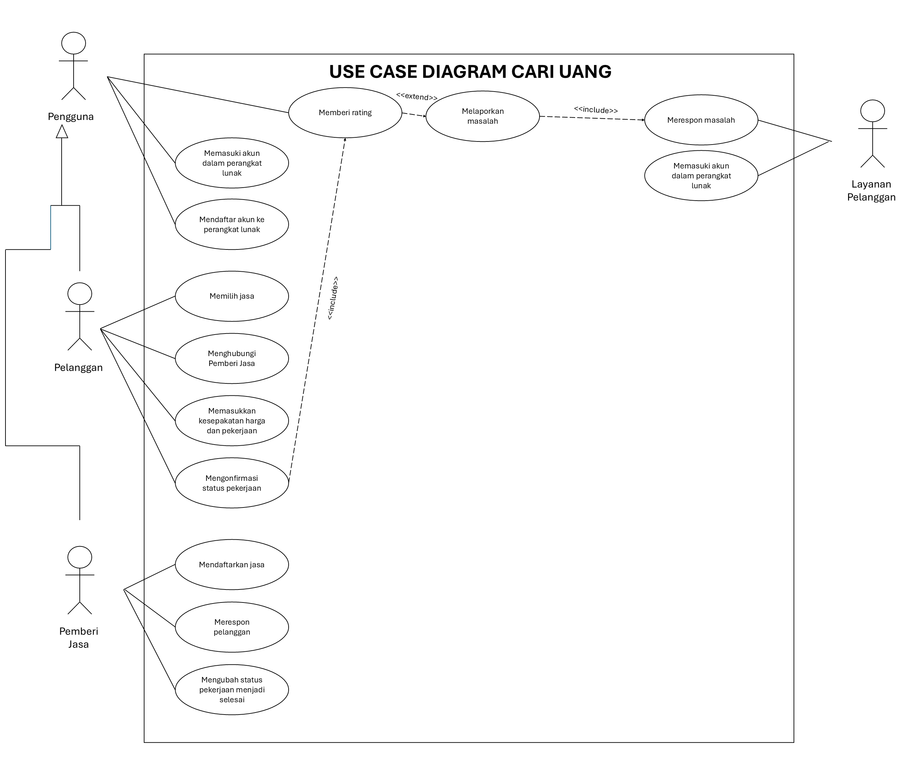
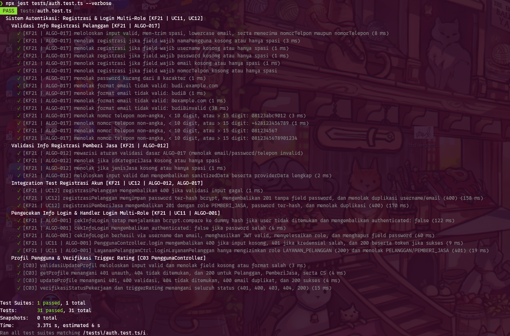
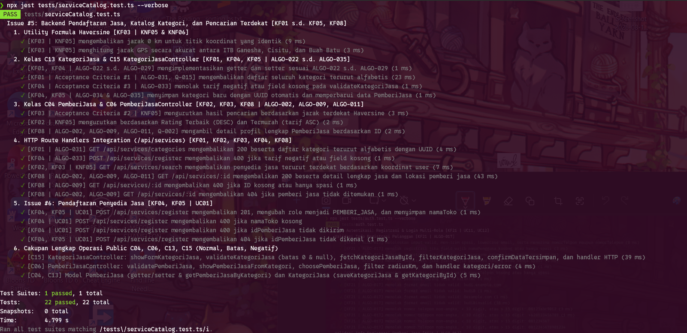
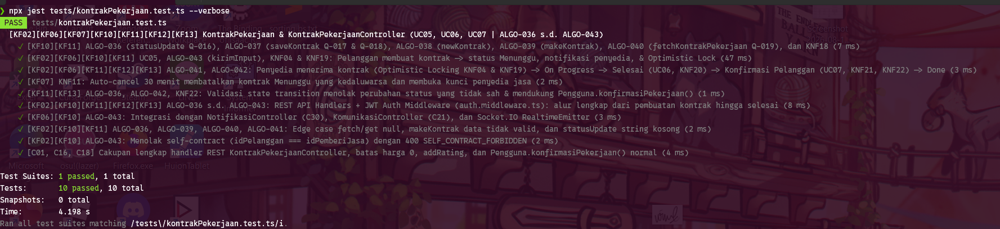
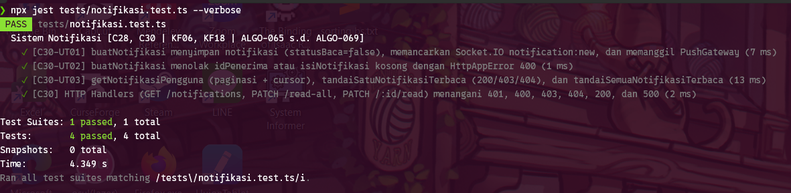
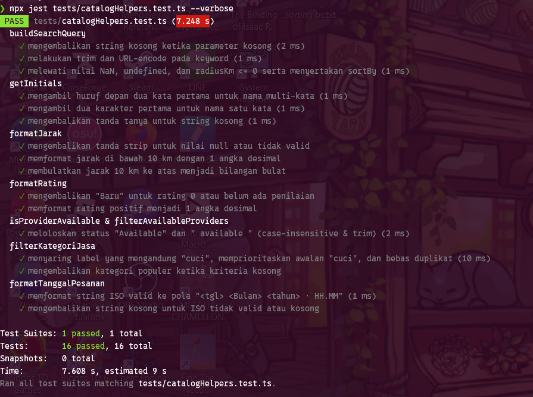
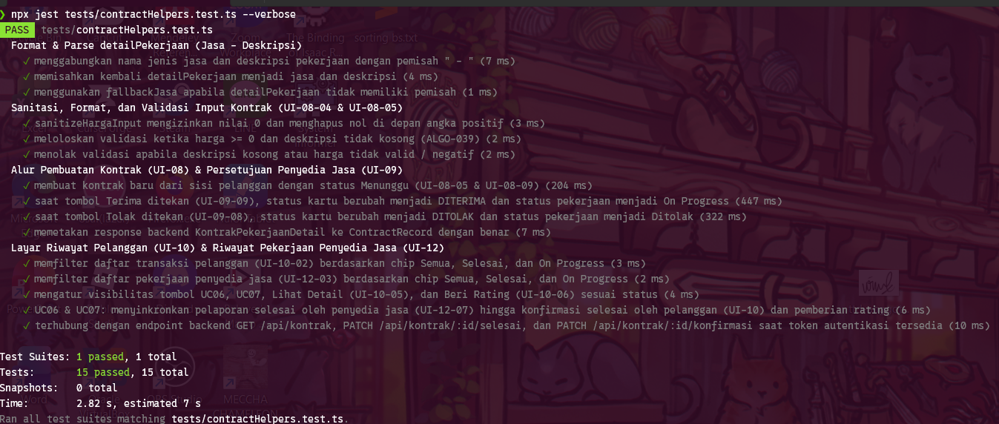

<h1>
IF2150 REKAYASA PERANGKAT LUNAK
 
TUGAS 10
 
HASIL IMPLEMENTASI DAN UJI PERANGKAT LUNAK (HIUPL)
</h1>
 

## Cari Uang
### 

### Untuk: Agatha Tatianingseto

Dipersiapkan oleh:
| Informasi | Keterangan |
| --- | --- |
| Kelas | 3 |
| Kelompok | 9 |

| NIM | Nama |
|---|---|
| 13525120 | Naufal Hasbialhaq |
| 13525009 | Wimar Widiarto |
| 13525093 | Vinsensius Juan Setiady |
| 13525126 | Raymond Edson Sabajan |
| 13525048 | Yohanes Nicholas Setiawan |

---

## Daftar Isi

- [BAB 1: Pendahuluan](#bab-1-pendahuluan)
  - [1.1 Tujuan Penulisan Dokumen](#11-tujuan-penulisan-dokumen)
  - [1.2 Lingkup Masalah](#12-lingkup-masalah)
  - [1.3 Definisi, Istilah, dan Singkatan](#13-definisi-istilah-dan-singkatan)
  - [1.4 Aturan Penomoran](#14-aturan-penomoran)
  - [1.5 Referensi](#15-referensi)
  - [1.6 Deskripsi Umum Dokumen (Ikhtisar)](#16-deskripsi-umum-dokumen-ikhtisar)
- [BAB 2: Deskripsi Umum Perangkat Lunak](#bab-2-deskripsi-umum-perangkat-lunak)
- [BAB 3: Implementasi](#bab-3-implementasi)
  - [3.1 Lingkungan Implementasi](#31-lingkungan-implementasi)
  - [3.2 Implementasi Modul](#32-implementasi-modul)
  - [3.3 Implementasi Antarmuka](#33-implementasi-antarmuka)
  - [3.4 File Lain](#34-file-lain)
- [BAB 4: Hasil Pengujian](#bab-4-hasil-pengujian)
  - [4.1 Strategi dan Kedalaman Pengujian Kelas](#41-strategi-dan-kedalaman-pengujian-kelas)
  - [4.2 Pengujian Unit Kelas](#42-pengujian-unit-kelas)
  - [4.3 Pengujian Integrasi](#43-pengujian-integrasi)
  - [4.4 Pengujian Use Case](#44-pengujian-use-case)
  - [4.5 Pengujian Kebutuhan Non-Fungsional (KNF)](#45-pengujian-kebutuhan-non-fungsional-knf)
  - [4.6 Tangkapan Layar dan Bukti Hasil Pengujian](#46-tangkapan-layar-dan-bukti-hasil-pengujian)
- [BAB 5: Traceability](#bab-5-traceability)

---

## Daftar Perubahan

| Revisi | Deskripsi |
| :--- | :--- |
| *A* | *Deskripsikan perubahan yang dilakukan dari dokumen sebelumnya pada dokumen ini. Jika tidak terdapat perubahan, harap kosongkan tabel.* |
| *B* |  |
| *C* |  |
| ... |  |

---

# Bab 1: Pendahuluan
## 1.1 Tujuan Penulisan Dokumen

Dokumen Hasil Implementasi dan Uji Perangkat Lunak (HIUPL) ini disusun untuk mendokumentasikan hasil realisasi implementasi serta hasil pengujian perangkat lunak **CariUang**. Isi dokumen mencakup gambaran umum perangkat lunak, rincian lingkungan implementasi beserta daftar modul, antarmuka, dan berkas pendukung yang telah dibangun, hasil pengujian pada tingkat unit kelas, integrasi antarkomponen, *use case*, dan kebutuhan non-fungsional (KNF) beserta bukti pengujiannya, hingga matriks kerunutan (*traceability*) antara spesifikasi kebutuhan, implementasi, dan kasus uji. Tujuan pembuatan dokumen ini adalah memverifikasi dan membuktikan secara terukur bahwa perangkat lunak **CariUang** telah diimplementasikan sesuai dengan rancangan pada dokumen DPPL serta memenuhi kebutuhan fungsional dan non-fungsional pada dokumen SKPL. Dokumen ini ditujukan bagi dosen dan asisten mata kuliah IF2150 Rekayasa Perangkat Lunak sebagai bahan evaluasi dan penilaian, tim pengembang sebagai dokumentasi acuan untuk pemeliharaan maupun perbaikan lanjutan, serta penguji perangkat lunak untuk menelusuri cakupan dan hasil pengujian sistem.

## 1.2 Lingkup Masalah

  Lingkup masalah dari proyek ini adalah membangun perangkat lunak **CariUang**, yaitu aplikasi *mobile* berbasis Android yang menjembatani pekerja jasa sektor informal (seperti teknisi AC, tukang listrik, jasa kebersihan rumah, tukang ledeng, penjahit, tukang sol sepatu, dan *handyman*) dengan pelanggan melalui fitur katalog jasa, pencarian berbasis lokasi, obrolan negosiasi, pengelolaan kontrak pekerjaan, penilaian (*rating*) dua arah, serta pelaporan dan mediasi kendala oleh *Customer Service* guna membantu mengatasi kesenjangan sosial-ekonomi (SDG 10). Dalam pengoperasiannya, CariUang berinteraksi dengan layanan eksternal perangkat berupa GPS (`expo-location`), penyedia peta (`react-native-maps`), dan kamera/galeri (`expo-image-picker`), menyimpan seluruh data pada DBMS PostgreSQL 16 melalui server *backend* Express.js dan Socket.IO, menyediakan titik sambung *push notification* (`ExpoPushGateway`), sementara proses pengerjaan fisik jasa dan transaksi pembayaran dilakukan secara langsung di luar sistem.

## 1.3 Definisi, Istilah, dan Singkatan

  Seluruh definisi, istilah, dan singkatan yang digunakan pada dokumen ini dijelaskan pada Tabel 1.3.
  
  Tabel 1.3. Definisi Istilah dan Singkatan
  
  | Singkatan, Akronim, atau Istilah | Penjelasan |
  | :--- | :--- |
  | P/L | Singkatan dari Perangkat Lunak, yaitu aplikasi atau program komputer yang dibangun untuk menjalankan tugas tertentu. |
  | SKPL | Singkatan dari Spesifikasi Kebutuhan Perangkat Lunak, yaitu dokumen yang merangkum kebutuhan fungsional, non-fungsional, dan pemodelan *use case* P/L. |
  | APL | Singkatan dari Arsitektur Perangkat Lunak, yaitu dokumen yang menetapkan pola arsitektur, modul/subsistem, dan pandangan arsitektur P/L. |
  | DPPL | Singkatan dari Deskripsi Perancangan Perangkat Lunak, yaitu dokumen yang menjelaskan rancangan arsitektur, kelas, algoritma, *query*, dan antarmuka P/L. |
  | HIUPL | Singkatan dari Hasil Implementasi dan Uji Perangkat Lunak, yaitu dokumen yang melaporkan hasil implementasi, pengujian, dan kerunutan (*traceability*) P/L. |
  | KF | Singkatan dari Kebutuhan Fungsional, yaitu layanan atau fitur spesifik yang harus disediakan oleh P/L. |
  | KNF | Singkatan dari Kebutuhan Non-Fungsional, yaitu batasan dan atribut kualitas P/L seperti *response time*, *reliability*, *security*, *availability*, dan *ergonomy*. |
  | UC | Singkatan dari *Use Case*, yaitu skenario interaksi antara aktor dan P/L untuk mencapai suatu tujuan tertentu. |
  | UI | Singkatan dari *User Interface*, yaitu antarmuka layar aplikasi tempat pengguna berinteraksi dengan P/L. |
  | MVC | Singkatan dari *Model-View-Controller*, yaitu pola arsitektur yang memisahkan pengelolaan data (*Model*), tampilan (*View*), dan logika aplikasi (*Controller*). |
  | DBMS | Singkatan dari *Database Management System*, yaitu perangkat lunak pengelola basis data (pada CariUang menggunakan PostgreSQL 16). |
  | ORM | Singkatan dari *Object-Relational Mapping*, yaitu pustaka pemetaan objek program ke tabel basis data relasional (pada CariUang menggunakan Prisma ORM). |
  | API / REST API | Singkatan dari *Application Programming Interface* / *Representational State Transfer API*, yaitu antarmuka komunikasi berbasis HTTP/JSON antara aplikasi *mobile* dan server *backend*. |
  | JWT | Singkatan dari *JSON Web Token*, yaitu token standar yang digunakan untuk autentikasi dan otorisasi peran pengguna pada setiap permintaan API. |
  | CS | Singkatan dari *Customer Service* (Layanan Pelanggan), yaitu aktor operasional yang menangani dan memediasi tiket laporan kendala pengguna. |
  | GPS | Singkatan dari *Global Positioning System*, yaitu layanan penentuan koordinat lokasi geografis perangkat untuk pencarian penyedia jasa terdekat. |
  | *Optimistic Locking* | Mekanisme pengendalian konkurensi berbasis versi data untuk mencegah dua pelanggan memesan satu pemberi jasa yang sama secara bersamaan. |
  | TC | Singkatan dari *Test Case*, yaitu satu kasus uji untuk memverifikasi skenario atau kebutuhan tertentu. |
  | UT | Singkatan dari *Unit Test*, yaitu kasus uji pada tingkat kelas atau operasi secara terisolasi. |
  | INT | Singkatan dari *Integration Test*, yaitu kasus uji yang memverifikasi interaksi antarkomponen melewati batas modul, basis data, atau layanan eksternal. |
  | *Boundary* | Kasus uji pada nilai batas masukan, misalnya nilai minimum, maksimum, atau tepat pada ambang aturan bisnis. |
  | *Coverage* | Persentase baris (*statement/line*) maupun cabang (*branch*) kode program yang tereksekusi selama pengujian otomatis. |

## 1.4 Aturan Penomoran

  Aturan penomoran yang digunakan secara konsisten pada dokumen ini serta merujuk pada dokumen SKPL dan DPPL dirangkum pada Tabel 1.4.
   
   
  Tabel 1.4. Aturan Penomoran

  | Hal/Bagian | Penomoran | Keterangan |
  | :--- | :--- | :--- |
  | Kebutuhan Fungsional | KFXX | XX menyatakan dua digit nomor urut kebutuhan fungsional P/L (contoh: `KF01`). |
  | Kebutuhan Non-Fungsional | KNFXX | XX menyatakan dua digit nomor urut kebutuhan non-fungsional P/L (contoh: `KNF01`). |
  | Aktor | AXX | XX menyatakan dua digit nomor urut aktor yang berinteraksi dengan P/L (contoh: `A01`). |
  | *Use Case* | UCXX | XX menyatakan dua digit nomor urut *use case* P/L (contoh: `UC01`). |
  | Kelas | CXX | XX menyatakan dua digit nomor urut kelas perancangan P/L (contoh: `C01`). |
  | Algoritma | ALGO-XXX | XXX menyatakan tiga digit nomor urut algoritma operasi kelas pada DPPL (contoh: `ALGO-001`). |
  | *Query* Basis Data | Q-XXX | XXX menyatakan tiga digit nomor urut *query* basis data pada DPPL (contoh: `Q-001`). |
  | Antarmuka Pengguna (Layar) | UI-XX | XX menyatakan dua digit nomor urut layar antarmuka pengguna sesuai DPPL (contoh: `UI-01`). |
  | Antarmuka Antarkomponen | I-XX | XX menyatakan dua digit nomor urut antarmuka antarkomponen pada pengujian integrasi (contoh: `I-01`). |
  | *Test Case* Unit | CXX-UTYY | XX adalah nomor kelas, YY adalah nomor urut *test case* unit pada kelas tersebut (contoh: `C03-UT01`). |
  | *Test Case* Integrasi | INT-TCYY | YY adalah nomor urut *test case* pengujian integrasi (contoh: `INT-TC01`). |
  | *Test Case Use Case* | UCXX-TCYY | XX adalah nomor *use case*, YY adalah nomor urut *test case* pada *use case* tersebut (contoh: `UC01-TC01`). |
  | *Test Case* KNF | KNFXX-TCYY | XX adalah nomor KNF, YY adalah nomor urut *test case* pada KNF tersebut (contoh: `KNF01-TC01`). |

## 1.5 Referensi

- [Dokumen SKPL](../M5/K03_G09_SKPL.md)
- [Dokumen APL](../M6/K03_G09_APL.md)
- [Dokumen DPPL](../M7/DPPL.md)
- [Dokumen DPPL2](../M8/K03_G09_DPPL2.md)
- [Dokumen Implementasi](../M9/K03_G09_Implementasi.md)
- [Dokumentasi Node.js](https://nodejs.org/docs/latest/api/)
- [Dokumentasi Prisma ORM](https://www.prisma.io/docs/getting-started)
- [Dokumentasi ExpressJS](https://expressjs.com/)
- [Dokumentasi React Expo](https://expressjs.com/)
- [Dokumentasi Jest](https://jestjs.io/docs/getting-started)

## 1.6 Deskripsi Umum Dokumen (Ikhtisar)
Tuliskan sistematika pembahasan dokumen ini secara ringkas dan runut bab demi bab, dengan maksimal 1 paragraf.

 

---

# BAB 2: Deskripsi Umum Perangkat Lunak
  
**CariUang** adalah perangkat lunak berbasis *mobile application* (dikembangkan dengan React Native/Expo untuk perangkat Android) yang berperan sebagai penghubung antara pekerja jasa sektor informal (**Pemberi Jasa**, seperti teknisi AC, tukang listrik, jasa kebersihan rumah, tukang ledeng, penjahit, dan tukang sol sepatu) dengan masyrakat yang membutuhkan layanan tersebut (**Pelanggan**), serta didukung oleh pihak **Layanan Pelanggan (*Customer Service*)** untuk menangani aduan dan mediasi kendala. Perangkat lunak ini dibangun untuk menjawab keterbatasan akses pemasaran pekerja informal, ketidakpastian pencarian tenaga kerja terdekat yang tepercaya, serta minimnya rekam jejak reputasi dan mekanisme penyelesaian sengketa. 
  
Secara garis besar, CariUang beroperasi dengan arsitektur *client-server* berpola **MVC (*Model-View-Controller*)** yang terdiri atas tiga komponen utama:  
1. **Aplikasi Mobile (*Frontend*: *View* & *Client Controller*):** Menyediakan antarmuka multi-peran bagi Pelanggan, Pemberi Jasa, dan Layanan Pelanggan untuk autentikasi, pencarian katalog jasa beserta pemetaan lokasi berbasis radius GPS, ruang percakapan (*chat*), pengelolaan kontrak pekerjaan, penilaian (*rating*) dua arah, pengajuan dan mediasi tiket laporan, serta pusat notifikasi.
2. **Server Aplikasi (*Backend API & Real-Time Server*: *Controller* & *Model*):** Dibangun menggunakan Node.js, Express.js, Socket.IO, dan Prisma ORM. Bagian ini menjalankan seluruh logika bisnis, termasuk autentikasi dan otorisasi berbasis JWT, perhitungan jarak lokasi (*Haversine*), mekanisme *optimistic locking* saat pemesanan jasa agar satu pemberi jasa tidak dipesan ganda secara bersamaan, *background worker* pembatalan otomatis kontrak apabila tidak direspons dalam 30 menit, distribusi tiket laporan secara otomatis ke petugas CS yang tersedia, serta pengiriman notifikasi *real-time*.
3. **Basis Data Relasional (*DBMS*):** Menggunakan PostgreSQL 16 (dijalankan melalui Docker Compose) untuk menyimpan secara persisten data pengguna, profil pemberi jasa, kategori jasa, kontrak pekerjaan, riwayat komunikasi, tiket laporan, rating, dan notifikasi.

## 2.2 Batasan dan Keterkaitan dengan Sistem Lain
### 2.2.1 Keterkaitan dengan Sistem dan Layanan Eksternal
Keterkaitan antara perangkat lunak CariUang dengan sistem, layanan perangkat, maupun proses eksternal di luar sistem dirangkum pada Tabel 2.1.
Tabel 2.1. Keterkaitan Perangkat Lunak CariUang dengan Sistem Eksternal
| No | Sistem / Layanan Eksternal | Arah & Bentuk Keterkaitan | Batasan Tanggung Jawab Sistem CariUang |
| :--- | :--- | :--- | :--- |
| 1 | **Layanan Lokasi / GPS Perangkat** (*OS Location Services* melalui `expo-location`) | Sistem membaca koordinat lintang dan bujur (*latitude/longitude*) perangkat Pelanggan dan Pemberi Jasa. | Sistem menghitung jarak (*Haversine*) dan menyaring radius pencarian; akurasi sinyal GPS bergantung pada perangkat keras dan izin lokasi sistem operasi. |
| 2 | **Layanan Peta Eksternal** (*Map Provider* melalui `react-native-maps`) | Sistem mengirimkan daftar koordinat penyedia jasa untuk ditampilkan sebagai penanda (*marker*) di atas peta interaktif. | Sistem hanya menyediakan data koordinat dan tampilan kartu peta; penyediaan *tile* peta dan layanan pemetaan dikelola penyedia peta eksternal. |
| 3 | **Kamera & Galeri Perangkat** (melalui `expo-image-picker`) | Sistem meminta akses media perangkat untuk mengambil gambar bukti laporan (UI-15) atau lampiran percakapan (UI-08/UI-18). | Sistem memvalidasi format (JPG/PNG) dan ukuran berkas (maks. 5 MB) sebelum disimpan di penyimpanan server; pengambilan gambar bergantung pada izin perangkat. |
| 4 | **Layanan *Push Notification* Eksternal** (*Expo Push Service*) | Server menyediakan antarmuka titik sambung `ExpoPushGateway` (`PushGateway`) sebagai jalur integrasi *push notification* di samping *event* Socket.IO. | Pengiriman notifikasi internal ditangani melalui basis data, Socket.IO, dan *polling* aplikasi; pengiriman *push notification* produksi bergantung pada konfigurasi layanan Expo eksternal. |
| 5 | **DBMS PostgreSQL 16** (melalui Docker Compose & Prisma ORM) | *Backend* melakukan operasi baca, tulis, transaksi, penguncian baris (`FOR UPDATE`), dan indeksasi melalui koneksi TCP ke PostgreSQL. | Pengelolaan penyimpanan fisik dan persistensi volume data ditangani oleh layanan DBMS PostgreSQL. |

### 2.2.2 Batasan Perangkat Lunak
Batasan ruang lingkup, pengguna, dan teknis yang berlaku pada perangkat lunak CariUang adalah sebagai berikut:
1. **Batasan Ruang Lingkup Fungsional:**
   - **Pembayaran di luar sistem:** Transaksi pembayaran upah jasa dilakukan secara langsung antara Pelanggan dan Pemberi Jasa di luar aplikasi; CariUang tidak menyediakan *payment gateway* maupun dompet digital internal.
   - **Pekerjaan fisik luring (*offline*):** Pelaksanaan jasa dilakukan secara langsung di lokasi pelanggan. Aplikasi hanya mengelola pencatatan kontrak, status pengerjaan (`Menunggu` → `On Progress` → `Menunggu Konfirmasi Pelanggan` → `Done`, atau `Ditolak`/`Dibatalkan`), komunikasi, penilaian, dan mediasi tiket.
   - **Validasi data administratif:** Aplikasi memvalidasi kelengkapan, format, tipe data, serta keamanan masukan pada sisi server, tetapi tidak melakukan verifikasi identitas kependudukan (misalnya integrasi Dukcapil/KYC) ataupun pengujian keahlian fisik secara otomatis.
   - **Akun Layanan Pelanggan (CS):** Akun CS disediakan oleh pengelola sistem (*pre-provisioned* melalui basis data/seed) dan tidak dibuka untuk pendaftaran mandiri publik.
2. **Batasan Pengguna dan Asumsi Operasional:**
   - Pengguna (Pelanggan dan Pemberi Jasa) diasumsikan memiliki *smartphone* yang kompatibel, koneksi internet aktif, literasi digital dasar untuk mengoperasikan aplikasi, serta memberikan data profil dan kebutuhan jasa yang nyata (bukan fiktif).
   - Pemberi Jasa diasumsikan mengaktifkan layanan GPS saat menerima pesanan serta melaksanakan pekerjaan secara profesional sesuai kesepakatan.
3. **Batasan Teknis:**
   - Target utama platform *client* adalah sistem operasi **Android** (dijalankan melalui React Native / Expo Go atau Android Emulator) dengan dukungan antarmuka satu bahasa (**Bahasa Indonesia**).
   - Arsitektur diimplementasikan untuk lingkungan *deployment* lokal/kontainer (Node.js/Express + PostgreSQL 16 pada Docker Compose) dengan skalabilitas yang disesuaikan untuk kebutuhan pengujian dan operasional skala terbatas.

## 2.3 Pemodelan Kasus Penggunaan (*Use Case*)
### 2.3.1 Identifikasi Aktor
Perangkat lunak CariUang melibatkan tiga aktor utama yang berinteraksi langsung dengan sistem, sebagaimana tercantum pada Tabel 2.2. Dalam pemodelan *use case*, **Pelanggan** dan **Pemberi Jasa** juga digeneralisasikan sebagai aktor **Pengguna** untuk fungsionalitas bersama (registrasi akun, *login*, dan pemberian *rating*).
Tabel 2.2. Identifikasi Aktor Perangkat Lunak CariUang
| ID Aktor | Aktor | Deskripsi |
| :--- | :--- | :--- |
| A01 | Pemberi Jasa | Pihak penyedia jasa informal yang mendaftarkan layanan, menerima atau menolak pesanan, bernegosiasi dengan pelanggan, melaksanakan pekerjaan fisik di lokasi, memperbarui status penyelesaian, memberi *rating*, serta melaporkan masalah jika terjadi kendala. |
| A02 | Pelanggan | Pihak yang membutuhkan, mencari, memilih, dan memesan layanan jasa, melakukan negosiasi harga, menginput kesepakatan kontrak, mengonfirmasi penyelesaian pekerjaan, membayar jasa secara langsung, memberi *rating*, serta melaporkan masalah. |
| A03 | Layanan Pelanggan | Pihak pengelola (*Customer Service*) yang memantau, merespons, dan memediasi tiket laporan masalah yang diajukan oleh Pelanggan maupun Pemberi Jasa hingga permasalahan terselesaikan. |
### 2.3.2 *Use Case Diagram*
Pemodelan fungsionalitas perangkat lunak berdasarkan interaksi antaraktor disajikan pada *Use Case Diagram* Gambar 2.3.

<i>Gambar 2.X. Use Case Diagram Perangkat Lunak CariUang</i>

### 2.3.3 Daftar *Use Case*

Ringkasan seluruh *use case* yang dimodelkan pada Gambar 2.3 beserta pemetaannya terhadap Kebutuhan Fungsional (KF) pada SKPL disajikan pada Tabel 2.3. 
Tabel 2.3. Daftar *Use Case* Perangkat Lunak CariUang

| ID UC | Nama *Use Case* | Deskripsi Singkat | Aktor | ID KF Terkait |
| :--- | :--- | :--- | :--- | :--- |
| UC01 | Mendaftarkan jasa | Pemberi jasa mendaftarkan diri beserta informasi kategori, tarif, jam kerja, daerah kerja, dan deskripsi jasa yang ditawarkan. | Pemberi Jasa | KF04, KF05 |
| UC02 | Memilih jasa | Pelanggan menelusuri katalog kategori jasa, melihat lokasi pemberi jasa pada peta dan jaraknya, serta memilih jasa yang sesuai kebutuhan. | Pelanggan | KF01, KF02, KF03, KF08 |
| UC03 | Menghubungi pemberi jasa | Pelanggan mengirimkan pesan kepada pemberi jasa melalui ruang komunikasi terkait detail pekerjaan dan penawaran harga awal. | Pelanggan | KF09 |
| UC04 | Merespon pelanggan | Pemberi jasa menerima notifikasi dan menanggapi pelanggan melalui obrolan, baik memberikan estimasi/tawaran harga, menyetujui, maupun menolak pesanan. | Pemberi Jasa | KF06, KF07, KF09 |
| UC05 | Memasukkan kesepakatan harga dan pekerjaan | Pelanggan menginput detail kesepakatan pekerjaan dan harga ke dalam aplikasi; setelah disetujui, status pekerjaan berubah menjadi *On Progress* dan penyedia jasa dikunci dari pesanan lain. | Pelanggan | KF10, KF11 |
| UC06 | Mengubah status pekerjaan menjadi selesai | Pemberi jasa melaporkan melalui aplikasi bahwa pekerjaan fisik telah selesai dilaksanakan sehingga menunggu konfirmasi pelanggan. | Pemberi Jasa | KF12 |
| UC07 | Mengonfirmasi status pekerjaan | Pelanggan mengonfirmasi laporan penyelesaian pekerjaan dari pemberi jasa sehingga status pekerjaan berubah menjadi *Done*. | Pelanggan | KF13 |
| UC08 | Melaporkan masalah | Pelanggan atau pemberi jasa mengajukan tiket laporan kendala beserta keterangan dan bukti foto kepada layanan pelanggan. | Pelanggan, Pemberi Jasa | KF14, KF15, KF16 |
| UC09 | Merespon laporan masalah | Layanan pelanggan menerima notifikasi tiket baru, meninjau laporan, berkomunikasi di ruang mediasi dengan pelapor, dan menutup tiket setelah selesai. | Layanan Pelanggan, Pelanggan, Pemberi Jasa | KF15, KF17, KF18 |
| UC10 | Memberi rating | Pelanggan dan pemberi jasa saling memberikan skor penilaian (1-5) dan ulasan setelah kontrak selesai untuk memperbarui akumulasi rata-rata rating profil. | Pelanggan, Pemberi Jasa | KF19, KF20 |
| UC11 | Memasuki akun dalam perangkat lunak | Pelanggan, pemberi jasa, dan layanan pelanggan melakukan autentikasi (*login*) menggunakan akun yang telah terdaftar untuk mengakses fitur sesuai peran. | Pelanggan, Pemberi Jasa, Layanan Pelanggan | KF21 |
| UC12 | Mendaftar akun ke perangkat lunak | Pelanggan dan pemberi jasa mendaftarkan akun baru pada aplikasi CariUang. | Pelanggan, Pemberi Jasa | KF21 |

 

---

# BAB 3: Implementasi

Bagian ini diisi dengan informasi tentang elemen P/L yang dikembangkan (*executable files*, *configuration files*, *data files*, dan sebagainya) serta perubahannya terhadap rancangan pada DPPL (jika ada).

## 3.1 Lingkungan Implementasi

Tuliskan *hardware* dan *software* yang digunakan untuk implementasi, mencakup *operating system*, bahasa pemrograman beserta versinya, *framework*/*library*, DBMS, *development tools*, dan *version control*. Lingkungan ini harus konsisten dengan **Subbab 2.1 DPPL**; jelaskan jika ada perubahan. Cantumkan juga *framework* dan alat pengujian yang dipakai.

Tabel 3.1. Lingkungan Implementasi

| Aspek | Keterangan |
| :--- | :--- |
| *Hardware* | *[Spesifikasi perangkat keras]* |
| *Operating System* | *[Nama dan versi OS]* |
| *Bahasa Pemrograman* | *[Bahasa dan versi]* |
| *Framework/Library* | *[Daftar framework/library beserta versi]* |
| *DBMS* | *[Nama dan versi DBMS]* |
| *Development Tools* | *[IDE, version control, tools lain]* |
| *Testing Tools* | *[Framework unit test, alat ukur performa, alat coverage]* |

## 3.2 Implementasi Modul

Daftar modul/kelas yang **TELAH** diimplementasikan. Gunakan nama dan ID kelas yang sama dengan DPPL, dan konsisten dengan Tabel B.5 pada dokumen Implementasi (Tugas 9).

Tabel 3.2. Implementasi Modul

| No | ID Kelas | Nama Modul/Kelas | Nama File Fisik | Nama File Executable |
| :--- | :--- | :--- | :--- | :--- |
| 1 | *[C01]* | *[Nama modul/kelas]* | *[path/ke/file]* | *[Nama file executable, atau - jika tidak ada]* |
| 2 | *[C02]* | *[Nama modul/kelas]* | *[path/ke/file]* | *[...]* |
| ... | *...* | *...* | *...* | *...* |

## 3.3 Implementasi Antarmuka

Daftar antarmuka yang telah diimplementasikan. Gunakan ID dan nama layar yang sama dengan ID dan nama layar pada tugas DPPL.

Tabel 3.3. Implementasi Antarmuka

| No | ID Antarmuka | Nama Antarmuka | Nama File Fisik | Nama File Executable |
| :--- | :--- | :--- | :--- | :--- |
| 1 | *[I-01]* | *[Nama layar]* | *[path/ke/file]* | *[Nama file executable, atau - jika tidak ada]* |
| 2 | *[I-02]* | *[Nama layar]* | *[path/ke/file]* | *[...]* |
| ... | *...* | *...* | *...* | *...* |

## 3.4 File Lain

Daftar file lain yang dibuat selain file kelas dan antarmuka, misalnya file *utility*, *configuration*, *database schema/seed*, *file test*, atau *data*.

Tabel 3.4. File Lain

| No | Nama File | Keterangan |
| :--- | :--- | :--- |
| 1 | *[Nama file]* | *[Fungsi file]* |
| ... | *...* | *...* |

 

---

# BAB 4: Hasil Pengujian

Bab ini melaporkan hasil pengujian P/L pada level unit, integrasi, dan sistem. Pengujian dilakukan pada tag release terakhir Tugas 9. Hasil aktual diisi berdasarkan pengamatan saat pengujian. Kesimpulan diisi `Pass` atau `Fail`, dan untuk `Fail` dilengkapi penyebab serta usulan perbaikan.

## 4.1 Strategi dan Kedalaman Pengujian Kelas

Setiap kelas perancangan pada Tabel 4.1 DPPL (`C01` s.d. `C30`) diklasifikasikan ke dalam tiga tingkat kedalaman pengujian:
- **Mendalam (13 kelas):** Kelas yang memuat logika bisnis inti, validasi masukan, perhitungan (jarak *Haversine*, akumulasi *rating*), aturan transisi status, pengendalian konkurensi (*optimistic locking*, penguncian baris `FOR UPDATE`), algoritma DPPL (`ALGO-XXX`), atau keamanan autentikasi/otorisasi. Kelas pada tingkat ini diuji pada seluruh operasi `public` (kasus *Normal*, *Batas*, dan *Negatif*) dengan target *coverage* ≥ 70%.
- **Sedang (7 kelas):** Kelas yang mengoordinasikan/mendelegasikan proses ke kelas lain atau memuat *helper* presentasi/validasi ringan di sisi klien. Kelas pada tingkat ini diuji minimal dengan kasus *Normal* dan *Negatif/Gagal* pada operasi utama.
- **Tidak perlu (10 kelas):** Kelas tanpa logika bisnis, seperti *entity/DTO* murni, kelas akses ORM tanpa aturan bisnis, serta lapisan *View* React Native murni yang diuji secara tidak langsung melalui pengujian *use case* pada Subbab 4.4.

Tabel 4.1.1. Identifikasi Tingkat Pengujian Kelas
| ID Kelas | Nama Kelas | Tingkat | Alasan | Test Case Terkait |
| :--- | :--- | :--- | :--- | :--- |
| C01 | Pengguna | Sedang | Kelas induk akun yang mayoritas berisi *getter/setter* dan *query* profil, namun memiliki operasi `addNewRatingRiwayat()` dan delegasi `konfirmasiPekerjaan()`. | C01-UT01 s.d. C01-UT04, INT-TC01, INT-TC07 |
| C02 | PenggunaUI | Tidak perlu | Lapisan *View* React Native (registrasi, profil, riwayat) tanpa logika bisnis internal; teruji melalui pengujian *use case* (`UC10`, `UC11`, `UC12`). | - |
| C03 | PenggunaController | Mendalam | Memuat aturan keamanan autentikasi (*bcrypt*, *dummy hash* anti-*timing attack*, pembuatan JWT) serta validasi format input registrasi (`ALGO-001`, `ALGO-017`). | C03-UT01 s.d. C03-UT08, INT-TC01 |
| C04 | PemberiJasa | Mendalam | Memuat pencarian penyedia jasa berbasis jarak *Haversine*, filter kategori/radius, pengurutan (*terdekat*, *rating*, *termurah*), dan atribut *optimistic locking* (`version`). | C04-UT01 s.d. C04-UT06, INT-TC02, INT-TC03 |
| C05 | PemberiJasaUI | Tidak perlu | Lapisan *View* React Native (hasil pencarian, peta, registrasi penyedia, riwayat) tanpa logika bisnis internal; teruji melalui `UC01`, `UC02`, `UC04`, `UC06`, `UC11`. | - |
| C06 | PemberiJasaController | Mendalam | Memuat validasi registrasi penyedia jasa (`ALGO-012`), validasi parameter pencarian & detail penyedia (`ALGO-002`, `ALGO-009`, `ALGO-011`), serta *helper* katalog klien (`useCatalogController`). | C06-UT01 s.d. C06-UT07, INT-TC02, INT-TC03 |
| C07 | Pelanggan | Tidak perlu | Subkelas *entity/DTO* murni dari `Pengguna` tanpa aturan bisnis tambahan (hanya konstruksi `makePelanggan()` dan penyimpanan ke tabel `pengguna`). | - |
| C08 | PelangganUI | Tidak perlu | Lapisan *View* React Native (login, beranda, rekomendasi pencarian, obrolan pelanggan) tanpa logika bisnis; teruji melalui `UC02`, `UC03`, `UC05`, `UC07`, `UC11`, `UC12`. | - |
| C09 | PelangganController | Sedang | Mengoordinasikan registrasi pelanggan dengan mendelegasikan validasi ke `PenggunaController`, cek duplikasi ke `Pengguna`, dan penyimpanan ke `Pelanggan`. | C09-UT01 s.d. C09-UT03, INT-TC01 |
| C10 | LayananPelanggan | Mendalam | Memuat algoritma pemilihan staf CS berbeban terkecil (`cariLayananKosong()`, `ALGO-019` dengan penguncian baris `FOR UPDATE`) serta manajemen beban tiket (`tambahBeban`, `kurangiBeban`). | C10-UT01 s.d. C10-UT05, INT-TC08, INT-TC09 |
| C11 | LayananPelangganUI | Tidak perlu | Lapisan *View* React Native (Meja Kerja CS & tampilan detail tiket) tanpa logika bisnis internal; teruji melalui `UC09`, `UC11`. | - |
| C12 | LayananPelangganController | Mendalam | Memuat otorisasi login khusus peran CS, validasi filter tiket (`ALGO-020`), *auto-claim* & perubahan status `Open` → `Diproses` saat membalas (`ALGO-021`), serta penutupan tiket dan pengurangan beban CS. | C12-UT01 s.d. C12-UT06, INT-TC09 |
| C13 | KategoriJasa | Sedang | Kelas entitas kategori jasa yang berisi *getter/setter* (`ALGO-022`-`ALGO-029`) serta operasi penyimpanan dan pengurutan alfabetis via Prisma (`ALGO-031`, `Q-015`). | C13-UT01 s.d. C13-UT03, INT-TC02 |
| C14 | KategoriJasaUI | Tidak perlu | Lapisan *View* React Native (form pendaftaran jasa & daftar kategori beranda) tanpa logika bisnis; teruji melalui `UC01`, `UC02`. | - |
| C15 | KategoriJasaController | Mendalam | Memuat validasi input pendaftaran jasa (`validateKategoriJasa()`, `ALGO-033`), transaksi penyimpanan kategori & pembaruan peran penyedia (`ALGO-034`, `ALGO-035`), dan pemfilteran kategori (`filterKategoriJasa()`). | C15-UT01 s.d. C15-UT06, INT-TC02 |
| C16 | KontrakPekerjaan | Mendalam | Memuat aturan transisi status pekerjaan (`VALID_TRANSITIONS`, `KNF22`), *optimistic locking* pemesanan (`KNF04`, `KNF19`), konstruksi/validasi kontrak (`ALGO-036`-`ALGO-040`), dan *worker* *auto-cancel* 30 menit (`KNF11`). | C16-UT01 s.d. C16-UT07, INT-TC05, INT-TC06, INT-TC07 |
| C17 | KontrakPekerjaanUI | Sedang | Mencakup *hook* `useContractController` di sisi klien yang menjalankan sanitasi/validasi form kontrak, pemetaan status kartu, filter tab riwayat, dan aturan visibilitas tombol aksi. | C17-UT01 s.d. C17-UT04 |
| C18 | KontrakPekerjaanController | Mendalam | Mengatur seluruh siklus bisnis kontrak (`kirimInput`, `konfirmasiPersetujuanPenyedia`, `selesaikanPekerjaan`, `konfirmasiPekerjaan`, `ALGO-041`-`ALGO-043`), larangan *self-contract*, serta integrasi notifikasi & chat. | C18-UT01 s.d. C18-UT07, INT-TC05, INT-TC07 |
| C19 | Komunikasi | Mendalam | Memuat inisialisasi pesan, isolasi dan pengurutan riwayat percakapan dua arah (`ALGO-044`-`ALGO-048`), penandaan pesan terbaca, dan agregasi daftar percakapan serta jumlah belum terbaca (`unreadCount`). | C19-UT01 s.d. C19-UT05, INT-TC04 |
| C20 | KomunikasiUI | Tidak perlu | Lapisan *View* React Native (daftar percakapan & ruang obrolan) tanpa logika bisnis internal; teruji melalui `UC03`, `UC04`. | - |
| C21 | KomunikasiController | Mendalam | Memuat validasi pesan (anti-*self-message*, batas 1000 karakter, anti-*spoofing* pengirim), kontrol akses riwayat chat (`ALGO-049`-`ALGO-052`), pemancaran *Socket.IO*, dan pemicuan notifikasi aman. | C21-UT01 s.d. C21-UT06, INT-TC04 |
| C22 | TiketLaporan | Sedang | Mengelola operasi persistensi tiket, penomoran `A-xxxx`, statistik status, dan pengambilan/penambahan pesan mediasi via Prisma (`Q-008`). | C22-UT01 s.d. C22-UT03, INT-TC08, INT-TC09 |
| C23 | TiketLaporanUI | Tidak perlu | Lapisan *View* React Native (buat tiket, daftar tiket saya, detail mediasi) tanpa logika bisnis internal; teruji melalui `UC08`, `UC09`. | - |
| C24 | TiketLaporanController | Mendalam | Memuat validasi form aduan (`validasiFormTiket()`, `ALGO-053`), transaksi pembuatan tiket + penugasan otomatis CS (`ALGO-013`, `ALGO-054`), notifikasi non-blokir (`ALGO-055`), dan kontrol akses pelapor. | C24-UT01 s.d. C24-UT06, INT-TC08, INT-TC09 |
| C25 | Rating | Mendalam | Memuat sanitasi *ulasan* & *tags* (`makeRating()`, `ALGO-057`), validasi nilai batas 1-5 (`ALGO-056`), serta kalkulasi rata-rata array PostgreSQL dengan pembulatan 2 desimal (`updateRatingPengguna()`, `ALGO-058`). | C25-UT01 s.d. C25-UT06, INT-TC10 |
| C26 | RatingUI | Sedang | Mencakup *hook* `useRatingController` di sisi klien yang mengelola label predikat bintang (1-5), multi-pilih *tag* per peran, aktivasi tombol kirim, dan logika visibilitas tombol *Beri Rating* dua arah. | C26-UT01 s.d. C26-UT04 |
| C27 | RatingController | Mendalam | Memuat validasi parameter rating (`validateRatingValue()`, `ALGO-064`), penegakan status kontrak wajib `Done`, pencegahan rating ganda per kontrak, dan pengambilan riwayat rating pengguna. | C27-UT01 s.d. C27-UT06, INT-TC10 |
| C28 | Notifikasi | Tidak perlu | Kelas model akses data murni Prisma ORM tanpa aturan bisnis (terdokumentasi langsung di `Notifikasi.ts`); teruji tidak langsung melalui `C30` dan pengujian integrasi. | - |
| C29 | NotifikasiUI | Tidak perlu | Lapisan *View* React Native (daftar notifikasi & *badge* belum dibaca) tanpa logika bisnis internal; teruji melalui `UC04`, `UC08`, `UC09`. | - |
| C30 | NotifikasiController | Sedang | Mengoordinasikan pembuatan notifikasi (`buatNotifikasi()`, `ALGO-067`), pemancaran *Socket.IO*, pemanggilan `ExpoPushGateway`, dan penandaan notifikasi terbaca. | C30-UT01 s.d. C30-UT03, INT-TC04, INT-TC05, INT-TC08 |

## 4.2 Pengujian Unit Kelas

Pengujian unit dilakukan pada seluruh kelas bertingkat **Mendalam** (13 kelas) dan **Sedang** (7 kelas). Kelas **Mendalam** diuji pada seluruh operasi `public` dengan kasus *Normal*, *Batas* (*Boundary*), dan *Negatif* serta memenuhi *coverage* ≥ 70%. Kelas **Sedang** diuji minimal dengan satu kasus *Normal* dan satu kasus *Negatif/Gagal* pada operasi `public` utama. Kelas bertingkat **Tidak perlu** (10 kelas) tidak diuji secara unit terpisah karena tidak memuat logika bisnis internal dan diverifikasi melalui pengujian *use case* pada Subbab 4.4.

Cara menjalankan unit test:
- **Backend:** `cd src/backend && npx jest --verbose --coverage`
- **Frontend:** `cd src/frontend && npx jest --verbose --coverage`

Lokasi file test:
- **Backend:** `src/backend/tests/` (`auth.test.ts`, `serviceCatalog.test.ts`, `komunikasi.test.ts`, `kontrakPekerjaan.test.ts`, `tiketLaporan.test.ts`, `rating.test.ts`, `notifikasi.test.ts`)
- **Frontend:** `src/frontend/tests/` (`catalogHelpers.test.ts`, `contractHelpers.test.ts`, `ratingUI.test.ts`)

---

### 4.2.1 Kelas Pengguna

**ID Kelas:** C01  
**Nama Kelas:** Pengguna  
**Tingkat:** Sedang

Tabel 4.2.1. Hasil Pengujian Unit Kelas C01

| ID Pengujian | Operasi yang Diuji | Jenis Kasus | Prosedur/Masukan | Hasil yang Diharapkan | Hasil Pengujian | Kesimpulan |
| :--- | :--- | :--- | :--- | :--- | :--- | :--- |
| C01-UT01 | `addNewRatingRiwayat()` | Normal | Inisialisasi `new Pengguna({ idPengguna: 'u-local-1' })`, lalu panggil berurutan `addNewRatingRiwayat(5)`, `addNewRatingRiwayat(4)`, dan `addNewRatingRiwayat(4)` | `getRiwayatRating()` mengembalikan `[5, 4, 4]` dan `getAkumulasiRating()` mengembalikan `4.33` (rata-rata 2 desimal) | `getRiwayatRating()` menghasilkan `[5, 4, 4]` dan `getAkumulasiRating()` menghasilkan `4.33` (`tests/rating.test.ts`) | Pass |
| C01-UT02 | `addNewRatingRiwayat()` | Batas | Panggil `addNewRatingRiwayat(1)` (batas bawah) dan `addNewRatingRiwayat(5)` (batas atas) pada `new Pengguna({ idPengguna: 'u-local-batas' })` | Kedua nilai diterima tanpa *error*, `getRiwayatRating()` = `[1, 5]`, dan `getAkumulasiRating()` = `3` | Nilai `1` dan `5` diterima, `riwayatRating` = `[1, 5]` dan `akumulasiRating` = `3` (`tests/rating.test.ts`) | Pass |
| C01-UT03 | `addNewRatingRiwayat()` | Negatif | Panggil `addNewRatingRiwayat(0)` dan `addNewRatingRiwayat(6)` pada objek `Pengguna` | Melempar *error* `'Nilai rating harus berada dalam rentang 1 hingga 5.'` | Kedua pemanggilan melempar *error* sesuai pesan validasi rentang (`tests/rating.test.ts`) | Pass |
| C01-UT04 | `konfirmasiPekerjaan()` | Normal & Negatif | (1) Panggil `konfirmasiPekerjaan(idKontrak)` saat kontrak masih berstatus `'Menunggu'`; (2) Panggil saat kontrak berstatus `'Menunggu Konfirmasi Pelanggan'` milik `'cust-1'` | (1) Mengembalikan `false`; (2) Mengembalikan `true` dan mengubah status kontrak menjadi `'Done'` | (1) Mengembalikan `false`; (2) Mengembalikan `true` dan status berubah menjadi `'Done'` (`tests/kontrakPekerjaan.test.ts`) | Pass |

---

### 4.2.2 Kelas PenggunaUI

**ID Kelas:** C02  
**Nama Kelas:** PenggunaUI  
**Tingkat:** Tidak perlu

Tidak dilakukan pengujian unit terpisah karena kelas ini merupakan lapisan antarmuka (*View* React Native untuk registrasi, profil, dan riwayat) tanpa logika bisnis internal. Pengujian dilakukan secara tidak langsung melalui pengujian *use case* (`UC10`, `UC11`, `UC12`) pada Subbab 4.4.

---

### 4.2.3 Kelas PenggunaController

**ID Kelas:** C03  
**Nama Kelas:** PenggunaController  
**Tingkat:** Mendalam

Tabel 4.2.3. Hasil Pengujian Unit Kelas C03

| ID Pengujian | Operasi yang Diuji | Jenis Kasus | Prosedur/Masukan | Hasil yang Diharapkan | Hasil Pengujian | Kesimpulan |
| :--- | :--- | :--- | :--- | :--- | :--- | :--- |
| C03-UT01 | `validasiInfoRegistrasi()` | Normal | Kirim payload valid dengan spasi tepi pada `namaPengguna`/`username`/`email` huruf kapital serta alias `nomorTelpon`/`nomorTelepon` | Mengembalikan `valid: true` dengan data sudah di-*trim* dan email diubah ke *lowercase* | Mengembalikan `valid: true` dan `sanitizedData` terformat sesuai harapan (`tests/auth.test.ts`) | Pass |
| C03-UT02 | `validasiInfoRegistrasi()` | Batas | Uji batas panjang password (`7` vs `8` karakter) dan panjang nomor telepon (`9`, `10`, `15`, `16` digit) | Password ≥ 8 karakter dan nomor `10-15` digit lolos; di luar batas ditolak (`valid: false`) | Password 7 karakter serta nomor 9 & 16 digit ditolak; batas 8 karakter & 10-15 digit lolos (`tests/auth.test.ts`) | Pass |
| C03-UT03 | `validasiInfoRegistrasi()` | Negatif | Kirim field wajib kosong/spasi (`namaPengguna`, `username`, `password`, `email`, `nomorTelpon`), format email invalid (`budi@`, `@example.com`), serta nomor non-angka/`+62` | Semua masukan tidak valid ditolak dengan `valid: false` dan pesan error deskriptif | Seluruh 14 variasi kasus negatif ditolak dengan `valid: false` (`tests/auth.test.ts`) | Pass |
| C03-UT04 | `cekInfoLogin()` | Normal | Panggil dengan `username` valid (`'pelanggan1'`) dan `email` valid (`'pelanggan1@cariuang.id'`) beserta password benar | Mengembalikan `authenticated: true`, token JWT valid, `role` terresolusi, dan tanpa field `password` | Autentikasi berhasil untuk username & email, JWT terverifikasi, field `password` dihapus (`tests/auth.test.ts`) | Pass |
| C03-UT05 | `cekInfoLogin()` | Negatif | Panggil dengan akun tidak ditemukan dan dengan akun ada tetapi password salah | Mengembalikan `authenticated: false` (tetap menjalankan `bcrypt.compare` ke *dummy hash* saat akun tidak ada) | Kedua kasus mengembalikan `authenticated: false` dan *dummy bcrypt* dijalankan (`tests/auth.test.ts`) | Pass |
| C03-UT06 | `login()` | Normal & Negatif | Panggil handler `POST /api/auth/login` dengan input kosong, password salah, dan kredensial benar | Mengembalikan `400` untuk kosong, `401` untuk salah, dan `200` + JWT untuk benar | Handler mengembalikan `400`, `401`, dan `200` beserta token JWT (`tests/auth.test.ts`) | Pass |
| C03-UT07 | `validasiUpdateProfil()`, `getProfile()`, `updateProfile()` | Normal & Negatif | Uji validasi profil (valid & invalid), `getProfile` (401 unauth, 404 tidak ada, 200 untuk 3 peran), dan `updateProfile` (401, 400 validasi, 404, 400 email duplikat, 200 sukses) | Setiap kondisi mengembalikan kode status HTTP dan payload respons yang sesuai | Seluruh cabang `401`, `400`, `404`, dan `200` (termasuk update `avatarUrl`) berjalan sesuai harapan (`tests/auth.test.ts`) | Pass |
| C03-UT08 | `verifikasiStatusPekerjaan()`, `triggerRating()` | Normal & Negatif | Uji `verifikasiStatusPekerjaan` (kosong, tidak ada, `On Progress`, `Done`) dan `triggerRating` (`401`, `400` kosong/belum Done/sudah dinilai, `403` bukan peserta, `404`, `200` Pelanggan & Mitra) | Hanya kontrak `Done` milik peserta yang belum menilai yang mengembalikan `true` / `200` (`canRate: true`) | Seluruh cabang `false`/`true` dan HTTP `401`, `400`, `403`, `404`, `200` sesuai harapan (`tests/auth.test.ts`) | Pass |

Tabel 4.2.3b. Ringkasan Cakupan Kelas C03

| Informasi | Keterangan |
| :--- | :--- |
| Daftar operasi public pada DPPL | `validasiInfoRegistrasi()`, `validasiUpdateProfil()`, `cekInfoLogin()`, `login()`, `getProfile()`, `updateProfile()`, `verifikasiStatusPekerjaan()`, `triggerRating()` |
| Operasi yang diuji | `validasiInfoRegistrasi()`, `validasiUpdateProfil()`, `cekInfoLogin()`, `login()`, `getProfile()`, `updateProfile()`, `verifikasiStatusPekerjaan()`, `triggerRating()` |
| ID Algoritma yang tercakup | `ALGO-001`, `ALGO-017` |
| Coverage (wajib ≥ 70%) | **94,77% Lines / 84,52% Branch / 100% Funcs** (`src/backend/src/controllers/PenggunaController.ts`, Jest `--coverage`, bukti pada Subbab 4.6) |

---

### 4.2.4 Kelas PemberiJasa

**ID Kelas:** C04  
**Nama Kelas:** PemberiJasa  
**Tingkat:** Mendalam

Tabel 4.2.4. Hasil Pengujian Unit Kelas C04

| ID Pengujian | Operasi yang Diuji | Jenis Kasus | Prosedur/Masukan | Hasil yang Diharapkan | Hasil Pengujian | Kesimpulan |
| :--- | :--- | :--- | :--- | :--- | :--- | :--- |
| C04-UT01 | `calculateHaversineDistance()` | Batas | Hitung jarak antara dua titik koordinat identik `(-6.8915, 107.6107)` | Mengembalikan jarak tepat `0` km | Mengembalikan `0` km (`tests/serviceCatalog.test.ts`) | Pass |
| C04-UT02 | `calculateHaversineDistance()` | Normal | Hitung jarak GPS antara titik ITB Ganesha, Cisitu, dan Buah Batu | Mengembalikan jarak numerik akurat sesuai formula *Haversine* (Cisitu lebih dekat dari Buah Batu) | Jarak terhitung akurat sesuai jarak geografis (`tests/serviceCatalog.test.ts`) | Pass |
| C04-UT03 | `searchPemberiJasa()` | Normal | Cari penyedia jasa dengan pengurutan terdekat (*Haversine*), *Rating Terbaik* (`DESC`), dan *Termurah* (`tarif ASC`) | Daftar penyedia terurut sesuai kriteria yang diminta | Urutan hasil sesuai untuk ketiga mode pengurutan (`tests/serviceCatalog.test.ts`) | Pass |
| C04-UT04 | `getPemberiJasaByID()`, `getPemberiJasaByKategori()` | Normal & Negatif | Ambil detail penyedia berdasarkan `PJ_AHMAD_ID`, ambil berdasarkan kategori `KAT_AC_ID`, dan uji ID tidak ditemukan | Mengembalikan objek detail lengkap/daftar penyedia untuk ID valid, dan `null` untuk ID tidak ditemukan | Detail lengkap & daftar per kategori kembali akurat; ID tidak dikenal menghasilkan `null` (`tests/serviceCatalog.test.ts`) | Pass |
| C04-UT05 | `makePemberiJasa()`, `simpanKeDb()`, `savePemberiJasa()` | Normal | Buat dan simpan penyedia jasa baru lengkap dengan `idKategoriJasa`, `jenisJasa`, `namaToko`, dan koordinat | Data tersimpan di `pengguna` (`role = PEMBERI_JASA`) dan `pemberi_jasa` dengan password ter-*hash* | Data tersimpan konsisten pada kedua entitas (`tests/auth.test.ts`, `tests/serviceCatalog.test.ts`) | Pass |
| C04-UT06 | *Getter/Setter* atribut (`setIDPemberiJasa`, `setIDKategoriJasa`, `setJenisJasa`, `setNamaToko`, `setLatitude`, `setLongitude`, `setStatusKetersediaan`, `setIsOnline`, `setJarakKm`) | Normal | Inisialisasi `new PemberiJasa(...)`, perbarui seluruh atribut melalui *setter*, lalu baca kembali via *getter* | Seluruh *getter* mengembalikan nilai terbaru yang disetel | Seluruh 11 *getter/setter* mengembalikan nilai yang tepat (`tests/serviceCatalog.test.ts`) | Pass |

Tabel 4.2.4b. Ringkasan Cakupan Kelas C04

| Informasi | Keterangan |
| :--- | :--- |
| Daftar operasi public pada DPPL | `getIDPemberiJasa()`, `setIDPemberiJasa()`, `getIDKategoriJasa()`, `setIDKategoriJasa()`, `getJenisJasa()`, `setJenisJasa()`, `savePemberiJasa()`, `makePemberiJasa()`, `simpanKeDb()`, `getPemberiJasaByID()`, `getPemberiJasaByKategori()`, `searchPemberiJasa()`, serta *getter/setter* lokasi & ketersediaan |
| Operasi yang diuji | `getIDPemberiJasa()`, `setIDPemberiJasa()`, `getIDKategoriJasa()`, `setIDKategoriJasa()`, `getIdKategoriJasa()`, `getJenisJasa()`, `setJenisJasa()`, `getNamaToko()`, `setNamaToko()`, `getLatitude()`, `setLatitude()`, `getLongitude()`, `setLongitude()`, `getStatusKetersediaan()`, `setStatusKetersediaan()`, `getIsOnline()`, `setIsOnline()`, `getJarakKm()`, `setJarakKm()`, `getDataPemberiJasa()`, `makePemberiJasa()`, `simpanKeDb()`, `savePemberiJasa()`, `getPemberiJasaByID()`, `getPemberiJasaByKategori()`, `searchPemberiJasa()` |
| ID Algoritma yang tercakup | `ALGO-002`, `ALGO-003`, `ALGO-004`, `ALGO-005`, `ALGO-006`, `ALGO-012` |
| Coverage (wajib ≥ 70%) | **85,10% Lines / 53,92% Branch / 86,11% Funcs** (`PemberiJasa.ts`) dan **100% Lines / 100% Branch** (`haversine.ts`, Jest `--coverage`, bukti pada Subbab 4.6) |

---

### 4.2.5 Kelas PemberiJasaUI

**ID Kelas:** C05  
**Nama Kelas:** PemberiJasaUI  
**Tingkat:** Tidak perlu

Tidak dilakukan pengujian unit terpisah karena kelas ini merupakan lapisan antarmuka (*View* React Native untuk hasil pencarian, kartu peta, registrasi penyedia, dan riwayat pekerjaan) tanpa logika bisnis internal. Pengujian dilakukan melalui pengujian *use case* (`UC01`, `UC02`, `UC04`, `UC06`, `UC11`) pada Subbab 4.4.

---

### 4.2.6 Kelas PemberiJasaController

**ID Kelas:** C06  
**Nama Kelas:** PemberiJasaController  
**Tingkat:** Mendalam

Tabel 4.2.6. Hasil Pengujian Unit Kelas C06

| ID Pengujian | Operasi yang Diuji | Jenis Kasus | Prosedur/Masukan | Hasil yang Diharapkan | Hasil Pengujian | Kesimpulan |
| :--- | :--- | :--- | :--- | :--- | :--- | :--- |
| C06-UT01 | `registrasiPemberiJasa()` | Normal | Kirim payload registrasi penyedia jasa valid lengkap (`idKategoriJasa`, `jenisJasa`, `namaToko`, koordinat) | Mengembalikan `201`, role `PEMBERI_JASA`, password ter-*hash* bcrypt, tanpa field `password` | Mengembalikan `201`, data tersimpan di `pengguna` & `pemberiJasa` (`tests/auth.test.ts`) | Pass |
| C06-UT02 | `registrasiPemberiJasa()` | Negatif | Kirim payload dengan `idKategoriJasa` kosong, `jenisJasa` kosong, format email/telepon salah, atau `username` duplikat | Mengembalikan `400` dengan pesan error validasi/duplikasi | Seluruh kasus negatif ditolak dengan status `400` (`tests/auth.test.ts`) | Pass |
| C06-UT03 | `validatePemberiJasa()`, `fetchPemberiJasaById()`, `choosePemberiJasa()`, `getServiceByIdHandler()` | Normal & Negatif | Uji ID valid (`PJ_AHMAD_ID`/`PJ_SITI_ID`), ID kosong/spasi (`""`, `"   "`), ID tidak dikenal, dan error DB (`500`) | ID valid mengembalikan `true`/detail (`200`); kosong mengembalikan `false`/`null`/`400`; tidak ada mengembalikan `404`; error DB `500` | Seluruh cabang `true`/`false`/`null` dan HTTP `200`, `400`, `404`, `500` sesuai harapan (`tests/serviceCatalog.test.ts`) | Pass |
| C06-UT04 | `showPemberiJasaFromKategori()`, `getServicesByCategoryHandler()` | Normal & Negatif | Panggil dengan `KAT_AC_ID`, string kosong `""`, dan simulasi error DB | `KAT_AC_ID` mengembalikan 1 penyedia (`200`), string kosong `[]`, error DB `500` | Mengembalikan `[]`, `200` (`count: 1`), dan `500` saat error (`tests/serviceCatalog.test.ts`) | Pass |
| C06-UT05 | `searchServices()`, `searchServicesHandler()` | Normal & Negatif | Panggil pencarian dengan koordinat user (urut terdekat, rating terbaik, termurah) serta simulasi error DB (`500`) | Mengembalikan daftar terurut sesuai `sortBy` (`200`) dan `500` saat gagal | Ketiga mode pengurutan menghasilkan urutan tepat (`200`) dan error DB mengembalikan `500` (`tests/serviceCatalog.test.ts`) | Pass |
| C06-UT06 | `searchServices()`, `buildSearchQuery()` | Batas | Uji filter batas `radiusKm = 2` dari ITB Ganesha serta `buildSearchQuery` dengan parameter kosong, `NaN`, dan `radiusKm = 0` | Hanya penyedia dengan `jarakKm <= 2` yang lolos; parameter tidak valid/batas `0` diabaikan pada *query string* | Filter `radiusKm <= 2` tepat dan `buildSearchQuery` menghasilkan `"?q=servis&long=107.6107&sortBy=terdekat"` (`tests/serviceCatalog.test.ts`, `tests/catalogHelpers.test.ts`) | Pass |
| C06-UT07 | `isProviderAvailable()`, `filterAvailableProviders()` | Normal & Batas | Uji status `'Available'`, `' available '` (*case-insensitive* + spasi), dan `'On Progress'` | `'Available'` & `' available '` mengembalikan `true`; `'On Progress'` mengembalikan `false` dan tersaring keluar | Hasil filter hanya memuat penyedia berstatus *available* (`tests/catalogHelpers.test.ts`) | Pass |

Tabel 4.2.6b. Ringkasan Cakupan Kelas C06

| Informasi | Keterangan |
| :--- | :--- |
| Daftar operasi public pada DPPL | `registrasiPemberiJasa()`, `validatePemberiJasa()`, `setInformasiKategoriJasa()`, `fetchPemberiJasaById()`, `showPemberiJasaFromKategori()`, `choosePemberiJasa()`, `searchServices()`, `searchServicesHandler()`, `getServiceByIdHandler()`, `getServicesByCategoryHandler()` |
| Operasi yang diuji | Seluruh 10 operasi public backend di atas serta *helper* `useCatalogController` (`buildSearchQuery`, `isProviderAvailable`, `filterAvailableProviders`) |
| ID Algoritma yang tercakup | `ALGO-007`, `ALGO-008`, `ALGO-009`, `ALGO-010`, `ALGO-011`, `ALGO-012` |
| Coverage (wajib ≥ 70%) | **91,15% Lines / 80,76% Branch / 100% Funcs** (`src/backend/src/controllers/PemberiJasaController.ts`, Jest `--coverage`, bukti pada Subbab 4.6) |

---

### 4.2.7 Kelas Pelanggan

**ID Kelas:** C07  
**Nama Kelas:** Pelanggan  
**Tingkat:** Tidak perlu

Tidak dilakukan pengujian unit terpisah karena kelas ini merupakan subkelas *entity/DTO* murni dari `Pengguna` tanpa aturan bisnis tambahan (hanya konstruksi `makePelanggan()`, serialisasi `toResponse()`, dan persistensi `simpanKeDb()`). Kelas ini teruji secara tidak langsung melalui `C09 PelangganController` (`auth.test.ts`, *coverage* `Pelanggan.ts` tercatat **100% Lines**) dan pengujian *use case* (`UC12`).

---

### 4.2.8 Kelas PelangganUI

**ID Kelas:** C08  
**Nama Kelas:** PelangganUI  
**Tingkat:** Tidak perlu

Tidak dilakukan pengujian unit terpisah karena kelas ini merupakan lapisan antarmuka (*View* React Native untuk login, beranda, rekomendasi pencarian, dan obrolan pelanggan) tanpa logika bisnis internal. Pengujian dilakukan melalui pengujian *use case* (`UC02`, `UC03`, `UC05`, `UC07`, `UC11`, `UC12`) pada Subbab 4.4.

---

### 4.2.9 Kelas PelangganController

**ID Kelas:** C09  
**Nama Kelas:** PelangganController  
**Tingkat:** Sedang

Tabel 4.2.9. Hasil Pengujian Unit Kelas C09

| ID Pengujian | Operasi yang Diuji | Jenis Kasus | Prosedur/Masukan | Hasil yang Diharapkan | Hasil Pengujian | Kesimpulan |
| :--- | :--- | :--- | :--- | :--- | :--- | :--- |
| C09-UT01 | `registrasiPelanggan()` | Normal | Kirim payload registrasi pelanggan valid lengkap (`namaPengguna`, `username`, `password`, `email`, `nomorTelpon`) | Mengembalikan `201`, role `PELANGGAN`, password tersimpan sebagai *hash bcrypt*, dan respons tanpa field `password` | Mengembalikan `201`, `bcrypt.compare` bernilai `true`, dan field `password` tidak dikembalikan (`tests/auth.test.ts`) | Pass |
| C09-UT02 | `registrasiPelanggan()` | Negatif | Kirim payload dengan password 3 karakter, email `'salah'`, dan nomor telepon `'0812'` | Mengembalikan `400`, `success: false`, dan tidak menyimpan data ke basis data | Mengembalikan `400` dan `mockStore.pengguna.size === 0` (`tests/auth.test.ts`) | Pass |
| C09-UT03 | `registrasiPelanggan()` | Negatif | Kirim payload dengan `username` atau `email` yang sudah terdaftar sebelumnya | Mengembalikan `400` dengan pesan `'Username sudah terdaftar'` atau `'Email sudah terdaftar'` | Kedua percobaan duplikasi mengembalikan `400` dengan pesan yang sesuai (`tests/auth.test.ts`) | Pass |

---

### 4.2.10 Kelas LayananPelanggan

**ID Kelas:** C10  
**Nama Kelas:** LayananPelanggan  
**Tingkat:** Mendalam

Tabel 4.2.10. Hasil Pengujian Unit Kelas C10

| ID Pengujian | Operasi yang Diuji | Jenis Kasus | Prosedur/Masukan | Hasil yang Diharapkan | Hasil Pengujian | Kesimpulan |
| :--- | :--- | :--- | :--- | :--- | :--- | :--- |
| C10-UT01 | `cariLayananKosong()` | Normal | Sediakan beberapa staf CS berstatus `Available` dengan beban tiket berbeda (`cs-1`: 3, `cs-2`: 1), lalu panggil `cariLayananKosong(tx)` | Mengembalikan ID staf CS dengan `jumlahTiketDipegang` terkecil (`cs-2`) | Mengembalikan `'cs-2'` yang memiliki beban terkecil (`tests/tiketLaporan.test.ts`) | Pass |
| C10-UT02 | `cariLayananKosong()` | Batas & Negatif | Atur seluruh staf CS tidak memenuhi syarat (`status !== 'Available'` dan `jumlahTiketDipegang >= 5`), lalu panggil `cariLayananKosong(tx)` | Mengembalikan `null` karena tidak ada staf CS yang tersedia | Mengembalikan `null` (`tests/tiketLaporan.test.ts`) | Pass |
| C10-UT03 | `tambahBeban()` | Normal & Batas | (1) Panggil `tambahBeban(tx, 'cs-2')` dari beban `1`; (2) Panggil `tambahBeban(tx, 'cs-boundary')` dari batas beban `4` berstatus `'Available'` | (1) Beban naik menjadi `2`; (2) Beban naik menjadi `5` dan status otomatis berubah menjadi `'Busy'` | Beban bertambah `+1` dan pada batas `5` status berubah menjadi `'Busy'` (`tests/tiketLaporan.test.ts`) | Pass |
| C10-UT04 | `kurangiBeban()` | Normal & Batas | (1) Panggil `kurangiBeban(tx, 'cs-boundary')` dari beban `5` (`'Busy'`); (2) Panggil saat beban sudah `0` | (1) Beban turun menjadi `4` dan status kembali `'Available'`; (2) Beban tetap `0` (tidak negatif) | Beban turun ke `4` (`'Available'`) dan pada beban `0` tetap `0` (`tests/tiketLaporan.test.ts`) | Pass |
| C10-UT05 | Konstruktor, `getStatus()`, `getJumlahTiketDipegang()`, `toJSON()` | Normal | Inisialisasi `new LayananPelanggan(...)` dengan `status: 'Available'` dan `jumlahTiketDipegang: 4`, lalu panggil *getter* dan `toJSON()` | Mengembalikan `'Available'`, `4`, dan objek JSON lengkap berisi `idLayananPelanggan`, `status`, dan `jumlahTiketDipegang` | Seluruh *getter* dan `toJSON()` mengembalikan nilai sesuai harapan (`tests/tiketLaporan.test.ts`) | Pass |

Tabel 4.2.10b. Ringkasan Cakupan Kelas C10

| Informasi | Keterangan |
| :--- | :--- |
| Daftar operasi public pada DPPL | `getStatus()`, `getJumlahTiketDipegang()`, `cariLayananKosong()`, `tambahBeban()`, `kurangiBeban()`, `toJSON()` |
| Operasi yang diuji | `getStatus()`, `getJumlahTiketDipegang()`, `cariLayananKosong()`, `tambahBeban()`, `kurangiBeban()`, `toJSON()` |
| ID Algoritma yang tercakup | `ALGO-019` (`Q-013`) |
| Coverage (wajib ≥ 70%) | **100% Lines / 77,77% Branch / 100% Funcs** (`src/backend/src/models/LayananPelanggan.ts`, Jest `--coverage`, bukti pada Subbab 4.6) |

### 4.2.11 Kelas KontrakPekerjaanUI

**ID Kelas:** C17  
**Nama Kelas:** KontrakPekerjaanUI  
**Tingkat:** *Sedang* (diuji melalui *hook* `useContractController`)

Tabel 4.2.11. Hasil Pengujian Unit Kelas [C17]

| ID Pengujian | Operasi yang Diuji | Jenis Kasus | Prosedur/Masukan | Hasil yang Diharapkan | Hasil Pengujian | Kesimpulan |
| :--- | :--- | :--- | :--- | :--- | :--- | :--- |
| C17-UT01 | `sanitizeHargaInput()`, `validateContractForm()` | Normal & Batas | Panggil `sanitizeHargaInput()` dengan `'0'`, `'000'`, dan `'0100000'`; panggil `formatHargaRibuan('100000')`; panggil `validateContractForm()` dengan deskripsi `"Bersihin rumah wimar"` dan `totalHarga` `'0'` serta `100000`. | Sanitasi menghasilkan `'0'`, `'0'`, dan `'100000'` (nol di depan terhapus); format menghasilkan `'100.000'`; validasi mengembalikan `isValid = true` dengan `parsedHarga` bernilai `0` dan `100000`. | *[Hasil aktual]* | *Pass/Fail* |
| C17-UT02 | `validateContractForm()` | Negatif | Panggil `validateContractForm()` dengan (a) deskripsi `''`/`'   '` dan harga `'100000'`; (b) deskripsi valid dan harga `'-5000'`. | (a) `isValid = false` dan `errors.deskripsi` terisi; (b) `isValid = false` dan `errors.totalHarga` terisi. | *[Hasil aktual]* | *Pass/Fail* |
| C17-UT03 | `filterCustomerTransactionsByTab()`, `filterProviderJobsByTab()` | Normal | Ambil data riwayat pelanggan dan riwayat pekerjaan penyedia jasa (masing-masing ≥ 4 entri dengan status campuran), lalu filter dengan tab `'Semua'`, `'Selesai'`, dan `'On Progress'`. | Tab `Semua` mengembalikan seluruh data; tab `Selesai` hanya berisi item dengan `statusDisplay = 'Selesai'`; tab `On Progress` hanya berisi item dengan `statusDisplay = 'On Progress'` (berlaku untuk pelanggan dan penyedia jasa). | *[Hasil aktual]* | *Pass/Fail* |
| C17-UT04 | `shouldShowPekerjaanSelesaiButton()`, `shouldShowKonfirmasiSelesaiButton()`, `shouldShowBeriRatingButton()` | Normal & Batas | Panggil tiap fungsi dengan status `'On Progress'`, `'Menunggu Konfirmasi Pelanggan'`, dan `'Done'`; untuk Beri Rating gunakan kombinasi (`'Done'`, `hasRating = false`), (`'Done'`, `hasRating = true`), dan (`'On Progress'`, `hasRating = false`). | Tombol *Pekerjaan Telah Selesai* `true` hanya untuk `On Progress`; tombol *Konfirmasi Selesai* `true` hanya untuk `Menunggu Konfirmasi Pelanggan`; tombol *Beri Rating* `true` hanya untuk `Done` dan belum dinilai, selain itu `false`. | *[Hasil aktual]* | *Pass/Fail* |

### 4.2.12 Kelas KontrakPekerjaanController

**ID Kelas:** C18  
**Nama Kelas:** KontrakPekerjaanController  
**Tingkat:** *Mendalam*

Tabel 4.2.12. Hasil Pengujian Unit Kelas [C18]

| ID Pengujian | Operasi yang Diuji | Jenis Kasus | Prosedur/Masukan | Hasil yang Diharapkan | Hasil Pengujian | Kesimpulan |
| :--- | :--- | :--- | :--- | :--- | :--- | :--- |
| C18-UT01 | `kirimInput()` | Normal | Pelanggan `cust-1` memanggil `kirimInput('Servis resleting jaket kulit', 85000, 'cust-1', 'provider-1', 1)`; ulangi melalui `handleKirimInput()` dengan JWT pelanggan dan `kirimKeChat = true`. | Kontrak tersimpan dengan status `Menunggu`, `persetujuanHarga = 85000`, dan `expiresAt` terisi; notifikasi tersimpan untuk `provider-1` (event `notification:new`); kartu kontrak tersisip ke Komunikasi (event `chat:new` & `kontrak:new`); respons HTTP `201`. | *[Hasil aktual]* | *Pass/Fail* |
| C18-UT02 | `kirimInput()` | Negatif | (a) `kirimInput('Memesan jasa milik sendiri', 100000, 'provider-1', 'provider-1', 1)` dan versi HTTP-nya; (b) `kirimInput()` dengan deskripsi `'   '` atau harga `-1000`. | (a) Ditolak `400 SELF_CONTRACT_FORBIDDEN`; (b) ditolak sebagai input tidak valid; pada kedua kasus tidak ada kontrak maupun notifikasi yang tersimpan. | *[Hasil aktual]* | *Pass/Fail* |
| C18-UT03 | `konfirmasiPersetujuanPenyedia()` | Normal | Untuk kontrak berstatus `Menunggu`: (a) `konfirmasiPersetujuanPenyedia(id, 'provider-1', true, 2)`; (b) pada kontrak lain, `konfirmasiPersetujuanPenyedia(id, 'provider-1', false)`. | (a) Status menjadi `On Progress`, ketersediaan penyedia tetap terkunci, dan `version` bertambah; (b) status menjadi `Ditolak` dan ketersediaan penyedia kembali `Available`. | *[Hasil aktual]* | *Pass/Fail* |
| C18-UT04 | `konfirmasiPersetujuanPenyedia()` | Negatif | (a) Panggil dengan `idPemberiJasa` yang bukan pemilik kontrak (mis. `provider-2`); (b) panggil pada kontrak yang sudah berstatus `On Progress`/`Ditolak`. | (a) Ditolak `403 FORBIDDEN_PROVIDER`; (b) ditolak `400 INVALID_STATE_TRANSITION`; status kontrak tidak berubah. | *[Hasil aktual]* | *Pass/Fail* |
| C18-UT05 | `selesaikanPekerjaan()` | Normal & Negatif | (a) Kontrak `On Progress`, panggil `selesaikanPekerjaan(id, 'provider-1')`; (b) panggil pada kontrak yang masih berstatus `Menunggu`. | (a) Status menjadi `Menunggu Konfirmasi Pelanggan` dan notifikasi terkirim ke pelanggan; (b) ditolak `400 INVALID_STATE_TRANSITION` dan status tidak berubah. | *[Hasil aktual]* | *Pass/Fail* |
| C18-UT06 | `konfirmasiPekerjaan()` | Normal & Negatif | (a) Kontrak `Menunggu Konfirmasi Pelanggan`, panggil `konfirmasiPekerjaan(id, 'cust-1')`; (b) panggil pada kontrak yang masih `Menunggu`/`On Progress` (termasuk melalui `Pengguna.konfirmasiPekerjaan()`). | (a) Mengembalikan `true`, status menjadi `Done`, dan ketersediaan penyedia kembali `Available`; (b) ditolak (mengembalikan `false`/error transisi status) dan status tidak berubah. | *[Hasil aktual]* | *Pass/Fail* |
| C18-UT07 | `getKontrakPekerjaan()` | Normal & Negatif | Panggil `handleGetKontrakById()` dengan (a) JWT valid dan ID kontrak yang ada; (b) tanpa header `Authorization`; (c) ID `kontrak-tidak-ada`. | (a) `200` beserta detail kontrak; (b) `401 Unauthorized`; (c) `404` kontrak tidak ditemukan (`getKontrakPekerjaan()` mengembalikan `null`). | *[Hasil aktual]* | *Pass/Fail* |

Tabel 4.2.12b. Ringkasan Cakupan Kelas [C18]

| Informasi | Keterangan |
| :--- | :--- |
| Daftar operasi public pada DPPL | `getKontrakPekerjaan()`, `konfirmasiPekerjaan()`, `showKontrakForm()`, `kirimInput()` |
| Operasi yang diuji | `kirimInput()`, `konfirmasiPersetujuanPenyedia()`, `selesaikanPekerjaan()`, `konfirmasiPekerjaan()`, `getKontrakPekerjaan()`; `showKontrakForm()` diuji di sisi klien melalui C17-UT01 |
| ID Algoritma yang tercakup | ALGO-036 (melalui `statusUpdate()` *private*), ALGO-041, ALGO-042, ALGO-043 |
| Coverage (wajib ≥ 70%) | *[% baris / % cabang, alat dan bukti pada 4.6]* |

### 4.2.13 Kelas Komunikasi

**ID Kelas:** C19  
**Nama Kelas:** Komunikasi  
**Tingkat:** *Mendalam*

Tabel 4.2.13. Hasil Pengujian Unit Kelas [C19]

| ID Pengujian | Operasi yang Diuji | Jenis Kasus | Prosedur/Masukan | Hasil yang Diharapkan | Hasil Pengujian | Kesimpulan |
| :--- | :--- | :--- | :--- | :--- | :--- | :--- |
| C19-UT01 | `constructor()`, `getIDChat()`, `getAtributInternal()` | Normal | Buat `new Komunikasi({ idPengirim: 'pelanggan-01', idPenerima: 'penyedia-01', isiPesan: 'Halo, apakah biaya servis AC bisa dinego menjadi 150rb?' })`. | `getIDChat()` berawalan `CHAT-`; atribut `idPengguna`, `idPenerima`, dan `isiPesan` sesuai masukan; `isChatTerbaca = false`, `statusChat = 'SENT'`, `durasiChat = 0`, dan `waktuTerkirim` bertipe `Date`. | *[Hasil aktual]* | *Pass/Fail* |
| C19-UT02 | `saveChat()`, `simpanPesan()`, `getPesan()` | Normal | Simpan pesan `CHAT-NEGOSIASI-001` dengan `saveChat()`, ambil dengan `getPesan('CHAT-NEGOSIASI-001')`, lalu simpan pesan kedua `CHAT-NEGOSIASI-002` dengan `simpanPesan()`; panggil juga `getPesan('CHAT-TIDAK-ADA')`. | Pesan tersimpan dengan ID, pengirim, dan penerima yang sesuai; `getPesan()` mengembalikan isi pesan yang sama; jumlah pesan di DB menjadi 2; ID yang tidak ada mengembalikan `null`. | *[Hasil aktual]* | *Pass/Fail* |
| C19-UT03 | `getChatHistory()` | Normal | Isi DB dengan pesan `CHAT-02` (10:05) dan `CHAT-01` (10:00) antara `pelanggan-01` ↔ `penyedia-01`, serta `CHAT-LAIN` antara `pelanggan-01` ↔ `penyedia-02`; panggil `getChatHistory('pelanggan-01', 'penyedia-01')`. | Mengembalikan 2 pesan dengan urutan `['CHAT-01', 'CHAT-02']` (ASC) dan tidak memuat `CHAT-LAIN`. | *[Hasil aktual]* | *Pass/Fail* |
| C19-UT04 | `markMessagesAsRead()` | Normal & Batas | Isi DB dengan 2 pesan *unread* dari `penyedia-01` ke `pelanggan-01` dan 1 pesan *unread* dari `pelanggan-01` ke `penyedia-01`; panggil `markMessagesAsRead('pelanggan-01', 'penyedia-01')`. | Mengembalikan `2`; hanya 2 pesan dari lawan bicara yang berubah menjadi `isChatTerbaca = true`, sedangkan pesan milik pengguna login tetap `false`. | *[Hasil aktual]* | *Pass/Fail* |
| C19-UT05 | `getConversationsByUser()` | Normal & Batas | (a) Isi DB dengan percakapan `pelanggan-01` bersama `penyedia-01` (1 *unread*) dan `penyedia-02` (2 *unread*), lalu panggil `getConversationsByUser('pelanggan-01')`; (b) panggil untuk pengguna tanpa percakapan. | (a) Mengembalikan 2 percakapan terurut dari yang terbaru dengan `isiPesanTerakhir` dan `unreadCount` (1 dan 2) yang tepat; (b) mengembalikan *array* kosong. | *[Hasil aktual]* | *Pass/Fail* |

Tabel 4.2.13b. Ringkasan Cakupan Kelas [C19]

| Informasi | Keterangan |
| :--- | :--- |
| Daftar operasi public pada DPPL | `constructor()`, `saveChat()`, `simpanPesan()`, `getIDChat()`, `getPesan()`, `getChatHistory()` |
| Operasi yang diuji | `constructor()`, `saveChat()`, `simpanPesan()`, `getIDChat()`, `getPesan()`, `getChatHistory()`, serta tambahan non-DPPL `markMessagesAsRead()` dan `getConversationsByUser()` |
| ID Algoritma yang tercakup | ALGO-044, ALGO-045, ALGO-046, ALGO-047, ALGO-048 |
| Coverage (wajib ≥ 70%) | *[% baris / % cabang, alat dan bukti pada 4.6]* |

### 4.2.14 Kelas KomunikasiController

**ID Kelas:** C21  
**Nama Kelas:** KomunikasiController  
**Tingkat:** *Mendalam*

Tabel 4.2.14. Hasil Pengujian Unit Kelas [C21]

| ID Pengujian | Operasi yang Diuji | Jenis Kasus | Prosedur/Masukan | Hasil yang Diharapkan | Hasil Pengujian | Kesimpulan |
| :--- | :--- | :--- | :--- | :--- | :--- | :--- |
| C21-UT01 | `kirimPesan()` | Normal | Panggil `kirimPesan({ idPengirim: 'pelanggan-01', idPenerima: 'penyedia-01', isiPesan: <pesan valid> })` dengan `RealtimeEmitter` dan `NotifikasiController` tiruan. | Pesan tersimpan di DB; event Socket.IO `chat:new` terpancar ke penerima; `NotifikasiController.buatNotifikasi()` dipanggil untuk `penyedia-01`. | *[Hasil aktual]* | *Pass/Fail* |
| C21-UT02 | `kirimPesan()` | Batas | Kirim pesan dengan panjang tepat 1 karakter, tepat 1000 karakter, dan 1001 karakter. | Pesan 1 dan 1000 karakter tersimpan; pesan 1001 karakter ditolak dengan `400`. | *[Hasil aktual]* | *Pass/Fail* |
| C21-UT03 | `kirimPesan()` | Negatif | Kirim pesan dengan (a) `idPengirim` kosong; (b) `idPenerima` kosong; (c) `idPengirim = idPenerima`; (d) `isiPesan` kosong/spasi atau bukan *string*; (e) `idPenerima` tidak terdaftar. | (a)-(d) ditolak dengan `400`; (e) ditolak dengan `404` penerima tidak ditemukan; tidak ada pesan yang tersimpan. | *[Hasil aktual]* | *Pass/Fail* |
| C21-UT04 | `sendChat()` | Normal/*Resilience* | Atur `buatNotifikasi()` agar melempar error, lalu panggil `sendChat()` dengan pesan valid. | Pesan tetap tersimpan dan event `chat:new` tetap terpancar; error notifikasi tidak diteruskan ke pemanggil. | *[Hasil aktual]* | *Pass/Fail* |
| C21-UT05 | `sendChatHandler()` | Negatif | Panggil `POST /api/chats` (a) tanpa data autentikasi; (b) dengan JWT `pelanggan-01` tetapi `idPengirim` pada *body* diisi `penyedia-01` (*spoofing*). | (a) `401 Unauthorized`; (b) `403 Forbidden`; pesan tidak tersimpan. | *[Hasil aktual]* | *Pass/Fail* |
| C21-UT06 | `getChatHistoryHandler()`, `getConversationsHandler()`, `markChatReadHandler()` | Normal & Negatif | Panggil ketiga *handler* dengan (a) JWT valid dan lawan bicara valid (mode `startChat` dan `loadChat`); (b) parameter lawan bicara kosong; (c) tanpa autentikasi; (d) meminta riwayat percakapan milik pengguna lain. | (a) `200` beserta riwayat chat/daftar percakapan/jumlah pesan yang ditandai terbaca; (b) `400`; (c) `401`; (d) `403`. | *[Hasil aktual]* | *Pass/Fail* |

Tabel 4.2.14b. Ringkasan Cakupan Kelas [C21]

| Informasi | Keterangan |
| :--- | :--- |
| Daftar operasi public pada DPPL | `sendChat()`, `kirimPesan()`, `getRiwayatChat()`, `loadChat()`, `startChat()` |
| Operasi yang diuji | `sendChat()`, `kirimPesan()`, `getRiwayatChat()`, `loadChat()`, `startChat()` (melalui `getChatHistoryHandler()`), serta `sendChatHandler()`, `getConversationsHandler()`, dan `markChatReadHandler()` |
| ID Algoritma yang tercakup | ALGO-049, ALGO-050, ALGO-051, ALGO-052 |
| Coverage (wajib ≥ 70%) | *[% baris / % cabang, alat dan bukti pada 4.6]* |

### 4.2.15 Kelas TiketLaporan

**ID Kelas:** C22  
**Nama Kelas:** TiketLaporan  
**Tingkat:** *Sedang*

Tabel 4.2.15. Hasil Pengujian Unit Kelas [C22]

| ID Pengujian | Operasi yang Diuji | Jenis Kasus | Prosedur/Masukan | Hasil yang Diharapkan | Hasil Pengujian | Kesimpulan |
| :--- | :--- | :--- | :--- | :--- | :--- | :--- |
| C22-UT01 | `generateId()`, `simpan()` | Normal | Panggil `generateId()`, lalu `simpan()` dengan `idTiket` hasil *generate*, `idPengguna`, `jenisTiket = 'Kendala Aplikasi'`, `keteranganTiket` terisi, dan `buktiFotoUrl` berisi path foto. | `generateId()` menghasilkan nomor berformat `A-xxxx`; tiket tersimpan dengan `statusTiket = 'Open'` beserta `buktiFotoUrl` yang sesuai. | *[Hasil aktual]* | *Pass/Fail* |
| C22-UT02 | `getDetailTiket()`, `daftarCs()`, `daftarPelapor()` | Normal & Negatif | (a) Panggil `getDetailTiket()` dengan ID tiket yang ada; (b) panggil `daftarCs(idCs)` dan `daftarPelapor(idPengguna)`; (c) panggil `getDetailTiket('A-TIDAK-ADA')`. | (a) Mengembalikan detail tiket beserta data pelapor; (b) `daftarCs()` mengembalikan tiket milik CS tersebut ditambah tiket aktif yang belum ditugaskan, `daftarPelapor()` hanya mengembalikan tiket milik pelapor; (c) mengembalikan `null`. | *[Hasil aktual]* | *Pass/Fail* |
| C22-UT03 | `updateStatusTiket()`, `tambahPesan()` | Normal | Panggil `updateStatusTiket(db, idTiket, 'Diproses')`, lalu `tambahPesan(db, { idTiket, idPengirim, idPenerima, isiPesan })`. | Status tiket berubah menjadi `Diproses`; pesan mediasi tersimpan pada tabel `komunikasi` dengan kolom `idTiket` terisi sesuai tiket terkait. | *[Hasil aktual]* | *Pass/Fail* |

### 4.2.16 Kelas TiketLaporanController

**ID Kelas:** C24  
**Nama Kelas:** TiketLaporanController  
**Tingkat:** *Mendalam*

Tabel 4.2.16. Hasil Pengujian Unit Kelas [C24]

| ID Pengujian | Operasi yang Diuji | Jenis Kasus | Prosedur/Masukan | Hasil yang Diharapkan | Hasil Pengujian | Kesimpulan |
| :--- | :--- | :--- | :--- | :--- | :--- | :--- |
| C24-UT01 | `validasiFormTiket()` | Normal | Panggil `validasiFormTiket()` untuk setiap `jenisTiket` valid (`Laporan Pembayaran`, `Kendala Aplikasi`, `Perilaku Pengguna`, `Lainnya`) dengan `keteranganTiket = 'Pembayaran belum terkonfirmasi oleh sistem'`. | Mengembalikan `true` untuk seluruh jenis tiket valid. | *[Hasil aktual]* | *Pass/Fail* |
| C24-UT02 | `validasiFormTiket()` | Negatif | Panggil dengan (a) `jenisTiket` `'Kategori Asal'`, `'   '`, `123`, atau `undefined`; (b) `jenisTiket = 'Kendala Aplikasi'` dengan `keteranganTiket` `''`, `'    '`, `null`, atau `999`. | Mengembalikan `false` untuk seluruh masukan tidak valid. | *[Hasil aktual]* | *Pass/Fail* |
| C24-UT03 | `buatTiketHandler()` | Normal | Pelanggan dan Pemberi Jasa (JWT valid) masing-masing mengirim `POST /api/tickets` dengan form valid; tersedia beberapa CS dengan beban berbeda. | Respons `201`; tiket ditugaskan otomatis ke CS dengan beban terkecil; `tambahBeban()` menaikkan beban CS sebesar +1; `buatNotifikasi()` dipanggil untuk CS terpilih dengan menyertakan nomor tiket. | *[Hasil aktual]* | *Pass/Fail* |
| C24-UT04 | `buatTiketHandler()` | Batas | (a) Kirim form valid saat tidak ada CS yang memenuhi syarat (`cariLayananKosong()` mengembalikan `null`); (b) kirim form valid saat `buatNotifikasi()` melempar error. | (a) Respons `201` dengan `assignedTo: null` tanpa memanggil `tambahBeban()` maupun notifikasi; (b) respons tetap `201` dan tiket tetap tersimpan. | *[Hasil aktual]* | *Pass/Fail* |
| C24-UT05 | `buatTiketHandler()` | Negatif | (a) Kirim form dengan `jenisTiket` tidak valid; (b) akses dengan peran `LAYANAN_PELANGGAN`; (c) simulasikan error DB saat `$transaction`. | (a) `400` tanpa menjalankan `$transaction`; (b) `403 Forbidden`; (c) `500` dengan pesan kesalahan server. | *[Hasil aktual]* | *Pass/Fail* |
| C24-UT06 | `tiketSayaHandler()`, `detailTiketHandler()`, `kirimPesanPelaporHandler()` | Normal & Negatif | (a) Pelapor mengambil daftar & detail tiket miliknya serta mengirim pesan valid; (b) pengguna lain mengakses detail tiket bukan miliknya; (c) kirim pesan kosong; (d) kirim pesan ke ID tiket yang tidak ada; (e) kirim pesan ke tiket berstatus `Selesai`. | (a) `200` untuk daftar/detail dan `201` untuk pesan; (b) `403` akses ditolak; (c) `400`; (d) `404`; (e) `409`. | *[Hasil aktual]* | *Pass/Fail* |

Tabel 4.2.16b. Ringkasan Cakupan Kelas [C24]

| Informasi | Keterangan |
| :--- | :--- |
| Daftar operasi public pada DPPL | `validasiFormTiket()`, `buatTiket()`, `teruskanKeNotifikasi()`, `getTiketLaporan()`, `balasTiket()`, `tutupTiket()` |
| Operasi yang diuji | `validasiFormTiket()`, `buatTiketHandler()` (realisasi `buatTiket()` & `teruskanKeNotifikasi()`), `detailTiketHandler()` (realisasi `getTiketLaporan()`), `tiketSayaHandler()`, `kirimPesanPelaporHandler()`; `balasTiket()` & `tutupTiket()` direalisasikan pada `LayananPelangganCtrl` dan diuji pada C12 |
| ID Algoritma yang tercakup | ALGO-013, ALGO-053, ALGO-054, ALGO-055 |
| Coverage (wajib ≥ 70%) | *[% baris / % cabang, alat dan bukti pada 4.6]* |

### 4.2.17 Kelas Rating

**ID Kelas:** C25  
**Nama Kelas:** Rating  
**Tingkat:** *Mendalam*

Tabel 4.2.17. Hasil Pengujian Unit Kelas [C25]

| ID Pengujian | Operasi yang Diuji | Jenis Kasus | Prosedur/Masukan | Hasil yang Diharapkan | Hasil Pengujian | Kesimpulan |
| :--- | :--- | :--- | :--- | :--- | :--- | :--- |
| C25-UT01 | `makeRating()`, *getter*, `toJSON()` | Normal | Panggil `makeRating('id-1', 'pemberi', 'penerima', 'kontrak', 5, 'Bagus', ['Tepat Waktu'])`, lalu panggil seluruh *getter* dan `toJSON()`. | `getIdRating()`, `getIdPemberi()`, `getIdPenerima()`, `getIdKontrakPekerjaan()`, `getRatingValue()`, `getUlasan()`, `getTags()`, dan `getTanggalRating()` mengembalikan nilai sesuai masukan; `toJSON()` memuat seluruh atribut tersebut. | *[Hasil aktual]* | *Pass/Fail* |
| C25-UT02 | `makeRating()` | Batas & Negatif | Panggil `makeRating()` dengan (a) `ulasan = 12345`; (b) `tags = ['tepat waktu', 99, null]`; (c) `nilaiRating = 0` (di luar 1..5). | (a) `getUlasan()` bernilai `null` tanpa *crash* dan nilai rating tetap; (b) `getTags()` menjadi `['tepat waktu']`; (c) `getRatingValue()` bernilai `-1`. | *[Hasil aktual]* | *Pass/Fail* |
| C25-UT03 | `simpanKeDb()` | Normal | Buat rating valid (nilai 1..5) untuk kontrak `Done`, lalu panggil `simpanKeDb()`. | Entri rating tersimpan di tabel `rating` dan kolom `hasRating` pada kontrak terkait berubah menjadi `true`. | *[Hasil aktual]* | *Pass/Fail* |
| C25-UT04 | `simpanKeDb()` | Negatif | Buat rating dengan `nilaiRating` di luar batas (tersimpan sebagai `-1`), lalu panggil `simpanKeDb()`. | Melempar error dan tidak ada data rating yang tersimpan. | *[Hasil aktual]* | *Pass/Fail* |
| C25-UT05 | `updateRatingPengguna()` | Normal | Panggil `updateRatingPengguna()` secara berurutan dengan nilai rating `5`, `4`, lalu `4` untuk pengguna penerima yang sama. | `riwayatRating` berturut-turut menjadi `[5]`, `[5, 4]`, `[5, 4, 4]` dengan `akumulasiRating` `5`, `4.5`, dan `4.33` (pembulatan 2 desimal). | *[Hasil aktual]* | *Pass/Fail* |
| C25-UT06 | `updateRatingPengguna()` | Negatif | Panggil `updateRatingPengguna()` dengan (a) rating bernilai `-1`; (b) `idPenerima` yang tidak terdaftar. | Melempar error pada kedua kasus dan data rating pengguna tidak berubah. | *[Hasil aktual]* | *Pass/Fail* |

Tabel 4.2.17b. Ringkasan Cakupan Kelas [C25]

| Informasi | Keterangan |
| :--- | :--- |
| Daftar operasi public pada DPPL | `getIdRating()`, `getIdPemberi()`, `getIdPenerima()`, `getIdKontrakPekerjaan()`, `getRatingValue()`, `makeRating()`, `simpanKeDb()`, `updateRatingPengguna()` |
| Operasi yang diuji | Seluruh operasi pada DPPL, serta tambahan `getTanggalRating()`, `getUlasan()`, `getTags()`, dan `toJSON()` |
| ID Algoritma yang tercakup | ALGO-056, ALGO-057, ALGO-058, ALGO-059, ALGO-060, ALGO-061, ALGO-062, ALGO-063 |
| Coverage (wajib ≥ 70%) | *[% baris / % cabang, alat dan bukti pada 4.6]* |

### 4.2.18 Kelas RatingUI

**ID Kelas:** C26  
**Nama Kelas:** RatingUI  
**Tingkat:** *Sedang* (diuji melalui *hook* `useRatingController`)

Tabel 4.2.18. Hasil Pengujian Unit Kelas [C26]

| ID Pengujian | Operasi yang Diuji | Jenis Kasus | Prosedur/Masukan | Hasil yang Diharapkan | Hasil Pengujian | Kesimpulan |
| :--- | :--- | :--- | :--- | :--- | :--- | :--- |
| C26-UT01 | `getRatingPredicate()`, `toggleRatingTag()` | Normal & Batas | (a) Panggil `getRatingPredicate()` dengan bintang `0` sampai `5`; (b) pilih tag `'Tepat Waktu'` dan `'Kerja Bersih'`, lalu pilih ulang `'Tepat Waktu'`; (c) ambil opsi tag untuk peran `PELANGGAN` dan `PEMBERI_JASA`. | (a) `0` → `'Pilih bintang penilaian'`, `1`-`5` → `'Sangat Buruk'`, `'Buruk'`, `'Cukup'`, `'Baik'`, `'Sangat Baik'`; (b) tag terpilih menjadi `['Tepat Waktu', 'Kerja Bersih']` lalu `['Kerja Bersih']`; (c) daftar tag sesuai peran masing-masing. | *[Hasil aktual]* | *Pass/Fail* |
| C26-UT02 | `isSubmitRatingEnabled()`, `validateRatingInput()` | Batas & Negatif | (a) Panggil `isSubmitRatingEnabled()` dengan (`0`, `false`), (`5`, `true`), (`1`, `false`), (`5`, `false`); (b) panggil `validateRatingInput()` dengan skor `5`, `0`, `6`, serta pemberi = penerima (`'pengguna-sama'`). | (a) Tombol nonaktif untuk bintang 0 atau saat sedang *submit*, aktif untuk (`1`, `false`) dan (`5`, `false`); (b) hanya skor `5` dengan pemberi ≠ penerima yang mengembalikan `true`. | *[Hasil aktual]* | *Pass/Fail* |
| C26-UT03 | `shouldShowBeriRatingButton()`, `shouldShowProviderBeriRatingButton()` | Normal | Panggil dengan kontrak berstatus `On Progress`, `Done` belum dinilai, `Done` sudah dinilai, `Dibatalkan`, dan `Menunggu Konfirmasi Pelanggan`, baik dari sisi pelanggan maupun penyedia jasa. | Tombol *Beri Rating* hanya tampil (`true`) untuk kontrak `Done` yang belum dinilai oleh pengguna login; selain itu `false`. | *[Hasil aktual]* | *Pass/Fail* |
| C26-UT04 | `extractPerUserRatingFromBackendRow()` | Normal | Gunakan baris kontrak `Done` dengan `hasRating = true` dan satu rating dari `pelanggan-1` ke `mitra-1`, lalu panggil `extractPerUserRatingFromBackendRow(row, 'mitra-1')`; petakan juga baris dengan rating dari `mitra-1` ke `pelanggan-1` untuk sisi pelanggan. | Untuk penyedia: `hasRatedByMe = false`, `diterima.nilaiRating = 5`, `diberikan = null`; untuk pelanggan: tombol *Beri Rating* tetap tampil walaupun penyedia sudah menilai lebih dulu. | *[Hasil aktual]* | *Pass/Fail* |

### 4.2.19 Kelas RatingController

**ID Kelas:** C27  
**Nama Kelas:** RatingController  
**Tingkat:** *Mendalam*

Tabel 4.2.19. Hasil Pengujian Unit Kelas [C27]

| ID Pengujian | Operasi yang Diuji | Jenis Kasus | Prosedur/Masukan | Hasil yang Diharapkan | Hasil Pengujian | Kesimpulan |
| :--- | :--- | :--- | :--- | :--- | :--- | :--- |
| C27-UT01 | `validateRatingValue()` | Normal | Panggil `validateRatingValue()` dengan seluruh ID terisi (pemberi, penerima, kontrak) dan skor `1` sampai `5`. | Mengembalikan `true` untuk seluruh skor 1..5. | *[Hasil aktual]* | *Pass/Fail* |
| C27-UT02 | `validateRatingValue()` | Batas & Negatif | Panggil dengan (a) skor `0` dan `6`; (b) salah satu ID wajib kosong atau hanya spasi. | Mengembalikan `false` pada seluruh kasus. | *[Hasil aktual]* | *Pass/Fail* |
| C27-UT03 | `createRating()` | Normal | Pada kontrak berstatus `Done`: (a) Pelanggan mengirim rating untuk Penyedia Jasa; (b) Penyedia Jasa mengirim rating balik untuk Pelanggan pada kontrak yang sama. | Kedua rating berhasil disimpan (`201`) dan rata-rata rating masing-masing penerima diperbarui (*two-way rating*). | *[Hasil aktual]* | *Pass/Fail* |
| C27-UT04 | `createRating()` | Negatif | Pelanggan yang sudah memberi rating pada kontrak tertentu mengirim rating kedua untuk kontrak yang sama. | Ditolak (`400`/`409`) dengan pesan "Anda sudah memberikan rating untuk kontrak pekerjaan ini." dan tidak ada rating baru yang tersimpan. | *[Hasil aktual]* | *Pass/Fail* |
| C27-UT05 | `createRating()` | Negatif | Kirim rating untuk kontrak yang berstatus selain `Done` (mis. `On Progress`). | Ditolak `400` dengan pesan "Pekerjaan belum berstatus Done" dan tidak ada rating yang tersimpan. | *[Hasil aktual]* | *Pass/Fail* |
| C27-UT06 | `getRatingsByUser()` | Normal & Negatif | Panggil `GET` rating pengguna dengan (a) ID pengguna valid yang memiliki rating; (b) ID kosong atau hanya spasi; (c) ID pengguna yang tidak terdaftar. | (a) `200` beserta `akumulasiRating`, `riwayatRating`, `totalRating`, dan daftar ulasan; (b) `400`; (c) `404`. | *[Hasil aktual]* | *Pass/Fail* |

Tabel 4.2.19b. Ringkasan Cakupan Kelas [C27]

| Informasi | Keterangan |
| :--- | :--- |
| Daftar operasi public pada DPPL | `validateRatingValue()` |
| Operasi yang diuji | `validateRatingValue()`, serta tambahan `createRating()` dan `getRatingsByUser()` |
| ID Algoritma yang tercakup | ALGO-064 |
| Coverage (wajib ≥ 70%) | *[% baris / % cabang, alat dan bukti pada 4.6]* |

### 4.2.20 Kelas NotifikasiController

**ID Kelas:** C30  
**Nama Kelas:** NotifikasiController  
**Tingkat:** *Sedang*

Tabel 4.2.20. Hasil Pengujian Unit Kelas [C30]

| ID Pengujian | Operasi yang Diuji | Jenis Kasus | Prosedur/Masukan | Hasil yang Diharapkan | Hasil Pengujian | Kesimpulan |
| :--- | :--- | :--- | :--- | :--- | :--- | :--- |
| C30-UT01 | `buatNotifikasi()` | Normal | Panggil `buatNotifikasi('provider-1', 'Pesanan baru masuk')` dengan `RealtimeEmitter` dan `PushGateway` tiruan. | Notifikasi tersimpan di DB dengan ID berawalan `NOTIF-` dan `statusBaca = false`; event Socket.IO `notification:new` terpancar ke `provider-1`; `pushGateway.sendPush()` dipanggil dengan isi notifikasi. | *[Hasil aktual]* | *Pass/Fail* |
| C30-UT02 | `buatNotifikasi()` | Negatif | Panggil `buatNotifikasi()` dengan (a) `idPenerima` kosong/bukan *string*; (b) `isiNotifikasi` kosong, hanya spasi, atau bukan *string*. | Melempar error `400` (`INVALID_RECIPIENT` / `INVALID_NOTIFICATION_CONTENT`); tidak ada notifikasi yang tersimpan maupun terkirim. | *[Hasil aktual]* | *Pass/Fail* |
| C30-UT03 | `tandaiSatuNotifikasiTerbaca()`, `tandaiSemuaNotifikasiTerbaca()` | Normal & Negatif | (a) Pengguna login menandai satu notifikasi miliknya, lalu menandai seluruh notifikasinya; (b) pengguna login menandai notifikasi milik pengguna lain. | (a) `statusBaca` berubah menjadi `true` dan `updatedCount` sesuai jumlah notifikasi belum terbaca milik pengguna; (b) ditolak `403 FORBIDDEN` dan `statusBaca` notifikasi tidak berubah. | *[Hasil aktual]* | *Pass/Fail* |

 

## 4.3 Pengujian Integrasi

Pengujian integrasi memeriksa interaksi antarkomponen yang melewati batas, yaitu *Controller* ke *Model*, aplikasi ke basis data, dan aplikasi ke sistem eksternal. Daftar antarmuka mengacu pada dokumen DPPL, dengan minimal satu test case untuk setiap antarmuka. Pengujian memakai komponen nyata, bukan *mock*. Apabila ada antarmuka tambahan yang belum didaftarkan pada dokumen DPPL, cantumkan juga.

Tabel 4.3.1. Daftar Antarmuka Antarkomponen

| ID Antarmuka | Komponen Asal | Komponen Tujuan | Jenis Batas | Test Case |
| :--- | :--- | :--- | :--- | :--- |
| *I-01* | *KeranjangController* | *Keranjang (Model)* | *Controller - Model* | *INT-TC01, INT-TC02* |
| *I-02* | *Pesanan (Model)* | *Database* | *Aplikasi - Basis data* | *INT-TC03* |
| *I-03* | *PaymentGatewayAdapter* | *Payment Gateway (dummy)* | *Aplikasi - Sistem eksternal* | *INT-TC04, INT-TC05* |
| *[I-XX]* | *[Komponen asal]* | *[Komponen tujuan]* | *[Jenis batas]* | *[ID test case]* |
| *...* | *...* | *...* | *...* | *...* |

Tabel 4.3.2. Hasil Pengujian Integrasi

| ID Pengujian | ID Antarmuka | Skenario | Prosedur/Masukan | Hasil yang Diharapkan | Hasil Pengujian | Kesimpulan |
| :--- | :--- | :--- | :--- | :--- | :--- | :--- |
| *INT-TC01* | *I-01* | *Normal: tambah item ke keranjang* | *Panggil `tambahItem()` melalui KeranjangController dengan produk valid* | *Item tersimpan pada Keranjang dan tampil pada daftar item* | *[Hasil aktual]* | *Pass/Fail* |
| *INT-TC03* | *I-02* | *Normal: simpan pesanan* | *Buat pesanan, lalu baca ulang langsung dari basis data* | *Baris pesanan ada dengan nilai total dan status yang sama* | *[...]* | *Pass/Fail* |
| *INT-TC05* | *I-03* | *Gagal: gateway mengembalikan status gagal* | *Kirim otorisasi dengan saldo dummy tidak cukup* | *Status pesanan tidak berubah menjadi "Lunas", pesan gagal diteruskan ke pengguna* | *[...]* | *Pass/Fail* |
| *...* | *...* | *...* | *...* | *...* | *...* | *...* |

 

## 4.4 Pengujian Use Case

Pengujian use case dilakukan pada seluruh skenario normal dan alternatif sesuai Subbab 4.4 SKPL, dengan minimal satu test case untuk setiap skenario. Kolom ID KF menunjukkan KF yang diverifikasi oleh test case tersebut.

### 4.4.1 Use Case Mendaftarkan jasa

**ID Use Case:** UC01  
**Nama Use Case:** Mendaftarkan jasa

Tabel 4.4.1. Hasil Pengujian Use Case [UC01]

| ID Pengujian | ID KF | Skenario | Prosedur Pengujian | Masukan | Hasil yang Diharapkan | Hasil Pengujian | Kesimpulan |
| :--- | :--- | :--- | :--- | :--- | :--- | :--- | :--- |
| *UC01-TC01* | *[KFXX]* | *Normal* | *[Langkah-langkah pengujian]* | *[Data masukan]* | *[Hasil yang diharapkan]* | *[Hasil aktual]* | *[Pass/Fail. Jika Fail: penjelasan dan solusi]* |
| *UC01-TC02* | *[KFXX]* | *Alternatif 1: [Nama skenario]* | *[Langkah-langkah pengujian]* | *[Data masukan]* | *[Hasil yang diharapkan]* | *[Hasil aktual]* | *[Pass/Fail. Jika Fail: penjelasan dan solusi]* |
| *...* | *...* | *...* | *...* | *...* | *...* | *...* | *...* |

### 4.4.2 Use Case Memilih jasa

**ID Use Case:** UC02  
**Nama Use Case:** Memilih jasa

Tabel 4.4.2. Hasil Pengujian Use Case [UC02]

| ID Pengujian | ID KF | Skenario | Prosedur Pengujian | Masukan | Hasil yang Diharapkan | Hasil Pengujian | Kesimpulan |
| :--- | :--- | :--- | :--- | :--- | :--- | :--- | :--- |
| *UC02-TC01* | *[KFXX]* | *Normal* | *[Langkah-langkah pengujian]* | *[Data masukan]* | *[Hasil yang diharapkan]* | *[Hasil aktual]* | *[Pass/Fail. Jika Fail: penjelasan dan solusi]* |
| *UC02-TC02* | *[KFXX]* | *Alternatif 1: [Nama skenario]* | *[Langkah-langkah pengujian]* | *[Data masukan]* | *[Hasil yang diharapkan]* | *[Hasil aktual]* | *[Pass/Fail. Jika Fail: penjelasan dan solusi]* |
| *...* | *...* | *...* | *...* | *...* | *...* | *...* | *...* |

### 4.4.3 Use Case Menghubungi pemberi jasa

**ID Use Case:** UC03  
**Nama Use Case:** Menghubungi pemberi jasa

Tabel 4.4.3. Hasil Pengujian Use Case [UC03]

| ID Pengujian | ID KF | Skenario | Prosedur Pengujian | Masukan | Hasil yang Diharapkan | Hasil Pengujian | Kesimpulan |
| :--- | :--- | :--- | :--- | :--- | :--- | :--- | :--- |
| *UC03-TC01* | *[KFXX]* | *Normal* | *[Langkah-langkah pengujian]* | *[Data masukan]* | *[Hasil yang diharapkan]* | *[Hasil aktual]* | *[Pass/Fail. Jika Fail: penjelasan dan solusi]* |
| *UC03-TC02* | *[KFXX]* | *Alternatif 1: [Nama skenario]* | *[Langkah-langkah pengujian]* | *[Data masukan]* | *[Hasil yang diharapkan]* | *[Hasil aktual]* | *[Pass/Fail. Jika Fail: penjelasan dan solusi]* |
| *...* | *...* | *...* | *...* | *...* | *...* | *...* | *...* |

### 4.4.4 Use Case Merespon pelanggan

**ID Use Case:** UC04  
**Nama Use Case:** Merespon pelanggan

Tabel 4.4.4. Hasil Pengujian Use Case [UC04]

| ID Pengujian | ID KF | Skenario | Prosedur Pengujian | Masukan | Hasil yang Diharapkan | Hasil Pengujian | Kesimpulan |
| :--- | :--- | :--- | :--- | :--- | :--- | :--- | :--- |
| *UC04-TC01* | *[KFXX]* | *Normal* | *[Langkah-langkah pengujian]* | *[Data masukan]* | *[Hasil yang diharapkan]* | *[Hasil aktual]* | *[Pass/Fail. Jika Fail: penjelasan dan solusi]* |
| *UC04-TC02* | *[KFXX]* | *Alternatif 1: [Nama skenario]* | *[Langkah-langkah pengujian]* | *[Data masukan]* | *[Hasil yang diharapkan]* | *[Hasil aktual]* | *[Pass/Fail. Jika Fail: penjelasan dan solusi]* |
| *...* | *...* | *...* | *...* | *...* | *...* | *...* | *...* |

### 4.4.5 Use Case Memasukkan kesepakatan harga dan pekerjaan

**ID Use Case:** UC05  
**Nama Use Case:** Memasukkan kesepakatan harga dan pekerjaan

Tabel 4.4.5. Hasil Pengujian Use Case [UC05]

| ID Pengujian | ID KF | Skenario | Prosedur Pengujian | Masukan | Hasil yang Diharapkan | Hasil Pengujian | Kesimpulan |
| :--- | :--- | :--- | :--- | :--- | :--- | :--- | :--- |
| *UC05-TC01* | *[KFXX]* | *Normal* | *[Langkah-langkah pengujian]* | *[Data masukan]* | *[Hasil yang diharapkan]* | *[Hasil aktual]* | *[Pass/Fail. Jika Fail: penjelasan dan solusi]* |
| *UC05-TC02* | *[KFXX]* | *Alternatif 1: [Nama skenario]* | *[Langkah-langkah pengujian]* | *[Data masukan]* | *[Hasil yang diharapkan]* | *[Hasil aktual]* | *[Pass/Fail. Jika Fail: penjelasan dan solusi]* |
| *...* | *...* | *...* | *...* | *...* | *...* | *...* | *...* |

### 4.4.6 Use Case Mengubah status pekerjaan menjadi selesai

**ID Use Case:** UC06  
**Nama Use Case:** Mengubah status pekerjaan menjadi selesai

Tabel 4.4.6. Hasil Pengujian Use Case [UC06]

| ID Pengujian | ID KF | Skenario | Prosedur Pengujian | Masukan | Hasil yang Diharapkan | Hasil Pengujian | Kesimpulan |
| :--- | :--- | :--- | :--- | :--- | :--- | :--- | :--- |
| *UC06-TC01* | *[KFXX]* | *Normal* | *[Langkah-langkah pengujian]* | *[Data masukan]* | *[Hasil yang diharapkan]* | *[Hasil aktual]* | *[Pass/Fail. Jika Fail: penjelasan dan solusi]* |
| *UC06-TC02* | *[KFXX]* | *Alternatif 1: [Nama skenario]* | *[Langkah-langkah pengujian]* | *[Data masukan]* | *[Hasil yang diharapkan]* | *[Hasil aktual]* | *[Pass/Fail. Jika Fail: penjelasan dan solusi]* |
| *...* | *...* | *...* | *...* | *...* | *...* | *...* | *...* |

### 4.4.7 Use Case Mengonfirmasi status pekerjaan

**ID Use Case:** UC07  
**Nama Use Case:** Mengonfirmasi status pekerjaan

Tabel 4.4.7. Hasil Pengujian Use Case [UC07]

| ID Pengujian | ID KF | Skenario | Prosedur Pengujian | Masukan | Hasil yang Diharapkan | Hasil Pengujian | Kesimpulan |
| :--- | :--- | :--- | :--- | :--- | :--- | :--- | :--- |
| *UC07-TC01* | *[KFXX]* | *Normal* | *[Langkah-langkah pengujian]* | *[Data masukan]* | *[Hasil yang diharapkan]* | *[Hasil aktual]* | *[Pass/Fail. Jika Fail: penjelasan dan solusi]* |
| *UC07-TC02* | *[KFXX]* | *Alternatif 1: [Nama skenario]* | *[Langkah-langkah pengujian]* | *[Data masukan]* | *[Hasil yang diharapkan]* | *[Hasil aktual]* | *[Pass/Fail. Jika Fail: penjelasan dan solusi]* |
| *...* | *...* | *...* | *...* | *...* | *...* | *...* | *...* |

### 4.4.8 Use Case Melaporkan masalah

**ID Use Case:** UC08  
**Nama Use Case:** Melaporkan masalah

Tabel 4.4.8. Hasil Pengujian Use Case [UC08]

| ID Pengujian | ID KF | Skenario | Prosedur Pengujian | Masukan | Hasil yang Diharapkan | Hasil Pengujian | Kesimpulan |
| :--- | :--- | :--- | :--- | :--- | :--- | :--- | :--- |
| *UC08-TC01* | *[KFXX]* | *Normal* | *[Langkah-langkah pengujian]* | *[Data masukan]* | *[Hasil yang diharapkan]* | *[Hasil aktual]* | *[Pass/Fail. Jika Fail: penjelasan dan solusi]* |
| *UC08-TC02* | *[KFXX]* | *Alternatif 1: [Nama skenario]* | *[Langkah-langkah pengujian]* | *[Data masukan]* | *[Hasil yang diharapkan]* | *[Hasil aktual]* | *[Pass/Fail. Jika Fail: penjelasan dan solusi]* |
| *...* | *...* | *...* | *...* | *...* | *...* | *...* | *...* |

### 4.4.9 Use Case Merespon laporan masalah

**ID Use Case:** UC09  
**Nama Use Case:** Merespon laporan masalah

Tabel 4.4.9. Hasil Pengujian Use Case [UC09]

| ID Pengujian | ID KF | Skenario | Prosedur Pengujian | Masukan | Hasil yang Diharapkan | Hasil Pengujian | Kesimpulan |
| :--- | :--- | :--- | :--- | :--- | :--- | :--- | :--- |
| *UC09-TC01* | *[KFXX]* | *Normal* | *[Langkah-langkah pengujian]* | *[Data masukan]* | *[Hasil yang diharapkan]* | *[Hasil aktual]* | *[Pass/Fail. Jika Fail: penjelasan dan solusi]* |
| *UC09-TC02* | *[KFXX]* | *Alternatif 1: [Nama skenario]* | *[Langkah-langkah pengujian]* | *[Data masukan]* | *[Hasil yang diharapkan]* | *[Hasil aktual]* | *[Pass/Fail. Jika Fail: penjelasan dan solusi]* |
| *...* | *...* | *...* | *...* | *...* | *...* | *...* | *...* |

### 4.4.10 Use Case Memberi rating

**ID Use Case:** UC10  
**Nama Use Case:** Memberi rating

Tabel 4.4.10. Hasil Pengujian Use Case [UC10]

| ID Pengujian | ID KF | Skenario | Prosedur Pengujian | Masukan | Hasil yang Diharapkan | Hasil Pengujian | Kesimpulan |
| :--- | :--- | :--- | :--- | :--- | :--- | :--- | :--- |
| *UC10-TC01* | *[KFXX]* | *Normal* | *[Langkah-langkah pengujian]* | *[Data masukan]* | *[Hasil yang diharapkan]* | *[Hasil aktual]* | *[Pass/Fail. Jika Fail: penjelasan dan solusi]* |
| *UC10-TC02* | *[KFXX]* | *Alternatif 1: [Nama skenario]* | *[Langkah-langkah pengujian]* | *[Data masukan]* | *[Hasil yang diharapkan]* | *[Hasil aktual]* | *[Pass/Fail. Jika Fail: penjelasan dan solusi]* |
| *...* | *...* | *...* | *...* | *...* | *...* | *...* | *...* |

### 4.4.11 Use Case Memasuki akun dalam perangkat lunak

**ID Use Case:** UC11  
**Nama Use Case:** Memasuki akun dalam perangkat lunak

Tabel 4.4.11. Hasil Pengujian Use Case [UC11]

| ID Pengujian | ID KF | Skenario | Prosedur Pengujian | Masukan | Hasil yang Diharapkan | Hasil Pengujian | Kesimpulan |
| :--- | :--- | :--- | :--- | :--- | :--- | :--- | :--- |
| *UC11-TC01* | *[KFXX]* | *Normal* | *[Langkah-langkah pengujian]* | *[Data masukan]* | *[Hasil yang diharapkan]* | *[Hasil aktual]* | *[Pass/Fail. Jika Fail: penjelasan dan solusi]* |
| *UC11-TC02* | *[KFXX]* | *Alternatif 1: [Nama skenario]* | *[Langkah-langkah pengujian]* | *[Data masukan]* | *[Hasil yang diharapkan]* | *[Hasil aktual]* | *[Pass/Fail. Jika Fail: penjelasan dan solusi]* |
| *...* | *...* | *...* | *...* | *...* | *...* | *...* | *...* |

### 4.4.12 Use Case Mendaftar akun ke perangkat lunak

**ID Use Case:** UC12  
**Nama Use Case:** Mendaftar akun ke perangkat lunak

Tabel 4.4.12. Hasil Pengujian Use Case [UC12]

| ID Pengujian | ID KF | Skenario | Prosedur Pengujian | Masukan | Hasil yang Diharapkan | Hasil Pengujian | Kesimpulan |
| :--- | :--- | :--- | :--- | :--- | :--- | :--- | :--- |
| *UC12-TC01* | *[KFXX]* | *Normal* | *[Langkah-langkah pengujian]* | *[Data masukan]* | *[Hasil yang diharapkan]* | *[Hasil aktual]* | *[Pass/Fail. Jika Fail: penjelasan dan solusi]* |
| *UC12-TC02* | *[KFXX]* | *Alternatif 1: [Nama skenario]* | *[Langkah-langkah pengujian]* | *[Data masukan]* | *[Hasil yang diharapkan]* | *[Hasil aktual]* | *[Pass/Fail. Jika Fail: penjelasan dan solusi]* |
| *...* | *...* | *...* | *...* | *...* | *...* | *...* | *...* |

 

## 4.5 Pengujian Kebutuhan Non-Fungsional (KNF)

Setiap KNF pada Tabel 3.2 SKPL diuji secara terukur berdasarkan parameter yang telah didefinisikan. Setiap pengujian memuat target terukur, metode dan alat yang sesuai dengan parameter (misalnya Chrome DevTools untuk *response time* dan inspeksi basis data untuk *security*), serta hasil aktual berupa angka atau data. KNF yang belum dipenuhi atau tidak diimplementasikan dicantumkan beserta alasan dan rencana perbaikan.

Tabel 4.5. Hasil Pengujian KNF

| ID Pengujian | ID KNF | Parameter | Target Terukur | Metode dan Alat | Hasil Aktual | Kesimpulan |
| :--- | :--- | :--- | :--- | :--- | :--- | :--- |
| *KNF01-TC01* | *KNF01* | *Reliability* | *Tidak ada data hilang/ganda saat jaringan putus di tengah transaksi* | *Simulasi putus koneksi saat bayar, lalu cek status di DB* | *[Hasil aktual]* | *Pass/Fail* |
| *KNF02-TC01* | *KNF02* | *Security* | *Password tersimpan sebagai hash, bukan plain-text* | *Inspeksi tabel pengguna di DB* | *[...]* | *Pass/Fail* |
| *KNFXX-TC01* | *KNFXX* | *Response time* | *Halaman tampil ≤ 4 detik* | *Chrome DevTools, 5 kali ukur, ambil rata-rata* | *[Rata-rata ... detik, maks ... detik]* | *Pass/Fail* |
| *...* | *...* | *...* | *...* | *...* | *...* | *...* |

 

## 4.6 Tangkapan Layar dan Bukti Hasil Pengujian

Bukti pengujian dilampirkan sesuai ID Pengujian pada Subbab 4.2 sampai 4.5, berupa tangkapan layar aplikasi, keluaran *test runner*, laporan *coverage* untuk setiap kelas Mendalam, atau hasil alat ukur.

Tabel 4.6. Bukti Hasil Pengujian

| ID Pengujian | Bukti Hasil Pengujian |
| :--- | :--- |
| C03, C04, C06, C10, C12, C15, C16, C18, C19, C21, C24, C25, C27 (coverage)|  |
| C03-UT01 - C03-UT08, C06-UT01 - C06-UT02, C09-UT01 - C09-UT03, C12-UT01 |  |
| C04-UT01 - C04-UT06, C06-UT03 - C06-UT06, C13-UT01 - C13-UT03, C15-UT01 - C15-UT05 |   | 
| C19-UT01 - C19-UT05, C21-UT01 - C21-UT06 |  |
| C01-UT04, C16-UT01 - C16-UT07, C18-UT01 - C18-UT07 |  |
| C10-UT01 - C10-UT05, C12-UT02 - C12-UT06, C22-UT01 - C22-UT03, C24-UT01 - C24-UT06|  |
| C01-UT01 - C01-UT03, C25-UT01 - C25-UT06, C27-UT01 - C27-UT06 |  |
| C30-UT01 - C30-UT03|  |
| C06-UT06 - C06-UT07, C15-UT06 |  |
| C17-UT01 - C17-UT04 |  |
| C26-UT01 - C26-UT04 |  |
| *INT-TC01* | *[Sisipkan bukti pengujian integrasi]* |
| *UC01-TC01* | *[Sisipkan tangkapan layar UC01-TC01 sesuai prosedur pengujian]* |
| *UC01-TC02* | *[Sisipkan tangkapan layar UC01-TC02 sesuai prosedur pengujian]* |
| *KNF01-TC01* | *[Sisipkan bukti pengukuran parameter KNF01-TC01]* |

 

---

# BAB 5: Traceability

Petakan setiap KF ke KNF, use case, kelas perancangan, file implementasi, dan test case. Tabel traceability berikut akan menjadi sarana verifikasi KF. Setiap KF memiliki minimal satu test case dan dinyatakan terpenuhi apabila **seluruh** test case terkaitnya berkesimpulan `Pass`. KF yang tidak diimplementasikan tetap dicantumkan beserta alasannya.

Tabel 5.1. Matriks Kerunutan KF terhadap Implementasi dan Pengujian

| KF ID | KNF Terkait | Use Case ID | Kelas Terkait | Implementasi File Terkait | Test Case (UC) | Test Case (Unit/Integrasi/KNF) |
| :--- | :--- | :--- | :--- | :--- | :--- | :--- |
| *KF05* | *KNF01* | *UC03* | *C02 - Pesanan* | *`src/...`* | *UC03-TC01* | *C02-UT05, INT-TC04, KNF01-TC01* |
| *KF01* | *-* | *UC01 UC02* | *[C01 - Nama kelas] [C02 - Nama kelas]* | *[path/ke/file1] [path/ke/file2]* | *UC01-TC01, UC01-TC02 UC02-TC01* | *-* |
| *KF02* | *[KNFXX atau -]* | *[UCXX]* | *[CXX - Nama kelas]* | *[path/ke/file]* | *[UCXX-TCYY]* | *[CXX-UTYY, INT-TCYY, KNFXX-TCYY atau -]* |
| *KFXX* | *-* | *[UCXX atau -]* | *[CXX - Nama kelas atau -]* | *Tidak diimplementasikan: [alasan]* | *-* | *-* |
| *...* | *...* | *...* | *...* | *...* | *...* | *...* |

Tabel 5.2. Matriks Kerunutan KNF terhadap Pengujian

| ID KNF | Parameter | KF/UC Terkait | Test Case |
| :--- | :--- | :--- | :--- |
| *KNF01* | *Reliability* | *KF05 / UC03* | *KNF01-TC01* |
| *KNFXX* | *[Parameter]* | *[KFXX / UCXX atau -]* | *[KNFXX-TCYY]* |
| *...* | *...* | *...* | *...* |

