<h1>
IF2150 REKAYASA PERANGKAT LUNAK
 
TUGAS 5
 
DESKRIPSI PERANCANGAN PERANGKAT LUNAK (DPPL)
</h1>
 

# CariUang
### 

### Untuk: Agatha Tatianingseto

Dipersiapkan oleh:

| Informasi | Keterangan |
| --- | --- |
| Kelas | K03 |
| Kelompok | 09 |
| Nama Kelompok | 9naga |

| NIM       | Nama               |
| --------- | ------------------ |
| 13525120 | Naufal Hasbialhaq |
| 13525009 | Wimar Widiarto |
| 13525093 | Vinsensius Juan Setiady |
| 13525126 | Raymond Edson Sabajan |
| 13525048 | Yohanes Nicholas Setiawan |

---

## Daftar Perubahan

| Revisi | Deskripsi |
| :--- | :--- |
| *A* | Menambahkan atribut baru dan method baru di beberapa kelas  |
| *B* | Mengubah dan menambahkan UC2 yang belum terdaftar pada class di traceability yang akan dipakai di matrix kerunutan |
| *C* | Skenario UC12, validasi yang dilakukan bukan kebenaran informasi, namun ketepatan data type input dengan data type input yang diharapkan. |

---

 

> **Petunjuk pengerjaan:** *[Silahkan hapus bagian ini setelah selesai mengerjakan]*
>
> Dokumen ini melanjutkan **Spesifikasi Kebutuhan Perangkat Lunak (SKPL)** dan **Arsitektur Perangkat Lunak (APL)**. Gunakan nama, ID, kebutuhan, dan use case yang konsisten dengan kedua dokumen tersebut. Contoh pola ID baru di bawah dapat disesuaikan dengan kesepakatan kelompok, ID yang sudah ada tetap dipertahankan.

 

---

# BAB 1: Pendahuluan

## 1.1 Tujuan Penulisan Dokumen
Dokumen DPPL ini dibuat dengan tujuan mendeskripsikan perancangan teknis perangkat lunak kami, mulai dari mendeskripsikan realisasi use case, rancangan diagram kelas secara keseluruhan, matriks kerunutan antarkomponen, hingga memodelkan arsitektur dan subsistem yang diperlukan untuk membangun perangkat lunak tersebut. Dokumen ini akan digunakan oleh para pengembang perangkat lunak sebagai cetak biru atau panduan utama untuk mulai menulis kode dan mengimplementasikan sistem yang sudah dirancang di dokumen ini, serta oleh penguji perangkat lunak untuk memastikan alur program berjalan sesuai dengan rancangan teknis yang telah didefinisikan.

## 1.2 Lingkup Masalah
Nama perangkat lunak kami adalah CariUang, CariUang sendiri merupakan platform yang menghubungkan para pekerja2 di bidang informal, seperti tukang jahit keliling, tukang sol sepatu keliling, handyman, dan lain-lain. Mayoritas pekerja informal di Indonesia masih menghadapi kesulitan ekonomi akibat tidak adanya tarif standar dan jaminan sosial yang minimal. Di sisi lain, konsumen juga mengalami kesulitan menemukan tenaga kerja terdekat yang terpercaya dan terverifikasi karena solusi digital saat ini masih terbatas dan kurang mencakup seluruh segmen jasa. Oleh karena itu, diperlukan suatu platform digital yang mampu menghubungkan pekerja informal ini dengan konsumen untuk mendukung pengurangan kesenjangan sosial-ekonomi (SDG 10).

## 1.3 Definisi, Istilah, dan Singkatan
Semua definisi dan singkatan yang digunakan dalam dokumen ini beserta penjelasannya.

Tabel 1.3. Definisi Istilah dan Singkatan

| Singkatan, Akronim, atau Istilah | Penjelasan |
| :--- | :--- |
| **P/L** | Perangkat Lunak, yaitu aplikasi atau program komputer yang sedang dikembangkan. |
| **DPPL** | Deskripsi Perancangan Perangkat Lunak, yaitu dokumen berisi rancangan teknis detail dari aplikasi yang akan dibuat. |
| **SKPL** | Spesifikasi Kebutuhan Perangkat Lunak, yaitu dokumen yang berisi daftar kebutuhan dan fitur aplikasi. |
| **UC (*Use Case*)** | Skenario atau langkah-langkah yang menunjukkan bagaimana pengguna menggunakan fitur aplikasi. |
| **UI (*User Interface*)** | Tampilan visual aplikasi tempat pengguna melihat informasi dan menekan tombol. |
| **MVC** | *Model-View-Controller*, cara merancang aplikasi dengan membaginya menjadi 3 bagian: penyimpanan data (Model), tampilan (View), dan pengatur logika/proses (Controller). |

## 1.4 Aturan Penomoran
Tuliskan aturan penomoran (ID) yang digunakan dalam dokumen ini. Gunakan pola ID yang **sama** dengan yang sudah dipakai pada dokumen-dokumen sebelumnya, jangan membuat pola baru di dokumen ini.

Tabel 1.4. Aturan Penomoran

| Hal/Bagian | Penomoran | Keterangan |
| :--- | :--- | :--- |
| *Use Case* | *UCXX* | Menyatakan ID kasus yang mungkin terjadi di perangkat lunak|
| *Kelas* | *CXX* | Menyatakan ID kelas di perangkat lunak|

## 1.5 Referensi
Dokumen ini merujuk pada dokumentasi-dokumentasi milestone sebelumnya, seperti dokumen Topic Brainstorming, Requirement Gathering, Use Case, Class Diagram, SKPL, APL.

## 1.6 Deskripsi Umum Dokumen (Ikhtisar)
Dokumen DPPL CariUang ini disusun secara runut untuk menjadi panduan perancangan teknis perangkat lunak, dimulai dari BAB 1 Pendahuluan yang menjelaskan tujuan, lingkup masalah, definisi istilah, aturan penomoran, referensi, serta ikhtisar dokumen; BAB 2 Perancangan Arsitektur yang membahas lingkungan implementasi, pemilihan style MVC (Model-View-Controller), identifikasi komponen/modul/subsistem, serta model arsitektur berupa Development View; BAB 3 Realisasi Use Case yang menjabarkan identifikasi kelas, sequence diagram untuk skenario normal dan alternatif, serta diagram kelas pada setiap use case; BAB 4 Diagram Kelas Keseluruhan yang menyajikan diagram kelas perancangan secara menyeluruh beserta daftar atribut dan metode/operasi seluruh kelas; dan BAB 5 Matriks Kerunutan yang memetakan keterkaitan antara kelas perancangan dengan use case terkait sebagai acuan implementasi dan penelusuran kebutuhan.

 

---

# BAB 2: Perancangan Arsitektur

## 2.1 Rancangan Lingkungan Implementasi

| Komponen | Spesifikasi |
| :--- | :--- |
| *Development Tools* | VS Code; Github; React native |
| *DBMS* | Postgresql 16 |
| *OS* | Android OS |
| *Filing System* | <pre>cariuang-project/ ├── backend/ │   ├── src/ │   ├── database/ │   └── tests/ └── frontend/     ├── android/     ├── assets/     ├── src/     └── tests/</pre> |
| *Bahasa Pemrograman* | typescript |

## 2.2 Style/Pattern Arsitektur Acuan

CariUang menggunakan *style*: **MVC (*Model-View-Controller*)**. Komponen P/L dibagi menjadi tiga peran:

| Bagian | Peran |
| :--- | :--- | 
| ***View*** | Menampilkan halaman (login/registrasi, katalog jasa dan peta, kontrak pekerjaan, chat, tiket laporan, rating, notifikasi) dan meneruskan aksi pengguna ke *Controller*. *View* tidak menyimpan aturan bisnis. |
| ***Controller*** | Menerima permintaan dari *View*, memvalidasi input, menjalankan aturan bisnis (misalnya penguncian pemberi jasa, perubahan status 'On Progress' → 'Done', pembuatan tiket otomatis), lalu memanggil *Model*. |
| ***Model*** | Merepresentasikan data (Pengguna, KategoriJasa, KontrakPekerjaan, Komunikasi, TiketLaporan, Rating, Notifikasi), serta membaca dan menyimpan data ke basis data.|

Pemilihan MVC sebagai style yang dipilih karena MVC memisahkan antara bagaimana data diroses, bagaimana navigasinya berjalan dan bagaimana tampilannya. Jika ada perubahan logika bisa langsung tanpa merusak UI yang sudah ada. Selain itu, pengerjaan dari perangkat lunak ini juga dapat dilakukan secara paralel sehingga pengerjaan UI dan bagian controller serta model dapat dilakukan secara bersamaan.

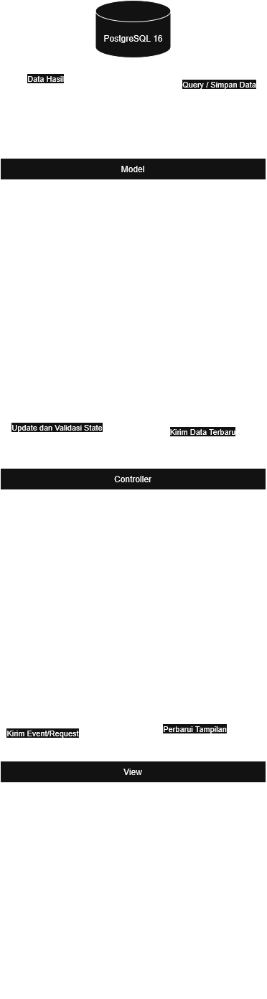

<i>Gambar 2.1 Arsitektur MVC</i>

## 2.3 Identifikasi Komponen / Modul / Subsistem

Identifikasi komponen, modul, atau subsistem penyusun aplikasi berdasarkan *pattern* yang telah ditetapkan. Jelaskan tanggung jawab masing-masing komponen. Pengelompokan dapat mengikuti lapisan arsitektur atau fungsi/peran komponen dalam sistem.

Ambil dari **Tabel 2.1 dokumen APL**, lalu kelompokkan berdasarkan lapisan (Model/View/Controller). Kolom **Jenis** diisi sesuai pattern, misalnya View, Controller, Model, Service, Repository. Satu komponen merepresentasikan saatu tanggung jawab utama yang jelas,

Tabel 2.3. Identifikasi Komponen/Modul/Subsistem

| Nama Komponen/Modul/Subsistem | Jenis | Penjelasan |
| :--- | :--- | :--- |
 TiketLaporanUI | View | Menampilkan halaman pengajuan tiket laporan masalah bagi pelanggan dan pemberi jasa, serta meneruskan ke TiketLaporanController. |
| PenggunaUI | View | Menampilkan antarmuka umum akun pengguna dan meneruskan proses atau input pengguna ke PenggunaController. |
| PelangganUI | View | Menampilkan antarmuka beranda bagi pelanggan untuk mencari jasa, melihat peta lokasi pemberi jasa, memilih jasa, dan meneruskan  pemesanan ke PelangganController. |
| PemberiJasaUI | View | Menampilkan antarmuka bagi pemberi jasa untuk mengelola profil, menerima notifikasi pesanan masuk, dan meneruskan proses ke PemberiJasaController. |
| LayananPelangganUI | View | Menampilkan halaman bagi layanan pelanggan untuk memantau tiket kendala pengguna, merespons tiket laporan, dan meneruskannya ke LayananPelangganController. |
| KontrakPekerjaanUI | View | Menampilkan antarmuka pembuatan kesepakatan kontrak kerja, status pekerjaan, serta tombol konfirmasi penyelesaian kerja ke KontrakPekerjaanController. |
| KategoriJasaUI | View | Menampilkan halaman katalog kategori jasa dan daftar jenis jasa yang tersedia kepada pelanggan serta meneruskan aksi pemilihan kategori ke KategoriJasaController. |
| RatingUI | View | Menampilkan antarmuka pengisian skor penilaian (rating) dan ulasan dua arah setelah pekerjaan selesai serta meneruskan data ulasan ke RatingController. |
| NotifikasiUI | View | Menampilkan daftar pemberitahuan sistem dan notifikasi pesan baru atau tiket masuk kepada pengguna serta meneruskan interaksi notifikasi ke NotifikasiController. |
| KomunikasiUI | View | Menampilkan antarmuka obrolan (*chat*) interaktif antara pengguna (pelanggan–pemberi jasa untuk negosiasi atau pengguna–layanan pelanggan untuk mediasi) ke KomunikasiController. |
| TiketLaporanController | Controller | Memproses logika pembentukan tiket laporan serta memperbarui state pada Model TiketLaporan. |
| PenggunaController | Controller | Menangani logika akun pengguna (login dan registrasi), serta berinteraksi dengan Model Pengguna. |
| PelangganController | Controller | Mengatur logika interaksi pelanggan, validasi pemilihan jasa dan lokasi, inisiasi pesanan kerja, serta memperbarui state pada Model Pelanggan. |
| PemberiJasaController | Controller | Mengatur logika pendaftaran jasa, pemrosesan penerimaan/penolakan pesanan, penanganan batas waktu respons pesanan (30 menit), dan pembaruan state pada Model PemberiJasa. |
| LayananPelangganController | Controller | Mengatur logika penanganan tiket laporan, serta memperbarui state tindak lanjut tiket pada Model LayananPelanggan. |
| KontrakPekerjaanController | Controller | Mengatur logika kontrak kerja dan pembaruan state pada Model KontrakPekerjaan. |
| KategoriJasaController | Controller | Mengatur logika pengambilan dan pemfilteran data kategori serta jenis jasa dari Model KategoriJasa untuk ditampilkan ke pengguna. |
| RatingController | Controller | Memvalidasi masukan penilaian dua arah, menghitung akumulasi dan rata-rata rating pengguna, serta menyimpan hasil penilaian melalui Model Rating. |
| NotifikasiController | Controller | Memproses pembentukan notifikasi otomatis saat terjadi sebuah event dan mengelola data notifikasi melalui Model Notifikasi. |
| KomunikasiController | Controller | Mengatur pengiriman dan penerimaan pesan obrolan secara *real-time*, validasi isi pesan, dan pencatatan riwayat pesan ke Model Komunikasi. |
| TiketLaporan | Model | Merepresentasikan entitas data tiket laporan masalah serta membaca dan menyimpan data. |
| Pengguna | Model | Merepresentasikan entitas dasar data pengguna aplikasi serta membaca dan menyimpan data. |
| Pelanggan | Model | Merepresentasikan data profil khusus pelanggan dan preferensi pemesanan jasa serta mengelola status data pelanggan di basis data. |
| PemberiJasa | Model | Merepresentasikan data khusus pemberi jasa (keahlian, lokasi GPS, status ketersediaan, akumulasi rating, dan lain-lain) serta mengelola status data di basis data. |
| LayananPelanggan | Model | Merepresentasikan data profil layanan pelanggan serta. |
| KontrakPekerjaan | Model | Merepresentasikan data kesepakatan kerja. |
| KategoriJasa | Model | Merepresentasikan data kategori dan jenis jasa yang ditawarkan dalam sistem serta membaca dan menyimpan data. |
| Rating | Model | Merepresentasikan data evaluasi/penilaian kerja serta membaca dan menyimpan data. |
| Notifikasi | Model | Merepresentasikan data notifikasi sistem serta membaca dan menyimpan data. |
| Komunikasi | Model | Merepresentasikan data percakapan obrolan serta membaca dan menyimpan data. |
| PostgreSQL 16 | Database | Menyimpan seluruh sistem CariUang, melayani operasi *query*, dan manipulasi data dari lapisan Model. |

Tabel 2.1 Tabel Identifikasi Komponen / Modul / Subsistem

## 2.4 Model Arsitektur Perangkat Lunak

### 2.4.1 Development View

Pemilihan *Development View* didasari oleh kebutuhan untuk mendeskripsikan organisasi statis kode perangkat lunak ke dalam *package*. Dengan memfokuskan perancangan pada manajemen perangkat lunak, penyusunan hierarki folder atau modul, dan pemetaan ketergantungan kode, arsitektur sistem dapat dipastikan selaras dengan implementasi teknis pada repositori proyek serta meminimalkan risiko ketergantungan sirkular antar modul.

Penerapan *package diagram* pada pandangan ini memberikan batasan aksesantar bagian sistem melalui aturan dependensi seperti pemakaian, pengimporan publik, maupun akses privat. Kejelasan struktur ini mempermudah pembagian alokasi kerja antarpengembang agar tidak saling berbenturan, mendukung pembagian tanggung jawab fitur, serta meningkatkan potensi penggunaan ulang kode program dan kemudahan pemeliharaan sistem secara berkelanjutan.

<i>Gambar 2.4.1 Model Development View</i>

 

---

# BAB 3: Realisasi Use Case

## 3.1 Use Case Mendaftarkan Jasa

**ID Use Case:** UC01 
**Nama Use Case:** Mendaftarkan jasa

### 3.1.1 Identifikasi Kelas

Identifikasi kelas yang terkait dengan use case tersebut. Kelas di tahap perancangan dapat berbeda dengan dengan kelas di tahap analisis. Dapat menggunakan tabel di bawah:

Tabel 3.1. Identifikasi Kelas Use Case Mendaftarkan Jasa

| ID Kelas | Nama Kelas | Deskripsi Kelas |
| :--- | :--- | :--- |
| C04 | PemberiJasa | Turunan dari kelas Pengguna yang bertanggung jawab dalam proses pekerjaan, memberi rating, memberi laporan kepada layanan pelanggan. Menyimpan titik lokasi, akumulasi rating, identitas pemberi jasa, deskripsi keahlian | UC01, UC02, UC04, UC06, UC08, UC10, UC11, UC12 |
| C06 | PemberiJasaController | Kelas yang mengatur logika program untuk pemberi jasa | UC01, UC02, UC04, UC06, UC08, UC10, UC11, UC12 |
| C13 | KategoriJasa | Menyimpan data spesifik jasa yang ditawarkan oleh PemberiJasa | UC01, UC02 |
| C14 | KategoriJasaUI | Kelas yang mengatur penampilan halaman pada kategori jasa | UC01, UC02 |
| C15 | KategoriJasaController | Kelas yang mengatur logika program kategori jasa | UC01, UC02 |

### 3.1.2 Sequence Diagram

- **Skenario Normal**

<i>Gambar 1. Sequence Diagram UC01</i>

- **Skenario Alternatif 1: Verifikasi Input Gagal**

<i>Gambar 2. Sequence Diagram UC01 - Verifikasi Input Gagal</i>

### 3.1.3 Diagram Kelas

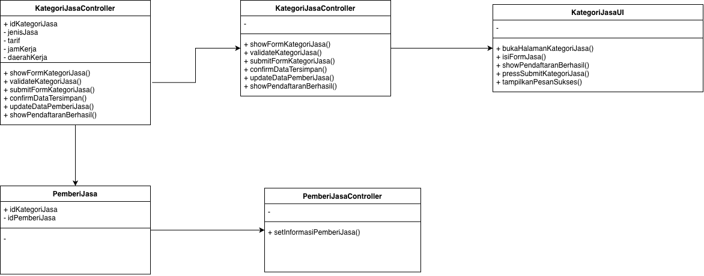

<i>Gambar 3. Diagram Kelas UC01 - Mendaftarkan Jasa</i>

## 3.2 Use Case Memilih Jasa

**ID Use Case:** UC02 
**Nama Use Case:** Memilih Jasa

## 3.2.1 Sequence Diagram

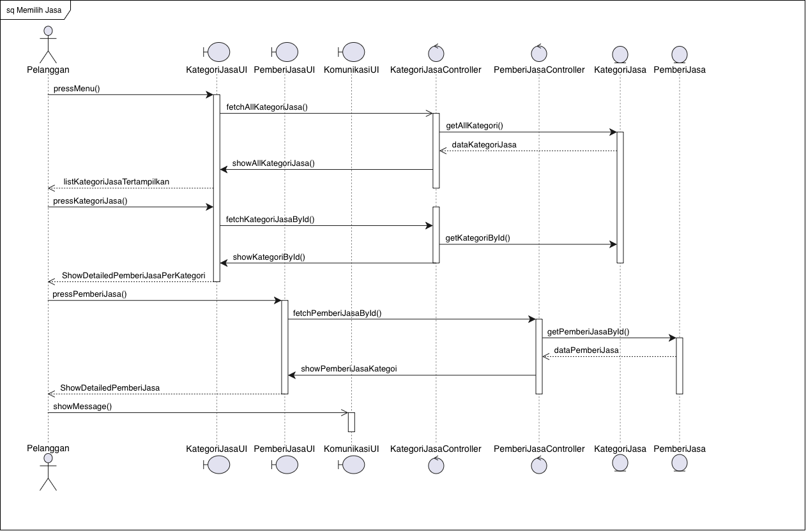

<i>Gambar 4. Sequence Diagram UC02</i>

- **Skenario Alternatif 1: Pemberi Jasa Tidak Ditemukan**

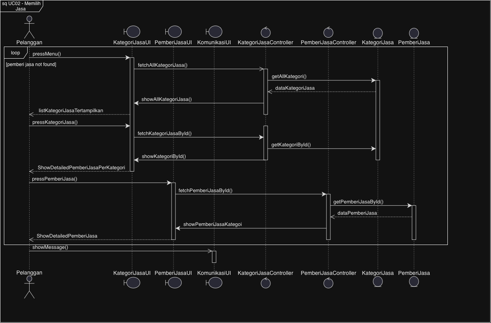

<i>Gambar 5. Sequence Diagram UC02 - Pemberi Jasa Tidak Ditemukan</i>

## 3.2.2 Diagram Kelas

<i>Gambar 6. Diagram Kelas UC02 </i>

## 3.3 Use Case 03

**ID Use Case:** UC03 
**Nama Use Case:** Menghubungi Pemberi Jasa

## 3.3.1 Sequence Diagram

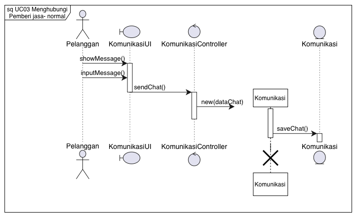

<i>Gambar 7. Sequence Diagram UC03</i>

- **Skenario Alternatif 1: Pesan tidak terkirim ke pemberi jasa**

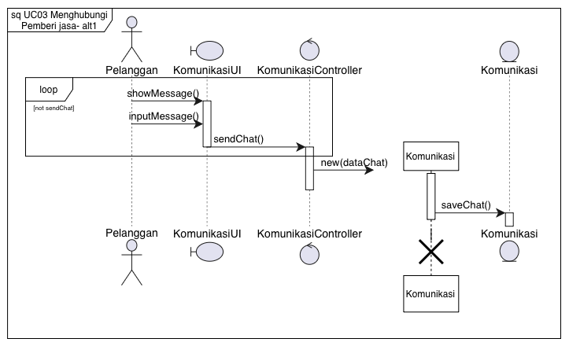

<i>Gambar 8. Sequence Diagram UC03 - Pesan tidak terkirim ke pemberi jasa</i>

## 3.3.2 Class Diagram

<i>Gambar 9. Diagram Kelas UC03 - Mendaftarkan Jasa</i>

 

## 3.4 Use Case 4
<b>ID Use Case: </b> UC04 
<b>Nama Use Case: </b> Merespon pelanggan

### 3.4.1 Identifikasi Kelas Use Case Memberi Rating
| ID Kelas | Nama Kelas | Deskripsi Kelas |
| :--- | :--- | :--- |
| C04 | PemberiJasa | Turunan dari kelas Pengguna yang bertanggung jawab dalam proses pekerjaan, memberi rating, memberi laporan kepada layanan pelanggan. Menyimpan titik lokasi, akumulasi rating, identitas pemberi jasa, deskripsi keahlian |
| C07 | Pelanggan | Turunan dari kelas Pengguna yang bertanggung jawab dalam proses pemesanan jasa, memasukkan input kesepakatan harga dan pekerjaan dan mengonfirmasi selesainya pekerjaan, melaporkan masalah, dan memberikan rating kepada pemberi jasa. Selain itu, menyimpan data akumulasi rating dan data Pelanggan|
| C19 | Komunikasi | Merealisasikan fitur komunikasi |
| C20 | KomunikasiUI | Kelas yang mengatur penampilan halaman pada halaman komunikasi |
| C21 | KomunikasiController | Kelas yang mengatur logika program komunikasi |
| C28 | Notifikasi | Merealisasikan fitur notifikasi yang akan diberikan kepada PemberiJasa ketika jasanya dipesan | 
| C29 | NotifikasiUI | Kelas yang mengatur penampilan halaman notifikasi | 
| C30 | NotifikasiController | Kelas yang mengatur logika program notifikasi |  

### 3.4.2 Sequence Diagram
<ul>
    <li>Skenario Normal  
        

        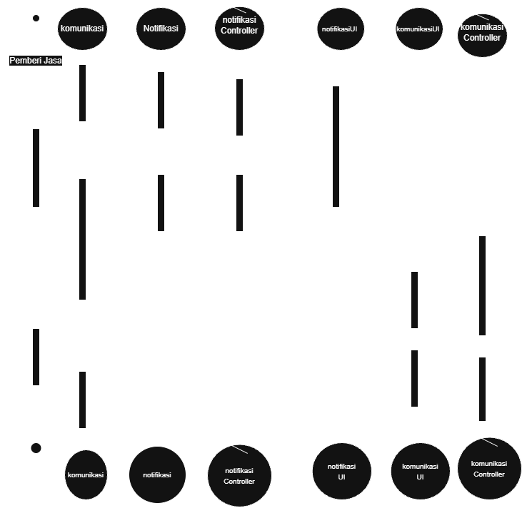
        

        

        <i>Gambar X. Diagram Sequence UC04</i>
        

    
</ul>

### 3.4.3 Diagram Kelas

<i>Gambar X. Diagram Kelas UC04</i>

## 3.5 Use Case 5
<b>ID Use Case: </b> UC05 
<b>Nama Use Case: </b> Pelanggan memasukkan kesepakatan harga dan pekerjaan

### 3.5.1 Identifikasi Kelas Use Case Memberi Rating
| ID Kelas | Nama Kelas | Deskripsi Kelas |
| :--- | :--- | :--- |
| C07 | Pelanggan | Turunan dari kelas Pengguna yang bertanggung jawab dalam proses pemesanan jasa, memasukkan input kesepakatan harga dan pekerjaan dan mengonfirmasi selesainya pekerjaan, melaporkan masalah, dan memberikan rating kepada pemberi jasa. Selain itu, menyimpan data akumulasi rating dan data Pelanggan| 
| C16 | KontrakPekerjaan | Menyimpan data detail kesepakatan antara Pelanggan dan PemberiJasa, seperti harga, detail pekerjaan, status pekerjaan (On Progress/Done) | 
| C17 | KontrakPekerjaanUI | Kelas yang mengatur penampilan halaman pada kelas kontrak pekerjaan | 
| C18 | KontrakPekerjaanController | Kelas yang mengatur logika program kontrak pekerjaan |

### 3.5.2 Sequence Diagram
<ul>
    <li>Skenario Normal  
        

        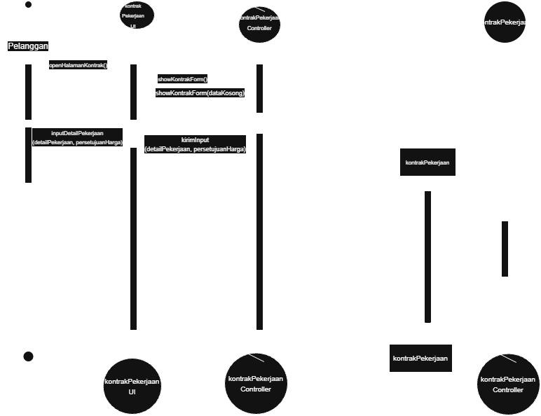
        

        

        <i>Gambar X. Diagram Sequence UC05</i>
        

    
</ul>

### 3.5.3 Diagram Kelas

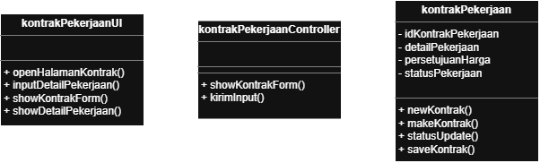

<i>Gambar X. Diagram Kelas UC05</i>

## 3.6 Use Case 6
<b>ID Use Case: </b> UC06 
<b>Nama Use Case: </b> Pemberi jasa telah selesai bekerja

### 3.6.1 Identifikasi Kelas Use Case Memberi Rating
| ID Kelas | Nama Kelas | Deskripsi Kelas |
| :--- | :--- | :--- |
| C07 | Pelanggan | Turunan dari kelas Pengguna yang bertanggung jawab dalam proses pemesanan jasa, memasukkan input kesepakatan harga dan pekerjaan dan mengonfirmasi selesainya pekerjaan, melaporkan masalah, dan memberikan rating kepada pemberi jasa. Selain itu, menyimpan data akumulasi rating dan data Pelanggan| 
| C16 | KontrakPekerjaan | Menyimpan data detail kesepakatan antara Pelanggan dan PemberiJasa, seperti harga, detail pekerjaan, status pekerjaan (On Progress/Done) | 
| C17 | KontrakPekerjaanUI | Kelas yang mengatur penampilan halaman pada kelas kontrak pekerjaan | 
| C18 | KontrakPekerjaanController | Kelas yang mengatur logika program kontrak pekerjaan |

### 3.6.2 Sequence Diagram
<ul>
    <li>Skenario Normal  
        

        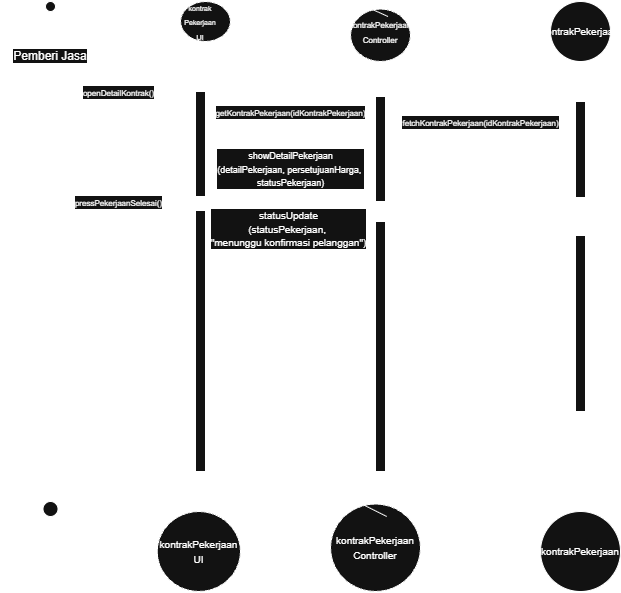
        

        

        <i>Gambar X. Diagram Sequence UC06</i>
        

    
</ul>

### 3.6.3 Diagram Kelas

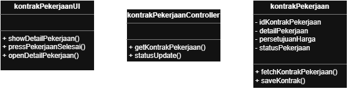

<i>Gambar X. Diagram Kelas UC06</i>

## 3.7 Use Case 7

### 3.7.1 Identifikasi Kelas Use Case Pelanggan dan Pemberi Jasa Melaporkan Masalah
| ID Kelas | Nama Kelas Perancangan | Nama Kelas Analisis Terkait |
| :--- | :--- | :--- |
| C04 | PemberiJasa | PemberiJasa | 
| C05 | PemberiJasaUI | PemberiJasaUI | 
| C06 | PemberiJasaController | PemberiJasaController | 
| C07 | Pelanggan | Pelanggan | 
| C08 | PelangganUI | PelangganUI | 
| C09 | PelangganController | PelangganController | 
| C22 | TiketLaporan | TiketLaporan | 
| C23 | TiketLaporanUI | TiketLaporanUI | 
| C24 | TiketLaporanController | TiketLaporanController | 
| C28 | Notifikasi | Notifikasi | 
| C29 | NotifikasiUI | NotifikasiUI | 
| C30 | NotifikasiController | NotifikasiController | 

### 3.7.2 Sequence Diagram
<ul>
    

    
    

    

    <i>Gambar 15. Diagram Sequence UC7</i>
    

</ul>

### 3.7.3 Diagram Kelas

<i>Gambar 16. Diagram Kelas UC7</i>

## 3.8 Use Case 8

### 3.8.1 Identifikasi Kelas Use Case Pelanggan dan Pemberi Jasa Melaporkan Masalah
| ID Kelas | Nama Kelas Perancangan | Nama Kelas Analisis Terkait |
| :--- | :--- | :--- |
| C04 | PemberiJasa | PemberiJasa | 
| C05 | PemberiJasaUI | PemberiJasaUI | 
| C06 | PemberiJasaController | PemberiJasaController | 
| C07 | Pelanggan | Pelanggan | 
| C08 | PelangganUI | PelangganUI | 
| C09 | PelangganController | PelangganController | 
| C22 | TiketLaporan | TiketLaporan | 
| C23 | TiketLaporanUI | TiketLaporanUI | 
| C24 | TiketLaporanController | TiketLaporanController | 
| C28 | Notifikasi | Notifikasi | 
| C29 | NotifikasiUI | NotifikasiUI | 
| C30 | NotifikasiController | NotifikasiController | 

### 3.8.2 Sequence Diagram
<ul>
    

    
    

    

    <i>Gambar 17. Diagram Sequence UC8</i>
    

</ul>

### 3.8.3 Diagram Kelas

<i>Gambar 18. Diagram Kelas UC8</i>

## 3.9 Use Case 9

### 3.9.1 Identifikasi Kelas Use Case Layanan Pelanggan Merespon Pelanggan
| ID Kelas | Nama Kelas Perancangan | Nama Kelas Analisis Terkait |
| :--- | :--- | :--- |
| C10 | LayananPelanggan | LayananPelanggan | 
| C11 | LayananPelangganUI | LayananPelangganUI | 
| C12 | LayananPelangganController | LayananPelangganController | 
| C19 | Komunikasi | Komunikasi | 
| C20 | KomunikasiUI | KomunikasiUI | 
| C21 | KomunikasiController | KomunikasiController |
| C22 | TiketLaporan | TiketLaporan | 
| C23 | TiketLaporanUI | TiketLaporanUI | 
| C24 | TiketLaporanController | TiketLaporanController | 
| C28 | Notifikasi | Notifikasi | 
| C29 | NotifikasiUI | NotifikasiUI | 
| C30 | NotifikasiController | NotifikasiController | 

### 3.9.2 Sequence Diagram
<ul>
    

    
    

    

    <i>Gambar 19. Diagram Sequence UC9</i>
    

</ul>

### 3.9.3 Diagram Kelas

<i>Gambar 20. Diagram Kelas UC9</i>

## 3.10 Use Case 10
<b>ID Use Case: </b> UC10 
<b>Nama Use Case: </b> Memberi Rating

### 3.10.1 Identifikasi Kelas Use Case Memberi Rating
| ID Kelas | Nama Kelas Perancangan | Nama Kelas Analisis Terkait |
| :--- | :--- | :--- |
| C01 | Pengguna | Pengguna |     
| C02 | PenggunaUI | PenggunaUI |     
| C03 | PenggunaController | PenggunaController |     
| C04 | PemberiJasa | PemberiJasa |    
| C07 | Pelanggan | Pelanggan |    
| C16 | KontrakPekerjaan | KontrakPekerjaan |    
| C18 | KontrakPekerjaanController | KontrakPekerjaanController |    
| C25 | Rating | Rating |    
| C26 | RatingUI | RatingUI |    
| C27 | RatingController | RatingController |    

### 3.10.2 Sequence Diagram
<ul>
    <li>Skenario Normal  
        

        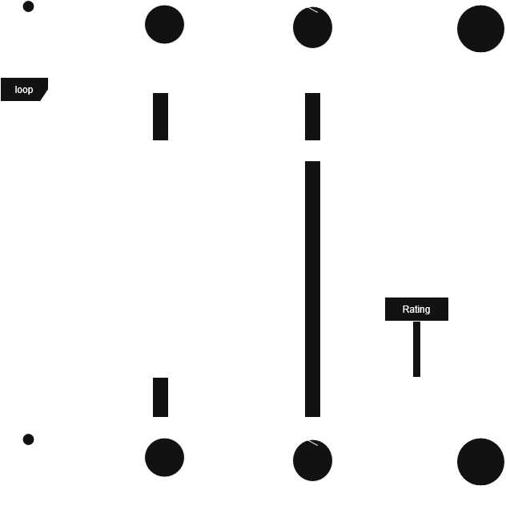
        

        

        <i>Gambar 21. Diagram Sequence UC10</i>
        

    <li>Skenario Alternatif 1: Penyedia Jasa atau pengguna menutup popup yang telah dimunculkan atau menutup aplikasi setelah proses transaksi selesai
        

        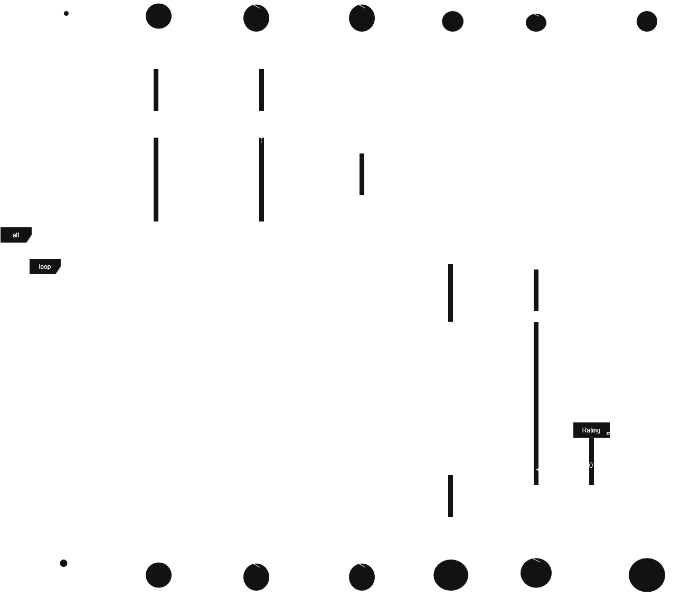
        

        

        <i>Gambar 22. Diagram Sequence UC10 Alternatif 1</i>
        

</ul>

### 3.10.3 Diagram Kelas

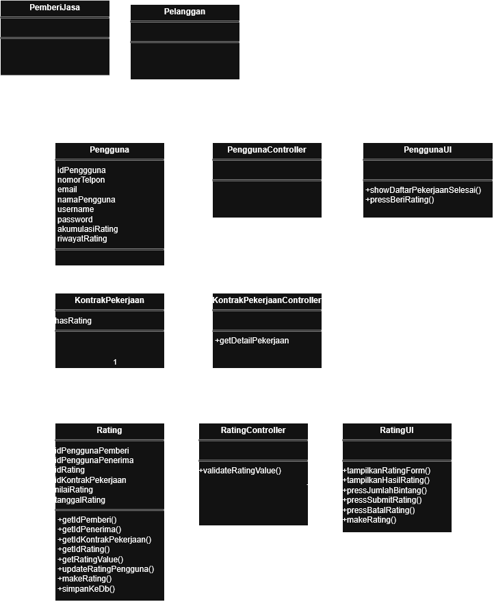

<i>Gambar 23. Diagram Kelas UC10</i>

## 3.11 Use Case 11
<b>ID Use Case: </b> UC11 
<b>Nama Use Case: </b> Memasuki akun dalam perangkat lunak

### 3.11.1 Identifikasi Kelas Use Case Memasuki akun dalam perangkat lunak
| ID Kelas | Nama Kelas | Deskripsi Kelas |
| :--- | :--- | :--- |
| C04 | PemberiJasa | PemberiJasa | 
| C05 | PemberiJasaUI | PemberiJasaUI | 
| C06 | PemberiJasaController | PemberiJasaController | 
| C07 | Pelanggan | Pelanggan | 
| C08 | PelangganUI | PelangganUI | 
| C09 | PelangganController | PelangganController | 
| C10 | LayananPelanggan | LayananPelanggan | 
| C11 | LayananPelangganUI | LayananPelangganUI | 
| C12 | LayananPelangganController | LayananPelangganController | 

### 3.11.2 Sequence Diagram
<ul>
    <li>Skenario Pelanggan 
        

        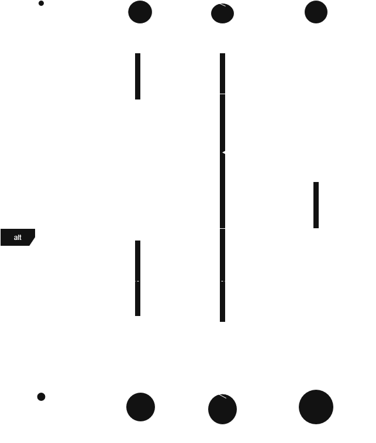
        

        

        <i>Gambar 24. Diagram Sequence UC10 Skenario Pelanggan</i>
        

    <li>Skenario Pemberi Jasa
        

        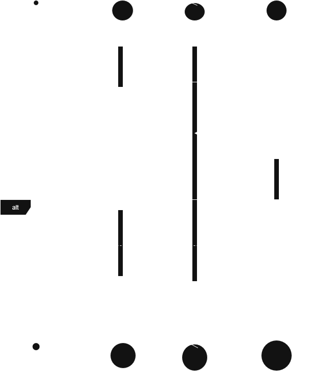
        

        

        <i>Gambar 25. Diagram Sequence UC10 Skenario Pemberi Jasa</i>
        

    <li> Skenario Layanan Pelanggan
        

        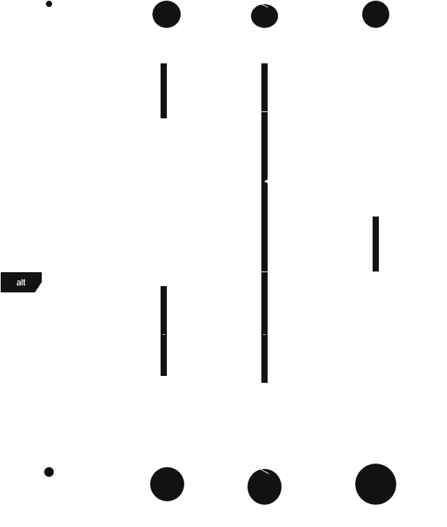
        

        

        <i>Gambar 26. Diagram Sequence UC10 Skenario Layanan Pelanggan</i>
        

</ul>

### 3.11.3 Diagram Kelas

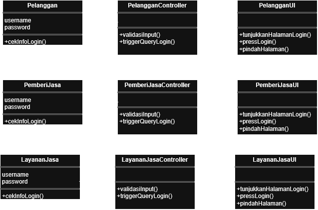

<i>Gambar 27. Diagram Kelas UC11</i>

## 3.12 Use Case 

<b>ID Use Case: </b> UC11 
<b>Nama Use Case: </b> Memasuki akun dalam perangkat lunak

### 3.12.1 Identifikasi Kelas Use Case Memasuki akun dalam perangkat lunak
| ID Kelas | Nama Kelas | Deskripsi Kelas |
| :--- | :--- | :--- |
| C01 | Pengguna | Pengguna | 
| C02 | PenggunaUI | PenggunaUI | 
| C03 | PenggunaController | PenggunaController | 
| C04 | PemberiJasa | PemberiJasa | 
| C07 | Pelanggan | Pelanggan | 

### 3.12.2 Sequence Diagram
<ul>
    <li>Skenario Pelanggan 
        

        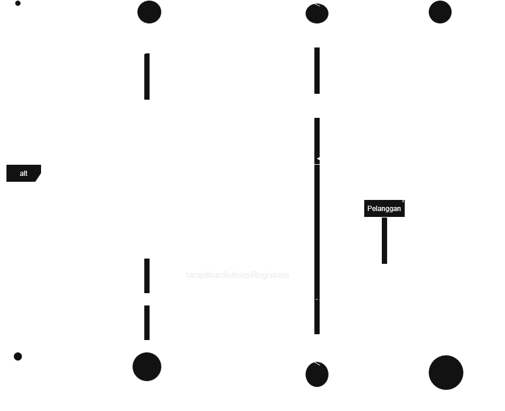
        

        

        <i>Gambar 28. Diagram Sequence UC10 Skenario Pelanggan</i>
        

    <li>Skenario Pemberi Jasa
        

        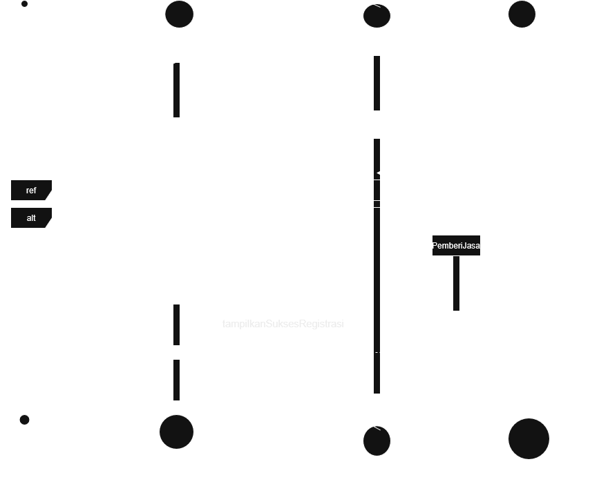
        

        <i>Gambar 29. Diagram Sequence UC10 Skenario Pelanggan</i>
        

### 3.12.2 Diagram Kelas

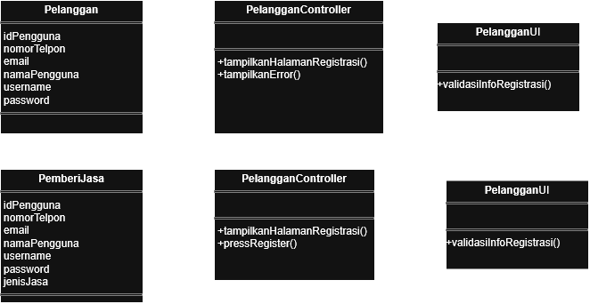

<i>Gambar 30. Diagram Kelas UC11</i>

# BAB 4: Diagram Kelas Keseluruhan

## 4.1 Diagram Kelas

**Bagian ini diisi dengan diagram kelas keseluruhan.**

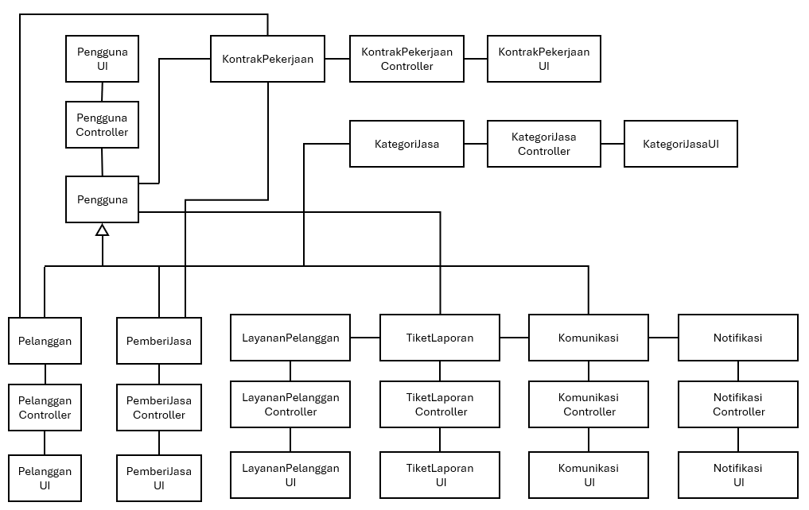

<i>Gambar 4.1. Diagram Kelas Perancangan Keseluruhan Cari Uang</i>

Tabel 4.1. Daftar Kelas Perancangan Keseluruhan

| Kode | Nama Class | Atribut | Metode |
| :--- | :--- | :--- | :--- |
| C01 | Pengguna | idPengguna nomorTelpon email namaPengguna username password akumulasiRating riwayatRating | +getId() +getNomor() +getEmail() +getNama() +setNomor() +setEmail() +setNama() +getAkumulasiRating() +getRiwayatRating() +addNewRatingRiwayat() +konfirmasiPekerjaan() +laporkanMasalah() |
| C02 | PenggunaUI | - | +showDaftarPekerjaanSelesai() +pressBeriRating() +tampilkanHalamanRegistrasi() +showInformasiPekerjaanSelesai() +pressRegister() +pressBantuanLayanan() +showInformasiPekerjaanSelesai() |
| C03 | PenggunaController | - | +triggerRating() -verifikasiStatusPekerjaan() +validasiInfoRegistrasi() +requestKontrakPekerjaan() +requestFormTiket() |
| C04 | PemberiJasa | jenisJasa idKategoriJasa -idPemberiJasa -dataPemberiJasa | +getIDPemberiJasa() +getIDKategoriJasa() +setIDKategoriJasa() +savePemberiJasa() +makePemberiJasa() +cekInfoLogin() +laporkanMasalah() +simpanKeDb() +tampilkanSuksesRegistrasi() +getPemberiJasaByID() |
| C05 | PemberiJasaUI | - | +tunjukkanHalamanLogin() +pressLogin() +pindahHalaman() +pressPemberiJasa() +pressChat() +showPemberiJasaMap() +pressBantuanLayanan() +tampilkanError() +showPemberiJasaKategori() |
| C06 | PemberiJasaController | - | +validatePemberiJasa() +validasiInput() +triggerQueryLogin() +showPemberiJasaFromKategori() +choosePemberiJasa() +requestFormTiket() +setInformasiPemberiJasa() +fetchPemberiJasaById() |
| C07 | Pelanggan | - | +makePelanggan() +cekInfoLogin() +simpanKeDb() |
| C08 | PelangganUI | - | +tunjukkanHalamanLogin() +pressLogin() +pindahHalaman() +tampilkanError() +tampilkanSuksesRegistrasi() |
| C09 | PelangganController | - | +validasiInput() +triggerQueryLogin() |
| C10 | LayananPelanggan | -idLayananPelanggan | +makeLayananPelanggan() +cekInfoLogin() +responTiket() |
| C11 | LayananPelangganUI | - | +tunjukkanHalamanLogin() +pressLogin() +pindahHalaman() +showDaftarTiket() +pressBukaTiket() +tampilkanError() |
| C12 | LayananPelangganController | - | +validasiInput() +triggerQueryLogin() +requestTiketLaporan() +teruskanBalasan() |
| C13 | KategoriJasa | idKategoriJasa jenisJasa tarif jamKerja daerahKerja -dataKategoriJasa | +getIDKategoriJasa() +getJenisJasa() +getTarif() +getJamKerja() +getDaerahKerja() +setTarif() +setJamKerja() +setDaerahKerja() +saveKategoriJasa() +getAllKategori() +getKategoriById() |
| C14 | KategoriJasaUI | - | +pressOpenKategoriJasa() +showFormKategoriJasa() +pressSubmitKategoriJasa() +inputDataKategoriJasa() +showKategoriJasa() +pressKategoriJasa() +pressMenu() +bukaHalamanKategoriJasa() +isiFormJasa() +showPendaftaranBerhasil() +tampilkanPesanSukses() +showAllKategoriJasa() +showKategoriById() |
| C15 | KategoriJasaController | - | +validateKategoriJasa() +submitFormKategoriJasa() +filterKategoriJasa() +showFormKategoriJasa() +confirmDataTersimpan() +updateDataPemberiJasa() +showPendaftaranBerhasil() +fetchAllKategoriJasa() +fetchKategoriJasaById() |
| C16 | KontrakPekerjaan | idKontrakPekerjaan detailPekerjaan persetujuanHarga statusPekerjaan hasRating | +fetchKontrakPekerjaan() +saveKontrak() +getDetailPekerjaan() +newKontrak() +makeKontrak() +statusUpdate() +saveKontrak() +addRating() |
| C17 | KontrakPekerjaanUI | - | +openHalamanKontrak() +inputDetailPekerjaan() +showKontrakForm() +showDetailPekerjaan() +pressPekerjaanSelesai() +openDetailPekerjaan() |
| C18 | KontrakPekerjaanController | - | -getKontrakPekerjaan() -statusUpdate() -showKontrakForm() -kirimInput() |
| C19 | Komunikasi | -idChat -idPengguna -isiPesan -waktuTerkirim -isChatTerbaca -statusChat -durasiChat -dataChat | +simpanPesan() +getPesan() +getIDChat() +getChatHistory() +saveChat() |
| C20 | KomunikasiUI | - | +showChat() +pressKirimBalasan() +showChatChannel() +inputMessage() +pressSendChat() +showMessage() |
| C21 | KomunikasiController | - | +kirimPesan() +getRiwayatChat() +loadChat() +startChat() +sendChat() |
| C22 | TiketLaporan | -idTiket -idPengguna -jenisTiket -keteranganTiket -tanggalTiket -statusTiket | +getDetailTiket() +updateStatusTiket() |
| C23 | TiketLaporanUI | - | +showDetailTiket() +pressBalasTiket() |
| C24 | TiketLaporanController | - | +getTiketLaporan() +balasTiket() +tutupTiket() |
| C25 | Rating | idPenggunaPemberi idPenggunaPenerima idRating idKontrakPekerjaan nilaiRating tanggalRating | +getIdPemberi() +getIdPenerima() +getIdKontrakPekerjaan() +getIdRating() +getRatingValue() +updateRatingPengguna() +makeRating() +simpanKeDb() |
| C26 | RatingUI | - | +tampilkanRatingForm() +tampilkanHasilRating() +pressJumlahBintang() +pressSubmitRating() +pressBatalRating() |
| C27 | RatingController | - | +validateRatingValue() |
| C28 | Notifikasi | -idNotifikasi -idPenerima -isiNotifikasi -waktuNotifikasi -statusBaca | +getIsiNotifikasi() +tandaiTerbaca() +getLastMessage() |
| C29 | NotifikasiUI | - | -playSound() -stopSound() +showNotifikasi() +closeNotifikasi() +pressNotifikasi() |
| C30 | NotifikasiController | - | +buatNotifikasi() +kirimNotifikasi() |

 

---

# BAB 5: Matriks Kerunutan

Petakan kelas perancangan dengan use case yang terkait. Gunakan **BAB 6 Traceability pada dokumen SKPL** sebagai acuan keterkaitan kelas analisis dan use case, lalu sesuaikan dengan realisasi use case dan kelas perancangan pada BAB 3–BAB 5 DPPL.

Tabel 7.1. Matriks Kerunutan Kelas terhadap Use Case

| Kelas | Use Case Terkait |
| :--- | :--- |
| C01 - Pengguna | UC10 - Memberi rating; UC12 - Mendaftar akun ke perangkat lunak |
| C02 - PenggunaUI | UC10 - Memberi rating; UC12 - Mendaftar akun ke perangkat lunak |
| C03 - PenggunaController | UC10 - Memberi rating; UC12 - Mendaftar akun ke perangkat lunak |
| C04 - PemberiJasa | UC01 - Mendaftarkan jasa; UC02 - Memilih jasa; UC03 - Menghubungi pemberi jasa; UC04 - Merespon pelanggan; UC06 - Mengubah status pekerjaan menjadi selesai; UC08 - Melaporkan masalah; UC10 - Memberi rating; UC11 - Memasuki akun dalam perangkat lunak; UC12 - Mendaftar akun ke perangkat lunak |
| C05 - PemberiJasaUI | UC02 - Memilih jasa; UC08 - Melaporkan masalah; UC11 - Memasuki akun dalam perangkat lunak |
| C06 - PemberiJasaController | UC01 - Mendaftarkan jasa; UC02 - Memilih jasa; UC08 - Melaporkan masalah; UC11 - Memasuki akun dalam perangkat lunak |
| C07 - Pelanggan | UC02 - Memilih jasa; UC03 - Menghubungi pemberi jasa; UC04 - Merespon pelanggan; UC05 - Memasukkan kesepakatan harga dan pekerjaan; UC07 - Mengonfirmasi status pekerjaan; UC08 - Melaporkan masalah; UC10 - Memberi rating; UC11 - Memasuki akun dalam perangkat lunak; UC12 - Mendaftar akun ke perangkat lunak |
| C08 - PelangganUI | UC07 - Mengonfirmasi status pekerjaan; UC08 - Melaporkan masalah; UC11 - Memasuki akun dalam perangkat lunak |
| C09 - PelangganController | UC02 - Memilih jasa; UC07 - Mengonfirmasi status pekerjaan; UC08 - Melaporkan masalah; UC11 - Memasuki akun dalam perangkat lunak |
| C10 - LayananPelanggan | UC09 - Merespon laporan masalah; UC11 - Memasuki akun dalam perangkat lunak |
| C11 - LayananPelangganUI | UC09 - Merespon laporan masalah; UC11 - Memasuki akun dalam perangkat lunak |
| C12 - LayananPelangganController | UC09 - Merespon laporan masalah; UC11 - Memasuki akun dalam perangkat lunak |
| C13 - KategoriJasa | UC01 - Mendaftarkan jasa; UC02 - Memilih jasa |
| C14 - KategoriJasaUI | UC01 - Mendaftarkan jasa; UC02 - Memilih jasa |
| C15 - KategoriJasaController | UC01 - Mendaftarkan jasa; UC02 - Memilih jasa |
| C16 - KontrakPekerjaan | UC05 - Memasukkan kesepakatan harga dan pekerjaan; UC06 - Mengubah status pekerjaan menjadi selesai; UC07 - Mengonfirmasi status pekerjaan |
| C17 - KontrakPekerjaanUI | UC05 - Memasukkan kesepakatan harga dan pekerjaan; UC06 - Mengubah status pekerjaan menjadi selesai; UC07 - Mengonfirmasi status pekerjaan |
| C18 - KontrakPekerjaanController | UC05 - Memasukkan kesepakatan harga dan pekerjaan; UC06 - Mengubah status pekerjaan menjadi selesai; UC07 - Mengonfirmasi status pekerjaan |
| C19 - Komunikasi | UC02 - Memilih jasa; UC03 - Menghubungi pemberi jasa; UC04 - Merespon pelanggan; UC09 - Merespon laporan masalah |
| C20 - KomunikasiUI | UC02 - Memilih jasa; UC03 - Menghubungi pemberi jasa; UC04 - Merespon pelanggan; UC09 - Merespon laporan masalah |
| C21 - KomunikasiController | UC02 - Memilih jasa; UC03 - Menghubungi pemberi jasa; UC04 - Merespon pelanggan; UC09 - Merespon laporan masalah |
| C22 - TiketLaporan | UC08 - Melaporkan masalah; UC09 - Merespon laporan masalah |
| C23 - TiketLaporanUI | UC08 - Melaporkan masalah; UC09 - Merespon laporan masalah |
| C24 - TiketLaporanController | UC08 - Melaporkan masalah; UC09 - Merespon laporan masalah |
| C25 - Rating | UC10 - Memberi rating |
| C26 - RatingUI | UC10 - Memberi rating |
| C27 - RatingController | UC10 - Memberi rating |
| C28 - Notifikasi | UC02 - Memilih jasa; UC03 - Menghubungi pemberi jasa; UC04 - Merespon pelanggan; UC08 - Melaporkan masalah; UC09 - Merespon laporan masalah |
| C29 - NotifikasiUI | UC02 - Memilih jasa; UC03 - Menghubungi pemberi jasa; UC04 - Merespon pelanggan; UC08 - Melaporkan masalah; UC09 - Merespon laporan masalah |
| C30 - NotifikasiController | UC02 - Memilih jasa; UC03 - Menghubungi pemberi jasa; UC04 - Merespon pelanggan; UC08 - Melaporkan masalah; UC09 - Merespon laporan masalah |
