<h1>
IF2150 REKAYASA PERANGKAT LUNAK
<br>
TUGAS 5
<br>
DESKRIPSI PERANCANGAN PERANGKAT LUNAK (DPPL)
</h1>
<br>

## Cari Uang
### 

### Untuk: Agatha Tatianingseto

Dipersiapkan oleh:
| Informasi | Keterangan |
| --- | --- |
| Kelas | 3 |
| Kelompok | 9  |

| NIM | Nama |
|---|---|
| 13525120 | Naufal Hasbialhaq |
| 13525009 | Wimar Widiarto |
| 13525093 | Vinsensius Juan Setiady |
| 13525126 | Raymond Edson Sabajan |
| 13525048 | Yohanes Nicholas Setiawan |


## Daftar Perubahan

| Revisi | Deskripsi |
| :--- | :--- |
| *A* | Dihapus method yang bernama `updateAkumulasiRating()` pada objek pengguna |
| *B* | Memperbaiki tabel UC 4-6 yang kurang tepat dan gambar yang kurang sesuai |
| *C* |  |
| ... |  |

---

<br>

---


# BAB 1: Pendahuluan

## 1.1 Tujuan Penulisan Dokumen
Dokumen DPPL ini dibuat dengan tujuan mendeskripsikan perancangan teknis perangkat lunak kami, mulai dari mendeskripsikan realisasi use case, rancangan diagram kelas secara keseluruhan, matriks kerunutan antarkomponen, hingga memodelkan arsitektur dan subsistem yang diperlukan untuk membangun perangkat lunak tersebut. Dokumen ini akan digunakan oleh para pengembang perangkat lunak sebagai cetak biru atau panduan utama untuk mulai menulis kode dan mengimplementasikan sistem yang sudah dirancang di dokumen ini, serta oleh penguji perangkat lunak untuk memastikan alur program berjalan sesuai dengan rancangan teknis yang telah didefinisikan.

## 1.2 Lingkup Masalah
Nama perangkat lunak kami adalah CariUang, CariUang sendiri merupakan platform yang menghubungkan para pekerja2 di bidang informal, seperti tukang jahit keliling, tukang sol sepatu keliling, handyman, dan lain-lain. Mayoritas pekerja informal di Indonesia masih menghadapi kesulitan ekonomi akibat tidak adanya tarif standar dan jaminan sosial yang minimal. Di sisi lain, konsumen juga mengalami kesulitan menemukan tenaga kerja terdekat yang terpercaya dan terverifikasi karena solusi digital saat ini masih terbatas dan kurang mencakup seluruh segmen jasa. Oleh karena itu, diperlukan suatu platform digital yang mampu menghubungkan pekerja informal ini dengan konsumen untuk mendukung pengurangan kesenjangan sosial-ekonomi (SDG 10).

## 1.3 Definisi, Istilah, dan Singkatan
Semua definisi dan singkatan yang digunakan dalam dokumen ini beserta penjelasannya.

Tabel 1.3. Definisi Istilah dan Singkatan

| Singkatan, Akronim, atau Istilah | Penjelasan |
| :--- | :--- |
| **P/L** | Perangkat Lunak, yaitu aplikasi atau program komputer yang sedang dikembangkan. |
| **DPPL** | Deskripsi Perancangan Perangkat Lunak, yaitu dokumen berisi rancangan teknis detail dari aplikasi yang akan dibuat. |
| **SKPL** | Spesifikasi Kebutuhan Perangkat Lunak, yaitu dokumen yang berisi daftar kebutuhan dan fitur aplikasi. |
| **UC (*Use Case*)** | Skenario atau langkah-langkah yang menunjukkan bagaimana pengguna menggunakan fitur aplikasi. |
| **UI (*User Interface*)** | Tampilan visual aplikasi tempat pengguna melihat informasi dan menekan tombol. |
| **MVC** | *Model-View-Controller*, cara merancang aplikasi dengan membaginya menjadi 3 bagian: penyimpanan data (Model), tampilan (View), dan pengatur logika/proses (Controller). |

## 1.4 Aturan Penomoran
Tuliskan aturan penomoran (ID) yang digunakan dalam dokumen ini. Gunakan pola ID yang **sama** dengan yang sudah dipakai pada dokumen-dokumen sebelumnya, jangan membuat pola baru di dokumen ini.

Tabel 1.4. Aturan Penomoran

| Hal/Bagian | Penomoran | Keterangan |
| :--- | :--- | :--- |
| *Use Case* | *UCXX* | Menyatakan ID kasus yang mungkin terjadi di perangkat lunak|
| *Kelas* | *CXX* | Menyatakan ID kelas di perangkat lunak|

## 1.5 Referensi
Dokumen ini merujuk pada dokumentasi-dokumentasi milestone sebelumnya, seperti dokumen Topic Brainstorming, Requirement Gathering, Use Case, Class Diagram, SKPL, APL.

## 1.6 Deskripsi Umum Dokumen (Ikhtisar)
Dokumen DPPL CariUang ini disusun secara runut untuk menjadi panduan perancangan teknis perangkat lunak, dimulai dari BAB 1 Pendahuluan yang menjelaskan tujuan, lingkup masalah, definisi istilah, aturan penomoran, referensi, serta ikhtisar dokumen; BAB 2 Perancangan Arsitektur yang membahas lingkungan implementasi, pemilihan style MVC (Model-View-Controller), identifikasi komponen/modul/subsistem, serta model arsitektur berupa Development View; BAB 3 Realisasi Use Case yang menjabarkan identifikasi kelas, sequence diagram untuk skenario normal dan alternatif, serta diagram kelas pada setiap use case; BAB 4 Diagram Kelas Keseluruhan yang menyajikan diagram kelas perancangan secara menyeluruh beserta daftar atribut dan metode/operasi seluruh kelas; dan BAB 5 Matriks Kerunutan yang memetakan keterkaitan antara kelas perancangan dengan use case terkait sebagai acuan implementasi dan penelusuran kebutuhan.

<br>

<br>

---

# BAB 2: Perancangan Arsitektur

## 2.1 Rancangan Lingkungan Implementasi

| Komponen | Spesifikasi |
| :--- | :--- |
| *Development Tools* | VS Code; Github; React native |
| *DBMS* | Postgresql 16 |
| *OS* | Android OS |
| *Filing System* | <pre>cariuang-project/<br>├── backend/<br>│   ├── src/<br>│   ├── database/<br>│   └── tests/<br>└── frontend/<br>    ├── android/<br>    ├── assets/<br>    ├── src/<br>    └── tests/</pre> |
| *Bahasa Pemrograman* | typescript |

## 2.2 Style/Pattern Arsitektur Acuan

CariUang menggunakan *style*: **MVC (*Model-View-Controller*)**. Komponen P/L dibagi menjadi tiga peran:

| Bagian | Peran |
| :--- | :--- | 
| ***View*** | Menampilkan halaman (login/registrasi, katalog jasa dan peta, kontrak pekerjaan, chat, tiket laporan, rating, notifikasi) dan meneruskan aksi pengguna ke *Controller*. *View* tidak menyimpan aturan bisnis. |
| ***Controller*** | Menerima permintaan dari *View*, memvalidasi input, menjalankan aturan bisnis (misalnya penguncian pemberi jasa, perubahan status 'On Progress' → 'Done', pembuatan tiket otomatis), lalu memanggil *Model*. |
| ***Model*** | Merepresentasikan data (Pengguna, KategoriJasa, KontrakPekerjaan, Komunikasi, TiketLaporan, Rating, Notifikasi), serta membaca dan menyimpan data ke basis data.|

Pemilihan MVC sebagai style yang dipilih karena MVC memisahkan antara bagaimana data diroses, bagaimana navigasinya berjalan dan bagaimana tampilannya. Jika ada perubahan logika bisa langsung tanpa merusak UI yang sudah ada. Selain itu, pengerjaan dari perangkat lunak ini juga dapat dilakukan secara paralel sehingga pengerjaan UI dan bagian controller serta model dapat dilakukan secara bersamaan.


<p align="center">

</p>
<p align="center">
<i>Gambar 2.1 Arsitektur MVC</i>
</p>

## 2.3 Identifikasi Komponen / Modul / Subsistem

Identifikasi komponen, modul, atau subsistem penyusun aplikasi berdasarkan *pattern* yang telah ditetapkan. Jelaskan tanggung jawab masing-masing komponen. Pengelompokan dapat mengikuti lapisan arsitektur atau fungsi/peran komponen dalam sistem.

Ambil dari **Tabel 2.1 dokumen APL**, lalu kelompokkan berdasarkan lapisan (Model/View/Controller). Kolom **Jenis** diisi sesuai pattern, misalnya View, Controller, Model, Service, Repository. Satu komponen merepresentasikan saatu tanggung jawab utama yang jelas,

Tabel 2.3. Identifikasi Komponen/Modul/Subsistem

| Nama Komponen/Modul/Subsistem | Jenis | Penjelasan |
| :--- | :--- | :--- |
 TiketLaporanUI | View | Menampilkan halaman pengajuan tiket laporan masalah bagi pelanggan dan pemberi jasa, serta meneruskan ke TiketLaporanController. |
| PenggunaUI | View | Menampilkan antarmuka umum akun pengguna dan meneruskan proses atau input pengguna ke PenggunaController. |
| PelangganUI | View | Menampilkan antarmuka beranda bagi pelanggan untuk mencari jasa, melihat peta lokasi pemberi jasa, memilih jasa, dan meneruskan  pemesanan ke PelangganController. |
| PemberiJasaUI | View | Menampilkan antarmuka bagi pemberi jasa untuk mengelola profil, menerima notifikasi pesanan masuk, dan meneruskan proses ke PemberiJasaController. |
| LayananPelangganUI | View | Menampilkan halaman bagi layanan pelanggan untuk memantau tiket kendala pengguna, merespons tiket laporan, dan meneruskannya ke LayananPelangganController. |
| KontrakPekerjaanUI | View | Menampilkan antarmuka pembuatan kesepakatan kontrak kerja, status pekerjaan, serta tombol konfirmasi penyelesaian kerja ke KontrakPekerjaanController. |
| KategoriJasaUI | View | Menampilkan halaman katalog kategori jasa dan daftar jenis jasa yang tersedia kepada pelanggan serta meneruskan aksi pemilihan kategori ke KategoriJasaController. |
| RatingUI | View | Menampilkan antarmuka pengisian skor penilaian (rating) dan ulasan dua arah setelah pekerjaan selesai serta meneruskan data ulasan ke RatingController. |
| NotifikasiUI | View | Menampilkan daftar pemberitahuan sistem dan notifikasi pesan baru atau tiket masuk kepada pengguna serta meneruskan interaksi notifikasi ke NotifikasiController. |
| KomunikasiUI | View | Menampilkan antarmuka obrolan (*chat*) interaktif antara pengguna (pelanggan–pemberi jasa untuk negosiasi atau pengguna–layanan pelanggan untuk mediasi) ke KomunikasiController. |
| TiketLaporanController | Controller | Memproses logika pembentukan tiket laporan serta memperbarui state pada Model TiketLaporan. |
| PenggunaController | Controller | Menangani logika akun pengguna (login dan registrasi), serta berinteraksi dengan Model Pengguna. |
| PelangganController | Controller | Mengatur logika interaksi pelanggan, validasi pemilihan jasa dan lokasi, inisiasi pesanan kerja, serta memperbarui state pada Model Pelanggan. |
| PemberiJasaController | Controller | Mengatur logika pendaftaran jasa, pemrosesan penerimaan/penolakan pesanan, penanganan batas waktu respons pesanan (30 menit), dan pembaruan state pada Model PemberiJasa. |
| LayananPelangganController | Controller | Mengatur logika penanganan tiket laporan, serta memperbarui state tindak lanjut tiket pada Model LayananPelanggan. |
| KontrakPekerjaanController | Controller | Mengatur logika kontrak kerja dan pembaruan state pada Model KontrakPekerjaan. |
| KategoriJasaController | Controller | Mengatur logika pengambilan dan pemfilteran data kategori serta jenis jasa dari Model KategoriJasa untuk ditampilkan ke pengguna. |
| RatingController | Controller | Memvalidasi masukan penilaian dua arah, menghitung akumulasi dan rata-rata rating pengguna, serta menyimpan hasil penilaian melalui Model Rating. |
| NotifikasiController | Controller | Memproses pembentukan notifikasi otomatis saat terjadi sebuah event dan mengelola data notifikasi melalui Model Notifikasi. |
| KomunikasiController | Controller | Mengatur pengiriman dan penerimaan pesan obrolan secara *real-time*, validasi isi pesan, dan pencatatan riwayat pesan ke Model Komunikasi. |
| TiketLaporan | Model | Merepresentasikan entitas data tiket laporan masalah serta membaca dan menyimpan data. |
| Pengguna | Model | Merepresentasikan entitas dasar data pengguna aplikasi serta membaca dan menyimpan data. |
| Pelanggan | Model | Merepresentasikan data profil khusus pelanggan dan preferensi pemesanan jasa serta mengelola status data pelanggan di basis data. |
| PemberiJasa | Model | Merepresentasikan data khusus pemberi jasa (keahlian, lokasi GPS, status ketersediaan, akumulasi rating, dan lain-lain) serta mengelola status data di basis data. |
| LayananPelanggan | Model | Merepresentasikan data profil layanan pelanggan serta. |
| KontrakPekerjaan | Model | Merepresentasikan data kesepakatan kerja. |
| KategoriJasa | Model | Merepresentasikan data kategori dan jenis jasa yang ditawarkan dalam sistem serta membaca dan menyimpan data. |
| Rating | Model | Merepresentasikan data evaluasi/penilaian kerja serta membaca dan menyimpan data. |
| Notifikasi | Model | Merepresentasikan data notifikasi sistem serta membaca dan menyimpan data. |
| Komunikasi | Model | Merepresentasikan data percakapan obrolan serta membaca dan menyimpan data. |
| PostgreSQL 16 | Database | Menyimpan seluruh sistem CariUang, melayani operasi *query*, dan manipulasi data dari lapisan Model. |

<p align="center">Tabel 2.1 Tabel Identifikasi Komponen / Modul / Subsistem</p>

## 2.4 Model Arsitektur Perangkat Lunak


### 2.4.1 Development View

Pemilihan *Development View* didasari oleh kebutuhan untuk mendeskripsikan organisasi statis kode perangkat lunak ke dalam *package*. Dengan memfokuskan perancangan pada manajemen perangkat lunak, penyusunan hierarki folder atau modul, dan pemetaan ketergantungan kode, arsitektur sistem dapat dipastikan selaras dengan implementasi teknis pada repositori proyek serta meminimalkan risiko ketergantungan sirkular antar modul.

Penerapan *package diagram* pada pandangan ini memberikan batasan aksesantar bagian sistem melalui aturan dependensi seperti pemakaian, pengimporan publik, maupun akses privat. Kejelasan struktur ini mempermudah pembagian alokasi kerja antarpengembang agar tidak saling berbenturan, mendukung pembagian tanggung jawab fitur, serta meningkatkan potensi penggunaan ulang kode program dan kemudahan pemeliharaan sistem secara berkelanjutan.

<p align="center">

</p>
<p align="center">
<i>Gambar 2.4.1 Model Development View</i>
</p>

<br>


# BAB 3: Realisasi Use Case

## 3.1 Use Case Mendaftarkan Jasa

**ID Use Case:** UC01 
**Nama Use Case:** Mendaftarkan jasa

### 3.1.1 Identifikasi Kelas

Identifikasi kelas yang terkait dengan use case tersebut. Kelas di tahap perancangan dapat berbeda dengan dengan kelas di tahap analisis. Dapat menggunakan tabel di bawah:

Tabel 3.1. Identifikasi Kelas Use Case Mendaftarkan Jasa

| ID Kelas | Nama Kelas | Deskripsi Kelas |
| :--- | :--- | :--- |
| C04 | PemberiJasa| PemberiJasa | Turunan dari kelas Pengguna yang bertanggung jawab dalam proses pekerjaan, memberi rating, memberi laporan kepada layanan pelanggan. Menyimpan titik lokasi, akumulasi rating, identitas pemberi jasa, deskripsi keahlian | UC01, UC02, UC04, UC06, UC08, UC10, UC11, UC12 |
| C06 | PemberiJasaController | PemberiJasaController | Kelas yang mengatur logika program untuk pemberi jasa | UC01, UC02, UC04, UC06, UC08, UC10, UC11, UC12 |
| C13 | KategoriJasa| KategoriJasa | Menyimpan data spesifik jasa yang ditawarkan oleh PemberiJasa | UC01, UC02 |
| C14 | KategoriJasaUI| KategoriJasaUI | Kelas yang mengatur penampilan halaman pada kategori jasa | UC01, UC02 |
| C15 | KategoriJasaController | KategoriJasaController | Kelas yang mengatur logika program kategori jasa | UC01, UC02 |

### 3.1.2 Sequence Diagram


- **Skenario Normal**

<p align="center">

</p>
<p align="center">
<i>Gambar 1. Sequence Diagram UC01</i>
</p>

- **Skenario Alternatif 1: Verifikasi Input Gagal**

<p align="center">

</p>
<p align="center">
<i>Gambar 2. Sequence Diagram UC01 - Verifikasi Input Gagal</i>
</p>

### 3.1.3 Diagram Kelas


<p align="center">

</p>
<p align="center">
<i>Gambar 3. Diagram Kelas UC01 - Mendaftarkan Jasa</i>
</p>


## 3.2 Use Case Memilih Jasa

**ID Use Case:** UC02 
**Nama Use Case:** Memilih Jasa

## 3.2.1 Sequence Diagram

<p align="center">

</p>
<p align="center">
<i>Gambar 4. Sequence Diagram UC02</i>
</p>

- **Skenario Alternatif 1: Pemberi Jasa Tidak Ditemukan**

<p align="center">

</p>
<p align="center">
<i>Gambar 5. Sequence Diagram UC02 - Pemberi Jasa Tidak Ditemukan</i>
</p>

## 3.2.2 Diagram Kelas

<p align="center">

</p>
<p align="center">
<i>Gambar 6. Diagram Kelas UC02 </i>
</p>

## 3.3 Use Case 03

**ID Use Case:** UC03 
**Nama Use Case:** Menghubungi Pemberi Jasa

## 3.3.1 Sequence Diagram

<p align="center">

</p>
<p align="center">
<i>Gambar 7. Sequence Diagram UC03</i>
</p>

- **Skenario Alternatif 1: Pesan tidak terkirim ke pemberi jasa**

<p align="center">

</p>
<p align="center">
<i>Gambar 8. Sequence Diagram UC03 - Pesan tidak terkirim ke pemberi jasa</i>
</p>

## 3.3.2 Class Diagram

<p align="center">

</p>
<p align="center">
<i>Gambar 9. Diagram Kelas UC03 - Mendaftarkan Jasa</i>
</p>

<br>

## 3.4 Use Case 4
<b>ID Use Case: </b> UC04<br>
<b>Nama Use Case: </b> Merespon pelanggan

### 3.4.1 Identifikasi Kelas Use Case Memberi Rating
| ID Kelas |Nama Kelas Perancangan | Nama Kelas | Deskripsi Kelas |
| :--- | :--- | :--- |
| C04 | PemberiJasa | PemberiJasa | Turunan dari kelas Pengguna yang bertanggung jawab dalam proses pekerjaan, memberi rating, memberi laporan kepada layanan pelanggan. Menyimpan titik lokasi, akumulasi rating, identitas pemberi jasa, deskripsi keahlian |
| C07 | Pelanggan | Pelanggan | Turunan dari kelas Pengguna yang bertanggung jawab dalam proses pemesanan jasa, memasukkan input kesepakatan harga dan pekerjaan dan mengonfirmasi selesainya pekerjaan, melaporkan masalah, dan memberikan rating kepada pemberi jasa. Selain itu, menyimpan data akumulasi rating dan data Pelanggan|
| C19 | Komunikasi | Komunikasi | Merealisasikan fitur komunikasi |
| C20 | KomunikasiUI| KomunikasiUI | Kelas yang mengatur penampilan halaman pada halaman komunikasi |
| C21 | KomunikasiController| KomunikasiController | Kelas yang mengatur logika program komunikasi |
| C28 | Notifikasi | Notifikasi | Merealisasikan fitur notifikasi yang akan diberikan kepada PemberiJasa ketika jasanya dipesan | 
| C29 | NotifikasiUI | NotifikasiUI | Kelas yang mengatur penampilan halaman notifikasi | 
| C30 | NotifikasiController | NotifikasiController | Kelas yang mengatur logika program notifikasi |  

### 3.4.2 Sequence Diagram
<ul>
    <li>Skenario Normal <br>
        <p align="center">
        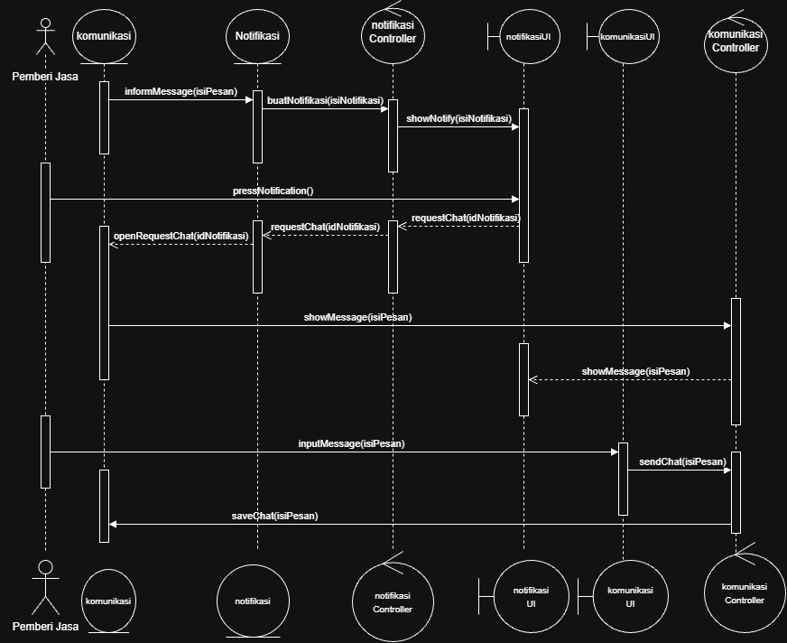
        </p>
        <p align="center">
        <i>Gambar X. Diagram Sequence UC04</i>
        </p>
    
</ul>

### 3.4.3 Diagram Kelas


<p align="center">
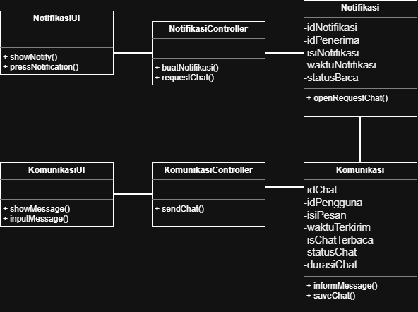
</p>
<p align="center">
<i>Gambar X. Diagram Kelas UC04</i>
</p>

## 3.5 Use Case 5
<b>ID Use Case: </b> UC05<br>
<b>Nama Use Case: </b> Pelanggan memasukkan kesepakatan harga dan pekerjaan

### 3.5.1 Identifikasi Kelas Use Case Memberi Rating
| ID Kelas | Nama Kelas | Deskripsi Kelas |
| :--- | :--- | :--- |
| C07 | Pelanggan | Pelanggan | 
| C16 | KontrakPekerjaan | KontrakPekerjaan | 
| C17 | KontrakPekerjaanUI | KontrakPekerjaanUI | 
| C18 | KontrakPekerjaanController | KontrakPekerjaanController | 


### 3.5.2 Sequence Diagram
<ul>
    <li>Skenario Normal <br>
        <p align="center">
        
        </p>
        <p align="center">
        <i>Gambar X. Diagram Sequence UC05</i>
        </p>
    
</ul>

### 3.5.3 Diagram Kelas


<p align="center">

</p>
<p align="center">
<i>Gambar X. Diagram Kelas UC05</i>
</p>

## 3.6 Use Case 6
<b>ID Use Case: </b> UC06<br>
<b>Nama Use Case: </b> Pemberi jasa telah selesai bekerja

### 3.6.1 Identifikasi Kelas Use Case Memberi Rating
| ID Kelas | Nama Kelas | Deskripsi Kelas |
| :--- | :--- | :--- |
| C04 | Pelanggan | Pelanggan | 
| C16 | KontrakPekerjaan | KontrakPekerjaan | 
| C17 | KontrakPekerjaanUI | KontrakPekerjaanUI | 
| C18 | KontrakPekerjaanController | KontrakPekerjaanController | 

### 3.6.2 Sequence Diagram
<ul>
    <li>Skenario Normal <br>
        <p align="center">
        
        </p>
        <p align="center">
        <i>Gambar X. Diagram Sequence UC06</i>
        </p>
    
</ul>

### 3.6.3 Diagram Kelas


<p align="center">

</p>
<p align="center">
<i>Gambar X. Diagram Kelas UC06</i>
</p>

## 3.7 Use Case 7

### 3.7.1 Identifikasi Kelas Use Case Pelanggan dan Pemberi Jasa Melaporkan Masalah
| ID Kelas | Nama Kelas Perancangan | Nama Kelas Analisis Terkait |
| :--- | :--- | :--- |
| C04 | PemberiJasa | PemberiJasa | 
| C05 | PemberiJasaUI | PemberiJasaUI | 
| C06 | PemberiJasaController | PemberiJasaController | 
| C07 | Pelanggan | Pelanggan | 
| C08 | PelangganUI | PelangganUI | 
| C09 | PelangganController | PelangganController | 
| C22 | TiketLaporan | TiketLaporan | 
| C23 | TiketLaporanUI | TiketLaporanUI | 
| C24 | TiketLaporanController | TiketLaporanController | 
| C28 | Notifikasi | Notifikasi | 
| C29 | NotifikasiUI | NotifikasiUI | 
| C30 | NotifikasiController | NotifikasiController | 


### 3.7.2 Sequence Diagram
<ul>
    <p align="center">
    
    </p>
    <p align="center">
    <i>Gambar 15. Diagram Sequence UC7</i>
    </p>
</ul>

### 3.7.3 Diagram Kelas
<p align="center">

</p>
<p align="center">
<i>Gambar 16. Diagram Kelas UC7</i>
</p>

## 3.8 Use Case 8

### 3.8.1 Identifikasi Kelas Use Case Pelanggan dan Pemberi Jasa Melaporkan Masalah
| ID Kelas | Nama Kelas Perancangan | Nama Kelas Analisis Terkait |
| :--- | :--- | :--- |
| C04 | PemberiJasa | PemberiJasa | 
| C05 | PemberiJasaUI | PemberiJasaUI | 
| C06 | PemberiJasaController | PemberiJasaController | 
| C07 | Pelanggan | Pelanggan | 
| C08 | PelangganUI | PelangganUI | 
| C09 | PelangganController | PelangganController | 
| C22 | TiketLaporan | TiketLaporan | 
| C23 | TiketLaporanUI | TiketLaporanUI | 
| C24 | TiketLaporanController | TiketLaporanController | 
| C28 | Notifikasi | Notifikasi | 
| C29 | NotifikasiUI | NotifikasiUI | 
| C30 | NotifikasiController | NotifikasiController | 


### 3.8.2 Sequence Diagram
<ul>
    <p align="center">
    
    </p>
    <p align="center">
    <i>Gambar 17. Diagram Sequence UC8</i>
    </p>
</ul>

### 3.8.3 Diagram Kelas
<p align="center">

</p>
<p align="center">
<i>Gambar 18. Diagram Kelas UC8</i>
</p>

## 3.9 Use Case 9

### 3.9.1 Identifikasi Kelas Use Case Layanan Pelanggan Merespon Pelanggan
| ID Kelas | Nama Kelas Perancangan | Nama Kelas Analisis Terkait |
| :--- | :--- | :--- |
| C10 | LayananPelanggan | LayananPelanggan | 
| C11 | LayananPelangganUI | LayananPelangganUI | 
| C12 | LayananPelangganController | LayananPelangganController | 
| C19 | Komunikasi | Komunikasi | 
| C20 | KomunikasiUI | KomunikasiUI | 
| C21 | KomunikasiController | KomunikasiController |
| C22 | TiketLaporan | TiketLaporan | 
| C23 | TiketLaporanUI | TiketLaporanUI | 
| C24 | TiketLaporanController | TiketLaporanController | 
| C28 | Notifikasi | Notifikasi | 
| C29 | NotifikasiUI | NotifikasiUI | 
| C30 | NotifikasiController | NotifikasiController | 


### 3.9.2 Sequence Diagram
<ul>
    <p align="center">
    
    </p>
    <p align="center">
    <i>Gambar 19. Diagram Sequence UC9</i>
    </p>
</ul>

### 3.9.3 Diagram Kelas
<p align="center">

</p>
<p align="center">
<i>Gambar 20. Diagram Kelas UC9</i>


## 3.10 Use Case 10
<b>ID Use Case: </b> UC10<br>
<b>Nama Use Case: </b> Memberi Rating

### 3.10.1 Identifikasi Kelas Use Case Memberi Rating
| ID Kelas | Nama Kelas Perancangan | Nama Kelas Analisis Terkait |
| :--- | :--- | :--- |
| C01 | Pengguna | Pengguna |     
| C02 | PenggunaUI | PenggunaUI |     
| C03 | PenggunaController | PenggunaController |     
| C04 | PemberiJasa | PemberiJasa |    
| C07 | Pelanggan | Pelanggan |    
| C16 | KontrakPekerjaan | KontrakPekerjaan |    
| C18 | KontrakPekerjaanController | KontrakPekerjaanController |    
| C25 | Rating | Rating |    
| C26 | RatingUI | RatingUI |    
| C27 | RatingController | RatingController |    

### 3.10.2 Sequence Diagram
<ul>
    <li>Skenario Normal <br>
        <p align="center">
        
        </p>
        <p align="center">
        <i>Gambar 21. Diagram Sequence UC10</i>
        </p>
    <li>Skenario Alternatif 1: Penyedia Jasa atau pengguna menutup popup yang telah dimunculkan atau menutup aplikasi setelah proses transaksi selesai
        <p align="center">
        
        </p>
        <p align="center">
        <i>Gambar 22. Diagram Sequence UC10 Alternatif 1</i>
        </p>
</ul>

### 3.10.3 Diagram Kelas


<p align="center">

</p>
<p align="center">
<i>Gambar 23. Diagram Kelas UC10</i>
</p>


## 3.11 Use Case 11
<b>ID Use Case: </b> UC11<br>
<b>Nama Use Case: </b> Memasuki akun dalam perangkat lunak

### 3.11.1 Identifikasi Kelas Use Case Memasuki akun dalam perangkat lunak
| ID Kelas | Nama Kelas | Deskripsi Kelas |
| :--- | :--- | :--- |
| C04 | PemberiJasa | PemberiJasa | 
| C05 | PemberiJasaUI | PemberiJasaUI | 
| C06 | PemberiJasaController | PemberiJasaController | 
| C07 | Pelanggan | Pelanggan | 
| C08 | PelangganUI | PelangganUI | 
| C09 | PelangganController | PelangganController | 
| C10 | LayananPelanggan | LayananPelanggan | 
| C11 | LayananPelangganUI | LayananPelangganUI | 
| C12 | LayananPelangganController | LayananPelangganController | 

### 3.11.2 Sequence Diagram
<ul>
    <li>Skenario Pelanggan 
        <p align="center">
        
        </p>
        <p align="center">
        <i>Gambar 24. Diagram Sequence UC10 Skenario Pelanggan</i>
        </p>
    <li>Skenario Pemberi Jasa
        <p align="center">
        
        </p>
        <p align="center">
        <i>Gambar 25. Diagram Sequence UC10 Skenario Pemberi Jasa</i>
        </p>
    <li> Skenario Layanan Pelanggan
        <p align="center">
        
        </p>
        <p align="center">
        <i>Gambar 26. Diagram Sequence UC10 Skenario Layanan Pelanggan</i>
        </p>
</ul>

### 3.11.3 Diagram Kelas
<p align="center">

</p>
<p align="center">
<i>Gambar 27. Diagram Kelas UC11</i>
</p>


## 3.12 Use Case 

<b>ID Use Case: </b> UC11<br>
<b>Nama Use Case: </b> Memasuki akun dalam perangkat lunak

### 3.12.1 Identifikasi Kelas Use Case Memasuki akun dalam perangkat lunak
| ID Kelas | Nama Kelas | Deskripsi Kelas |
| :--- | :--- | :--- |
| C01 | Pengguna | Pengguna | 
| C02 | PenggunaUI | PenggunaUI | 
| C03 | PenggunaController | PenggunaController | 
| C04 | PemberiJasa | PemberiJasa | 
| C07 | Pelanggan | Pelanggan | 

### 3.12.2 Sequence Diagram
<ul>
    <li>Skenario Pelanggan 
        <p align="center">
        
        </p>
        <p align="center">
        <i>Gambar 28. Diagram Sequence UC10 Skenario Pelanggan</i>
        </p>
    <li>Skenario Pemberi Jasa
        <p align="center">
        
        </p>
        <i>Gambar 29. Diagram Sequence UC10 Skenario Pelanggan</i>
        </p>


### 3.12.2 Diagram Kelas

<p align="center">

</p>
<p align="center">
<i>Gambar 30. Diagram Kelas UC11</i>
</p>


# BAB 4: Diagram Kelas Keseluruhan

## 4.1 Diagram Kelas

**Bagian ini diisi dengan diagram kelas keseluruhan.**

<p align="center">

</p>
<p align="center">
<i>Gambar 4.1. Diagram Kelas Perancangan Keseluruhan Cari Uang</i>
</p>

Tabel 4.1. Daftar Kelas Perancangan Keseluruhan

| Kode | Nama Class | Atribut | Metode |
| :--- | :--- | :--- | :--- |
| C01 | Pengguna | idPengguna<br>nomorTelpon<br>email<br>namaPengguna<br>username<br>password<br>akumulasiRating<br>riwayatRating | +getId()<br>+getNomor()<br>+getEmail()<br>+getNama()<br>+setNomor()<br>+setEmail()<br>+setNama()<br>+getAkumulasiRating()<br>+getRiwayatRating()<br>+addNewRatingRiwayat()<br>+konfirmasiPekerjaan()<br>+laporkanMasalah() |
| C02 | PenggunaUI | - | +showDaftarPekerjaanSelesai()<br>+pressBeriRating()<br>+tampilkanHalamanRegistrasi()<br>+showInformasiPekerjaanSelesai()<br>+pressRegister()<br>+pressBantuanLayanan()<br>+showInformasiPekerjaanSelesai() |
| C03 | PenggunaController | - | +triggerRating()<br>-verifikasiStatusPekerjaan()<br>+validasiInfoRegistrasi()<br>+requestKontrakPekerjaan()<br>+requestFormTiket() |
| C04 | PemberiJasa | jenisJasa<br>idKategoriJasa<br>-idPemberiJasa<br>-dataPemberiJasa | +getIDPemberiJasa()<br>+getIDKategoriJasa()<br>+setIDKategoriJasa()<br>+savePemberiJasa()<br>+makePemberiJasa()<br>+cekInfoLogin()<br>+laporkanMasalah()<br>+simpanKeDb()<br>+tampilkanSuksesRegistrasi()<br>+getPemberiJasaByID() |
| C05 | PemberiJasaUI | - | +tunjukkanHalamanLogin()<br>+pressLogin()<br>+pindahHalaman()<br>+pressPemberiJasa()<br>+pressChat()<br>+showPemberiJasaMap()<br>+pressBantuanLayanan()<br>+tampilkanError()<br>+showPemberiJasaKategori() |
| C06 | PemberiJasaController | - | +validatePemberiJasa()<br>+validasiInput()<br>+triggerQueryLogin()<br>+showPemberiJasaFromKategori()<br>+choosePemberiJasa()<br>+requestFormTiket()<br>+setInformasiPemberiJasa()<br>+fetchPemberiJasaById() |
| C07 | Pelanggan | - | +makePelanggan()<br>+cekInfoLogin()<br>+simpanKeDb() |
| C08 | PelangganUI | - | +tunjukkanHalamanLogin()<br>+pressLogin()<br>+pindahHalaman()<br>+tampilkanError()<br>+tampilkanSuksesRegistrasi() |
| C09 | PelangganController | - | +validasiInput()<br>+triggerQueryLogin() |
| C10 | LayananPelanggan | -idLayananPelanggan | +makeLayananPelanggan()<br>+cekInfoLogin()<br>+responTiket() |
| C11 | LayananPelangganUI | - | +tunjukkanHalamanLogin()<br>+pressLogin()<br>+pindahHalaman()<br>+showDaftarTiket()<br>+pressBukaTiket()<br>+tampilkanError() |
| C12 | LayananPelangganController | - | +validasiInput()<br>+triggerQueryLogin()<br>+requestTiketLaporan()<br>+teruskanBalasan() |
| C13 | KategoriJasa | idKategoriJasa<br>jenisJasa<br>tarif<br>jamKerja<br>daerahKerja<br>-dataKategoriJasa | +getIDKategoriJasa()<br>+getJenisJasa()<br>+getTarif()<br>+getJamKerja()<br>+getDaerahKerja()<br>+setTarif()<br>+setJamKerja()<br>+setDaerahKerja()<br>+saveKategoriJasa()<br>+getAllKategori()<br>+getKategoriById() |
| C14 | KategoriJasaUI | - | +pressOpenKategoriJasa()<br>+showFormKategoriJasa()<br>+pressSubmitKategoriJasa()<br>+inputDataKategoriJasa()<br>+showKategoriJasa()<br>+pressKategoriJasa()<br>+pressMenu()<br>+bukaHalamanKategoriJasa()<br>+isiFormJasa()<br>+showPendaftaranBerhasil()<br>+tampilkanPesanSukses()<br>+showAllKategoriJasa()<br>+showKategoriById() |
| C15 | KategoriJasaController | - | +validateKategoriJasa()<br>+submitFormKategoriJasa()<br>+filterKategoriJasa()<br>+showFormKategoriJasa()<br>+confirmDataTersimpan()<br>+updateDataPemberiJasa()<br>+showPendaftaranBerhasil()<br>+fetchAllKategoriJasa()<br>+fetchKategoriJasaById() |
| C16 | KontrakPekerjaan | idKontrakPekerjaan<br>detailPekerjaan<br>persetujuanHarga<br>statusPekerjaan<br>hasRating | +fetchKontrakPekerjaan()<br>+saveKontrak()<br>+getDetailPekerjaan()<br>+newKontrak()<br>+makeKontrak()<br>+statusUpdate()<br>+saveKontrak()<br>+addRating() |
| C17 | KontrakPekerjaanUI | - | +openHalamanKontrak()<br>+inputDetailPekerjaan()<br>+showKontrakForm()<br>+showDetailPekerjaan()<br>+pressPekerjaanSelesai()<br>+openDetailPekerjaan() |
| C18 | KontrakPekerjaanController | - | -getKontrakPekerjaan()<br>-statusUpdate()<br>-showKontrakForm()<br>-kirimInput() |
| C19 | Komunikasi | -idChat<br>-idPengguna<br>-isiPesan<br>-waktuTerkirim<br>-isChatTerbaca<br>-statusChat<br>-durasiChat<br>-dataChat | +simpanPesan()<br>+getPesan()<br>+getIDChat()<br>+getChatHistory()<br>+saveChat() |
| C20 | KomunikasiUI | - | +showChat()<br>+pressKirimBalasan()<br>+showChatChannel()<br>+inputMessage()<br>+pressSendChat()<br>+showMessage() |
| C21 | KomunikasiController | - | +kirimPesan()<br>+getRiwayatChat()<br>+loadChat()<br>+startChat()<br>+sendChat() |
| C22 | TiketLaporan | -idTiket<br>-idPengguna<br>-jenisTiket<br>-keteranganTiket<br>-tanggalTiket<br>-statusTiket | +getDetailTiket()<br>+updateStatusTiket() |
| C23 | TiketLaporanUI | - | +showDetailTiket()<br>+pressBalasTiket() |
| C24 | TiketLaporanController | - | +getTiketLaporan()<br>+balasTiket()<br>+tutupTiket() |
| C25 | Rating | idPenggunaPemberi<br>idPenggunaPenerima<br>idRating<br>idKontrakPekerjaan<br>nilaiRating<br>tanggalRating | +getIdPemberi()<br>+getIdPenerima()<br>+getIdKontrakPekerjaan()<br>+getIdRating()<br>+getRatingValue()<br>+updateRatingPengguna()<br>+makeRating()<br>+simpanKeDb() |
| C26 | RatingUI | - | +tampilkanRatingForm()<br>+tampilkanHasilRating()<br>+pressJumlahBintang()<br>+pressSubmitRating()<br>+pressBatalRating() |
| C27 | RatingController | - | +validateRatingValue() |
| C28 | Notifikasi | -idNotifikasi<br>-idPenerima<br>-isiNotifikasi<br>-waktuNotifikasi<br>-statusBaca | +getIsiNotifikasi()<br>+tandaiTerbaca()<br>+getLastMessage() |
| C29 | NotifikasiUI | - | -playSound()<br>-stopSound()<br>+showNotifikasi()<br>+closeNotifikasi()<br>+pressNotifikasi() |
| C30 | NotifikasiController | - | +buatNotifikasi()<br>+kirimNotifikasi() |

<br>


# BAB 5: Perancangan Rinci Kelas

Tabel 5.1. Daftar Kelas Perancangan dan Kelas Analisis Terkait
| No | Nama Kelas Perancangan | Nama Kelas Analisis Terkait |
| :--- | :--- | :--- |
| 1 | *Pengguna* | *Pengguna* |
| 2 | *PenggunaController* | *PenggunaController* |
| 3 | *PemberiJasa* | *PemberiJasa* |
| 4 | *PemberiJasaController* | *PemberiJasaController* |
| 5 | *Pelanggan* | *Pelanggan* |
| 6 | *PelangganController* | *PelangganController* |
| 7 | *LayananPelanggan* | *LayananPelanggan* |
| 8 | *LayananPelangganController* | *LayananPelangganController* |
| 9 | *KategoriJasa* | *KategoriJasa* |
| 10 | *KategoriJasaController* | *KategoriJasaController* |
| 11 | *KontrakPekerjaan* | *KontrakPekerjaan* |
| 12 | *KontrakPekerjaanController* | *KontrakPekerjaanController* |
| 13 | *Komunikasi* | *Komunikasi* |
| 14 | *KomunikasiController* | *KomunikasiController* |
| 15 | *TiketLaporan* | *TiketLaporan* |
| 16 | *TiketLaporanController* | *TiketLaporanController* |
| 17 | *Rating* | *Rating* |
| 18 | *RatingController* | *RatingController* |
| 19 | *Notifikasi* | *Notifikasi* |
| 20 | *NotifikasiController* | *NotifikasiController* |
| ... | *...* | *...* |


## 5.1 Kelas Pengguna

**Nama Kelas:** Pengguna <br>
**ID Kelas:** C01

Tabel 5.1.1. Operasi Kelas Pengguna

| Nama Operasi | Visibility (private, public) | Keterangan |
| :--- | :--- | :--- |
| `getId(): String` | public | Mengembalikan ID unik pengguna |
| `getNomor(): String` | public | Mengembalikan nomor telepon pengguna |
| `getEmail(): String` | public | Mengembalikan alamat email pengguna |
| `getNama(): String` | public | Mengembalikan nama lengkap pengguna |
| `setNomor(nomorBaru: String): void` | public | Memperbarui nomor telepon pengguna |
| `setEmail(emailBaru: String): void` | public | Memperbarui alamat email pengguna |
| `setNama(namaBaru: String): void` | public | Memperbarui nama pengguna |
| `getAkumulasiRating(): Float` | public | Mengembalikan rata-rata akumulasi rating pengguna |
| `getRiwayatRating(): Float[]` | public | Mengembalikan daftar riwayat rating yang pernah diterima pengguna |
| `addNewRatingRiwayat(nilaiRating: Float): void` | public | Menambahkan nilai rating baru ke dalam riwayat rating pengguna |
| `konfirmasiPekerjaan(idKontrak: String): Boolean` | public | Mengonfirmasi bahwa pekerjaan pada kontrak terkait telah selesai |
| `laporkanMasalah(): void` | public | Melaporkan kendala atau masalah pekerjaan kepada layanan pelanggan |rating pengguna |

 
Tabel 5.1.2. Atribut Kelas Pengguna

| Nama Atribut | Visibility (private, public) | Tipe |
| :--- | :--- | :--- |
| idPengguna | private | String |
| nomorTelepon | private | String |
| email | private | String | 
| namaPengguna | private | String |
| akumulasiRating | private | Float |
| riwayatRating | private | Float[] | 
| username | private | String |
| passwordHash | private | String |

### 5.1.1 Algoritma/Query

**Nama Kelas:**  
**Nama Operasi:** 
**ID Algoritma:** 


```text

```

Jika operasi mengacu pada query tertentu, lengkapi tabel berikut. 

Tabel 5.1.1. Query Opersi [Nama Operasi]
| No Query | Query | Keterangan |
| :--- | :--- | :--- |
| *[Q-001]* | *[Tuliskan query]* | *[Fungsi query]* |
| *...* | *...* | *...* |


### 5.1.2 Algoritma/Query

*[Ulangi pola 5.1.1 untuk operasi penting berikutnya pada kelas yang sama, jika ada.]*


## 5.2 Kelas PenggunaController

**Nama Kelas:** *[Nama kelas]*  
**ID Kelas:** *[ID kelas]*

Tabel 5.2.1. Operasi Kelas [Nama Kelas 2]

| Nama Operasi | Visibility (private, public) | Keterangan |
| :--- | :--- | :--- |
| `triggerRating(idKontrak: String, nilaiRating: Float): Boolean` | public | Memicu proses pemberian dan penyimpanan rating setelah pekerjaan selesai |
| `verifikasiStatusPekerjaan(idKontrak: String): Boolean` | private | Memverifikasi apakah status kontrak pekerjaan sudah selesai sebelum diberi rating |
| `validasiInfoRegistrasi(dataRegistrasi: Object): Boolean` | public | Memvalidasi kelengkapan dan format data masukan saat registrasi akun pengguna |
| `requestKontrakPekerjaan(idKontrak: String): KontrakPekerjaan` | public | Meminta data detail kontrak pekerjaan berdasarkan ID kontrak |
| `requestFormTiket(): void` | public | Meminta tampilan formulir pelaporan masalah untuk pengguna |
| *...* | *...* | *...* |

Tabel 5.2.2. Atribut Kelas [Nama Kelas 2]

| Nama Atribut | Visibility (private, public) | Tipe |
| :--- | :--- | :--- |
| *[Nama atribut]* | *[Visibility]* | *[Tipe sesuai bahasa pemrograman yang digunakan]* |
| *...* | *...* | *...* |

### 5.2.1 Algoritma/Query

Bagian ini diisi untuk kerangka algoritma proses yang dianggap cukup penting. Algoritma dapat dituliskan sebagai *pseudocode*. Implementasi *skeleton code* juga dapat digunakan untuk kelas yang sudah terdefinisi pada bahasa pemrograman tertentu.

**Nama Kelas:** *[Nama kelas]*  
**Nama Operasi:** *[Signature operasi]*  
**ID Algoritma:** *[Algo-001]*

```text
[Tuliskan pseudocode algoritma operasi di sini.]
```

Jika operasi mengacu pada query tertentu, lengkapi tabel berikut. 

Tabel 5.2.1. Query Operasi [Nama Operasi]

| No Query | Query | Keterangan |
| :--- | :--- | :--- |
| *[Q-001]* | *[Tuliskan query]* | *[Fungsi query]* |
| *...* | *...* | *...* |


### 5.2.2 Algoritma/Query

*[Ulangi pola 5.2.1 untuk operasi penting berikutnya pada kelas yang sama, jika ada.]*


## 5.3 Kelas PemberiJasa
## 5.3 Kelas PemberiJasa

**Nama Kelas:** PemberiJasa  
**ID Kelas:** C04
**Nama Kelas:** *PemberiJasa*  
**ID Kelas:** *C04*

Tabel 5.3.1 Operasi Kelas PemberiJasa

| Nama Operasi | Visibility (private, public) | Keterangan |
| :--- | :--- | :--- |
| `cekInfoLogin(input username: String, input password: String): Boolean` | public | Menjalankan query ke database untuk memeriksa kecocokan informasi login dengan tabel pengguna |
| `makePemberiJasa(input idPengguna: String, input namaPengguna: String, input username: String, input password: String, input email: String, input nomorTelpon: String, input idKategoriJasa: String, input jenisJasa: String): PemberiJasa` | public | Memverifikasi keunikan akun di database lalu membuat objek PemberiJasa baru |
| `simpanKeDb(): void` | public | Menyimpan data objek pengguna dan pemberi jasa baru ke dalam database |
| `getIDPemberiJasa(): String` | public | Mengembalikan ID unik pemberi jasa |
| `getIDKategoriJasa(): String` | public | Mengembalikan ID kategori jasa yang dimiliki pemberi jasa |
| `setIDKategoriJasa(idKategoriJasa: String): void` | public | Mengatur atau memperbarui ID kategori jasa pada pemberi jasa |
| `savePemberiJasa(): void` | public | Memperbarui data kategori jasa dan jenis jasa pemberi jasa ke dalam database |
| `getPemberiJasaByID(idPemberiJasa: String): Object` | public | Mengambil detail profil, lokasi/daerah kerja, rating, dan tarif pemberi jasa berdasarkan ID |
| `getPemberiJasaByKategori(idKategoriJasa: String): List<Object>` | public | Mengambil daftar pemberi jasa yang tersedia berdasarkan ID kategori jasa |
| `laporkanMasalah(): void` | public | Pemberi jasa melaporkan masalah kepada layanan pelanggan |
| `tampilkanSuksesRegistrasi(): void` | public | Menampilkan konfirmasi bahwa registrasi akun pemberi jasa berhasil |

Tabel 5.3.2 Atribut Kelas PemberiJasa

| Nama Atribut | Visibility (private, public) | Tipe |
| :--- | :--- | :--- |
| *[Nama atribut]* | *[Visibility]* | *[Tipe sesuai bahasa pemrograman yang digunakan]* |
| *...* | *...* | *...* |

### 5.3.1 Algoritma/Query

**Nama Kelas:** PemberiJasa <br>
**Nama Operasi:** cekInfoLogin <br>
**ID Algoritma:** Algo-XXX

```text
public function cekInfoLogin(input username:String, input password:String)
KAMUS LOKAL
correctPassword: Boolean
userRecord: Row Table Pengguna

ALGORITMA
    if (username.strip = "" or password.strip = "") then
        --> false
    userRecord <- execute_query(Q-XXX, [trim(username)])
    
    if (userRecord = NUL) then
        {Mensimulasikan proses check hasing}
        verify_hash(password, "algoritma_hashing(data_dummy)")
        return false
    isPasswordValid <-- verify_hash(password, userRecord.passwordHash)
    if not(isPasswordValid) then
        --> false
    {Insialisasi Objek lokal jika kredensial valid}
    this.idPengguna <- userRecord.id_pengguna
    this.username <- userRecord.username
    this.email <- userRecord.email
    this.namaPengguna <- userRecord.nama_pengguna
    --> true

```

### 5.3.2 Algoritma/Query

**Nama Kelas:** PemberiJasa
**Nama Operasi:** getPemberiJasaByID()
**ID Algoritma:** Algo-XXX
```text
PRIVATE dataPemberiJasa : Object
PUBLIC function getPemberiJasaByID(idPemberiJasa : String) -> Object
    rows : Object
    rows <- // execute query data Pemberi Jasa berdasarkan ID

    this.dataPemberiJasa <- rows
    -> this.dataPemberiJasa
```

### 5.3.3 Algoritma/Query

**Nama Kelas:** PemberiJasa
**Nama Operasi:** getPemberiJasaByKategori()
**ID Algoritma:** Algo-XXX
```text
PRIVATE idPemberiJasa : String
PUBLIC  idKategoriJasa : String
PUBLIC  jenisJasa : String
PUBLIC function getPemberiJasaByKategori(idKategoriJasa : String) -> List<Object>
    rows : List <Object>
    rows <- // execute querydaftar Pemberi Jasa yang tersedia berdasarkan ID Kategori Jasa 
    -> rows
```

Tabel 5.3.3 Query Operasi cekInfoLogin

| No Query | Query | Keterangan |
| :--- | :--- | :--- |
| Q-XXX | `SELECT id_pengguna, nama_pengguna, username, password, email FROM pengguna WHERE username = $1;` | Mengambil data akun dan hash password dari tabel pengguna berdasarkan nama pengguna. |

### 5.3.2 Algoritma/Query

**Nama Kelas:** PemberiJasa <br>
**Nama Operasi:** getPemberiJasaByID() <br>
**ID Algoritma:** Alg-XXX

```text
PRIVATE dataPemberiJasa : Object
// Mengambil detail profil, lokasi, rating, dan tarif Pemberi Jasa berdasarkan ID
PUBLIC function getPemberiJasaByID(idPemberiJasa : String) -> Object
    rows : Object
    rows <- execute_query(Q-XXX, [idPemberiJasa])

    this.dataPemberiJasa <- rows
    -> this.dataPemberiJasa
```

Tabel 5.3.4 Query Operasi getPemberiJasaByID

| No Query | Query | Keterangan |
| :--- | :--- | :--- |
| Q-XXX | `SELECT pj.id_pemberi_jasa, u.nama_pengguna, u.nomor_telpon, u.email, u.akumulasi_rating, pj.id_kategori_jasa, pj.jenis_jasa, kj.deskripsi_jasa, kj.tarif, kj.jam_kerja, kj.daerah_kerja FROM pemberi_jasa pj JOIN pengguna u ON pj.id_pemberi_jasa = u.id_pengguna LEFT JOIN kategori_jasa kj ON pj.id_kategori_jasa = kj.id_kategori_jasa WHERE pj.id_pemberi_jasa = $1;` | Mengambil detail profil, lokasi/daerah kerja, rating, dan tarif Pemberi Jasa berdasarkan ID. |

### 5.3.3 Algoritma/Query

**Nama Kelas:** PemberiJasa <br>
**Nama Operasi:** getPemberiJasaByKategori() <br>
**ID Algoritma:** Alg-XXX

```text
PRIVATE idPemberiJasa : String
PUBLIC  idKategoriJasa : String
PUBLIC  jenisJasa : String
// Mengambil daftar Pemberi Jasa yang tersedia berdasarkan ID Kategori Jasa 
PUBLIC function getPemberiJasaByKategori(idKategoriJasa : String) -> List<Object>
    rows : List <Object>
    rows <- execute_query(Q-XXX, [idKategoriJasa])
    -> rows
```

Tabel 5.3.5 Query Operasi getPemberiJasaByKategori

| No Query | Query | Keterangan |
| :--- | :--- | :--- |
| Q-XXX | `SELECT pj.id_pemberi_jasa, u.nama_pengguna, u.akumulasi_rating, pj.id_kategori_jasa, pj.jenis_jasa FROM pemberi_jasa pj JOIN pengguna u ON pj.id_pemberi_jasa = u.id_pengguna WHERE pj.id_kategori_jasa = $1;` | Mengambil daftar Pemberi Jasa yang tersedia berdasarkan ID Kategori Jasa. |

### 5.3.4 Algoritma/Query

**Nama Kelas:** PemberiJasa <br>
**Nama Operasi:** savePemberiJasa() <br>
**ID Algoritma:** Alg-XXX

```text
PRIVATE idPemberiJasa : String
PUBLIC  idKategoriJasa : String
PUBLIC  jenisJasa : String
PUBLIC procedure savePemberiJasa() 
    execute_query(Q-XXX, [this.idKategoriJasa, this.idPemberiJasa])
```

Tabel 5.3.6 Query Operasi savePemberiJasa

| No Query | Query | Keterangan |
| :--- | :--- | :--- |
| Q-XXX | `UPDATE pemberi_jasa SET id_kategori_jasa = $1, jenis_jasa = (SELECT jenis_jasa FROM kategori_jasa WHERE id_kategori_jasa = $1) WHERE id_pemberi_jasa = $2;` | Memperbarui data kategori jasa dan jenis jasa pada tabel pemberi_jasa berdasarkan ID Pemberi Jasa. |

### 5.3.5 Algoritma/Query
**Nama Kelas:** PemberiJasa <br>
**Nama Operasi:** makePemberiJasa <br>
**ID Algoritma:** Algo-XXX


```text
public function makePelanggan(input idPengguna: String, input namaPengguna: String, input username: String, input password: String, input email: String, input nomorTelpon: String, input idKategoriJasa: String,   input jenisJasa: String) -> PemberiJasa
KAMUS LOKAL
record: SQL query row result
pemberijasa: PemberiJasa

ALGORITMA
    if (trim(username) = "" or trim(namaPengguna) = "" or trim(idPengguna) = "")
        --> false
    if (not(validEmail(email))) then
        --> false
    if (not isNumericString(nomorTelpon) or length(nomorTelpon) < 10) then
        --> false

    {Check if info is in db}
    record <- execute_query(Q-XXX, [trim(username), trim(email)])
    if (isExist is not null) then
        --> false

    pemberijasa.idPengguna <- idPengguna
    pemberijasa.namaPengguna <- namaPengguna
    pemberijasa.username <- trim(username)
    pemberijasa.password <- password
    pemberijasa.email <- trim(email)
    pemberijasa.nomorTelpon <- nomorTelpon
    pemberijasa.akumulasiRating <- 0.0
    pemberijasa.riwayatRating <- []

    pemberijasa.idKategoriJasa <- idKategoriJasa
    pemberijasa.jenisJasa <- jenisJasa
    --> pemberijasa
```
Tabel 5.3.7 Query Operasi makePemberiJasa

| No Query | Query | Keterangan |
| :--- | :--- | :--- |
| Q-XXX | `SELECT id_pengguna FROM pengguna WHERE username = $1 OR email = $2;` | Mencari sebuah entry dengan username dan pengguna |

### 5.3.6 Algoritma/Query
**Nama Kelas:** PemberiJasa <br>
**Nama Operasi:** simpanKeDb() <br>
**ID Algoritma:** Algo-XXX

```text
public function simpanKeDb() -> void
execute_query(Q-XXX, [
            this.idPengguna,
            this.namaPengguna,
            this.username,
            this.password,
            this.email,
            this.nomorTelpon
        ])
execute_query(Q-XXX, this.idPengguna, this.idKategoriJasa,this.jenisJasa)
```
Tabel 5.3.8 Query Operasi simpanKeDb

| No Query | Query | Keterangan |
| :--- | :--- | :--- |
| Q-XXX | `INSERT INTO pengguna (id_pengguna, nama_pengguna, username, password, email, nomor_telpon, akumulasi_rating, riwayat_rating) VALUES ($1, $2, $3, $4, $5, $6, 0.0, '{}'); | Menyimpan objek pelanggan dalam database | 
| Q-XXX | `INSERT INTO pemberi_jasa (id_pengguna, id_kategori_jasa, jenis_jasa) VALUES ($1, $2, $3)` | |


## 5.4 Kelas PemberiJasaController

**Nama Kelas:** PemberiJasaController
**ID Kelas:** C06

Tabel 5.4.1. Operasi Kelas PemberiJasaController

| Nama Operasi | Visibility (private, public) | Keterangan |
| :--- | :--- | :--- |
| requestFormTiket() | Public | Meminta form tiket untuk diisi dan dikirimkan le layanan pelanggan |
| `validatePemberiJasa(idPemberiJasa: String): Boolean` | public | Memvalidasi keberadaan dan keabsahan ID pemberi jasa |
| `validasiInput(): Boolean` | public | Memvalidasi masukan data dari antarmuka pemberi jasa |
| `triggerQueryLogin(username: String, password: String): Boolean` | public | Memicu proses autentikasi login untuk akun pemberi jasa |
| `setInformasiKategoriJasa(idKategoriJasa: String): void` | public | Mengatur informasi ID kategori jasa pada objek pemberi jasa |
| `fetchPemberiJasaById(idPemberiJasa: String): void` | public | Mengambil data detail pemberi jasa berdasarkan ID dan menampilkannya ke UI |
| `showPemberiJasaFromKategori(idKategoriJasa: String): List<Object>` | public | Mengambil dan menampilkan daftar pemberi jasa berdasarkan kategori jasa tertentu |
| `choosePemberiJasa(idPemberiJasa: String): Object` | public | Memilih pemberi jasa tertentu dan mengembalikan detail profilnya |
| `requestFormTiket(): void` | public | Meminta form tiket untuk diisi dan dikirimkan ke layanan pelanggan |


### 5.4.1 Algoritma/Query

**Nama Kelas:** PemberiJasaController
**Nama Operasi:** validatePemberiJasa(idPemberiJasa : String)  
**ID Algoritma:** [Algo-001]

```text
PUBLIC function validatePemberiJasa(idPemberiJasa : String) -> Boolean
    IF (isEmpty(idPemberiJasa)) THEN
        -> FALSE
    -> TRUE
```
### 5.4.2 Algoritma/Query
**Nama Kelas:** PemberiJasaController
**Nama Operasi:** setInformasiKategoriJasa(idKategoriJasa : String)  
**ID Algoritma:** [Algo-001]

```text
PUBLIC procedure setInformasiKategoriJasa(idKategoriJasa : String)
    this.pemberiJasa.idKategoriJasa <- idKategoriJasa
```
### 5.4.3 Algoritma/Query
**Nama Kelas:** PemberiJasaController
**Nama Operasi:** fetchPemberiJasaById(idPemberiJasa : String)
**ID Algoritma:** [Algo-001]

```text
PRIVATE pemberiJasaUI : PemberiJasaUI
PUBLIC procedure fetchPemberiJasaById(idPemberiJasa : String)
    IF (not isEmpty(idPemberiJasa)) THEN
        dataPemberiJasa <- this.pemberiJasa.getPemberiJasaByID(idPemberiJasa)
        this.pemberiJasaUI.showPemberiJasaKategori(dataPemberiJasa)
```
### 5.4.4 Algoritma/Query
**Nama Kelas:** PemberiJasaController
**Nama Operasi:** showPemberiJasaFromKategori(idKategoriJasa : String)
**ID Algoritma:** [Algo-001]

```text
PRIVATE pemberiJasa : PemberiJasa
PUBLIC function showPemberiJasaFromKategori(idKategoriJasa : String) -> List<Object>
    -> this.pemberiJasa.getPemberiJasaByKategori(idKategoriJasa)
```
### 5.4.5 Algoritma/Query
**Nama Kelas:** PemberiJasaController
**Nama Operasi:** choosePemberiJasa(idPemberiJasa : String)
**ID Algoritma:** [Algo-001]

```text
PRIVATE pemberiJasa : PemberiJasa
PUBLIC function choosePemberiJasa(idPemberiJasa : String) -> Object
    -> this.pemberiJasa.getPemberiJasaByID(idPemberiJasa)
```

| validasiInfoRegistrasi(input namaPengguna: String, input username: String, input password: String, input email: String, input nomorTelpon: String): Boolean | public | Memvalidasi input yang digunakan user dalam registrasi |

### 5.4.6 Algoritma/Query
**Nama Kelas:** PemberiJasaController  
**Nama Operasi:** validasiInfoRegistrasi
**ID Algoritma:** Algo-XXX

```text
public function validasiInfoRegistrasi(input namaPengguna: String, input username: String, input password: String, input email: String, input nomorTelpon: String): Boolean

ALGORITMA
    if (trim(namaPengguna) = "" or trim(username) = "" or trim(password) = "" or trim(email) = "" or trim(nomorTelpon) = "") then
        --> false
    if (length(password) < 8) then
        --> false
    if (not isValidEmailFormat(email)) then
        --> false
    if (not isNumericString(nomorTelpon) or length(nomorTelpon) < 10 or length(nomorTelpon) > 15) then
        --> false
    --> true
```

## 5.5 Kelas Pelanggan

**Nama Kelas:** *Pelanggan*  
**ID Kelas:** *C07*
**Nama Kelas:** Pelanggan <br> 
**ID Kelas:** C07

Tabel 5.5.1 Operasi Kelas Pelanggan

| Nama Operasi | Visibility (private, public) | Keterangan |
| :--- | :--- | :--- |
| `cekInfoLogin(input username: String, input password: String): Boolean` | public | Menjalankan query ke database untuk melihat apakah informasi login yang digunakan sesuai dengan informasi pada tabel pengguna |
| `simpanKeDb(): void`| public | Menyimpan objek ke database |
| `laporkanMasalah(idTiket: String, jenisTiket: String, keteranganTiket: String):Boolean` | public | fungsi untuk membuat tiket masalah yang terjadi |

### 5.5.1 Algoritma/Query
**Nama Kelas:** *Pelanggan*  
**Nama Operasi:** *laporkanMasalah()*  
**ID Algoritma:** *[Algo-001]*

```text
public function laporkanMasalah(input idTiket: String,input jenisTiket: String,input keteranganTiket: String)-> Boolean

ALGORITMA
    if (trim(idTiket) == "" or trim(jenisTiket) == "" or trim(keteranganTiket) == "") then
        --> false
    if (trim(this.idPengguna) == "") then
        --> false
    execute_query(Q-Tiket-001, [
            idTiket,
            this.idPengguna,
            jenisTiket,
            keteranganTiket
        ])
    --> true
```
Tabel 5.3.5 Query Operasi laporkanMasalah

| No Query | Query | Keterangan |
| :--- | :--- | :--- |
| Q-XXX | `INSERT INTO tiket_laporan (id_tiket, id_pengguna, jenis_tiket, keterangan_tiket, tanggal_tiket, status_tiket) VALUES ($1, $2, $3, $4, NOW(), 'Open');` | Menyimpan objek tiket dalam database | 


### 5.5.2 Algoritma/Query
**Nama Kelas:** Pelanggan 
**Nama Operasi:** cekInfoLogin
**ID Algoritma:** Algo-XXX

```text
public function cekInfoLogin(input username:String, input password:String)
KAMUS LOKAL
correctPassword: Boolean
userRecord: Row Table Pengguna

ALGORITMA
    if (username.strip = "" or password.strip = "") then
        --> false
    userRecord <- execute_query(Q-XXX, [trim(username)])
    
    if (userRecord = NUL) then
        {Mensimulasikan proses check hasing}
        verify_hash(password, "algoritma_hashing(data_dummy)")
        return false
    isPasswordValid <-- verify_hash(password, userRecord.passwordHash)
    if not(isPasswordValid) then
        --> false
    {Insialisasi Objek lokal jika kredensial valid}
    this.idPengguna <- userRecord.id_pengguna
    this.username <- userRecord.username
    this.email <- userRecord.email
    this.namaPengguna <- userRecord.nama_pengguna
    --> true
```

Tabel 5.5.3 Query Operasi cekInfoLogin

| No Query | Query | Keterangan |
| :--- | :--- | :--- |
| Q-XXX | `SELECT id_pengguna, nama_pengguna, username, password, email FROM pengguna WHERE username = $1;` | Mengambil data akun dan hash password dari tabel pengguna berdasarkan nama pengguna. |

### 5.5.3 Algoritma/Query
**Nama Kelas:** Pelanggan <br>
**Nama Operasi:** makePelanggan <br>
**ID Algoritma:** Algo-XXX

```text
public function makePelanggan(input idPengguna: String, input namaPengguna: String, input username: String, input password: String, input email: String, input nomorTelpon: String) -> Pelanggan
KAMUS LOKAL
record: SQL query row result
pelanggan: Pelanggan

ALGORITMA
    if (trim(username) = "" or trim(namaPengguna) = "" or trim(idPengguna) = "")
        --> false
    if (not(validEmail(email))) then
        --> false
    if (not isNumericString(nomorTelpon) or length(nomorTelpon) < 10) then
        --> false

    {Check if info is in db}
    record <- execute_query(Q-XXX, [trim(username), trim(email)])
    if (isExist is not null) then
        --> false

    pelanggan.idPengguna <- idPengguna
    pelanggan.namaPengguna <- namaPengguna
    pelanggan.username <- trim(username)
    pelanggan.password <- password
    pelanggan.email <- trim(email)
    pelanggan.nomorTelpon <- nomorTelpon
    pelanggan.akumulasiRating <- 0.0
    pelanggan.riwayatRating <- []
    --> pelanggan
```
Tabel 5.5.4 Query Operasi makePelanggan

| No Query | Query | Keterangan |
| :--- | :--- | :--- |
| Q-XXX | `SELECT id_pengguna FROM pengguna WHERE username = $1 OR email = $2;` | Mencari sebuah entry dengan username dan pengguna |

### 5.5.4 Algoritma/Query
**Nama Kelas:** Pelanggan <br>
**Nama Operasi:** simpanKeDb() <br>
**ID Algoritma:** Algo-XXX

```text
public function simpanKeDb() -> void
execute_query(Q-Reg-001, [
            this.idPengguna,
            this.namaPengguna,
            this.username,
            this.password,
            this.email,
            this.nomorTelpon
        ])
```
Tabel 5.5.5 Query Operasi simpanKeDb

| No Query | Query | Keterangan |
| :--- | :--- | :--- |
| Q-XXX | `INSERT INTO pengguna (id_pengguna, nama_pengguna, username, password, email, nomor_telpon, akumulasi_rating, riwayat_rating) VALUES ($1, $2, $3, $4, $5, $6, 0.0, '{}'); | Menyimpan objek pelanggan dalam database | 


## 5.6 Kelas PelangganController

**Nama Kelas:** PelangganController
**ID Kelas:** C09

Tabel 5.6.1. Operasi Kelas [Nama Kelas 6]

| Nama Operasi | Visibility (private, public) | Keterangan |
| :--- | :--- | :--- |
| validasiInfoRegistrasi(input namaPengguna: String, input username: String, input password: String, input email: String, input nomorTelpon: String): Boolean | public | Memvalidasi input yang digunakan user dalam registrasi |

### 5.6.1 Algoritma/Query
**Nama Kelas:** PelangganController  
**Nama Operasi:** validasiInfoRegistrasi
**ID Algoritma:** Algo-XXX

```text
public function validasiInfoRegistrasi(input namaPengguna: String, input username: String, input password: String, input email: String, input nomorTelpon: String): Boolean

ALGORITMA
    if (trim(namaPengguna) = "" or trim(username) = "" or trim(password) = "" or trim(email) = "" or trim(nomorTelpon) = "") then
        --> false
    if (length(password) < 8) then
        --> false
    if (not isValidEmailFormat(email)) then
        --> false
    if (not isNumericString(nomorTelpon) or length(nomorTelpon) < 10 or length(nomorTelpon) > 15) then
        --> false
    --> true
```

Jika operasi mengacu pada query tertentu, lengkapi tabel berikut. 

Tabel 5.6.1. Query Operasi [Nama Operasi]

| No Query | Query | Keterangan |
| :--- | :--- | :--- |
| *[Q-001]* | *[Tuliskan query]* | *[Fungsi query]* |
| *...* | *...* | *...* |


### 5.6.2 Algoritma/Query

*[Ulangi pola 5.6.1 untuk operasi penting berikutnya pada kelas yang sama, jika ada.]*


## 5.7 Kelas LayananPelanggan
**Nama Kelas:** LayananPelanggan <br>
**ID Kelas:** C10
Tabel 5.7.1 Operasi Kelas LayananPelanggan
| Nama Operasi | Visibility (private, public) | Keterangan |
| :--- | :--- | :--- |
| `cekInfoLogin(input username: String, input password: String): Boolean` | public | Menjalankan query ke database untuk melihat apakah informasi login sesuai dengan informasi pada tabel pengguna |
| `makeLayananPelanggan(input idPengguna: String, input namaPengguna: String, input username: String, input password: String, input email: String, input nomorTelpon: String): LayananPelanggan` | public | Membuat objek LayananPelanggan baru setelah memvalidasi data akun |
| `responTiket(idTiket: String, balasan: String): Boolean` | public | Memberikan respons atau tindak lanjut terhadap tiket laporan masalah yang masuk |
| cariLayananKosong() : String | Public | Menjalankan query untuk mencari layanan pelanggan yang dapat meng-handle tiket

Tabel 5.7.2 Atribut Kelas LayananPelanggan

| Nama Atribut | Visibility (private, public) | Tipe |
| :--- | :--- | :--- |
| *[Nama atribut]* | *[Visibility]* | *[Tipe sesuai bahasa pemrograman yang digunakan]* |
| idLayananPelanggan | Private | String |
| jumlahTiketDipegang | Private | Integer |
| statusAktif | Private | Boolean |

### 5.7.1 Algoritma/Query

**Nama Kelas:** LayananPelanggan  
**Nama Operasi:** cekInfoLogin
**ID Algoritma:** Algo-XXX

```text
public function cekInfoLogin(input username:String, input password:String)
KAMUS LOKAL
correctPassword: Boolean
userRecord: Row Table Pengguna

ALGORITMA
    if (username.strip = "" or password.strip = "") then
        --> false
    userRecord <- execute_query(Q-XXX, [trim(username)])
    
    if (userRecord = NUL) then
        {Mensimulasikan proses check hasing}
        verify_hash(password, "algoritma_hashing(data_dummy)")
        return false
    isPasswordValid <-- verify_hash(password, userRecord.passwordHash)
    if not(isPasswordValid) then
        --> false
    {Insialisasi Objek lokal jika kredensial valid}
    this.idPengguna <- userRecord.id_pengguna
    this.username <- userRecord.username
    this.email <- userRecord.email
    this.namaPengguna <- userRecord.nama_pengguna
    --> true
```
Tabel 5.7.3 Query Operasi cekInfoLogin

| No Query | Query | Keterangan |
| :--- | :--- | :--- |
| Q-XXX | `SELECT id_pengguna, nama_pengguna, username, password, email FROM pengguna WHERE username = $1;` | Mengambil data akun dan hash password dari tabel pengguna berdasarkan nama pengguna. |

### 5.7.2 Algoritma/Query

**Nama Kelas:** *LayananPelanggan*  
**Nama Operasi:** *cariLayananKosong()*  
**ID Algoritma:** *[Algo-001]*

```text
public cariLayananKosong() : String {
    -> execute_query(Q-001)
}
```

Tabel 5.8.1. Query Operasi cariLayananKosong()

| No Query | Query | Keterangan |
| :--- | :--- | :--- |
| `validasiInput(): Boolean` | public | Memvalidasi masukan data pada antarmuka layanan pelanggan |
| `triggerQueryLogin(username: String, password: String): Boolean` | public | Memicu proses pengecekan login bagi petugas layanan pelanggan |
| `requestTiketLaporan(): List<TiketLaporan>` | public | Mengambil daftar tiket laporan masalah yang masuk untuk ditindaklanjuti |
| `teruskanBalasan(idTiket: String, balasan: String): void` | public | Meneruskan balasan atau solusi dari layanan pelanggan kepada pelapor |

Tabel 5.8.2. Atribut Kelas [Nama Kelas 8]

| Nama Atribut | Visibility (private, public) | Tipe |
| :--- | :--- | :--- |
| *[Nama atribut]* | *[Visibility]* | *[Tipe sesuai bahasa pemrograman yang digunakan]* |
| *...* | *...* | *...* |

### 5.8.1 Algoritma/Query

Bagian ini diisi untuk kerangka algoritma proses yang dianggap cukup penting. Algoritma dapat dituliskan sebagai *pseudocode*. Implementasi *skeleton code* juga dapat digunakan untuk kelas yang sudah terdefinisi pada bahasa pemrograman tertentu.

**Nama Kelas:** *[Nama kelas]*  
**Nama Operasi:** *[Signature operasi]*  
**ID Algoritma:** *[Algo-001]*

```text
[Tuliskan pseudocode algoritma operasi di sini.]
```

Jika operasi mengacu pada query tertentu, lengkapi tabel berikut. 

Tabel 5.8.1. Query Operasi [Nama Operasi]

| No Query | Query | Keterangan |
| :--- | :--- | :--- |
| validasiInput() | Public | Memvalidasi input yang dikirim pada form |
| requestTiketLaporan() | Public | Meminta tiket laporan yang sesuai |
| teruskanBalasan() | Public | Meneruskan balasan mengenai tiket laporan |

### 5.8.1 Algoritma/Query


## 5.9 Kelas KategoriJasa
**Nama Kelas:** KategoriJasa <br>
**ID Kelas:** C13
Tabel 5.9.1 Operasi Kelas KategoriJasa
| Nama Operasi | Visibility (private, public) | Keterangan |
| :--- | :--- | :--- |
| `getIDKategoriJasa(): String` | public | Mengembalikan ID unik kategori jasa |
| `getJenisJasa(): String` | public | Mengembalikan nama atau jenis jasa |
| `getTarif(): Float` | public | Mengembalikan nominal tarif jasa |
| `getJamKerja(): String` | public | Mengembalikan informasi jam operasional kerja |
| `getDaerahKerja(): String` | public | Mengembalikan informasi cakupan daerah kerja |
| `setTarif(tarifBaru: Float): void` | public | Memperbarui nominal tarif jasa |
| `setJamKerja(jamKerjaBaru: String): void` | public | Memperbarui jam operasional kerja |
| `setDaerahKerja(daerahKerjaBaru: String): void` | public | Memperbarui informasi daerah kerja |
| `saveKategoriJasa(dataJasa: Object): void` | public | Menyimpan data kategori jasa baru beserta rinciannya ke dalam database |
| `getAllKategori(): List<Object>` | public | Mengambil seluruh daftar kategori jasa yang tersedia dari database |
| `getKategoriById(idKategoriJasa: String): Object` | public | Mengambil detail suatu kategori jasa berdasarkan ID kategori jasa |


### 5.9.1 Algoritma/Query

**Nama Kelas:** *KategoriJasa* 
**Nama Operasi:** *getIDKategoriJasa()*  
**ID Algoritma:** *[Algo-091]*

```text
PRIVATE  idKategoriJasa   : String
PUBLIC funtion getIDKategoriJasa() -> String
    -> this.idKategoriJasa
```


### 5.9.2 Algoritma/Query

**Nama Kelas:** *KategoriJasa* 
**Nama Operasi:** *getJenisJasa()*  
**ID Algoritma:** *[Algo-091]*

```text
PUBLIC function getJenisJasa() -> String
    -> this.jenisJasa
```

### 5.9.3 Algoritma/Query

**Nama Kelas:** *KategoriJasa* 
**Nama Operasi:** *getTarif()*  
**ID Algoritma:** *[Algo-091]*

```text
PUBLIC function getTarif() -> Float
    -> this.tarif
```

### 5.9.4 Algoritma/Query

**Nama Kelas:** *KategoriJasa* 
**Nama Operasi:** *getJamKerja()*  
**ID Algoritma:** *[Algo-091]*

```text
PRIVATE jamKerja         : String
PUBLIC function getJamKerja() -> String
    -> this.jamKerja
```

### 5.9.5 Algoritma/Query

**Nama Kelas:** *KategoriJasa* 
**Nama Operasi:** *getDaerahKerja()*  
**ID Algoritma:** *[Algo-091]*

```text
PRIVATE daerahKerja      : String
PUBLIC function getDaerahKerja() -> String
    RETURN this.daerahKerja
```


### 5.9.6 Algoritma/Query

**Nama Kelas:** *KategoriJasa* 
**Nama Operasi:** *setTarif()*  
**ID Algoritma:** *[Algo-091]*

```text
PRIVATE tarif : Integer
PUBLIC procedure setTarif(tarifBaru : Float)
    this.tarif <- tarifBaru
```

### 5.9.7 Algoritma/Query

**Nama Kelas:** *KategoriJasa* 
**Nama Operasi:** *setJamKerja()*  
**ID Algoritma:** *[Algo-091]*

```text
PRIVATE jamKerja : Integer
PUBLIC procedure setJamKerja(jamKerjaBaru : String)
    this.jamKerja <- jamKerjaBaru
```

### 5.9.8 Algoritma/Query

**Nama Kelas:** *KategoriJasa* 
**Nama Operasi:** *setDaerahKerja()*  
**ID Algoritma:** *[Algo-091]*

```text
PRIVATE daerahKerja : String
PUBLIC procedure setDaerahKerja(daerahKerjaBaru : String)
    this.daerahKerja <- daerahKerjaBaru
```

### 5.9.9 Algoritma/Query

**Nama Kelas:** *KategoriJasa* 
**Nama Operasi:** *saveKategoriJasa(dataJasa : Object)*  
**ID Algoritma:** *[Algo-091]*

```text
PUBLIC  idKategoriJasa   : String
PRIVATE jenisJasa        : String
PRIVATE deskripsiJasa    : String
PRIVATE tarif            : Integer
PRIVATE jamKerja         : String

PUBLIC procedure saveKategoriJasa(dataJasa : Object)
    this.idKategoriJasa   <- GenerateID()
    this.jenisJasa        <- dataJasa.jenisJasa
    this.deskripsiJasa    <- dataJasa.deskripsiJasa
    this.tarif            <- dataJasa.tarif
    this.jamKerja         <- dataJasa.jamKerja
    this.daerahKerja      <- dataJasa.daerahKerja
    this.dataKategoriJasa <- dataJasa

    execute_query(Q-XXX, [
        this.idKategoriJasa,
        this.jenisJasa,
        this.deskripsiJasa,
        this.tarif,
        this.jamKerja,
        this.daerahKerja
    ])
```

Tabel 5.9.3 Query Operasi saveKategoriJasa

| No Query | Query | Keterangan |
| :--- | :--- | :--- |
| Q-XXX | `INSERT INTO kategori_jasa (id_kategori_jasa, jenis_jasa, deskripsi_jasa, tarif, jam_kerja, daerah_kerja) VALUES ($1, $2, $3, $4, $5, $6);` | Menyimpan data kategori jasa baru ke tabel kategori_jasa. |

### 5.9.10 Algoritma/Query

**Nama Kelas:** *KategoriJasa* 
**Nama Operasi:** *getAllKategori()*  
**ID Algoritma:** *[Algo-091]*

```text
PRIVATE dataKategoriJasa : Object

PUBLIC function getAllKategori() -> List<Object>
    rows : List <Object>
    rows <- execute_query(Q-XXX, [])
    this.dataKategoriJasa <- rows
    -> rows
```

Tabel 5.9.4 Query Operasi getAllKategori

| No Query | Query | Keterangan |
| :--- | :--- | :--- |
| Q-XXX | `SELECT id_kategori_jasa, jenis_jasa, deskripsi_jasa, tarif, jam_kerja, daerah_kerja FROM kategori_jasa ORDER BY jenis_jasa ASC;` | Mengambil seluruh daftar kategori jasa dari tabel kategori_jasa. |


## 5.10 Kelas KategoriJasaController
**Nama Kelas:** KategoriJasaController <br>
**ID Kelas:** C15
Tabel 5.10.1 Operasi Kelas KategoriJasaController
| Nama Operasi | Visibility (private, public) | Keterangan |
| :--- | :--- | :--- |
| `showFormKategoriJasa(): void` | public | Menyiapkan struktur data kosong dan menampilkan formulir pendaftaran kategori jasa ke UI |
| `validateKategoriJasa(dataJasa: Object): Boolean` | public | Memvalidasi kelengkapan data kategori jasa serta memastikan tarif bernilai valid |
| `submitFormKategoriJasa(dataJasa: Object): void` | public | Memvalidasi masukan form, menyimpan kategori jasa baru, dan memperbarui data pemberi jasa |
| `updateDataPemberiJasa(idKategoriJasa: String): void` | public | Menghubungkan ID kategori jasa yang baru dibuat ke data pemberi jasa melalui controller |
| `filterKategoriJasa(kriteria: String): List<Object>` | public | Menyaring daftar kategori jasa berdasarkan kriteria pencarian pelanggan |
| `confirmDataTersimpan(): Boolean` | public | Mengonfirmasi bahwa data kategori jasa telah berhasil tersimpan di database |
| `showPendaftaranBerhasil(detailJasa: Object): void` | public | Menampilkan pesan sukses pendaftaran jasa beserta rinciannya ke UI |
| `fetchAllKategoriJasa(): void` | public | Mengambil seluruh daftar kategori jasa dari model dan menampilkannya ke UI |
| `fetchKategoriJasaById(idKategoriJasa: String): void` | public | Mengambil detail kategori jasa tertentu berdasarkan ID dan menampilkannya ke UI |

Tabel 5.10.2. Atribut Kelas [Nama Kelas 10]

| Nama Atribut | Visibility (private, public) | Tipe |
| :--- | :--- | :--- |
| *[Nama atribut]* | *[Visibility]* | *[Tipe sesuai bahasa pemrograman yang digunakan]* |
| *...* | *...* | *...* |

### 5.10.1 Algoritma/Query


**Nama Kelas:** *KategoriJasaController*  
**Nama Operasi:** *showFormKategoriJasa()*  
**ID Algoritma:** *[Algo-001]*

```text
PRIVATE kategoriJasaUI : KategoriJasaUI
PRIVATE kategoriJasa : KategoriJasa
PRIVATE pemberiJasaController : PemberiJasaController

PUBLIC procedure showFormKategoriJasa() :
    dataKosong <- {
        jenisJasa     : "",
        deskripsiJasa : "",
        tarif         : 0,
        jamKerja      : "",
        daerahKerja   : ""
    }
    this.kategoriJasaUI.showFormKategoriJasa(dataKosong)
```
### 5.10.2 Algoritma/Query


**Nama Kelas:** *KategoriJasaController*  
**Nama Operasi:** *validateKategoriJasa(Object: dataJasa)*  
**ID Algoritma:** *[Algo-001]*
```text
PUBLIC function validateKategoriJasa(Object: dataJasa) -> Boolean
        IF(dataJasa = NULL) THEN
            -> False
        ELSE IF (NOT isNumber(dataJasa.tarif) or dataJasa.tarif < 0 ) THEN
            -> False
        ELSE
            -> isEmpty(dataJasa.jenisJasa) AND isEmpty(dataJasa.deskripsiJasa) AND isEmpty(dataJasa.tarif) AND isEmpty(jamKerja) AND isEmpty(daerahKerja)
        -> TRUE
```

### 5.10.3 Algoritma/Query


**Nama Kelas:** *KategoriJasaController*  
**Nama Operasi:** *submifFormKategoriJasa(dataJasa: Object)*  
**ID Algoritma:** *[Algo-001]*
```text
PUBLIC procedure submifFormKategoriJasa(dataJasa: Object)
    IF(this.validateKategoriJasa(dataJasa)) THEN
        this.kategoriJasa.saveKategoriJasa(dataJasa)
        this.updateDataPemberiJasa(dataJasa.idKategoriJasa)
```

### 5.10.4 Algoritma/Query


**Nama Kelas:** *KategoriJasaController*  
**Nama Operasi:** *updateDataPemberiJasa(idKategoriJasa: String)*  
**ID Algoritma:** *[Algo-001]*
```text
PUBLIC procedure updateDataPemberiJasa(idKategoriJasa: String)
    this.pemberiJasaController.setInformasiKategoriJasa(idKategoriJasa)
```

Jika operasi mengacu pada query tertentu, lengkapi tabel berikut. 

Tabel 5.10.1. Query Operasi [Nama Operasi]

| No Query | Query | Keterangan |
| :--- | :--- | :--- |
| *[Q-001]* | *[Tuliskan query]* | *[Fungsi query]* |
| *...* | *...* | *...* |


### 5.10.2 Algoritma/Query

*[Ulangi pola 5.10.1 untuk operasi penting berikutnya pada kelas yang sama, jika ada.]*


## 5.11 Kelas KontrakPekerjaan
**Nama Kelas:** KontrakPekerjaan <br>
**ID Kelas:** C16
Tabel 5.11.1 Operasi Kelas KontrakPekerjaan
| Nama Operasi | Visibility (private, public) | Keterangan |
| :--- | :--- | :--- |
| `fetchKontrakPekerjaan(idKontrakPekerjaan: String): KontrakPekerjaan` | public | Mengambil data kontrak pekerjaan dari database berdasarkan ID kontrak |
| `saveKontrak(): Boolean` | public | Menyimpan data kontrak pekerjaan baru atau memperbarui kontrak di database |
| `getDetailPekerjaan(): Object` | public | Mengembalikan rincian pekerjaan dan kesepakatan harga pada kontrak |
| `newKontrak(dataKontrak: Object): void` | public | Menginisialisasi atribut objek kontrak baru dari data masukan controller |
| `makeKontrak(): Boolean` | public | Memvalidasi detail pekerjaan dan harga lalu membangkitkan ID unik kontrak pekerjaan |
| `statusUpdate(jenisStatus: String, nilaiStatus: String): Boolean` | public | Memperbarui status pekerjaan yang sedang dikontrak (misalnya `on progress` atau `Done`) |
| `addRating(): Boolean` | public | Menandai bahwa kontrak pekerjaan terkait telah diberikan penilaian (rating) |


Tabel 5.11.2. Atribut Kelas [Nama Kelas 11]

| Nama Atribut | Visibility (private, public) | Tipe |
| :--- | :--- | :--- |
| idKontrakPekerjaan | private | String |
| detailPekerjaan | private | String |
| persetujuanHarga | private | Integer |
| statusPekerjaan | private | String |

| *...* | *...* | *...* |

### 5.11.1 Algoritma/Query

Bagian ini diisi untuk kerangka algoritma proses yang dianggap cukup penting. Algoritma dapat dituliskan sebagai *pseudocode*. Implementasi *skeleton code* juga dapat digunakan untuk kelas yang sudah terdefinisi pada bahasa pemrograman tertentu.

**Nama Kelas:** *KontrakPekerjaan*  
**Nama Operasi:** *statusUpdate()*  
**ID Algoritma:** *[Algo-001]*

```text
PUBLIC PROCEDURE statusUpdate(jenisStatus, nilaiStatus)

    this.statusPekerjaan = nilaiStatus

    IF this.idKontrakPekerjaan IS NOT NULL THEN

        EXECUTE QUERY Q-004
        
        IF query is SUCCESS THEN
            RETURN "Status di-update ke database"
        ELSE
            RETURN "Error update database"
        END IF
        
    ELSE
        RETURN "Status di-update di memori"
    END IF
END PROCEDURE
```

Jika operasi mengacu pada query tertentu, lengkapi tabel berikut. 

Tabel 5.11.1. Query Operasi [Nama Operasi]

| No Query | Query | Keterangan |
| :--- | :--- | :--- |
| [Q-004] | UPDATE kontrak_pekerjaan SET status_pekerjaan = this.statusPekerjaan WHERE id = this.idKontrakPekerjaan | mengubah status awal |
| *...* | *...* | *...* |


### 5.11.2 Algoritma/Query

**Nama Kelas:** *KontrakPekerjaan*  
**Nama Operasi:** *saveKontrak()*  
**ID Algoritma:** *[Algo-001]*

```text
PUBLIC PROCEDURE saveKontrak()
    IF this.idKontrakPekerjaan IS NULL THEN

        EXECUTE QUERY Q-001
    ELSE
        // Artinya kontrak sudah ada (Skenario Pemberi Jasa)
        EXECUTE QUERY UPDATE kontrak_pekerjaan SET status_pekerjaan = this.statusPekerjaan WHERE id = this.idKontrakPekerjaan
    END IF
    
    
    IF query is SUCCESS THEN
        RETURN true
    ELSE
        RETURN false
    END IF
END PROCEDURE
```

Jika operasi mengacu pada query tertentu, lengkapi tabel berikut. 

Tabel 5.11.2. Query Operasi [Nama Operasi]

| No Query | Query | Keterangan |
| :--- | :--- | :--- |
| Q-001 | INSERT INTO kontrak_pekerjaan (id, detail_pekerjaan, persetujuan_harga, status_pekerjaan) VALUES (this.idKontrakPekerjaan, this.detailPekerjaan, this.persetujuanHarga, this.statusPekerjaan) | Menyimpan record kontrak baru ke tabel database. |
| *...* | *...* | *...* |

### 5.11.3 Algoritma/Query

**Nama Kelas:** *KontrakPekerjaan*  
**Nama Operasi:** *newKontrak()*  
**ID Algoritma:** *[Algo-001]*

```text
PROCEDURE newKontrak(dataKontrak)
    // Menginisialisasi atribut kelas dengan data yang dikirimkan dari Controller
    this.detailPekerjaan = dataKontrak.detailPekerjaan
    this.persetujuanHarga = dataKontrak.persetujuanHarga
    this.statusPekerjaan = "inisialisasi" // Nilai awal sebelum diperbarui
END PROCEDURE
```

Jika operasi mengacu pada query tertentu, lengkapi tabel berikut. 

Tabel 5.11.3. Query Operasi [Nama Operasi]

| No Query | Query | Keterangan |
| :--- | :--- | :--- |
| No Query | Query | Keterangan |
| :--- | :--- | :--- |
| *[Q-001]* | *[Tuliskan query]* | *[Fungsi query]* |
| *...* | *...* | *...* |

### 5.11.3 Algoritma/Query

**Nama Kelas:** *KontrakPekerjaan*  
**Nama Operasi:** *makeKontrak()*  
**ID Algoritma:** *[Algo-001]*

```text
PROCEDURE makeKontrak()
    IF this.detailPekerjaan IS NOT NULL AND this.persetujuanHarga >= 0 THEN
        this.idKontrakPekerjaan = generateUniqueID()
        RETURN true
    ELSE
        RETURN false 
    END IF
END PROCEDURE
```

Jika operasi mengacu pada query tertentu, lengkapi tabel berikut. 

Tabel 5.11.3. Query Operasi [Nama Operasi]
| No Query | Query | Keterangan |
| :--- | :--- | :--- |
| *[Q-001]* | *[Tuliskan query]* | *[Fungsi query]* |
| *...* | *...* | *...* |

### 5.11.4 Algoritma/Query

**Nama Kelas:** *KontrakPekerjaan*  
**Nama Operasi:** *fetchKontrakPekerjaan()*  
**ID Algoritma:** *[Algo-001]*

```text
PUBLIC PROCEDURE fetchKontrakPekerjaan(idKontrakPekerjaan)
    EXECUTE QUERY Q-002 WITH param idKontrakPekerjaan
    
    IF record is FOUND THEN
        this.idKontrakPekerjaan = record.idKontrakPekerjaan
        this.detailPekerjaan = record.detailPekerjaan
        this.persetujuanHarga = record.persetujuanHarga
        this.statusPekerjaan = record.statusPekerjaan
        
        RETURN data(detailPekerjaan, persetujuanHarga, statusPekerjaan)
    ELSE
        RETURN NULL
    END IF
END PROCEDURE
```

Jika operasi mengacu pada query tertentu, lengkapi tabel berikut. 

Tabel 5.11.4. Query Operasi [Nama Operasi]
| No Query | Query | Keterangan |
| :--- | :--- | :--- |
| Q-002 | SELECT detail_pekerjaan, persetujuan_harga, status_pekerjaan FROM kontrak_pekerjaan WHERE id = idKontrakPekerjaan | Mengambil detail pekerjaan, harga, dan status berdasarkan ID kontrak. |
| *...* | *...* | *...* |

**Nama Kelas:** KontrakPekerjaanController <br>
**ID Kelas:** C18
Tabel 5.12.1 Operasi Kelas KontrakPekerjaanController
| Nama Operasi | Visibility (private, public) | Keterangan |
| :--- | :--- | :--- |
| `getKontrakPekerjaan(idKontrakPekerjaan: Integer): KontrakPekerjaan` | public | Mengambil objek data kontrak pekerjaan melalui model KontrakPekerjaan |
| `konfirmasiPekerjaan(idKontrak: Integer): Boolean` | public | Mengonfirmasi penyelesaian pekerjaan dan mengubah status kontrak menjadi `Done` |
| `showKontrakForm(): void` | public | Menampilkan formulir pembuatan kontrak kosong ke UI untuk diisi pelanggan |
| `kirimInput(detailPekerjaan: String, persetujuanHarga: Integer): KontrakPekerjaan` | public | Menerima input kesepakatan dari UI, membuat objek kontrak baru, dan menyimpannya ke database |
| `statusUpdate(statusBaru: String): Boolean` | private | Memperbarui status progres kontrak pekerjaan |


Tabel 5.12.1. Atribut Kelas [Nama Kelas 12]

| Nama Atribut | Visibility (private, public) | Tipe |
| :--- | :--- | :--- |
| *[Nama atribut]* | *[Visibility]* | *[Tipe sesuai bahasa pemrograman yang digunakan]* |
| *...* | *...* | *...* |

### 5.12.1 Algoritma/Query

**Nama Kelas:** *KontrakPekerjaanController* 
**Nama Operasi:** *requestKontrakPekerjaan()*  
**ID Algoritma:** *[Algo-092]*

```text
public getKontrakPekerjaan(idKontrakPekerjaan : Integer) -> KontrakPekerjaan {

    KontrakPekerjaan temp = KontrakPekerjaan.fetchKontrakPekerjaan(idKontrakPekerjaan)

    return temp
}
```

Jika operasi mengacu pada query tertentu, lengkapi tabel berikut. 

Tabel 5.12.1. Query Operasi [Nama Operasi]

| No Query | Query | Keterangan |
| :--- | :--- | :--- |
| *[Q-001]* | *[Tuliskan query]* | *[Fungsi query]* |
| *...* | *...* | *...* |

### 5.12.2 Algoritma/Query

**Nama Kelas:** *KontrakPekerjaanController* 
**Nama Operasi:** *konfirmasiPekerjaan()*  
**ID Algoritma:** *[Algo-093]*

```text
public konfirmasiPekerjaan(idKontrak : Integer) -> Boolean {
    KontrakPekerjaan kontrak = getKontrakPekerjaan(idKontrak)
    boolean isUpdated = kontrak.statusUpdate("Done")
    if (isUpdated) {
        return True
    }
    output("Gagal mengonfirmasi pekerjaan")
    return False
}
```

Jika operasi mengacu pada query tertentu, lengkapi tabel berikut. 

Tabel 5.12.1. Query Operasi [Nama Operasi]

| No Query | Query | Keterangan |
| :--- | :--- | :--- |
| *[Q-001]* | *[Tuliskan query]* | *[Fungsi query]* |
| *...* | *...* | *...* |

### 5.12.3 Algoritma/Query

**Nama Kelas:** *KontrakPekerjaanController* 
**Nama Operasi:** *kirimInput()*  
**ID Algoritma:** *[Algo-094]*

```text
PUBLIC PROCEDURE kirimInput(detailPekerjaan, persetujuanHarga)

    dataKontrak = ARRAY(detailPekerjaan, persetujuanHarga)

    objKontrak = CREATE kontrakPekerjaan
    objKontrak.newKontrak(dataKontrak)

    objKontrak.makeKontrak()
    
    objKontrak.statusUpdate("statusPekerjaan", "on progress")
    isSaved = objKontrak.saveKontrak()

    IF isSaved == true THEN
        UI.showDetailPekerjaan(objKontrak)
    END IF
END PROCEDURE
```

Jika operasi mengacu pada query tertentu, lengkapi tabel berikut. 

Tabel 5.12.1. Query Operasi [Nama Operasi]

| No Query | Query | Keterangan |
| :--- | :--- | :--- |
| *[Q-001]* | *[Tuliskan query]* | *[Fungsi query]* |
| *...* | *...* | *...* |

## 5.13 Kelas Komunikasi
**Nama Kelas:** Komunikasi <br>
**ID Kelas:** C19
Tabel 5.13.1 Operasi Kelas Komunikasi
| Nama Operasi | Visibility (private, public) | Keterangan |
| :--- | :--- | :--- |
| `constructor(dataChat: Object): Komunikasi` | public | Menginisialisasi objek pesan obrolan baru beserta waktu kirim dan status awal pesan |
| `saveChat(): void` | public | Menyimpan data pesan obrolan baru ke dalam tabel komunikasi di database |
| `simpanPesan(dataChat: Object): void` | public | Menyimpan pesan yang dikirimkan pengguna ke dalam riwayat komunikasi |
| `getIDChat(): String` | public | Mengembalikan ID unik pesan obrolan |
| `getPesan(idChat: String): Object` | public | Mengambil data satu pesan obrolan dari database berdasarkan ID chat |
| `getChatHistory(idPengguna1: String, idPengguna2: String): List<Object>` | public | Mengambil seluruh riwayat percakapan dua arah antara dua pengguna secara terurut |
| *...* | *...* | *...* |

Tabel 5.13.2. Atribut Kelas [Nama Kelas 13]

| Nama Atribut | Visibility (private, public) | Tipe |
| :--- | :--- | :--- |
| *[Nama atribut]* | *[Visibility]* | *[Tipe sesuai bahasa pemrograman yang digunakan]* |
| *...* | *...* | *...* |

### 5.13.1 Algoritma/Query


**Nama Kelas:** *Komunikasi*  
**Nama Operasi:** *constructor(dataChat : Object)*  
**ID Algoritma:** *[Algo-001]*

```text
PRIVATE idChat        : String
PRIVATE idPengguna    : String
PRIVATE idPenerima    : String
PRIVATE isiPesan      : String
PRIVATE waktuTerkirim : Timestamp
PRIVATE isChatTerbaca : Boolean
PRIVATE statusChat    : String
PRIVATE durasiChat    : Float 
PRIVATE dataChat      : Object

PUBLIC constructor(dataChat : Object)
    this.idChat        <- GenerateID()
    this.idPengguna    <- dataChat.idPengirim
    this.idPenerima    <- dataChat.idPenerima
    this.isiPesan      <- dataChat.isiPesan
    this.waktuTerkirim <- CURRENT_TIMESTAMP()
    this.isChatTerbaca <- FALSE
    this.statusChat    <- "SENT"
    this.durasiChat    <- 0
    this.dataChat      <- dataChat
```

### 5.13.2 Algoritma/Query

**Nama Kelas:** *Komunikasi*  
**Nama Operasi:** *saveChat()*  
**ID Algoritma:** *[Algo-001]*

```text
PUBLIC procedure saveChat()
    result <- execute_query(Q-XXX, [
        this.idChat,
        this.idPengguna,
        this.idPenerima,
        this.isiPesan,
        this.waktuTerkirim,
        this.isChatTerbaca,
        this.statusChat,
        this.durasiChat
    ])
```

Tabel 5.13.3 Query Operasi saveChat

| No Query | Query | Keterangan |
| :--- | :--- | :--- |
| Q-XXX | `INSERT INTO komunikasi (id_chat, id_pengguna, id_penerima, isi_pesan, waktu_terkirim, is_chat_terbaca, status_chat, durasi_chat) VALUES ($1, $2, $3, $4, $5, $6, $7, $8);` | Menyimpan pesan obrolan baru ke tabel komunikasi. |

### 5.13.3 Algoritma/Query

**Nama Kelas:** *Komunikasi*  
**Nama Operasi:** *getIDChat()*  
**ID Algoritma:** *[Algo-001]*

```text
PUBLIC function getIDChat() -> String
    -> this.idChat
```

### 5.13.4 Algoritma/Query

**Nama Kelas:** *Komunikasi*  
**Nama Operasi:** *getPesan(idChat : String)*  
**ID Algoritma:** *[Algo-001]*

```text
PUBLIC funtion getPesan(idChat : String) -> Object
    rows <- execute_query(Q-XXX, [idChat])
    -> rows
```

Tabel 5.13.4 Query Operasi getPesan

| No Query | Query | Keterangan |
| :--- | :--- | :--- |
| Q-XXX | `SELECT id_chat, id_pengguna, id_penerima, isi_pesan, waktu_terkirim, is_chat_terbaca, status_chat, durasi_chat FROM komunikasi WHERE id_chat = $1;` | Mengambil data pesan dari tabel komunikasi berdasarkan id_chat. |

### 5.13.5 Algoritma/Query

**Nama Kelas:** *Komunikasi*  
**Nama Operasi:** *getChatHistory(idPengguna1 : String, idPengguna2 : String)*  
**ID Algoritma:** *[Algo-001]*

```text
PUBLIC function getChatHistory(idPengguna1 : String, idPengguna2 : String) -> List<Object>
    rows <- execute_query(Q-XXX, [idPengguna1, idPengguna2])
    -> rows
```

Tabel 5.13.5 Query Operasi getChatHistory

| No Query | Query | Keterangan |
| :--- | :--- | :--- |
| Q-XXX | `SELECT id_chat, id_pengguna, id_penerima, isi_pesan, waktu_terkirim, is_chat_terbaca, status_chat, durasi_chat FROM komunikasi WHERE (id_pengguna = $1 AND id_penerima = $2) OR (id_pengguna = $2 AND id_penerima = $1) ORDER BY waktu_terkirim ASC;` | Mengambil seluruh riwayat percakapan dua arah antara idPengguna1 dan idPengguna2 terurut berdasarkan waktu pengiriman. |


## 5.14 Kelas KomunikasiController
**Nama Kelas:** KomunikasiController <br>
**ID Kelas:** C21
Tabel 5.14.1 Operasi Kelas KomunikasiController
| Nama Operasi | Visibility (private, public) | Keterangan |
| :--- | :--- | :--- |
| `sendChat(dataChat: Object): void` | public | Membuat objek pesan baru, menyimpannya ke database, dan memicu pembuatan notifikasi ke penerima |
| `kirimPesan(dataChat: Object): void` | public | Memproses pengiriman pesan obrolan antar pengguna |
| `getRiwayatChat(idPengguna1: String, idPengguna2: String): List<Object>` | public | Mengambil daftar riwayat percakapan antara dua pengguna dari model Komunikasi |
| `loadChat(idPelanggan: String, idPemberiJasa: String): List<Object>` | public | Memuat riwayat percakapan antara pelanggan dan pemberi jasa saat ruang obrolan dibuka |
| `startChat(idPelanggan: String, idPemberiJasa: String): List<Object>` | public | Menginisiasi sesi percakapan antara pelanggan dan pemberi jasa serta memuat riwayat obrolan |

Tabel 5.14.2. Atribut Kelas [Nama Kelas 14]

| Nama Atribut | Visibility (private, public) | Tipe |
| :--- | :--- | :--- |
| *[Nama atribut]* | *[Visibility]* | *[Tipe sesuai bahasa pemrograman yang digunakan]* |
| *...* | *...* | *...* |

### 5.14.1 Algoritma/Query


**Nama Kelas:** *KomunikasiController*  
**Nama Operasi:** *sendChat(dataChat : Object)*  
**ID Algoritma:** *[Algo-001]*

```text
PUBLIC procedure sendChat(dataChat : Object)
    pesanBaru <- NEW Komunikasi(dataChat)
    pesanBaru.saveChat()
    this.notifikasiController.buatNotifikasi(dataChat.idPenerima, "Pesan baru: " + dataChat.isiPesan)
```

### 5.14.2 Algoritma/Query


**Nama Kelas:** *KomunikasiController*  
**Nama Operasi:** *getRiwayatChat(idPengguna1 : String, idPengguna2 : String)*  
**ID Algoritma:** *[Algo-001]*

```text
PUBLIC function getRiwayatChat(idPengguna1 : String, idPengguna2 : String) -> List<Object>
    -> this.komunikasi.getChatHistory(idPengguna1, idPengguna2)
```

### 5.14.3 Algoritma/Query


**Nama Kelas:** *KomunikasiController*  
**Nama Operasi:** *loadChat(idPelanggan : String, idPemberiJasa : String)*  
**ID Algoritma:** *[Algo-001]*

```text
PUBLIC function loadChat(idPelanggan : String, idPemberiJasa : String) -> List<Object>
    -> this.getRiwayatChat(idPelanggan, idPemberiJasa)
```

### 5.14.4 Algoritma/Query


**Nama Kelas:** *KomunikasiController*  
**Nama Operasi:** *startChat(idPelanggan : String, idPemberiJasa : String)*  
**ID Algoritma:** *[Algo-001]*

```text
PUBLIC startChat(idPelanggan : String, idPemberiJasa : String) -> List<Object>
    -> this.getRiwayatChat(idPelanggan, idPemberiJasa)
```


Jika operasi mengacu pada query tertentu, lengkapi tabel berikut. 

Tabel 5.14.1. Query Operasi [Nama Operasi]

| No Query | Query | Keterangan |
| :--- | :--- | :--- |
| *[Q-001]* | *[Tuliskan query]* | *[Fungsi query]* |
| *...* | *...* | *...* |


### 5.14.2 Algoritma/Query

*[Ulangi pola 5.14.1 untuk operasi penting berikutnya pada kelas yang sama, jika ada.]*


## 5.15 Kelas TiketLaporan
**Nama Kelas:** TiketLaporan <br>
**ID Kelas:** C22
Tabel 5.15.1 Operasi Kelas TiketLaporan
| Nama Operasi | Visibility (private, public) | Keterangan |
| :--- | :--- | :--- |
| `getDetailTiket(idTiket: String): TiketLaporan` | public | Mengambil rincian data tiket laporan masalah berdasarkan ID tiket |
| `updateStatusTiket(idTiket: String, statusBaru: String): Boolean` | public | Memperbarui status penanganan tiket laporan masalah di database |
| `simpanAntrian(tiket: TiketLaporan): Boolean` | public | Menyimpan tiket laporan masalah yang baru diajukan ke dalam antrian database |
| *...* | *...* | *...* |

Tabel 5.15.2. Atribut Kelas [Nama Kelas 15]

| Nama Atribut | Visibility (private, public) | Tipe |
| :--- | :--- | :--- |
| *[Nama atribut]* | *[Visibility]* | *[Tipe sesuai bahasa pemrograman yang digunakan]* |
| *...* | *...* | *...* |

### 5.15.1 Algoritma/Query

Bagian ini diisi untuk kerangka algoritma proses yang dianggap cukup penting. Algoritma dapat dituliskan sebagai *pseudocode*. Implementasi *skeleton code* juga dapat digunakan untuk kelas yang sudah terdefinisi pada bahasa pemrograman tertentu.

**Nama Kelas:** *[Nama kelas]*  
**Nama Operasi:** *[Signature operasi]*  
**ID Algoritma:** *[Algo-001]*

```text
[Tuliskan pseudocode algoritma operasi di sini.]
```

Jika operasi mengacu pada query tertentu, lengkapi tabel berikut. 

Tabel 5.15.1. Query Operasi [Nama Operasi]

| No Query | Query | Keterangan |
| :--- | :--- | :--- |
| *[Q-001]* | *[Tuliskan query]* | *[Fungsi query]* |
| *...* | *...* | *...* |


### 5.15.2 Algoritma/Query

*[Ulangi pola 5.15.1 untuk operasi penting berikutnya pada kelas yang sama, jika ada.]*


## 5.16 Kelas TiketLaporanController

**Nama Kelas:** *TiketLaporanController*  
**ID Kelas:** *C24*

Tabel 5.16.1. Operasi Kelas TiketLaporanController

| Nama Operasi | Visibility (private, public) | Keterangan |
| :--- | :--- | :--- |
| `validasiFormTiket(tiket: TiketLaporan): Boolean` | public | Memvalidasi kelengkapan jenis tiket dan keterangan masalah pada form tiket |
| `buatTiket(idPengguna: Integer, jenisTiket: String, keteranganTiket: String): Boolean` | public | Mengatur pembuatan objek tiket laporan baru, menyimpannya ke antrian, dan meneruskannya ke notifikasi |
| `teruskanKeNotifikasi(tiket: TiketLaporan): void` | public | Meneruskan informasi tiket laporan baru ke sistem notifikasi |
| `getTiketLaporan(idTiket: String): TiketLaporan` | public | Mengambil data tiket laporan tertentu untuk ditampilkan kepada layanan pelanggan |
| `balasTiket(idTiket: String, isiBalasan: String): Boolean` | public | Mengirimkan balasan tindak lanjut atas tiket laporan yang diajukan pengguna |
| `tutupTiket(idTiket: String): Boolean` | public | Mengubah status tiket laporan menjadi selesai/ditutup setelah masalah teratasi |

Tabel 5.16.2. Atribut Kelas TiketLaporanController

| Nama Atribut | Visibility (private, public) | Tipe |
| :--- | :--- | :--- |
| *[Nama atribut]* | *[Visibility]* | *[Tipe sesuai bahasa pemrograman yang digunakan]* |
| *...* | *...* | *...* |

### 5.16.1 Algoritma/Query

**Nama Kelas:** *TiketLaporanController*  
**Nama Operasi:** *validasiFormTiket()*  
**ID Algoritma:** *[Algo-001]*

```text
public validasiFormTiket(tiket : TiketLaporan) -> Boolean {
    if (jenisTiket = NULL or keteranganTiket = NULL) {
        return False
    }
    return True
}
```


### 5.16.2 Algoritma/Query

**Nama Kelas:** *TiketLaporanController*  
**Nama Operasi:** *buatTiket()*  
**ID Algoritma:** *[Algo-001]*

```text
public buatTiket(idPengguna : Integer, jenisTiket : String, keteranganTiket : String) -> Boolean{
    if (not(validasiFormTiket(jenisTiket, keteranganTiket))) {
        -> False
    }

    {Generator id untuk tiket}
    idTiket = {Generator id untuk tiket}
    tanggal = {ambil tanggal saat itu}

    TiketLaporan new 
    new.idTiket = idTiket
    new.idPengguna = idPengguna
    new.jenisTiket = jenisTiket
    new.keteranganTiket = keteranganTiket
    new.tanggalTiket = tanggal
    new.statusTiket = "Submitted"

    isSaved = TiketLaporan.simpanAntrian(new)
    if (isSaved) {
        teruskanKeNotifikasi(new)
        output("Tiket telah tersubmit")
        -> True
    }
    output("Tiket gagal disubmit")
    -> False
}
```
### 5.16.2 Algoritma/Query

**Nama Kelas:** *TiketLaporanController*  
**Nama Operasi:** *teruskanKeNotifikasi()*  
**ID Algoritma:** *[Algo-001]*

```text
public teruskanKeNotifikasi(tiket : TiketLaporan) -> Boolean {
    idPenerima = LayananPelanggan.cekLayananKosong()
    pesan = "Hey! Ada satu tiket laporan baru!"
    -> NotifikasiController.buatNotifikasi(idPenerima, pesan)
}
```


## 5.17 Kelas Rating

**Nama Kelas:** Rating <br>  
**ID Kelas:** C25

Tabel 5.17.1 Operasi Kelas Rating
| Nama Operasi | Visibility (private, public) | Keterangan |
| :--- | :--- | :--- |
| `getIdRating(): String` | public | Mengembalikan ID unik rating |
| `getIdPemberi(): String` | public | Mengembalikan ID pengguna yang memberikan rating |
| `getIdPenerima(): String` | public | Mengembalikan ID pengguna yang menerima rating |
| `getIdKontrakPekerjaan(): String` | public | Mengembalikan ID kontrak pekerjaan yang dinilai |
| `getRatingValue(): String` | public | Mengembalikan nilai rating yang diberikan |
| `makeRating(idRating: String, idPemberi: String, idPenerima: String, idKontrak: String, nilaiRating: Float): Rating` | public | Membuat objek Rating baru dengan atribut penilaian yang ditentukan |
| `simpanKeDb(rating: Rating): Boolean` | public | Menyimpan data transaksi penilaian ke database dan memperbarui status `has_rating` pada kontrak |
| `updateRatingPengguna(): Boolean` | public | Memperbarui riwayat dan menghitung ulang rata-rata akumulasi nilai rating pada profil pengguna penerima |


Tabel 5.17.2 Atribut Kelas Rating

| Nama Atribut | Visibility (private, public) | Tipe |
| :--- | :--- | :--- |
| idRating | private | String |
| idPemberi | private | String |
| idPenerima | private | String |
| idKontrakPekerjaan | private | String |
| nilaiRating | private | float | 
| tanggalRating | private | Date | 

### 5.17.1 Algoritma/Query

**Nama Kelas:** Rating <br>
**Nama Operasi:** simpanKeDb <br>
**ID Algoritma:** Algo-XXX

```text
public function simpanKeDb() -> boolean
KAMUS LOKAL
isSucces : Boolean

ALGORITMA

validateRatingValue(this.nilaiRating)

{Buat Entry Rating Baru pada database}
execute_query(Q-XXX, [
            this.idRating,
            this.idPenggunaPemberi,
            this.idPenggunaPenerima,
            this.idKontrakPekerjaan,
            this.nilaiRating
        ])

{Update bool hasRating di kontrakPekerjaan}
execute_query(Q-XXX, [this.idKontrakPekerjaan])

```
Tabel 5.17.3 Query Operasi simpanKeDb

| No Query | Query | Keterangan |
| :--- | :--- | :--- |
| Q-XXX | `INSERT INTO rating (id_rating, id_pengguna_pemberi, id_pengguna_penerima, id_kontrak_pekerjaan, nilai_rating, tanggal_rating) VALUES ($1, $2, $3, $4, $5, NOW());` | Menambah entry rating baru pada tabel rating |
| Q-XXX | `UPDATE kontrak_pekerjaan SET has_rating = TRUE WHERE id_kontrak_pekerjaan = $1;` | Memperbarui status kontrak kerja menjadi telah dinilai |


### 5.17.2 Algoritma/Query
**Nama Kelas:** Rating <br>
**Nama Operasi:** makeRating <br>
**ID Algoritma:** Algo-XXX

```text
public function makeRating(idRating: String, idPemberi: String, idPenerima: String, idKontrak: String, nilaiRating: Float) -> Rating
KAMUS LOKAL
rating: Rating

ALGORITMA

    rating.idRating <- idRating
    rating.idPembero <- idPemberi
    rating.idPenerima <- idPenerima
    rating.idKontrak <- idKontrak
    
    if validateRatingValue(nilaiRating)
        rating.nilaiRating <- nilaiRating
    else 
        rating.nilaiRating <- -1
    --> rating
```

### 5.17.3 Algoritma/Query
**Nama Kelas:** Rating <br>
**Nama Operasi:** updateRatingPengguna <br>
**ID Algoritma:** Algo-XXX

```text
public function updateRatingPengguna() -> Boolean
KAMUS LOKAL

ALGORITMA
execute_query(Q-XXX, [
            this.nilaiRating,
            this.idPenggunaPenerima
        ])

```

Tabel 5.17.4 Query Operasi updateRatingPengguna

| No Query | Query | Keterangan |
| :--- | :--- | :--- |
| Q-XXX | `UPDATE pengguna SET riwayat_rating = array_append(riwayat_rating, $1), akumulasi_rating = (SELECT ROUND(AVG(val)::numeric, 2) FROM unnest(array_append(riwayat_rating, $1)) AS val) WHERE id_pengguna = $2;` | Menambahkan skor ulasan ke riwayat rating sekaligus menghitung ulang rata-rata akumulasi rating pengguna tujuan |

### 5.17.4 Algoritma/Query
**Nama Kelas:** Rating <br>
**Nama Operasi:** getIdRating <br>
**ID Algoritma:** Algo-XXX

```text
public function getIdRating() -> String
ALGORITMA
    --> this.idRating
```

### 5.17.5 Algoritma/Query
**Nama Kelas:** Rating <br>
**Nama Operasi:** getIdPemberi <br>
**ID Algoritma:** Algo-XXX

```text
public function getIdPemberi() -> String
ALGORITMA
    --> this.idPemberi
```

### 5.17.6 Algoritma/Query
**Nama Kelas:** Rating <br>
**Nama Operasi:** getIdPenerima <br>
**ID Algoritma:** Algo-XXX

```text
public function getIdPenerima() -> String
ALGORITMA
    --> this.idPenerima
```
### 5.17.7 Algoritma/Query
**Nama Kelas:** Rating <br>
**Nama Operasi:** getIdKontrakPekerjaan <br>
**ID Algoritma:** Algo-XXX

```text
public function getIdKontrakPekerjaan() -> String
ALGORITMA
    --> this.idKontrakPekerjaan
```

### 5.17.8 Algoritma/Query
**Nama Kelas:** Rating <br>
**Nama Operasi:** getIdKontrakPekerjaan <br>
**ID Algoritma:** Algo-XXX

```text
public function getRatingValue() -> String
ALGORITMA
    --> this.nilaiRating
```


## 5.18 Kelas RatingController
**Nama Kelas:** RatingController <br>
**ID Kelas:** C27
Tabel 5.18.1 Operasi Kelas RatingController
| Nama Operasi | Visibility (private, public) | Keterangan |
| :--- | :--- | :--- |
| `validateRatingValue(val: Integer): Boolean` | public | Memvalidasi nilai rating yang diberikan (berada pada rentang 1 hingga 5) beserta kelengkapan ID terkait |

### 5.18.1 Algoritma/Query

**Nama Kelas:** RatingController <br>
**Nama Operasi:** validateRatingValue <br> 
**ID Algoritma:** Algo-XXX

```text
public function validateRatingValue(input val: Integer) -> Boolean
ALGORITMA
if (this.nilaiRating < 1 or this.nilaiRating > 5) then
    --> return false
if (this.idRating = "" or this.idPenggunaPemberi = "" or this.idPenggunaPenerima = "") then
    --> false
--> true
```


## 5.19 Kelas Notifikasi

**Nama Kelas:** *Notifikasi*  
**ID Kelas:** *C28*

Tabel 5.19.1. Operasi Kelas Notifikasi

**Nama Kelas:** Notifikasi <br>
**ID Kelas:** C28
Tabel 5.19.1 Operasi Kelas Notifikasi
| Nama Operasi | Visibility (private, public) | Keterangan |
| :--- | :--- | :--- |
| getIsiNotifikasi(idNotifikasi) : String | Public | Mengambil teks isi notifikasi |
| tandaiTerbaca(idNotifikasi) : Boolean | Public | Mengubah status notifikasi menjadi terbaca |
| `constructor(idPenerima: String, isiNotifikasi: String): Notifikasi` | public | Menginisialisasi objek notifikasi baru untuk pengguna penerima dengan status belum terbaca |
| `simpanNotifikasi(): void` | public | Menyimpan data notifikasi baru ke dalam database |
| `getIsiNotifikasi(): String` | public | Mengembalikan teks isi pesan notifikasi |
| `tandaiTerbaca(): void` | public | Memperbarui status baca notifikasi menjadi telah terbaca (`TRUE`) |
| `getLastMessage(): String` | public | Mengambil pesan notifikasi terakhir yang diterima oleh pengguna |
| *...* | *...* | *...* |

Tabel 5.19.2. Atribut Kelas Notifikasi

| Nama Atribut | Visibility (private, public) | Tipe |
| :--- | :--- | :--- |
| idNotifikasi | Private | String |
| idPenerima | Private | String |
| isiNotifikasi | Private | String |
| waktuNotifikasi | Private | Date |
| statusBaca | Private | Boolean |

### 5.19.1 Algoritma/Query

**Nama Kelas:** *Notifikasi*  
**Nama Operasi:** *getIsiNotifikasi*  
**ID Algoritma:** *[Algo-XXX]*

```text
public getIsiNotifikasi() -> String {
    -> this.isiNotifikasi
}
```

### 5.19.2 Algoritma/Query

**Nama Kelas:** *Notifikasi*  
**Nama Operasi:** *tandaiTerbaca()*  
**ID Algoritma:** *[Algo-XXX]*

```text
public tandaiTerbaca() {
    this.statusBaca = "Read"
    execute_query(Q-XXX)
}
```
Tabel 5.19.2. Query Operasi tandaiTerbaca()

| No Query | Query | Keterangan |
| :--- | :--- | :--- |
| *[Q-XXX]* | `UPDATE notifikasi SET status_baca = 'Read' WHERE id_notifikasi = this.idNotifikasi;` | Mengubah data statusBaca menjadi terbaca |


## 5.20 Kelas NotifikasiController

**Nama Kelas:** *NotifikasiController*  
**ID Kelas:** *C30*

Tabel 5.20.1. Operasi Kelas [Nama Kelas 20]

| Nama Operasi | Visibility (private, public) | Keterangan |
| :--- | :--- | :--- |
| buatNotifikasi(idPenerima, isiNotifikasi) : Boolean | Public | Membuat sebuah data notifikasi untuk diteruskan |
| requestChat() | Public | Meminta untuk 

### 5.20.1 Algoritma/Query

**Nama Kelas:** *NotifikasiController*  
**Nama Operasi:** *buatNotifikasi()*  
**ID Algoritma:** *[Algo-001]*

```text
public buatNotifikasi(idPenerima : String, pesan : String) {
    
    idNotifikasi = {generator idNotifikasi}
    waktuNotifikasi = {algoritma untuk mengambil waktu saat itu}

    execute_query(Q-XXX, [this.idNotifikasi, this.idPenerima, this.isiNotifikasi, this.waktuNotifikasi, this.statusBaca])
}
```

Tabel 5.20.1. Query Operasi buatNotifikasi()

| No Query | Query | Keterangan |
| :--- | :--- | :--- |
| *[Q-XXX]* | `INSERT INTO notifikasi (idNotifikasi, idPenerima, isiNotifikasi, waktuNotifikasi, statusBaca) VALUES ($1, $2, $3, $4, $5, NOW());` | Menambah entry notifikasi baru pada database notifikasi |

### 5.20.2 Algoritma/Query
**Nama Kelas:** *NotifikasiController*  
**Nama Operasi:** *kirimNotifikasi(notif: Notifikasi)*  
**ID Algoritma:** *[Algo-001]*
```text
PUBLIC kirimNotifikasi(notif : Notifikasi) : void
    this.notifikasiUI.showNotifikasi(notif.getIsiNotifikasi())
```


### 5.20.2 Algoritma/Query

**Nama Kelas:** *NotifikasiController*  
**Nama Operasi:** *kirimNotfikasi()*  
**ID Algoritma:** *[Algo-XXX]*

```text
public kirimNotifikasi(idPenerima : String, pesan : String) {
    execute_query(Q-XXX)
}
```
Tabel 5.20.2. Query Operasi kirimNotifikasi()

| No Query | Query | Keterangan |
| :--- | :--- | :--- |
| *[Q-XXX]* | `SEND PushNotification TO Notifikasi.idPenerima WITH MESSAGE Notifikasi.isiNotifikasi;` | Mengirim notifikasi ke aktor yang memiliki idPenerima |
<br>

---

# BAB 6: Perancangan Antarmuka

## 6.1 Rancangan Antarmuka

Berikut versi awal prototipe antarmuka aplikasi CariUang. Untuk setiap layar dijelaskan spesifikasi objek yang ditampilkan dan reaksi sistem terhadap interaksi pengguna.

---

**Antarmuka:** UI-01
**Nama Layar:** Login

<p align="center">
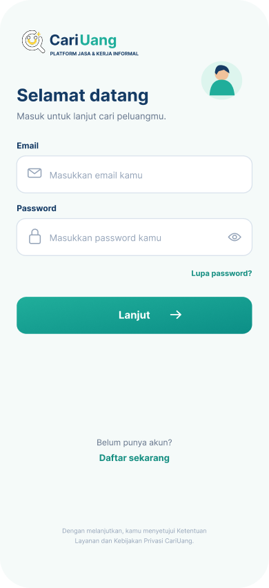
</p>
<p align="center">
<i>Gambar 6.1. Rancangan Antarmuka UI-01 - Login</i>
</p>

Tabel 6.1. Spesifikasi Objek Antarmuka UI-01

| Id_Objek | Jenis | Konten | Keterangan |
| :--- | :--- | :--- | :--- |
| UI-01-01 | Image | Logo CariUang dan tagline "Platform Jasa & Kerja Informal" | Identitas aplikasi, tidak dapat diklik. |
| UI-01-02 | Label | "Selamat datang" dan "Masuk untuk lanjut cari peluangmu." | Judul dan subjudul layar. |
| UI-01-03 | Text Field | Placeholder "Masukkan email kamu" | Input email. Divalidasi format email; jika tidak valid tampil pesan kesalahan di bawah kolom. |
| UI-01-04 | Password Field | Placeholder "Masukkan password kamu" | Input password, karakter disamarkan. |
| UI-01-05 | Icon Button | Ikon mata | Menampilkan atau menyembunyikan isi password. |
| UI-01-06 | Link | "Lupa password?" | Menuju layar pemulihan password. |
| UI-01-07 | Button | "Lanjut →" | Memvalidasi email dan password. Jika berhasil menuju Beranda (UI-04); jika gagal tampil pesan "Email atau password salah". |
| UI-01-08 | Link | "Daftar sekarang" | Menuju layar Buat Akun Pengguna (UI-02). |
| UI-01-09 | Label | "Dengan melanjutkan, kamu menyetujui Ketentuan Layanan dan Kebijakan Privasi CariUang." | Informasi persetujuan, tidak dapat diklik. |

---

**Antarmuka:** UI-02
**Nama Layar:** Buat Akun Pengguna

<p align="center">
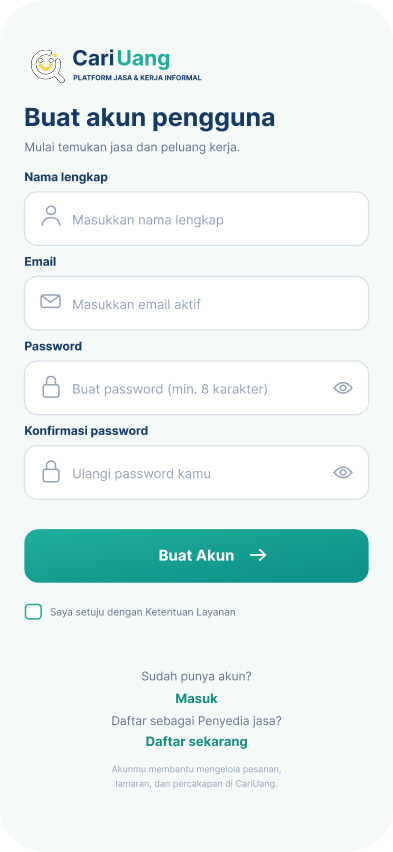
</p>
<p align="center">
<i>Gambar 6.2. Rancangan Antarmuka UI-02 - Buat Akun Pengguna</i>
</p>

Tabel 6.2. Spesifikasi Objek Antarmuka UI-02

| Id_Objek | Jenis | Konten | Keterangan |
| :--- | :--- | :--- | :--- |
| UI-02-01 | Image | Logo CariUang | Identitas aplikasi. |
| UI-02-02 | Label | "Buat akun pengguna" dan "Mulai temukan jasa dan peluang kerja." | Judul dan subjudul layar. |
| UI-02-03 | Text Field | Placeholder "Masukkan nama lengkap" | Input nama lengkap, wajib diisi. |
| UI-02-04 | Text Field | Placeholder "Masukkan email aktif" | Input email, divalidasi formatnya dan harus belum terdaftar. |
| UI-02-05 | Password Field | Placeholder "Buat password (min. 8 karakter)" | Input password, minimal 8 karakter. |
| UI-02-06 | Password Field | Placeholder "Ulangi password kamu" | Harus sama dengan password; jika berbeda tampil pesan kesalahan. |
| UI-02-07 | Icon Button | Ikon mata (pada kedua kolom password) | Menampilkan atau menyembunyikan isi password. |
| UI-02-08 | Button | "Buat Akun →" | Aktif jika semua kolom valid dan UI-02-09 dicentang. Sistem membuat akun lalu menuju Beranda (UI-04). |
| UI-02-09 | Checkbox | "Saya setuju dengan Ketentuan Layanan" | Wajib dicentang sebelum akun dibuat. |
| UI-02-10 | Link | "Masuk" | Menuju layar Login (UI-01). |
| UI-02-11 | Link | "Daftar sebagai Penyedia jasa? Daftar sekarang" | Menuju layar Buat Akun Jasa (UI-03). |

---

**Antarmuka:** UI-03
**Nama Layar:** Buat Akun Jasa (Penyedia Jasa)

<p align="center">
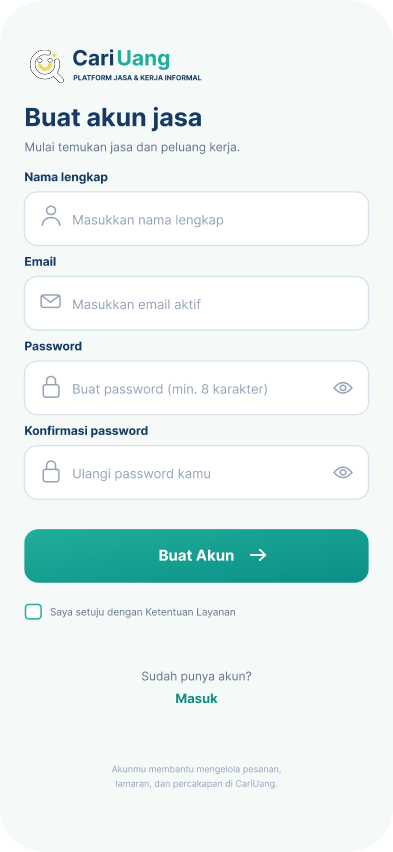
</p>
<p align="center">
<i>Gambar 6.3. Rancangan Antarmuka UI-03 - Buat Akun Jasa</i>
</p>

Tabel 6.3. Spesifikasi Objek Antarmuka UI-03

| Id_Objek | Jenis | Konten | Keterangan |
| :--- | :--- | :--- | :--- |
| UI-03-01 | Image | Logo CariUang | Identitas aplikasi. |
| UI-03-02 | Label | "Buat akun jasa" dan "Mulai temukan jasa dan peluang kerja." | Judul dan subjudul layar. |
| UI-03-03 | Text Field | Placeholder "Masukkan nama lengkap" | Input nama lengkap penyedia jasa, wajib diisi. |
| UI-03-04 | Text Field | Placeholder "Masukkan email aktif" | Input email, divalidasi formatnya dan harus belum terdaftar. |
| UI-03-05 | Password Field | Placeholder "Buat password (min. 8 karakter)" | Input password, minimal 8 karakter. |
| UI-03-06 | Password Field | Placeholder "Ulangi password kamu" | Harus sama dengan password. |
| UI-03-07 | Icon Button | Ikon mata | Menampilkan atau menyembunyikan isi password. |
| UI-03-08 | Button | "Buat Akun →" | Aktif jika semua kolom valid dan UI-03-09 dicentang. Sistem membuat akun dengan peran penyedia jasa lalu menuju Riwayat Pekerjaan (UI-12). |
| UI-03-09 | Checkbox | "Saya setuju dengan Ketentuan Layanan" | Wajib dicentang sebelum akun dibuat. |
| UI-03-10 | Link | "Masuk" | Menuju layar Login (UI-01). |
| UI-03-11 | Label | "Akunmu membantu mengelola pesanan, lamaran, dan percakapan di CariUang." | Informasi tambahan, tidak dapat diklik. |

---

**Antarmuka:** UI-04
**Nama Layar:** Beranda

<p align="center">
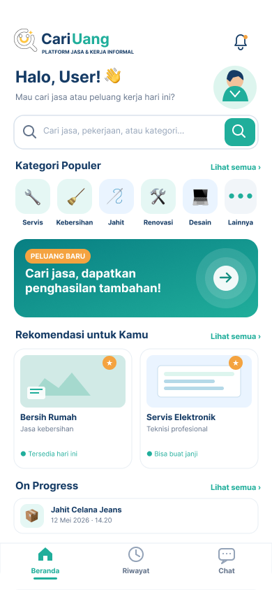
</p>
<p align="center">
<i>Gambar 6.4. Rancangan Antarmuka UI-04 - Beranda</i>
</p>

Tabel 6.4. Spesifikasi Objek Antarmuka UI-04

| Id_Objek | Jenis | Konten | Keterangan |
| :--- | :--- | :--- | :--- |
| UI-04-01 | Image | Logo CariUang | Identitas aplikasi. |
| UI-04-02 | Icon Button | Ikon lonceng | Menuju layar Notifikasi (UI-13). |
| UI-04-03 | Label | "Halo, User! 👋" dan "Mau cari jasa atau peluang kerja hari ini?" | Sapaan dengan nama pengguna yang sedang login. |
| UI-04-04 | Image | Avatar pengguna | Menuju layar Profil Saya (UI-14). |
| UI-04-05 | Search Field | Placeholder "Cari jasa, pekerjaan, atau kategori..." | Saat difokuskan dan diisi, menuju layar Rekomendasi Pencarian (UI-05). |
| UI-04-06 | Button | Ikon kaca pembesar | Menjalankan pencarian dan menuju Hasil Pencarian (UI-06). |
| UI-04-07 | Label + Link | "Kategori Populer" dan "Lihat semua ›" | Menampilkan seluruh kategori jasa. |
| UI-04-08 | Icon Button (list) | Servis, Kebersihan, Jahit, Renovasi, Desain, Lainnya | Menuju Hasil Pencarian (UI-06) sesuai kategori yang dipilih. |
| UI-04-09 | Banner | "Peluang Baru: Cari jasa, dapatkan penghasilan tambahan!" | Tombol panah menuju layar Buat Akun Jasa (UI-03). |
| UI-04-10 | Label + Link | "Rekomendasi untuk Kamu" dan "Lihat semua ›" | Menampilkan seluruh rekomendasi jasa. |
| UI-04-11 | Card (list) | "Bersih Rumah / Jasa kebersihan / Tersedia hari ini", "Servis Elektronik / Teknisi profesional / Bisa buat janji" | Menampilkan detail jasa dan opsi memulai chat dengan penyedia. |
| UI-04-12 | Label + Link | "On Progress" dan "Lihat semua ›" | Menuju Riwayat (UI-10) dengan filter On Progress. |
| UI-04-13 | Card | "Jahit Celana Jeans, 12 Mei 2026 · 14.20" | Menampilkan pesanan yang sedang berjalan; jika diklik menuju detail pesanan. |
| UI-04-14 | Bottom Navigation | Beranda, Riwayat, Chat | Berpindah ke UI-04, UI-10, atau UI-07. Tab aktif ditandai warna hijau. |

---

**Antarmuka:** UI-05
**Nama Layar:** Rekomendasi Pencarian

<p align="center">
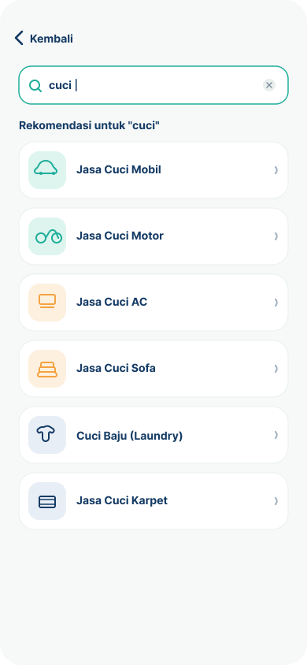
</p>
<p align="center">
<i>Gambar 6.5. Rancangan Antarmuka UI-05 - Rekomendasi Pencarian</i>
</p>

Tabel 6.5. Spesifikasi Objek Antarmuka UI-05

| Id_Objek | Jenis | Konten | Keterangan |
| :--- | :--- | :--- | :--- |
| UI-05-01 | Button | "‹ Kembali" | Kembali ke layar sebelumnya. |
| UI-05-02 | Search Field | Teks yang diketik pengguna (contoh "cuci") | Aktif otomatis dengan kursor. Daftar rekomendasi diperbarui setiap pengguna mengetik. |
| UI-05-03 | Icon Button | Ikon "×" | Menghapus teks pencarian. |
| UI-05-04 | Label | "Rekomendasi untuk "cuci"" | Judul daftar saran sesuai kata kunci. |
| UI-05-05 | List Item | Jasa Cuci Mobil, Jasa Cuci Motor, Jasa Cuci AC, Jasa Cuci Sofa, Cuci Baju (Laundry), Jasa Cuci Karpet | Setiap item diklik akan menuju Hasil Pencarian (UI-06) dengan kata kunci item tersebut. |

---

**Antarmuka:** UI-06
**Nama Layar:** Hasil Pencarian

<p align="center">
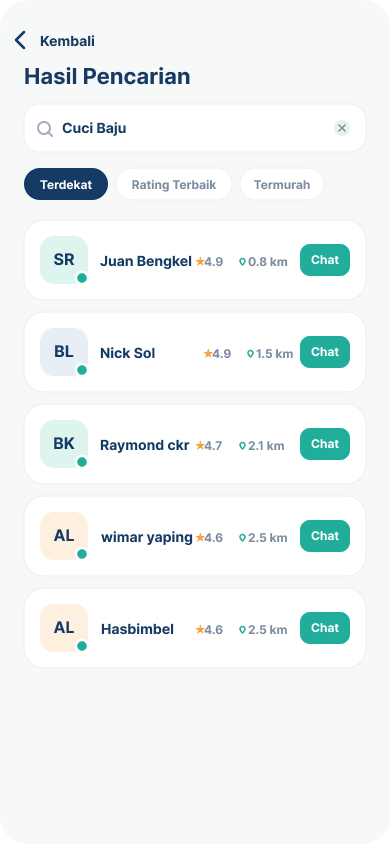
</p>
<p align="center">
<i>Gambar 6.6. Rancangan Antarmuka UI-06 - Hasil Pencarian</i>
</p>

Tabel 6.6. Spesifikasi Objek Antarmuka UI-06

| Id_Objek | Jenis | Konten | Keterangan |
| :--- | :--- | :--- | :--- |
| UI-06-01 | Button | "‹ Kembali" | Kembali ke layar sebelumnya. |
| UI-06-02 | Label | "Hasil Pencarian" | Judul layar. |
| UI-06-03 | Search Field | Kata kunci (contoh "Cuci Baju") | Dapat diubah; hasil diperbarui sesuai kata kunci baru. |
| UI-06-04 | Icon Button | Ikon "×" | Menghapus kata kunci. |
| UI-06-05 | Chip Filter | "Terdekat", "Rating Terbaik", "Termurah" | Mengurutkan hasil berdasarkan jarak, rating, atau harga. Hanya satu filter aktif; yang aktif berwarna biru tua. |
| UI-06-06 | Card (list) | Avatar inisial, nama penyedia, rating (★), jarak (km), status online | Menampilkan penyedia jasa sesuai kata kunci. Titik hijau menandakan penyedia sedang online. |
| UI-06-07 | Button | "Chat" | Membuka ruang obrolan dengan penyedia jasa terkait (UI-08). |

---

**Antarmuka:** UI-07
**Nama Layar:** Daftar Pesan

<p align="center">
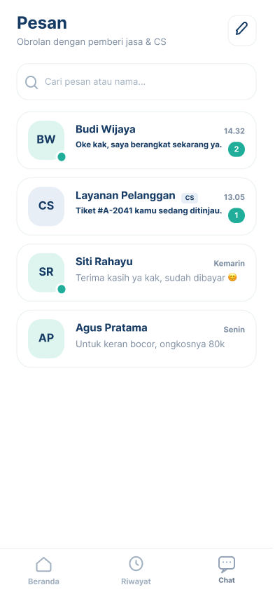
</p>
<p align="center">
<i>Gambar 6.7. Rancangan Antarmuka UI-07 - Daftar Pesan</i>
</p>

Tabel 6.7. Spesifikasi Objek Antarmuka UI-07

| Id_Objek | Jenis | Konten | Keterangan |
| :--- | :--- | :--- | :--- |
| UI-07-01 | Label | "Pesan" dan "Obrolan dengan pemberi jasa & CS" | Judul dan subjudul layar. |
| UI-07-02 | Icon Button | Ikon pensil | Memulai percakapan baru. |
| UI-07-03 | Search Field | Placeholder "Cari pesan atau nama..." | Memfilter daftar percakapan berdasarkan nama atau isi pesan. |
| UI-07-04 | Card (list) | Avatar inisial, nama, cuplikan pesan terakhir, waktu | Menampilkan percakapan dengan Budi Wijaya, Layanan Pelanggan, Siti Rahayu, dan Agus Pratama. Jika diklik membuka ruang obrolan (UI-08). |
| UI-07-05 | Badge | Titik hijau pada avatar | Menandakan lawan bicara sedang online. |
| UI-07-06 | Badge | Angka (contoh "2", "1") | Jumlah pesan belum dibaca; hilang setelah percakapan dibuka. |
| UI-07-07 | Tag | "CS" | Menandai percakapan dengan Layanan Pelanggan. |
| UI-07-08 | Bottom Navigation | Beranda, Riwayat, Chat | Berpindah ke UI-04, UI-10, atau UI-07. Tab Chat aktif. |

---

**Antarmuka:** UI-08
**Nama Layar:** Ruang Obrolan (Pelanggan)

<p align="center">
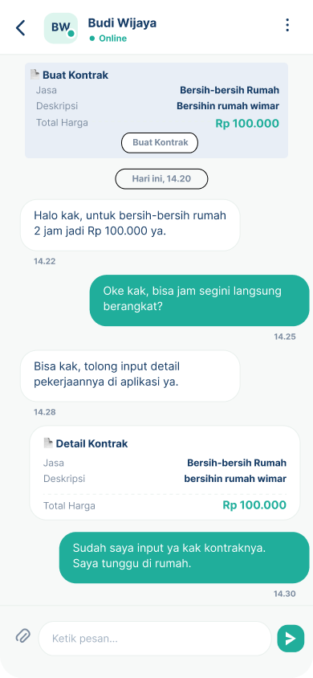
</p>
<p align="center">
<i>Gambar 6.8. Rancangan Antarmuka UI-08 - Ruang Obrolan (Pelanggan)</i>
</p>

Tabel 6.8. Spesifikasi Objek Antarmuka UI-08

| Id_Objek | Jenis | Konten | Keterangan |
| :--- | :--- | :--- | :--- |
| UI-08-01 | Icon Button | Ikon panah "<" | Kembali ke Daftar Pesan (UI-07) atau Hasil Pencarian (UI-06). |
| UI-08-02 | Header | Avatar inisial, nama penyedia (Budi Wijaya), status "Online" | Menampilkan identitas dan status lawan bicara. |
| UI-08-03 | Icon Button | Ikon tiga titik | Menampilkan menu tambahan (misalnya laporkan atau blokir). |
| UI-08-04 | Card | "Buat Kontrak" berisi Jasa, Deskripsi, Total Harga (Rp 100.000) | Ringkasan kontrak yang akan dibuat pelanggan. |
| UI-08-05 | Button | "Buat Kontrak" | Mengirim kontrak ke penyedia jasa. Kartu "Detail Kontrak" muncul di percakapan dengan status Menunggu. |
| UI-08-06 | Label | "Hari ini, 14.20" | Pemisah tanggal percakapan. |
| UI-08-07 | Chat Bubble (kiri) | Pesan dari penyedia jasa dan waktu kirim | Pesan masuk. |
| UI-08-08 | Chat Bubble (kanan) | Pesan dari pelanggan dan waktu kirim | Pesan keluar, berwarna hijau. |
| UI-08-09 | Card | "Detail Kontrak": Jasa, Deskripsi, Total Harga | Menampilkan isi kontrak yang sudah dikirim. |
| UI-08-10 | Icon Button | Ikon klip kertas | Melampirkan file atau gambar. |
| UI-08-11 | Text Field | Placeholder "Ketik pesan..." | Input pesan. |
| UI-08-12 | Icon Button | Ikon kirim | Mengirim pesan; pesan muncul sebagai bubble kanan dan kolom dikosongkan. |

---

**Antarmuka:** UI-09
**Nama Layar:** Ruang Obrolan (Penyedia Jasa)

<p align="center">
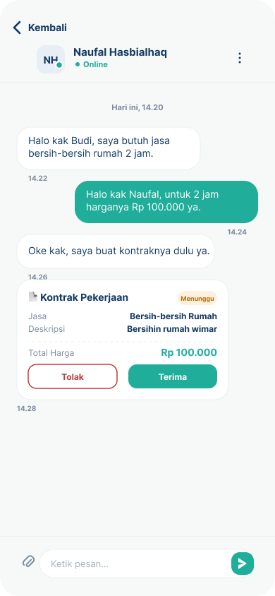
</p>
<p align="center">
<i>Gambar 6.9. Rancangan Antarmuka UI-09 - Ruang Obrolan (Penyedia Jasa)</i>
</p>

Tabel 6.9. Spesifikasi Objek Antarmuka UI-09

| Id_Objek | Jenis | Konten | Keterangan |
| :--- | :--- | :--- | :--- |
| UI-09-01 | Button | "‹ Kembali" | Kembali ke Daftar Pesan (UI-07). |
| UI-09-02 | Header | Avatar inisial, nama pelanggan (Naufal Hasbialhaq), status "Online" | Menampilkan identitas dan status lawan bicara. |
| UI-09-03 | Icon Button | Ikon tiga titik | Menampilkan menu tambahan. |
| UI-09-04 | Label | "Hari ini, 14.20" | Pemisah tanggal percakapan. |
| UI-09-05 | Chat Bubble (kiri/kanan) | Pesan pelanggan dan penyedia beserta waktu kirim | Pesan masuk di kiri berwarna putih, pesan keluar di kanan berwarna hijau. |
| UI-09-06 | Card | "Kontrak Pekerjaan": Jasa, Deskripsi, Total Harga (Rp 100.000) | Menampilkan kontrak yang dibuat pelanggan. |
| UI-09-07 | Badge | "Menunggu" | Status kontrak; berubah menjadi "Diterima" atau "Ditolak" setelah ada keputusan. |
| UI-09-08 | Button | "Tolak" | Menolak kontrak. Status berubah menjadi Ditolak dan pelanggan menerima notifikasi. |
| UI-09-09 | Button | "Terima" | Menerima kontrak. Status berubah menjadi Diterima, pesanan masuk ke Riwayat Pekerjaan dengan status On Progress, dan pelanggan menerima notifikasi. |
| UI-09-10 | Icon Button | Ikon klip kertas | Melampirkan file atau gambar. |
| UI-09-11 | Text Field | Placeholder "Ketik pesan..." | Input pesan. |
| UI-09-12 | Icon Button | Ikon kirim | Mengirim pesan. |

---

**Antarmuka:** UI-10
**Nama Layar:** Riwayat (Pelanggan)

<p align="center">
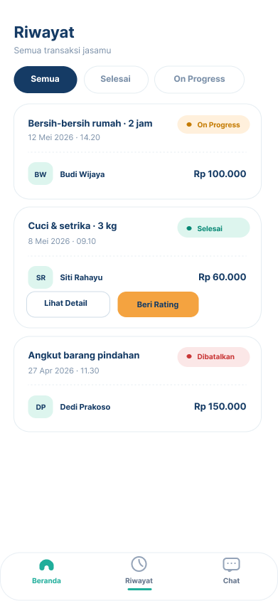
</p>
<p align="center">
<i>Gambar 6.10. Rancangan Antarmuka UI-10 - Riwayat (Pelanggan)</i>
</p>

Tabel 6.10. Spesifikasi Objek Antarmuka UI-10

| Id_Objek | Jenis | Konten | Keterangan |
| :--- | :--- | :--- | :--- |
| UI-10-01 | Label | "Riwayat" dan "Semua transaksi jasamu" | Judul dan subjudul layar. |
| UI-10-02 | Chip Filter | "Semua", "Selesai", "On Progress" | Memfilter daftar transaksi berdasarkan status. Chip aktif berwarna biru tua. |
| UI-10-03 | Card (list) | Nama jasa, tanggal dan jam, avatar, nama penyedia, harga | Menampilkan transaksi pelanggan. Jika diklik menuju detail transaksi. |
| UI-10-04 | Badge | "On Progress" (kuning), "Selesai" (hijau), "Dibatalkan" (merah) | Menunjukkan status transaksi. |
| UI-10-05 | Button | "Lihat Detail" | Muncul pada transaksi selesai; membuka detail transaksi. |
| UI-10-06 | Button | "Beri Rating" | Muncul pada transaksi selesai yang belum dinilai; menuju Beri Penilaian (UI-11). |
| UI-10-07 | Bottom Navigation | Beranda, Riwayat, Chat | Berpindah ke UI-04, UI-10, atau UI-07. Tab Riwayat aktif. |

---

**Antarmuka:** UI-11
**Nama Layar:** Beri Penilaian

<p align="center">
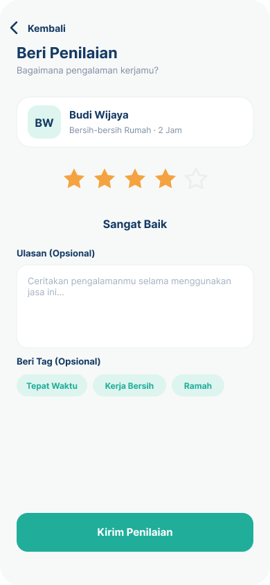
</p>
<p align="center">
<i>Gambar 6.11. Rancangan Antarmuka UI-11 - Beri Penilaian</i>
</p>

Tabel 6.11. Spesifikasi Objek Antarmuka UI-11

| Id_Objek | Jenis | Konten | Keterangan |
| :--- | :--- | :--- | :--- |
| UI-11-01 | Button | "‹ Kembali" | Kembali ke Riwayat (UI-10) tanpa menyimpan penilaian. |
| UI-11-02 | Label | "Beri Penilaian" dan "Bagaimana pengalaman kerjamu?" | Judul dan subjudul layar. |
| UI-11-03 | Card | Avatar inisial, nama penyedia (Budi Wijaya), "Bersih-bersih Rumah · 2 Jam" | Informasi pekerjaan yang dinilai, tidak dapat diubah. |
| UI-11-04 | Rating Bar | 5 ikon bintang | Pengguna memilih 1 sampai 5 bintang; bintang terpilih berwarna oranye. |
| UI-11-05 | Label | "Sangat Baik" | Deskripsi nilai yang berubah sesuai jumlah bintang. |
| UI-11-06 | Text Area | Placeholder "Ceritakan pengalamanmu selama menggunakan jasa ini..." | Ulasan, bersifat opsional. |
| UI-11-07 | Chip (multi-pilih) | "Tepat Waktu", "Kerja Bersih", "Ramah" | Tag opsional; dapat dipilih lebih dari satu. |
| UI-11-08 | Button | "Kirim Penilaian" | Aktif jika bintang sudah dipilih. Menyimpan penilaian, memperbarui rating penyedia, lalu kembali ke Riwayat (UI-10) dengan tombol "Beri Rating" hilang. |

---

**Antarmuka:** UI-12
**Nama Layar:** Riwayat Pekerjaan (Penyedia Jasa)

<p align="center">
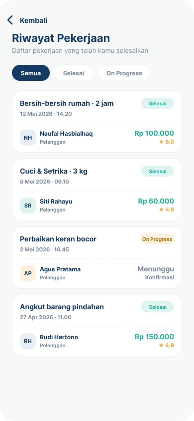
</p>
<p align="center">
<i>Gambar 6.12. Rancangan Antarmuka UI-12 - Riwayat Pekerjaan (Penyedia Jasa)</i>
</p>

Tabel 6.12. Spesifikasi Objek Antarmuka UI-12

| Id_Objek | Jenis | Konten | Keterangan |
| :--- | :--- | :--- | :--- |
| UI-12-01 | Button | "‹ Kembali" | Kembali ke layar sebelumnya. |
| UI-12-02 | Label | "Riwayat Pekerjaan" dan "Daftar pekerjaan yang telah kamu selesaikan" | Judul dan subjudul layar. |
| UI-12-03 | Chip Filter | "Semua", "Selesai", "On Progress" | Memfilter pekerjaan berdasarkan status. |
| UI-12-04 | Card (list) | Nama pekerjaan, tanggal dan jam, avatar, nama pelanggan, label "Pelanggan" | Menampilkan pekerjaan penyedia jasa. Jika diklik menuju detail pekerjaan. |
| UI-12-05 | Badge | "Selesai" (hijau), "On Progress" (kuning) | Menunjukkan status pekerjaan. |
| UI-12-06 | Label | Harga (contoh "Rp 100.000") dan rating (★ 5.0) | Muncul pada pekerjaan selesai; rating berasal dari penilaian pelanggan. |
| UI-12-07 | Label | "Menunggu Konfirmasi" | Muncul pada pekerjaan On Progress yang belum dikonfirmasi pelanggan. |

---

**Antarmuka:** UI-13
**Nama Layar:** Notifikasi

<p align="center">
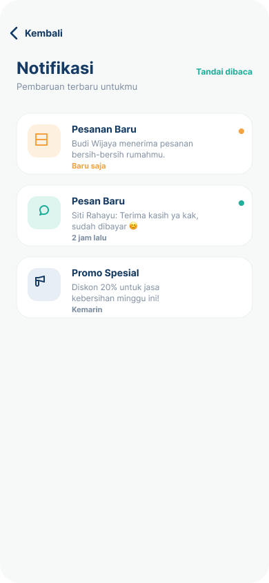
</p>
<p align="center">
<i>Gambar 6.13. Rancangan Antarmuka UI-13 - Notifikasi</i>
</p>

Tabel 6.13. Spesifikasi Objek Antarmuka UI-13

| Id_Objek | Jenis | Konten | Keterangan |
| :--- | :--- | :--- | :--- |
| UI-13-01 | Button | "‹ Kembali" | Kembali ke layar sebelumnya. |
| UI-13-02 | Label | "Notifikasi" dan "Pembaruan terbaru untukmu" | Judul dan subjudul layar. |
| UI-13-03 | Link | "Tandai dibaca" | Menandai seluruh notifikasi sebagai sudah dibaca; titik penanda hilang. |
| UI-13-04 | Card (list) | Ikon, judul, isi, waktu | Menampilkan "Pesanan Baru", "Pesan Baru", dan "Promo Spesial". Jika diklik menuju layar terkait (Riwayat, Chat, atau promo). |
| UI-13-05 | Badge | Titik berwarna di sisi kanan kartu | Menandai notifikasi yang belum dibaca. |

---

**Antarmuka:** UI-14
**Nama Layar:** Profil Saya

<p align="center">
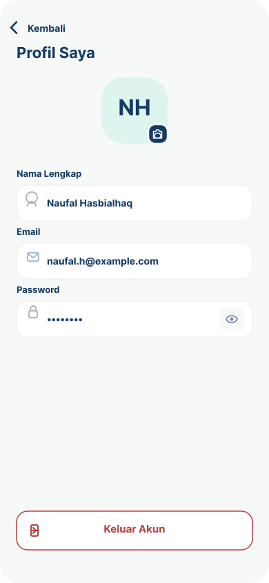
</p>
<p align="center">
<i>Gambar 6.14. Rancangan Antarmuka UI-14 - Profil Saya</i>
</p>

Tabel 6.14. Spesifikasi Objek Antarmuka UI-14

| Id_Objek | Jenis | Konten | Keterangan |
| :--- | :--- | :--- | :--- |
| UI-14-01 | Button | "‹ Kembali" | Kembali ke layar sebelumnya. |
| UI-14-02 | Label | "Profil Saya" | Judul layar. |
| UI-14-03 | Image | Avatar inisial (contoh "NH") | Foto profil pengguna. |
| UI-14-04 | Icon Button | Ikon kamera | Mengganti foto profil dari kamera atau galeri. |
| UI-14-05 | Text Field | "Nama Lengkap" berisi nama pengguna | Dapat diubah; perubahan disimpan ke profil. |
| UI-14-06 | Text Field | "Email" berisi email pengguna | Menampilkan email akun. |
| UI-14-07 | Password Field | "Password" berisi karakter tersamar | Dapat diubah; wajib minimal 8 karakter. |
| UI-14-08 | Icon Button | Ikon mata | Menampilkan atau menyembunyikan password. |
| UI-14-09 | Button | "Keluar Akun" | Menampilkan dialog konfirmasi. Jika disetujui, sesi diakhiri dan sistem menuju Login (UI-01). |

---

**Antarmuka:** UI-15
**Nama Layar:** Buat Tiket Laporan

<p align="center">

</p>
<p align="center">
<i>Gambar 6.15. Rancangan Antarmuka UI-15 - Buat Tiket Laporan</i>
</p>

Tabel 6.15. Spesifikasi Objek Antarmuka UI-15

| Id_Objek | Jenis | Konten | Keterangan |
| :--- | :--- | :--- | :--- |
| UI-15-01 | Button | "‹ Kembali" | Kembali ke Daftar Pesan (UI-07). Jika ada isian yang belum dikirim, tampil dialog konfirmasi keluar. |
| UI-15-02 | Label | "Buat Tiket Laporan" dan "Laporkan kendala yang kamu alami ke CS" | Judul dan subjudul layar. |
| UI-15-03 | Label | "Jenis Permasalahan" | Label kolom pilihan jenis masalah. |
| UI-15-04 | Dropdown | Placeholder "Pilih jenis permasalahan" dengan ikon peringatan | Menampilkan daftar jenis masalah (Laporan Pembayaran, Kendala Aplikasi, Perilaku Pengguna, dan lainnya). Wajib dipilih. |
| UI-15-05 | Label | "Penjelasan" | Label kolom penjelasan masalah. |
| UI-15-06 | Text Area | Placeholder "Jelaskan detail permasalahan yang kamu alami secara kronologis..." | Input penjelasan masalah, wajib diisi. |
| UI-15-07 | Label | "Unggah Foto / Bukti" | Label area unggah bukti. |
| UI-15-08 | Upload Area | Ikon kamera, "Ketuk untuk mengunggah foto", "Maksimal 5MB (JPG, PNG)" | Membuka pilihan kamera atau galeri. Sistem memvalidasi format (JPG/PNG) dan ukuran (maks. 5MB); jika tidak sesuai tampil pesan kesalahan, jika sesuai tampil pratinjau foto. Bersifat opsional. |
| UI-15-09 | Label | "Data laporanmu akan dijaga kerahasiaannya." | Informasi privasi, tidak dapat diklik. |
| UI-15-10 | Button | "Kirim Laporan" | Aktif jika UI-15-04 dan UI-15-06 sudah terisi. Sistem membuat tiket dengan nomor unik (contoh #A-2041) berstatus Tiket Baru, mengirimkannya ke CS, lalu menampilkan percakapan tiket di Daftar Pesan (UI-07). |

---

**Antarmuka:** UI-16
**Nama Layar:** Daftar Penyedia Jasa

<p align="center">

</p>
<p align="center">
<i>Gambar 6.16. Rancangan Antarmuka UI-16 - Daftar Penyedia Jasa</i>
</p>

Tabel 6.16. Spesifikasi Objek Antarmuka UI-16

| Id_Objek | Jenis | Konten | Keterangan |
| :--- | :--- | :--- | :--- |
| UI-16-01 | Button | "‹ Kembali" | Kembali ke layar sebelumnya. |
| UI-16-02 | Label | "Daftar Penyedia Jasa" dan "Lengkapi data untuk mulai menerima pesanan" | Judul dan subjudul layar. |
| UI-16-03 | Label | "Nama Toko / Penyedia Jasa" | Label kolom nama usaha. |
| UI-16-04 | Text Field | Ikon toko, placeholder "Masukkan nama toko atau usahamu" | Input nama toko atau usaha, wajib diisi. |
| UI-16-05 | Label | "Jenis Jasa" | Label kolom jenis jasa. |
| UI-16-06 | Dropdown | Placeholder "Pilih jenis jasa yang ditawarkan" | Menampilkan daftar kategori jasa (Servis, Kebersihan, Jahit, Renovasi, Desain, Lainnya). Wajib dipilih. |
| UI-16-07 | Button | "Ajukan Pendaftaran" | Aktif jika UI-16-04 dan UI-16-06 sudah terisi. Sistem menyimpan data penyedia jasa, mengubah peran akun menjadi penyedia jasa, lalu menuju Riwayat Pekerjaan (UI-12). |

---

**Antarmuka:** UI-17
**Nama Layar:** Beranda CS

<p align="center">
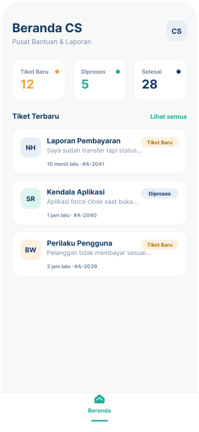
</p>
<p align="center">
<i>Gambar 6.17. Rancangan Antarmuka UI-17 - Beranda CS</i>
</p>

Tabel 6.17. Spesifikasi Objek Antarmuka UI-17

| Id_Objek | Jenis | Konten | Keterangan |
| :--- | :--- | :--- | :--- |
| UI-17-01 | Label | "Beranda CS" dan "Pusat Bantuan & Laporan" | Judul dan subjudul layar. |
| UI-17-02 | Avatar | Inisial "CS" | Menampilkan profil akun CS. |
| UI-17-03 | Card Statistik | "Tiket Baru" dengan jumlah (contoh 12) dan titik oranye | Jumlah tiket yang belum ditangani. Jika diklik menampilkan daftar tiket berstatus Tiket Baru. |
| UI-17-04 | Card Statistik | "Diproses" dengan jumlah (contoh 5) dan titik hijau | Jumlah tiket yang sedang ditangani. Jika diklik menampilkan daftar tiket berstatus Diproses. |
| UI-17-05 | Card Statistik | "Selesai" dengan jumlah (contoh 28) dan titik biru tua | Jumlah tiket yang sudah selesai. Jika diklik menampilkan daftar tiket berstatus Selesai. |
| UI-17-06 | Label + Link | "Tiket Terbaru" dan "Lihat semua" | "Lihat semua" menampilkan seluruh daftar tiket. |
| UI-17-07 | Card (list) | Avatar inisial pelapor, judul masalah, cuplikan laporan, waktu, nomor tiket | Menampilkan tiket terbaru (contoh Laporan Pembayaran #A-2041, Kendala Aplikasi #A-2040, Perilaku Pengguna #A-2039). Jika diklik membuka Detail Tiket (UI-18). |
| UI-17-08 | Badge | "Tiket Baru" (oranye), "Diproses" (abu-biru) | Menunjukkan status tiket. |
| UI-17-09 | Bottom Navigation | Tab "Beranda" | Menu navigasi CS; tab Beranda aktif ditandai warna hijau. |

---

**Antarmuka:** UI-18
**Nama Layar:** Detail Tiket (Ruang Obrolan CS)

<p align="center">

</p>
<p align="center">
<i>Gambar 6.18. Rancangan Antarmuka UI-18 - Detail Tiket (Ruang Obrolan CS)</i>
</p>

Tabel 6.18. Spesifikasi Objek Antarmuka UI-18

| Id_Objek | Jenis | Konten | Keterangan |
| :--- | :--- | :--- | :--- |
| UI-18-01 | Icon Button | Ikon panah "<" | Kembali ke Beranda CS (UI-17). |
| UI-18-02 | Header | Avatar inisial pelapor, "Tiket #A-2041", jenis masalah (Laporan Pembayaran) | Menampilkan identitas tiket dan jenis permasalahan. |
| UI-18-03 | Card | Nama pelapor (Naufal Hasbialhaq), "Pelanggan · 12 Mei 2026, 14.20", isi laporan, thumbnail bukti | Menampilkan laporan awal dari pelapor. Thumbnail bukti jika diklik tampil dalam ukuran penuh. |
| UI-18-04 | Chat Bubble (kiri) | Pesan dari pelapor dan waktu kirim | Pesan masuk dari pelapor, berwarna putih. |
| UI-18-05 | Chat Bubble (kanan) | Balasan CS dan waktu kirim | Pesan keluar dari CS, berwarna hijau. Pada balasan pertama, status tiket berubah dari Tiket Baru menjadi Diproses. |
| UI-18-06 | Icon Button | Ikon klip kertas | Melampirkan file atau gambar pada balasan. |
| UI-18-07 | Text Field | Placeholder "Ketik balasan..." | Input balasan CS. |
| UI-18-08 | Icon Button | Ikon kirim | Mengirim balasan; pesan muncul sebagai bubble kanan dan pelapor menerima notifikasi. |

---

## 6.2 Rancangan Antarmuka Keseluruhan

Berikut daftar gambar seluruh antarmuka aplikasi CariUang. ID setiap tampilan sama dengan ID pada subbab perancangan antarmuka masing-masing.

Tabel 6.19. Rancangan Antarmuka Keseluruhan

| No | Tampilan Antarmuka |
| :--- | :--- |
| UI-01 | <br><i>Login</i> |
| UI-02 | <br><i>Buat Akun Pengguna</i> |
| UI-03 | <br><i>Buat Akun Jasa</i> |
| UI-04 | <br><i>Beranda</i> |
| UI-05 | <br><i>Rekomendasi Pencarian</i> |
| UI-06 | <br><i>Hasil Pencarian</i> |
| UI-07 | <br><i>Daftar Pesan</i> |
| UI-08 | <br><i>Ruang Obrolan (Pelanggan)</i> |
| UI-09 | <br><i>Ruang Obrolan (Penyedia Jasa)</i> |
| UI-10 | <br><i>Riwayat (Pelanggan)</i> |
| UI-11 | <br><i>Beri Penilaian</i> |
| UI-12 | <br><i>Riwayat Pekerjaan (Penyedia Jasa)</i> |
| UI-13 | <br><i>Notifikasi</i> |
| UI-14 | <br><i>Profil Saya</i> |
| UI-15 | <br><i>Buat Tiket Laporan</i> |
| UI-16 | <br><i>Daftar Penyedia Jasa</i> |
| UI-17 | <br><i>Beranda CS</i> |
| UI-18 | <br><i>Detail Tiket (Ruang Obrolan CS)</i> |

<br>

---

# BAB 7: Matriks Kerunutan

Tabel 7.1. Matriks Kerunutan Kelas terhadap Use Case

| Kelas | Use Case Terkait |
| :--- | :--- |
| C01 - Pengguna | UC10 - Memberi rating; UC12 - Mendaftar akun ke perangkat lunak |
| C02 - PenggunaUI | UC10 - Memberi rating; UC12 - Mendaftar akun ke perangkat lunak |
| C03 - PenggunaController | UC10 - Memberi rating; UC12 - Mendaftar akun ke perangkat lunak |
| C04 - PemberiJasa | UC01 - Mendaftarkan jasa; UC02 - Memilih jasa; UC03 - Menghubungi pemberi jasa; UC04 - Merespon pelanggan; UC06 - Mengubah status pekerjaan menjadi selesai; UC08 - Melaporkan masalah; UC10 - Memberi rating; UC11 - Memasuki akun dalam perangkat lunak; UC12 - Mendaftar akun ke perangkat lunak |
| C05 - PemberiJasaUI | UC02 - Memilih jasa; UC08 - Melaporkan masalah; UC11 - Memasuki akun dalam perangkat lunak |
| C06 - PemberiJasaController | UC01 - Mendaftarkan jasa; UC02 - Memilih jasa; UC08 - Melaporkan masalah; UC11 - Memasuki akun dalam perangkat lunak |
| C07 - Pelanggan | UC02 - Memilih jasa; UC03 - Menghubungi pemberi jasa; UC04 - Merespon pelanggan; UC05 - Memasukkan kesepakatan harga dan pekerjaan; UC07 - Mengonfirmasi status pekerjaan; UC08 - Melaporkan masalah; UC10 - Memberi rating; UC11 - Memasuki akun dalam perangkat lunak; UC12 - Mendaftar akun ke perangkat lunak |
| C08 - PelangganUI | UC07 - Mengonfirmasi status pekerjaan; UC08 - Melaporkan masalah; UC11 - Memasuki akun dalam perangkat lunak |
| C09 - PelangganController | UC02 - Memilih jasa; UC07 - Mengonfirmasi status pekerjaan; UC08 - Melaporkan masalah; UC11 - Memasuki akun dalam perangkat lunak |
| C10 - LayananPelanggan | UC09 - Merespon laporan masalah; UC11 - Memasuki akun dalam perangkat lunak |
| C11 - LayananPelangganUI | UC09 - Merespon laporan masalah; UC11 - Memasuki akun dalam perangkat lunak |
| C12 - LayananPelangganController | UC09 - Merespon laporan masalah; UC11 - Memasuki akun dalam perangkat lunak |
| C13 - KategoriJasa | UC01 - Mendaftarkan jasa; UC02 - Memilih jasa |
| C14 - KategoriJasaUI | UC01 - Mendaftarkan jasa; UC02 - Memilih jasa |
| C15 - KategoriJasaController | UC01 - Mendaftarkan jasa; UC02 - Memilih jasa |
| C16 - KontrakPekerjaan | UC05 - Memasukkan kesepakatan harga dan pekerjaan; UC06 - Mengubah status pekerjaan menjadi selesai; UC07 - Mengonfirmasi status pekerjaan |
| C17 - KontrakPekerjaanUI | UC05 - Memasukkan kesepakatan harga dan pekerjaan; UC06 - Mengubah status pekerjaan menjadi selesai; UC07 - Mengonfirmasi status pekerjaan |
| C18 - KontrakPekerjaanController | UC05 - Memasukkan kesepakatan harga dan pekerjaan; UC06 - Mengubah status pekerjaan menjadi selesai; UC07 - Mengonfirmasi status pekerjaan |
| C19 - Komunikasi | UC02 - Memilih jasa; UC03 - Menghubungi pemberi jasa; UC04 - Merespon pelanggan; UC09 - Merespon laporan masalah |
| C20 - KomunikasiUI | UC02 - Memilih jasa; UC03 - Menghubungi pemberi jasa; UC04 - Merespon pelanggan; UC09 - Merespon laporan masalah |
| C21 - KomunikasiController | UC02 - Memilih jasa; UC03 - Menghubungi pemberi jasa; UC04 - Merespon pelanggan; UC09 - Merespon laporan masalah |
| C22 - TiketLaporan | UC08 - Melaporkan masalah; UC09 - Merespon laporan masalah |
| C23 - TiketLaporanUI | UC08 - Melaporkan masalah; UC09 - Merespon laporan masalah |
| C24 - TiketLaporanController | UC08 - Melaporkan masalah; UC09 - Merespon laporan masalah |
| C25 - Rating | UC10 - Memberi rating |
| C26 - RatingUI | UC10 - Memberi rating |
| C27 - RatingController | UC10 - Memberi rating |
| C28 - Notifikasi | UC02 - Memilih jasa; UC03 - Menghubungi pemberi jasa; UC04 - Merespon pelanggan; UC08 - Melaporkan masalah; UC09 - Merespon laporan masalah |
| C29 - NotifikasiUI | UC02 - Memilih jasa; UC03 - Menghubungi pemberi jasa; UC04 - Merespon pelanggan; UC08 - Melaporkan masalah; UC09 - Merespon laporan masalah |
| C30 - NotifikasiController | UC02 - Memilih jasa; UC03 - Menghubungi pemberi jasa; UC04 - Merespon pelanggan; UC08 - Melaporkan masalah; UC09 - Merespon laporan masalah |
