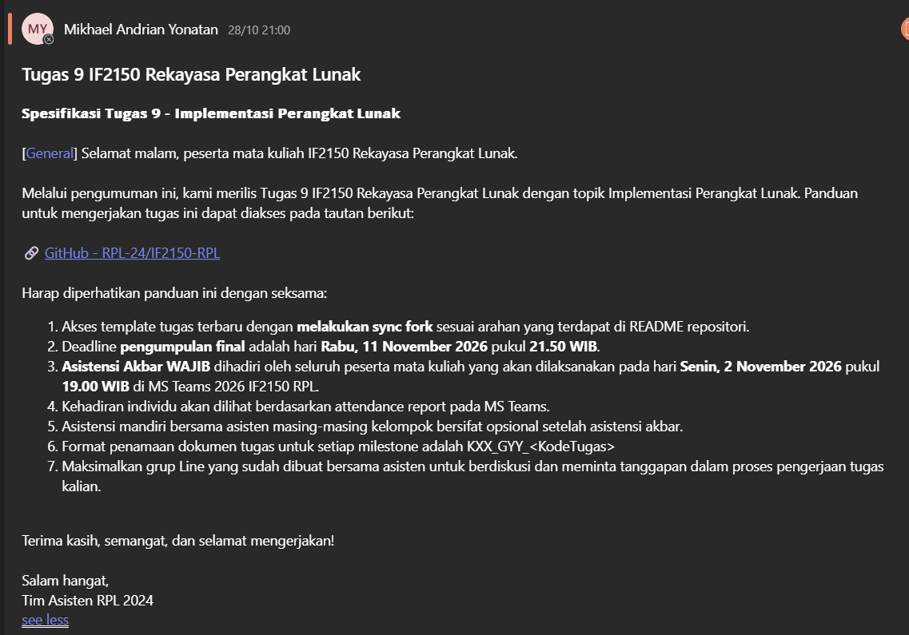

# Form Asistensi

## Tugas Besar IF2150 - Rekayasa Perangkat Lunak

| Informasi | Keterangan |
| --- | --- |
| **Hari** | *xxx* |
| **Tanggal** | *xxxx* |
| **Kelas** | *K3* |
| **Nomor Kelompok** | *09*  |
| **Nama Kelompok** | *9naga*  |
| **Nama Perangkat Lunak** | *Cari Uang*  |
| **Dokumen** | *K03_G09_SKPL*  |

### Anggota Kelompok

| NIM | Nama |
| --- | --- |
| 13525120 | Naufal Hasbialhaq |
| 13525009 | Wimar Widiarto |
| 13525093 | Vinsensius Juan Setiady |
| 13525126 | Raymond Edson Sabajan |
| 13525048 | Yohanes Nicholas Setiawan |

### Catatan

| Catatan |
| --- |
| 1. Perubahan Rancangan dari DPPL (B.1): Catatan mengenai perbedaan antara rancangan awal di DPPL dengan implementasi akhir yang sedang dikerjakan beserta alasannya. |
| 2. Kendala & Known Issues (B.3): Daftar hambatan teknis selama implementasi, bug atau masalah yang masih tersisa (known issues), serta catatan/pertanyaan spesifik untuk asisten. |
| 3. Progres & Pembagian Tugas Anggota (B.4): Persentase kontribusi atau daftar modul/fitur yang sedang dan sudah dikerjakan oleh masing-masing anggota. |
| 4. Pemilihan Teknologi & Arsitektur: Tech stack (bahasa, framework, database) yang digunakan, cara menjalankan proyek secara lokal (seperti penggunaan Docker Compose atau SQLite), serta pola arsitektur (misalnya MVC) yang diterapkan pada struktur folder. |
| 5. Progres Best Practices & Profiling (B.2): Penerapan Git workflow (branching, semantic commit, Pull Request, dan code review), manajemen issue/task, pengujian, serta rencana atau hasil profiling pada fitur yang berat (seperti query lambat atau UI freeze). |
| 6. Traceability DPPL ke Kode (B.5): Kesesuaian antara kelas-kelas pada DPPL dengan perwujudannya di dalam kode (baik berupa kelas, fungsi, komponen, maupun route).   |  
## Dokumentasi

  

  <i>Gambar 1. Dokumentasi kegiatan asistensi.</i>

