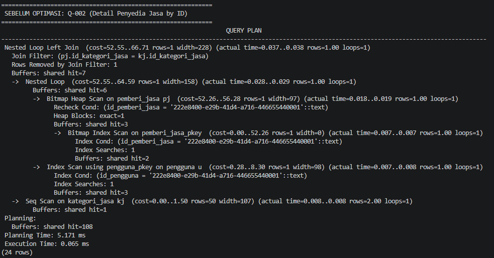
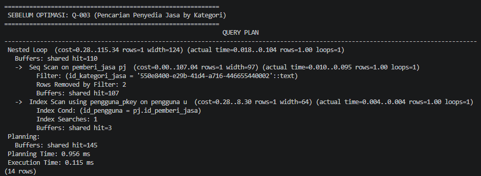
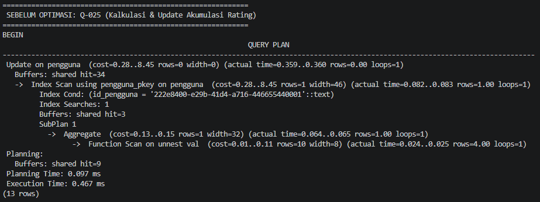
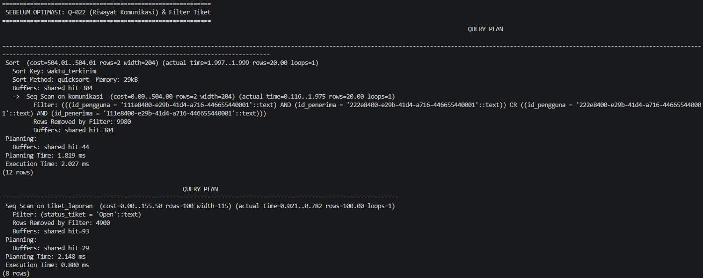
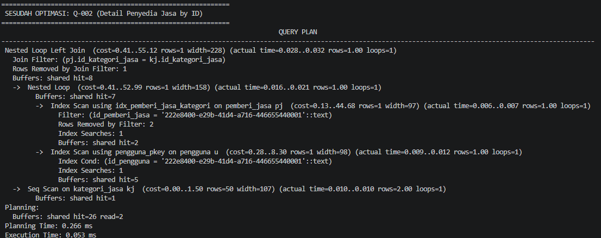
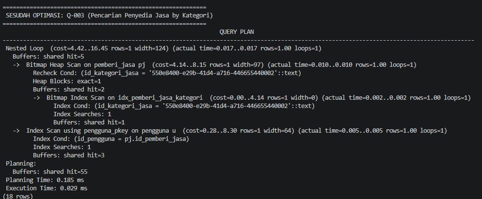
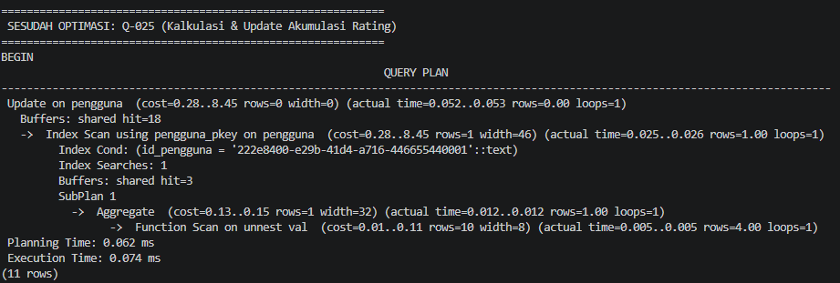
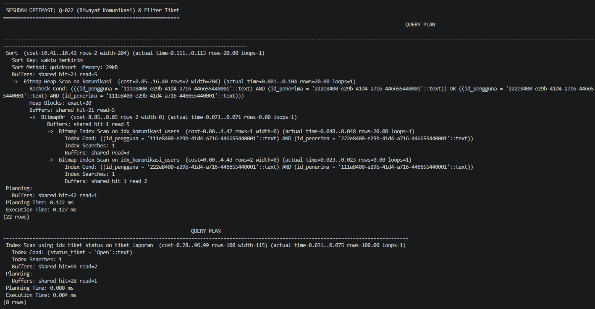

<h1>
IF2150 REKAYASA PERANGKAT LUNAK
<br>
TUGAS 9
<br>
IMPLEMENTASI PERANGKAT LUNAK
</h1>
<br>

## Cari Uang
### 

### Untuk: Agatha Tatianingseto

Dipersiapkan oleh:
| Informasi | Keterangan |
| --- | --- |
| Kelas | 3 |
| Kelompok | 9 |

| NIM | Nama |
|---|---|
| 13525120 | Naufal Hasbialhaq |
| 13525009 | Wimar Widiarto |
| 13525093 | Vinsensius Juan Setiady |
| 13525126 | Raymond Edson Sabajan |
| 13525048 | Yohanes Nicholas Setiawan |

# BAGIAN A: Ketentuan Implementasi

## A.1 Deskripsi Tugas

Pada tugas ini, kalian mengimplementasikan perangkat lunak yang telah dirancang pada tugas-tugas sebelumnya (SKPL, APL, DPPL) menjadi aplikasi yang **dapat dijalankan**. Platform bebas (web, desktop, atau mobile) selama aplikasi dapat dijalankan ulang oleh asisten mengikuti petunjuk kalian.

Ketentuan umum:
- Setiap anggota bertanggung jawab atas **minimal satu fitur atau modul** dan harus terlihat jelas di riwayat commit/PR.
- Implementasi harus **mengacu pada DPPL**. Jika ada yang berubah (kelas, layar, basis data, dsb.), catat di Bagian B.1. Perubahan itu wajar, tetapi harus tercatat dan beralasan.
- Implementasi **tidak harus berupa kelas** (misalnya fungsi, komponen, *route/handler*, *stored procedure*, atau skrip). Namun, setiap kelas perancangan pada DPPL **wajib dapat ditelusuri** ke implementasinya, dan penelusuran ini dicatat di Bagian B.5.
- Seluruh use case pada SKPL **diprioritaskan** untuk diimplementasikan. Status tiap use case akan dilaporkan pada HIUPL (Tugas 10).
- Seluruh mahasiswa **wajib** mengikuti asistensi akbar.

## A.2 Platform, Bahasa, dan Teknologi

Kalian **bebas** memilih bahasa, framework, library, dan basis data, dengan syarat:

1. **Dapat dijalankan ulang** oleh asisten pada mesin biasa dengan mengikuti README. Versi bahasa/runtime dan seluruh dependensi harus tertulis jelas.
2. **Dependensi dikelola lewat file standar**, misalnya `package.json` + lockfile, `requirements.txt`/`pyproject.toml`, `pom.xml`/`build.gradle`, `composer.json`, `pubspec.yaml`, dan sejenisnya. Jangan meng-commit folder hasil instalasi (`node_modules/`, `venv/`, `build/`, dll.).
3. **Jika memakai layanan eksternal** (basis data cloud, API pihak ketiga, auth, dll.), sediakan cara menjalankan tanpa akun pribadi kalian, atau sediakan data/akun uji pada README. Basis data **sangat disarankan** dapat dijalankan lokal (SQLite, atau Docker Compose untuk PostgreSQL/MySQL/MongoDB).
4. **Arsitektur sesuai DPPL.** Pola arsitektur yang kalian pilih di APL/DPPL (MVC, layered, client-server, dll.) harus terlihat pada struktur kode.

Ketentuan tambahan per platform:

| Platform | Ketentuan |
| :--- | :--- |
| **Web** | Berjalan lokal lewat satu-dua perintah yang terdokumentasi. Boleh juga di-*deploy*; jika ya, cantumkan URL, tetapi **tetap wajib bisa dijalankan lokal** (URL deploy bisa mati). |
| **Desktop** | Berjalan dari source lewat perintah yang terdokumentasi. Build/installer opsional. |
| **Mobile** | Berjalan di emulator/simulator atau perangkat. Sertakan langkah menjalankan, dan **sangat disarankan** melampirkan APK/build di Release. |

## A.3 Keamanan Repository

Repo fork kelompok bersifat **public**, sehingga:

- **Dilarang** meng-commit password, API key, token, `.env` asli, sertifikat/private key, atau data pribadi. Hal ini dapat mengurangi nilai.
- Sediakan `.env.example` berisi nama variabel tanpa nilai rahasia, dan masukkan `.env` ke `.gitignore`.
- Jika sudah terlanjur ter-commit, **cabut/ganti** kredensial tersebut. Menghapus commit saja tidak cukup.
- Data uji/seed harus berupa data fiktif.

## A.4 Struktur Folder

Seluruh kode ditempatkan di `src/` pada repo fork. Jangan mengubah folder milestone lama.

```
src/                              # SELURUH kode implementasi
	README.md                     # dokumentasi utama aplikasi (lihat A.5)
	.env.example                  # jika memakai environment variable
	<struktur kode kalian>        # bebas, mengikuti pola arsitektur DPPL
	tests/                        # test case (jika ada)
docs/
	M9/
		KXX_GYY_Implementasi.md   # laporan ini (Bagian B)
		KXX_GYY_Form-Asistensi.md
```

Catatan:
- `README.md` aplikasi diletakkan di **`src/README.md`**, bukan di root repo.
- Jika kerangka kerja kalian mewajibkan struktur tertentu (misalnya Maven `src/main/java`, Flutter `lib/`, monorepo `frontend/` dan `backend/`), letakkan semuanya **di dalam `src/`**.
- Nama file dan folder pada `do./` mengikuti aturan penamaan milestone sebelumnya (`KXX_GYY_...`).

## A.5 Isi Minimal `src/README.md`

README harus cukup bagi orang yang belum pernah melihat proyek kalian untuk menjalankan aplikasi dari nol. Minimal berisi:

1. **Deskripsi singkat** aplikasi.
2. **Teknologi yang digunakan** beserta versi (bahasa, framework, basis data).
3. **Prasyarat dan instalasi** (software yang harus ada, perintah instalasi dependensi).
4. **Konfigurasi** (environment variable, setup basis data, migrasi/seed) dan langkah demi langkah menjalankannya.
5. **Cara menjalankan aplikasi** (dan cara menjalankan test, jika ada).
6. **Akun/data uji** untuk mencoba tiap peran pengguna (jika ada login).
7. **Daftar modul/fitur yang diimplementasi** beserta pembagian anggota.
8. **Daftar tabel/koleksi basis data** beserta atributnya (atau tautan ke skema/ERD).

## A.6 Best Practices

Kalian dianjurkan menerapkan praktik berikut. Bukti penerapannya dirangkum pada Bagian B.2.

### 1. Branching
Sesuai aturan umum di README repository, `main` fork kelompok dijaga agar tetap bisa menerima sync dari asisten. Pada tugas ini **sangat disarankan** memakai branch per fitur dengan format `<tipe>/<nama-fitur>` (contoh: `feat/login-page`, `fix/null-cart`), lalu digabungkan ke `main` melalui Pull Request. Skema Gitflow penuh (dengan `develop`) boleh dipakai, tetapi tidak diwajibkan.

### 2. Semantic Commit
Gunakan format `<tipe>(<scope>): <deskripsi>`, misalnya `feat(auth): tambah validasi email`.

| Tipe | Kegunaan |
| :--- | :--- |
| `feat` | Menambahkan fitur baru |
| `fix` | Memperbaiki bug |
| `docs` | Mengubah dokumentasi |
| `style` | Perubahan format/spasi, tanpa mengubah logika |
| `refactor` | Perubahan kode yang tidak menambah fitur atau memperbaiki bug |
| `test` | Menambah/memperbaiki pengujian |
| `chore` | Tugas rutin (build, dependensi, konfigurasi) |

### 3. Track Tasks
Gunakan **GitHub Issues** (dan opsional GitHub Projects) untuk membagi tugas dan melacak progres.
- Pecah fitur besar menjadi issue yang lebih kecil dan tetapkan penanggung jawabnya.
- Hubungkan PR dengan issue (`Closes #12`) dan tutup issue ketika selesai.

### 4. Pull Request dan Code Review
- Setiap PR berisi penjelasan deskriptif tentang apa yang dikerjakan, beserta bukti (tangkapan layar/rekaman/hasil test).
- Setiap PR di-*review* minimal **1 anggota lain**, dengan komentar konstruktif atau approval.

### 5. Pengujian dan Optimasi Performa
- Tulis pengujian untuk logika inti (unit test dan/atau pengujian alur utama). Cakupan penuh tidak diwajibkan, tetapi pengujian pada logika utama dinilai.
- Lakukan **profiling** pada setidaknya satu fitur yang berat (query besar, proses pengolahan data, render list panjang, dsb.), lalu catat temuan dan perbaikannya. Contoh alat:

| Platform | Contoh alat |
| :--- | :--- |
| Web (frontend) | Chrome DevTools (Performance/Network), Lighthouse |
| Web (backend) | Profiler bawaan bahasa, `EXPLAIN` pada query basis data, logging waktu respons |
| Python | `cProfile`, `PyInstrument` |
| Java | VisualVM, JProfiler |
| Mobile | Android Studio Profiler, Flutter DevTools, Xcode Instruments |

### 6. Penggunaan AI
Penggunaan AI **tetap harus dicatat** pada `docs/KXX_GYY_AI-Usage.md` sesuai ketentuan yang sudah berlaku.

## A.7 Pengumpulan

Pengumpulan dinilai dari **tag release**, bukan commit terakhir.

1. Pastikan seluruh pekerjaan sudah di-*commit* dan di-*push* ke `main` fork kelompok.
2. Buat release dengan tag **`v9.0`** (revisi berikutnya `v9.1`, `v9.2`, dst.) dengan target branch `main`.
3. Yang dinilai adalah **tag terakhir yang dibuat sebelum deadline**.

## A.8 Aturan Tanya Jawab

Agar semua kelompok mendapat jawaban yang sama, pertanyaan dibagi menjadi dua jalur:

| Jenis Pertanyaan | Jalur |
| :--- | :--- |
| **Ketentuan tugas**, misalnya teknologi yang diperbolehkan, struktur folder, format pengumpulan, dan penilaian | **Sheets QnA:** *[tautan sheets QnA]* |
| **Kendala teknis kelompok sendiri**, misalnya error, setup, dan penggunaan git | Grup kelompok bersama asisten masing-masing |

Ketentuan:
1. Pertanyaan tentang ketentuan tugas **wajib** diajukan melalui Sheets QnA. Periksa terlebih dahulu apakah pertanyaan serupa sudah dijawab.
2. Jika pertanyaan tentang ketentuan tugas tetap diajukan langsung kepada asisten kelompok, asisten **berhak menolak menjawab** dan meminta kelompok memasukkan pertanyaannya ke Sheets QnA.
3. Jika pertanyaan di Sheets QnA **belum dijawab dalam 24 jam**, kelompok boleh menghubungi asisten kelompok masing-masing. Cantumkan pertanyaan yang sudah diajukan di sheets tersebut.
4. Jawaban pada Sheets QnA berlaku untuk **seluruh kelompok** dan menjadi acuan jika terjadi perbedaan pemahaman.

---

# BAGIAN B: Laporan Implementasi

## B.1 Perubahan dari DPPL

Tabel B.1. Perubahan dari DPPL

| No | Bagian DPPL | Rancangan Awal | Implementasi Akhir | Alasan |
| :--- | :--- | :--- | :--- | :--- |
| 1 | Bab 2.1 Rancangan Lingkungan Implementasi | *Development tools*: VS Code, GitHub, React Native; DBMS PostgreSQL 16; bahasa TypeScript. Struktur folder `backend/` (`src`, `database`, `tests`) dan `frontend/` (`android`, `assets`, `src`, `tests`). | *Frontend*: React Native 0.88 dengan **Expo SDK 58** (TypeScript). *Backend*: Node.js + **Express**, ORM **Prisma 5.22**, realtime **Socket.IO**. DBMS PostgreSQL 16 yang dijalankan dengan **Docker Compose** (`src/docker-compose.yml`). Struktur folder menjadi `src/backend/` (`src/{models,controllers,routes,middlewares,workers,utils,database}`, `prisma/`, `tests/`) dan `src/frontend/` (`src/{views,controllers,services,components,navigation,...}`, `tests/`). Folder `android/` tidak ada. | Expo mempercepat pengembangan dan pengujian di HP lewat Expo Go tanpa perlu membangun proyek Android native. Prisma dipakai untuk migrasi skema dan *query* yang *type-safe*. Docker Compose memudahkan asisten menjalankan basis data secara lokal. |
| 2 | Kelas View C02, C05, C08, C11, C14, C17, C20, C23, C26, C29 (Bab 4, Tabel 4.1) | Satu kelas UI per entitas atau aktor (misalnya `PenggunaUI`, `PelangganUI`, `KomunikasiUI`) yang berisi operasi `press...()`/`show...()`. | Diwujudkan sebagai **layar (*screen*) React Native per rancangan antarmuka UI-01 s.d. UI-18** di `src/frontend/src/views/`. Logika tampilan dipisah ke *hook controller* sisi *client* (`src/frontend/src/controllers/use*Controller.ts`) dan pemanggilan API ke `src/frontend/src/services/`. Operasi `press...()`/`show...()` menjadi *event handler* dan *state* komponen. Satu kelas UI dapat tersebar ke beberapa layar (rincian pada Tabel B.5). | Navigasi React Native berbasis layar, sehingga pemisahan per layar (sesuai Bab 6 DPPL) lebih alami daripada per aktor. Pola MVC tetap dipertahankan: *View* = `views/`, *Controller* = *hook* dan *controller* backend, *Model* = `models/` backend. |
| 3 | Login: C03, C06, C09, C12 (`cekInfoLogin`, `triggerQueryLogin`, `validasiInput`), UI-01 | Setiap aktor memiliki operasi login sendiri di *controller* masing-masing. ALGO login memakai `username`, sedangkan UI-01 memakai email. | Satu *endpoint* login untuk semua aktor: `POST /api/auth/login` (`PenggunaController.login` dan `cekInfoLogin`) yang menerima **username atau email** sebagai *identifier* dan mengembalikan **token JWT** berisi `idPengguna` dan `role`. CS juga dapat memakai `POST /api/auth/login/cs` (`LayananPelangganCtrl.loginLayananPelanggan`). Setelah login, *frontend* mengarahkan pengguna ke layar sesuai peran (`useAuthController`). | Menghindari duplikasi logika login, dan menyelesaikan ketidakkonsistenan antara ALGO (username) dan UI-01 (email). JWT dibutuhkan untuk otorisasi per peran pada *endpoint* lain (`authenticateJWT`, `authorizeRoles`). |
| 4 | C03 PenggunaController, C06, C09, C12 (relasi antarkelas) | *Controller* aktor berdiri sendiri. | `PelangganController`, `PemberiJasaController`, dan `LayananPelangganCtrl` **mewarisi** `PenggunaController` (memakai `validasiInfoRegistrasi`, `cekInfoLogin`, dan konfigurasi JWT bersama). Registrasi: `POST /api/auth/register/pelanggan` dan `POST /api/auth/register/pemberi-jasa`. | Validasi registrasi dan login identik untuk semua aktor, sehingga cukup ditulis sekali di kelas induk. |
| 5 | C01 Pengguna, C07 Pelanggan, C10 LayananPelanggan (penyimpanan data) | Atribut `password` disimpan apa adanya; tidak ada atribut peran. | Satu tabel `pengguna` dengan kolom `role` (*enum* `PELANGGAN`, `PEMBERI_JASA`, `LAYANAN_PELANGGAN`) dan `avatar_url`. Password disimpan sebagai *hash* **bcrypt**. Data khusus aktor disimpan di tabel `pemberi_jasa` dan `layanan_pelanggan` (relasi 1-1 ke `pengguna`). Pelanggan tidak memiliki tabel sendiri. | Keamanan kredensial (tidak menyimpan password asli) dan pewarisan kelas Pengguna yang mudah dipetakan ke basis data relasional. |
| 6 | C04 PemberiJasa (atribut) | `jenisJasa`, `idKategoriJasa`, `idPemberiJasa`, `dataPemberiJasa`. | Ditambah `namaToko`, `latitude`, `longitude`, `statusKetersediaan`, `isOnline`, `version`, dan `jarakKm` (dihitung dengan rumus *haversine* di `src/backend/src/utils/haversine.ts`). Operasi tambahan `searchPemberiJasa` dan `getPemberiJasaByKategori`. | Mendukung KF03 (peta dan lokasi penyedia jasa terdekat), pengurutan hasil berdasarkan jarak, serta KNF04 (*optimistic locking* lewat kolom `version`). |
| 7 | C13 KategoriJasa (atribut) | `idKategoriJasa`, `jenisJasa`, `tarif`, `jamKerja`, `daerahKerja`. | Ditambah `deskripsiJasa`. | Form pendaftaran jasa (UC01) membutuhkan deskripsi layanan untuk ditampilkan pada hasil pencarian. |
| 8 | C16 KontrakPekerjaan (atribut dan status) | Status pekerjaan hanya `On Progress` dan `Done`; atribut `idKontrakPekerjaan`, `detailPekerjaan`, `persetujuanHarga`, `statusPekerjaan`, `hasRating`. | Status menjadi `Menunggu`, `On Progress`, `Menunggu Konfirmasi Pelanggan`, `Done`, `Ditolak`, dan `Dibatalkan`, dengan aturan transisi `VALID_TRANSITIONS`. Atribut ditambah `idPelanggan`, `idPemberiJasa`, `createdAt`, dan `expiresAt`. Ditambahkan *worker* pembatalan otomatis 30 menit (`src/backend/src/workers/autoCancelKontrakWorker.ts`) dan operasi `saveNewKontrakWithOptimisticLock`, `acceptKontrakWithOptimisticLock`, `rejectKontrakAndUnlock`. | Alur UC05–UC07 membutuhkan persetujuan penyedia jasa sebelum `On Progress`, serta konfirmasi pelanggan sebelum `Done`. KF07/KNF11 (*auto-cancel* 30 menit) dan KNF04 (penguncian penyedia jasa) memerlukan status dan penanda waktu tambahan. |
| 9 | C18 KontrakPekerjaanController (operasi) | Operasi *private* `getKontrakPekerjaan`, `statusUpdate`, `showKontrakForm`, `kirimInput`. | Operasi dibuat *public* dan dibungkus *handler* REST di `/api/kontrak` (`routes/kontrakRoutes.ts`). Ditambah `konfirmasiPersetujuanPenyedia`, `selesaikanPekerjaan`, `konfirmasiPekerjaan`, `getKontrakByChatPartner`, dan `kirimPesanKontrakKeChat`. `statusUpdate` tetap *private*. | Operasi harus dapat dipanggil dari *frontend* melalui HTTP, dan setiap langkah alur kontrak (UC05–UC07) membutuhkan *endpoint* tersendiri. |
| 10 | C19 Komunikasi (atribut) dan C21 KomunikasiController | Atribut `idChat`, `idPengguna`, `isiPesan`, `waktuTerkirim`, `isChatTerbaca`, `statusChat`, `durasiChat`, `dataChat`. | Ditambah `idPenerima`, `idTiket`, dan `lampiranUrl`. Tabel `komunikasi` dipakai bersama untuk chat pelanggan–penyedia jasa (`/api/chats`) dan ruang mediasi tiket (baris dengan `id_tiket` terisi). Server memancarkan *event* **Socket.IO** setiap ada pesan baru, sedangkan aplikasi *mobile* saat ini memperbarui percakapan dengan *polling* berkala (`CHAT_CONFIG.POLL_CHAT_ROOM_MS`). Ditambah operasi `getConversationsByUser` dan `markMessagesAsRead`. | Penerima pesan harus jelas untuk daftar percakapan (UI-07) dan notifikasi. Kanal mediasi tiket (KNF26) memakai tabel yang sama agar riwayat terpusat. Lampiran dibutuhkan pada UI-08/UI-18. |
| 11 | C22 TiketLaporan (atribut dan operasi), Bab 5.15 | Atribut `idTiket`, `idPengguna`, `jenisTiket`, `keteranganTiket`, `tanggalTiket`, `statusTiket`; operasi `getDetailTiket` dan `updateStatusTiket`. | Ditambah `buktiFotoUrl` dan `idLayananPelanggan` (petugas CS yang ditugaskan). `idTiket` berformat **`A-xxxx`** (contoh `A-2041`) dari *sequence* `seq_nomor_tiket` (migrasi `20261112100000_tiket_nomor_sequence`). Status di basis data `Open`/`Diproses`/`Selesai`, ditampilkan sebagai "Tiket Baru"/"Diproses"/"Selesai". Operasi tambahan: `generateId`, `simpan` (Q-008), `daftarCs`, `daftarPelapor`, `statistik`, `klaim`, `kunci`, `tambahPesan`, `getPesan`. | Memenuhi UI-15 (unggah bukti foto, nomor tiket unik) dan UI-17 (statistik dan daftar tiket per status), serta penugasan otomatis ke CS (KNF25). Bab 5.15 DPPL belum merinci atribut dan operasi kelas ini. |
| 12 | C24 TiketLaporanController dan C12 LayananPelangganController (pembagian tanggung jawab) | C24 berisi `getTiketLaporan`, `balasTiket`, `tutupTiket`; C12 berisi `requestTiketLaporan` dan `teruskanBalasan`. | **C24** menangani sisi pelapor: `validasiFormTiket` (ALGO-053), `buatTiketHandler` (ALGO-013/054/055), `tiketSayaHandler`, `detailTiketHandler` (`getTiketLaporan`), dan `kirimPesanPelaporHandler` di `/api/tickets`. **C12** (nama file `LayananPelangganCtrl.ts`) menangani sisi CS: `statistik`, `daftarTiket` (ALGO-020 `requestTiketLaporan`), `balasTiket` (gabungan dengan `teruskanBalasan`, ALGO-021), dan `tutupTiket` di `/api/cs`. | Membalas dan menutup tiket hanya boleh dilakukan CS, sehingga lebih tepat berada di *controller* CS dan dilindungi `authorizeRoles(LAYANAN_PELANGGAN)`. `balasTiket` dan `teruskanBalasan` digabung karena menyimpan balasan dan meneruskannya ke pelapor terjadi dalam satu transaksi. |
| 13 | C10 LayananPelanggan (atribut dan operasi) | Atribut `idLayananPelanggan`; operasi `makeLayananPelanggan`, `cekInfoLogin`, `responTiket`. | Ditambah atribut `status` dan `jumlahTiketDipegang`, serta operasi `cariLayananKosong` (ALGO-019 / Q-013, dengan penguncian baris `FOR UPDATE`), `tambahBeban`, dan `kurangiBeban`. `responTiket` diwujudkan oleh `LayananPelangganCtrl.balasTiket`. | Penugasan tiket otomatis ke CS yang tersedia (KNF25). Penguncian baris memastikan beban CS tetap benar saat beberapa tiket masuk bersamaan. |
| 14 | C25 Rating (atribut) | `idPenggunaPemberi`, `idPenggunaPenerima`, `idRating`, `idKontrakPekerjaan`, `nilaiRating`, `tanggalRating`. | Ditambah `ulasan` dan `tags`, serta batasan unik (`idKontrakPekerjaan`, `idPenggunaPemberi`). Penyimpanan rating dan pembaruan akumulasi rating pengguna dilakukan dalam satu transaksi (`simpanRatingDanUpdatePengguna`). | Layar Beri Penilaian (UI-11) menyediakan ulasan teks dan pilihan *tag*. Batasan unik mencegah rating ganda untuk kontrak yang sama. |
| 15 | C28 Notifikasi, C29 NotifikasiUI, C30 NotifikasiController | `statusBaca` tanpa tipe tertentu; NotifikasiUI memiliki `playSound()` dan `stopSound()`. | `statusBaca` bertipe *boolean*. Ditambah paginasi (`findPaginatedByUser`) dan tandai semua terbaca (`markAllAsReadByUser`). Server memancarkan notifikasi *realtime* lewat Socket.IO (event `notification:new`) dan dapat mengirim *push notification* melalui `ExpoPushGateway`; layar notifikasi di aplikasi diperbarui dengan *polling* dan *pull-to-refresh*. `playSound()`/`stopSound()` **tidak diimplementasikan**: notifikasi ditampilkan sebagai daftar (UI-13) dan *badge* jumlah belum dibaca. | Notifikasi *realtime* di sisi server memenuhi KNF25 (notifikasi ke CS < 1 detik). Suara notifikasi tidak diprioritaskan karena *push notification* sistem operasi sudah memberikan suara bawaan perangkat. |
| 16 | UI-06 Hasil Pencarian dan UI-16 Daftar Penyedia Jasa | Dua layar terpisah. | Digabung dalam satu layar `SearchResultView.tsx` yang menampilkan daftar penyedia jasa, peta lokasi (`MapViewCard`), filter kategori, dan pengurutan. | Isi dan perilaku kedua layar sama (daftar penyedia jasa berdasarkan kata kunci atau kategori), sehingga cukup satu komponen dengan parameter berbeda. |
| 17 | UI-17 Beranda CS (UI-17-09 *bottom navigation*) | Beranda CS memiliki *bottom navigation* dengan tab "Beranda". | Beranda CS (`CSDashboardScreen.tsx`, rute `CSHome`/`CSDashboard`) memakai *header* "Meja Kerja CS" dengan tombol **Profil**, tanpa *bottom navigation*. Berkas `views/cs/CSHomeView.tsx` adalah prototipe statis dan tidak dipakai pada navigasi. | CS hanya memiliki satu menu utama, sehingga *bottom navigation* dengan satu tab tidak diperlukan. Akses ke profil dipindahkan ke *header*. |
| 18 | UI-07 Daftar Pesan (akses ke Buat Tiket Laporan) dan layar tiket pelapor | DPPL hanya merancang UI-15 (Buat Tiket) dan UI-18 (Detail Tiket sisi CS). | Ditambah tombol bantuan (ikon pelampung) di header Daftar Pesan (`ConversationListView.tsx`) menuju layar **Tiket Saya** (`MyTicketsScreen.tsx`). Layar `TicketDetailScreen.tsx` dipakai bersama oleh CS dan pelapor, sehingga pelapor dapat membalas di ruang mediasi. | Pelapor membutuhkan tempat untuk melihat status tiket dan membalas CS (KNF26). Tanpa layar ini, alur UC08–UC09 hanya berjalan satu arah. |
| 19 | Tidak ada di DPPL (pendukung pengujian) | - | *Endpoint* `POST /api/auth/dev-token` (`routes/devAuth.routes.ts`) yang hanya aktif bila `ENABLE_DEV_TOKEN=true`, untuk menerbitkan token JWT berdasarkan peran tanpa password. *Middleware* unggah berkas `upload.middleware.ts` (JPG/PNG, maksimal 5 MB) dipakai bersama untuk bukti tiket dan lampiran chat. | Mempermudah pengujian per peran (pelanggan, penyedia jasa, CS) tanpa login manual berulang kali selama pengembangan. Validasi unggah berkas memenuhi spesifikasi UI-15-08. *Endpoint* ini wajib dinonaktifkan di lingkungan produksi. |

## B.2 Bukti Penerapan Best Practices

Tabel B.2. Bukti Best Practices

| Praktik | Bukti | Keterangan |
| :--- | :--- | :--- |
| Branching | https://github.com/WimarW/IF2150-RPL-K03-G09/branches | Setiap issue dikerjakan dalam branchnya sendiri kemdidan jika sudah selesai implementasi dimerge ke dalam develop. Setelah semua fitur terimplementasi pada develop dan lulus testing. <br> Skema penamaan yang digunakan <prefix>/<fitur> <br> List Prefix: <br> - feat: Implementasi fitur baru<br> - fix: Memperbaiki sebuah bug <br> - test: Melakukan unit test atau integration test |
| Semantic commit | https://github.com/WimarW/IF2150-RPL-K03-G09/commits/main/ <br> https://github.com/WimarW/IF2150-RPL-K03-G09/commits/develop | Message commit mengikuti aturan semantic commit |
| Track tasks | https://github.com/WimarW/IF2150-RPL-K03-G09/issues | 30 Issues <br>  |
| Pull request dan review | https://github.com/WimarW/IF2150-RPL-K03-G09/pull/35<br>https://github.com/WimarW/IF2150-RPL-K03-G09/pull/34<br>https://github.com/WimarW/IF2150-RPL-K03-G09/pull/36<br>https://github.com/WimarW/IF2150-RPL-K03-G09/pull/38<br> | Review PR biasa dilakukan oleh Juan dan Hasbi karena paling familiar dengan web development, namun anggota lain juga melakukan beberapa review pr |
| Pengujian | *[Tautan ke `src/tests/` dan hasil test]* | *[Apa yang diuji, cara menjalankan]* |

### B.2.1 Profiling dan Optimasi

| Informasi | Keterangan |
| :--- | :--- |
| Fitur / proses yang diprofil | Pencarian Penyedia Jasa (Q-002, Q-003), Kalkulasi Akumulasi Rating (Q-025), serta query pendukung untuk Riwayat Komunikasi (Q-022) dan Filter Tiket Laporan pada PostgreSQL. |
| Alat | PostgreSQL 18 `EXPLAIN (ANALYZE, BUFFERS)` |
| Temuan (sebelum) | - **Q-002 (Detail Penyedia Jasa):** Menggunakan *Bitmap Index Scan* pada `pemberi_jasa_pkey` dan *Index Scan* pada `pengguna_pkey`. **Execution Time:** `0.065 ms`, **Buffers:** `shared hit=7`. <br>- **Q-003 (Pencarian Penyedia Jasa by Kategori):** Melakukan *Sequential Scan* (`Seq Scan`) pada tabel `pemberi_jasa` karena kolom `id_kategori_jasa` belum terindeks. **Execution Time:** `0.115 ms`, **Buffers:** `shared hit=110`.<br>- **Q-025 (Kalkulasi & Update Rating):** Menggunakan *Index Scan* pada `pengguna_pkey` disertai `SubPlan` `unnest(riwayat_rating)`. **Execution Time:** `0.467 ms`, **Buffers:** `shared hit=34`.<br>- **Q-022 (Riwayat Komunikasi, 10.000 baris):** Melakukan `Seq Scan` dan `Sort` di memori. **Execution Time:** `2.027 ms`, **Buffers:** `shared hit=304`.<br>- **Filter Tiket Laporan (`status_tiket = 'Open'`, 5.000 baris):** Melakukan `Seq Scan` pada `tiket_laporan`. **Execution Time:** `0.800 ms`, **Buffers:** `shared hit=93`.<br><br><br><br><br><br><br><br>|
| Perbaikan | Menambahkan *B-Tree Index* pada kolom filter dan pengurutan yang sering diakses:<br>1. `CREATE INDEX idx_pemberi_jasa_kategori ON pemberi_jasa(id_kategori_jasa);`<br>2. `CREATE INDEX idx_komunikasi_users ON komunikasi(id_pengguna, id_penerima, waktu_terkirim);`<br>3. `CREATE INDEX idx_tiket_status ON tiket_laporan(status_tiket);`<br>Dilanjutkan dengan `ANALYZE` untuk memperbarui statistik *query planner*. |
| Hasil (sesudah) | - **Q-002:** **Execution Time:** `0.053 ms` (turun ~18,5%), **Buffers:** `shared hit=8`.<br>- **Q-003:** Rencana eksekusi beralih dari `Seq Scan` menjadi `Bitmap Index Scan using idx_pemberi_jasa_kategori`. **Execution Time** turun dari `0.115 ms` menjadi `0.029 ms` (lebih cepat ~74,8%), **Buffers** turun drastis dari `shared hit=110` menjadi `shared hit=5`.<br>- **Q-025:** **Execution Time** turun dari `0.467 ms` menjadi `0.074 ms` (pengurangan akses buffer dari `shared hit=34` menjadi `shared hit=18`).<br>- **Q-022:** Beralih menjadi `Bitmap Index Scan using idx_komunikasi_users` dengan `BitmapOr`. **Execution Time** turun dari `2.027 ms` menjadi `0.127 ms` (lebih cepat ~93,7%), **Buffers:** `shared hit=21 read=5`.<br>- **Filter Tiket Laporan:** Beralih menjadi `Index Scan using idx_tiket_status`. **Execution Time** turun dari `0.800 ms` menjadi `0.084 ms` (lebih cepat ~89,5%), **Buffers:** `shared hit=93 read=2`.<br><br><br><br><br><br><br><br><br><br> |

## B.3 Kendala dan Catatan Penting

### Kendala implementasi fitur (Sudah Diperbaiki)
- Fitur chat antar user yang tidak menyimpan hasil chat ke backend, sehingga perlu dilakukan perbaikan dalam integrasi frontend dan backend.<br>
- Terdapat ketidak sinkronan antara data pada dashboard utama dengan riwayat pekerjaan.

### Catatan Penting
Untuk bagian aplikasi yang meminta input text, keyboard yang muncul dapat menutupi tampilan aplikasi. Selain itu, ada notifikasi di chat yang tidak bisa hilang sendiri, sehingga harus tutup chat kemudan buka lagi agar hilang.

## B.4 Kontribusi Anggota

Tabel B.4. Kontribusi Anggota

| NIM | Nama | Modul / Fitur yang Dikerjakan | Persentase Kontribusi |
| :--- | :--- | :--- | :--- |
| **13525120** | Naufal Hasbialhaq | Setup Database PostgreSQL, Pendaftaran Jasa, Katalog, Pencarian & Peta Lokasi, Unit/Integration Test | 20% |
| **13525009** | Wimar Widiarto| Setup Monorepo MVC, Autentikasi Multi-Role & Profil, Sistem Rating Dua Arah | 20% |
| **13525093** | Vinsensius Juan Setiady| Chat Real-Time, Sistem Notifikasi Otomatis, `src/README.md` | 20% |
| **13525126** | Raymond Edson Sabajan| Siklus Kontrak Pekerjaan (Optimistic Locking & Auto-Cancel), Riwayat Pesanan, Profiling & Indeks DB | 20% | 
| **13525048** | Yohanes Nicholas Setiawan | Tiket Laporan Masalah, Auto-Assign & Dashboard CS, Mediasi Tiket | 20% |

## B.5 Traceability Kelas Perancangan ke Implementasi

Tabel B.5. Traceability Kelas Perancangan ke Implementasi

| ID Kelas | Nama Kelas Perancangan | Bentuk Implementasi | Lokasi (File dan Nama) | Keterangan |
| :--- | :--- | :--- | :--- | :--- |
| C01 | Pengguna | Kelas (Model) + Tabel | `backend/models/Pengguna.ts` - `Pengguna`; `src/backend/prisma/schema.prisma` - `model Pengguna` (tabel `pengguna`) | Atribut menjadi properti *protected* dan kolom tabel (`password` disimpan sebagai *hash* bcrypt, ditambah `role`, `avatarUrl`). Operasi `getId`, `getNomor`, `getEmail`, `getNama`, `setNomor`, `setEmail`, `setNama`, `getAkumulasiRating`, `getRiwayatRating`, `addNewRatingRiwayat`, `konfirmasiPekerjaan`, `laporkanMasalah` tersedia dengan nama yang sama. Ditambah `findByUsernameOrEmail`, `cekDuplikasiKredensial`, `findProfileById`, `updateProfilKeDb`. Menjadi kelas induk `Pelanggan`, `PemberiJasa`, `LayananPelanggan`. |
| C02 | PenggunaUI | Komponen layar (React Native) | `frontend/views/auth/RegisterCustomerView.tsx` - `RegisterCustomerView`; `frontend/views/profile/ProfileView.tsx` - `ProfileView`; `frontend/views/history/CustomerHistoryView.tsx` - `CustomerHistoryView`; `frontend/views/chat/ConversationListView.tsx` - `ConversationListView`; `frontend/controllers/useAuthController.ts` | `tampilkanHalamanRegistrasi`/`pressRegister` menjadi layar UI-02 dan *handler* `pressRegister`. `showDaftarPekerjaanSelesai`, `showInformasiPekerjaanSelesai`, `pressBeriRating` menjadi daftar riwayat UI-10 dan `handleOpenRatingModal`/`showBeriRating`. `pressBantuanLayanan` menjadi tombol bantuan (ikon pelampung) di UI-07 yang membuka Tiket Saya. Profil pengguna di UI-14. |
| C03 | PenggunaController | Kelas (Controller) + Route | `backend/controllers/PenggunaController.ts` - `PenggunaController`; `backend/routes/auth.routes.ts` - `POST /api/auth/login`; `backend/routes/user.routes.ts` - `GET/PUT /api/users/profile` | Operasi statis `validasiInfoRegistrasi`, `verifikasiStatusPekerjaan`, `triggerRating` sesuai DPPL; ditambah `cekInfoLogin`, `login` (JWT), `getProfile`, `updateProfile`. `requestKontrakPekerjaan` didelegasikan ke `KontrakPekerjaanController` (C18), dan `requestFormTiket` diwujudkan sebagai navigasi *frontend* ke layar `CreateTicket`. Menjadi kelas induk C06, C09, C12 (lihat B.1 No. 4). |
| C04 | PemberiJasa | Kelas (Model) + Tabel | `backend/models/PemberiJasa.ts` - `PemberiJasa extends Pengguna`; `schema.prisma` - `model PemberiJasa` (tabel `pemberi_jasa`) | `getIDPemberiJasa`, `getIDKategoriJasa`, `setIDKategoriJasa`, `savePemberiJasa`, `makePemberiJasa`, `simpanKeDb`, `getPemberiJasaByID` tersedia dengan nama yang sama; ditambah `getPemberiJasaByKategori` dan `searchPemberiJasa`. `cekInfoLogin` dan `laporkanMasalah` diwarisi dari Pengguna/PenggunaController. `tampilkanSuksesRegistrasi` diwujudkan di layar UI-03. Atribut tambahan lokasi, ketersediaan, dan `version` (lihat B.1 No. 6). |
| C05 | PemberiJasaUI | Komponen layar | `frontend/views/home/SearchResultView.tsx` - `SearchResultView`; `frontend/components/MapViewCard.tsx` - `MapViewCard`; `frontend/views/auth/RegisterProviderView.tsx` - `RegisterProviderView`; `frontend/views/history/ProviderHistoryView.tsx` - `ProviderHistoryView`; `frontend/views/chat/ProviderChatView.tsx` - `ProviderChatView`; `frontend/views/auth/LoginView.tsx` - `LoginView` | `pressPemberiJasa`, `pressChat`, `showPemberiJasaMap`, `showPemberiJasaKategori` menjadi *handler* dengan nama yang sama di `SearchResultView` (UI-06/UI-16) dan peta di `MapViewCard`. `tunjukkanHalamanLogin`/`pressLogin`/`tampilkanError` berada di `LoginView` (dipakai bersama semua aktor). `pressBantuanLayanan` berada di UI-07. `pindahHalaman` diwujudkan oleh React Navigation. |
| C06 | PemberiJasaController | Kelas (Controller) + Route + Hook | `backend/controllers/PemberiJasaController.ts` - `PemberiJasaController extends PenggunaController`; `backend/routes/services.routes.ts` - `GET /api/services/search`, `/category/:kategoriId`, `/:id`; `backend/routes/auth.routes.ts` - `POST /api/auth/register/pemberi-jasa`; `frontend/controllers/useCatalogController.ts` | `validatePemberiJasa`, `fetchPemberiJasaById`, `showPemberiJasaFromKategori`, `choosePemberiJasa` dengan nama yang sama; `setInformasiPemberiJasa` menjadi `setInformasiKategoriJasa`; `validasiInput`/`triggerQueryLogin` menjadi `registrasiPemberiJasa` dan login bersama (C03). Ditambah `searchServices` (pencarian dan pengurutan jarak). `requestFormTiket` diwujudkan sebagai navigasi *frontend* ke `CreateTicket`. |
| C07 | Pelanggan | Kelas (Model) | `backend/models/Pelanggan.ts` - `Pelanggan extends Pengguna` | `makePelanggan` dan `simpanKeDb` dengan nama yang sama; `cekInfoLogin` diwarisi lewat PenggunaController. Tidak memiliki tabel sendiri: disimpan di tabel `pengguna` dengan `role = PELANGGAN`. |
| C08 | PelangganUI | Komponen layar | `frontend/views/auth/LoginView.tsx` - `LoginView`; `frontend/views/auth/RegisterCustomerView.tsx` - `RegisterCustomerView`; `frontend/views/home/HomeView.tsx` - `HomeView`; `frontend/views/home/SearchRecommendationView.tsx` - `SearchRecommendationView`; `frontend/views/chat/CustomerChatView.tsx` - `CustomerChatView`; `frontend/navigation/RootNavigator.tsx`, `MainTabNavigator.tsx` | `tunjukkanHalamanLogin`, `pressLogin`, `tampilkanError` di `LoginView` (UI-01). `tampilkanSuksesRegistrasi` di `RegisterCustomerView` (UI-02). `pindahHalaman` diwujudkan oleh navigasi *stack* dan *tab*. Beranda dan pencarian pelanggan di UI-04/UI-05. |
| C09 | PelangganController | Kelas (Controller) + Route | `backend/controllers/PelangganController.ts` - `PelangganController extends PenggunaController`; `backend/routes/auth.routes.ts` - `POST /api/auth/register/pelanggan` | `validasiInput` diwujudkan oleh `registrasiPelanggan` yang memakai `validasiInfoRegistrasi` milik kelas induk. `triggerQueryLogin` digantikan login bersama `PenggunaController.login` (lihat B.1 No. 3). |
| C10 | LayananPelanggan | Kelas (Model) + Tabel | `backend/models/LayananPelanggan.ts` - `LayananPelanggan extends Pengguna`; `schema.prisma` - `model LayananPelanggan` (tabel `layanan_pelanggan`) | Atribut `idLayananPelanggan` (sama dengan `idPengguna`), ditambah `status` dan `jumlahTiketDipegang`. Operasi `cariLayananKosong` (ALGO-019 / Q-013), `tambahBeban`, `kurangiBeban`. `makeLayananPelanggan` dilakukan oleh *seed* akun CS. `cekInfoLogin` diwarisi. `responTiket` diwujudkan oleh `LayananPelangganCtrl.balasTiket` (C12). |
| C11 | LayananPelangganUI | Komponen layar | `frontend/views/ticket/CSDashboardScreen.tsx` - `CSDashboardScreen` (rute `CSHome`/`CSDashboard`); `frontend/views/ticket/TicketDetailScreen.tsx` - `TicketDetailScreen`; `frontend/views/auth/LoginView.tsx` - `LoginView` | `showDaftarTiket` menjadi kartu statistik dan daftar tiket per status di UI-17 (fungsi `load`, filter status). `pressBukaTiket` menjadi ketukan kartu tiket yang membuka `TicketDetail`. `tunjukkanHalamanLogin`/`pressLogin`/`tampilkanError` memakai `LoginView` bersama; setelah login, peran CS diarahkan ke `CSHome`. |
| C12 | LayananPelangganController | Kelas (Controller) + Route | `backend/controllers/LayananPelangganCtrl.ts` - `LayananPelangganCtrl extends PenggunaController`; `backend/routes/cs.routes.ts` - `GET /api/cs/stats`, `GET /api/cs/tickets`, `POST /api/cs/tickets/:id/reply`, `POST /api/cs/tickets/:id/close`; `backend/routes/auth.routes.ts` - `POST /api/auth/login/cs` | `triggerQueryLogin`/`validasiInput` menjadi `loginLayananPelanggan`. `requestTiketLaporan` (ALGO-020) menjadi `daftarTiket` dan `statistik`. `teruskanBalasan` (ALGO-021) digabung dengan `balasTiket` (balasan pertama mengubah status `Open` menjadi `Diproses`). Ditambah `tutupTiket` (status `Selesai`, kanal mediasi ditutup) (lihat B.1 No. 12). |
| C13 | KategoriJasa | Kelas (Model) + Tabel | `backend/models/KategoriJasa.ts` - `KategoriJasa`; `schema.prisma` - `model KategoriJasa` (tabel `kategori_jasa`) | Seluruh *getter*/*setter* (`getIDKategoriJasa`, `getJenisJasa`, `getTarif`, `getJamKerja`, `getDaerahKerja`, `setTarif`, `setJamKerja`, `setDaerahKerja`) serta `saveKategoriJasa`, `getAllKategori`, `getKategoriById` dengan nama yang sama. Ditambah atribut `deskripsiJasa`. |
| C14 | KategoriJasaUI | Komponen layar | `frontend/views/service/ServiceRegistrationView.tsx` - `ServiceRegistrationView`; `frontend/views/home/HomeView.tsx` - `HomeView`; `frontend/views/home/SearchRecommendationView.tsx` - `SearchRecommendationView` | `showFormKategoriJasa`, `inputDataKategoriJasa`, `isiFormJasa` menjadi form pendaftaran jasa (UC01). `pressSubmitKategoriJasa` menjadi `handlePressSubmit`. `showPendaftaranBerhasil`/`tampilkanPesanSukses` menjadi dialog sukses (`handleConfirmSuccess`). `pressMenu`, `pressKategoriJasa`, `showAllKategoriJasa` menjadi *handler* dengan nama yang sama di Beranda (UI-04) dan Rekomendasi Pencarian (UI-05). |
| C15 | KategoriJasaController | Kelas (Controller) + Route + Hook | `backend/controllers/KategoriJasaController.ts` - `KategoriJasaController`; `backend/routes/services.routes.ts` - `GET /api/services/categories`, `GET /categories/:id`, `POST /categories`, `POST /register`; `frontend/controllers/useCatalogController.ts` - `showFormKategoriJasa`, `validateKategoriJasa` | `validateKategoriJasa`, `submitFormKategoriJasa`, `filterKategoriJasa`, `showFormKategoriJasa`, `confirmDataTersimpan`, `updateDataPemberiJasa`, `fetchAllKategoriJasa`, `fetchKategoriJasaById` dengan nama yang sama, dibungkus *handler* HTTP. Validasi juga dijalankan di sisi *client* sebelum form dikirim. |
| C16 | KontrakPekerjaan | Kelas (Model) + Tabel + Worker | `backend/models/KontrakPekerjaan.ts` - `KontrakPekerjaan`; `schema.prisma` - `model KontrakPekerjaan` (tabel `kontrak_pekerjaan`); `backend/workers/autoCancelKontrakWorker.ts` - `cancelExpiredContracts` | `fetchKontrakPekerjaan`, `saveKontrak`, `getDetailPekerjaan`, `newKontrak`, `makeKontrak`, `statusUpdate`, `addRating` dengan nama yang sama. Ditambah validasi transisi status (`isValidStateTransition`), *optimistic locking* (`saveNewKontrakWithOptimisticLock`, `acceptKontrakWithOptimisticLock`, `rejectKontrakAndUnlock`), dan pembatalan otomatis 30 menit oleh *worker* (lihat B.1 No. 8). |
| C17 | KontrakPekerjaanUI | Komponen + Hook | `frontend/components/chat/ContractCard.tsx` - `ContractCard`; `frontend/views/chat/CustomerChatView.tsx`, `frontend/views/chat/ProviderChatView.tsx`; `frontend/views/history/CustomerHistoryView.tsx`, `frontend/views/history/ProviderHistoryView.tsx`; `frontend/controllers/useContractController.ts`; `frontend/services/contractService.ts` | `openHalamanKontrak`/`showKontrakForm`/`inputDetailPekerjaan` menjadi form kesepakatan di ruang obrolan (UI-08) dan `showKontrakForm`/`validateContractForm` di *hook*. `showDetailPekerjaan`/`openDetailPekerjaan` menjadi `ContractCard`. `pressPekerjaanSelesai` menjadi `handleCompleteWork` di UI-12; konfirmasi pelanggan menjadi `handleConfirmOrderCompleted` di UI-10. |
| C18 | KontrakPekerjaanController | Kelas (Controller) + Route | `backend/controllers/KontrakPekerjaanController.ts` - `KontrakPekerjaanController`; `backend/routes/kontrakRoutes.ts` - `/api/kontrak` (`GET /form`, `POST /`, `GET /:id`, `GET /riwayat`, `GET /chat/:idLawanBicara`, `PATCH /:id/persetujuan`, `POST/PATCH /:id/terima`, `/:id/tolak`, `/:id/selesai`, `/:id/konfirmasi`) | `getKontrakPekerjaan`, `showKontrakForm`, `kirimInput` dengan nama yang sama (dibuat *public*); `statusUpdate` tetap *private*. Ditambah `konfirmasiPersetujuanPenyedia`, `selesaikanPekerjaan`, `konfirmasiPekerjaan`, `getKontrakByChatPartner`, `kirimPesanKontrakKeChat`, beserta *handler* REST (lihat B.1 No. 9). |
| C19 | Komunikasi | Kelas (Model) + Tabel | `backend/models/Komunikasi.ts` - `Komunikasi`; `schema.prisma` - `model Komunikasi` (tabel `komunikasi`) | `simpanPesan`, `getPesan`, `getIDChat`, `getChatHistory`, `saveChat` dengan nama yang sama. Atribut `dataChat` menjadi objek masukan `DataChatInput`. Ditambah `idPenerima`, `idTiket`, `lampiranUrl` serta operasi `getConversationsByUser` dan `markMessagesAsRead` (lihat B.1 No. 10). |
| C20 | KomunikasiUI | Komponen layar + Hook | `frontend/views/ChatScreen.tsx`; `frontend/views/chat/ConversationListView.tsx` - `ConversationListView`; `frontend/views/chat/CustomerChatView.tsx`, `ProviderChatView.tsx`, `ChatRoom.tsx`; `frontend/components/chat/` (`ChatBubble`, `MessageInput`, `ChatHeader`, `ConversationCard`, `SearchField`); `frontend/controllers/useChatController.ts`; `frontend/services/chatService.ts` | `showChatChannel` menjadi daftar percakapan UI-07. `showChat`/`showMessage` menjadi `ChatRoom` dan `ChatBubble` (UI-08/UI-09). `inputMessage`, `pressSendChat`, `pressKirimBalasan` menjadi `MessageInput` dan `sendChat` di `useChatController`. |
| C21 | KomunikasiController | Kelas (Controller) + Route | `backend/controllers/KomunikasiController.ts` - `KomunikasiController`; `backend/routes/chats.routes.ts` - `GET /api/chats/conversations`, `POST /api/chats`, `GET /api/chats/:idLawanBicara`, `PATCH /api/chats/:idLawanBicara/read`; `backend/server.ts` - `SocketIORealtimeEmitter` | `kirimPesan`, `getRiwayatChat`, `loadChat`, `startChat`, `sendChat` dengan nama yang sama. Ditambah `getConversations` dan `tandaiChatTerbaca`. Pesan baru dipancarkan ke penerima melalui Socket.IO. |
| C22 | TiketLaporan | Kelas (Model) + Tabel | `backend/models/TiketLaporan.ts` - `TiketLaporan`; `schema.prisma` - `model TiketLaporan` (tabel `tiket_laporan`); `src/backend/prisma/migrations/20261112100000_tiket_nomor_sequence/` - *sequence* `seq_nomor_tiket` | `getDetailTiket` (ALGO-020) dan `updateStatusTiket` (ALGO-021) dengan nama yang sama. Ditambah `generateId` (nomor `A-xxxx`), `simpan` (Q-008), `daftarCs`, `daftarPelapor`, `statistik`, `klaim`, `kunci`, `tambahPesan`, `getPesan`, serta atribut `buktiFotoUrl` dan `idLayananPelanggan` (lihat B.1 No. 11). |
| C23 | TiketLaporanUI | Komponen layar | `frontend/views/ticket/CreateTicketScreen.tsx` - `CreateTicketScreen` (UI-15); `frontend/views/ticket/TicketDetailScreen.tsx` - `TicketDetailScreen` (UI-18); `frontend/views/ticket/MyTicketsScreen.tsx` - `MyTicketsScreen`; `frontend/services/ticketService.ts` | `showDetailTiket` menjadi kartu laporan awal dan daftar percakapan di `TicketDetailScreen` (fungsi `load`, *polling* 5 detik). `pressBalasTiket` menjadi `sendMessage`. Form pengaduan (jenis masalah, penjelasan, unggah foto JPG/PNG maks. 5 MB) berada di `CreateTicketScreen` (`handleSubmit`, `handlePickImage`). |
| C24 | TiketLaporanController | Kelas (Controller) + Route + Middleware | `backend/controllers/TiketLaporanController.ts` - `TiketLaporanController`; `backend/routes/tickets.routes.ts` - `POST /api/tickets`, `GET /api/tickets/mine`, `GET /api/tickets/:id`, `POST /api/tickets/:id/messages`; `backend/middlewares/upload.middleware.ts` - `uploadFoto` | `getTiketLaporan` menjadi `detailTiketHandler` dan `tiketSayaHandler`. Ditambah `validasiFormTiket` (ALGO-053), `buatTiketHandler` (ALGO-013/054, penugasan CS ALGO-019, notifikasi ALGO-055), dan `kirimPesanPelaporHandler`. `balasTiket` dan `tutupTiket` dipindahkan ke C12 (lihat B.1 No. 12). |
| C25 | Rating | Kelas (Model) + Tabel | `backend/models/Rating.ts` - `Rating`; `schema.prisma` - `model Rating` (tabel `rating`) | `getIdPemberi`, `getIdPenerima`, `getIdKontrakPekerjaan`, `getIdRating`, `getRatingValue`, `updateRatingPengguna`, `makeRating`, `simpanKeDb` dengan nama yang sama. Ditambah `ulasan`, `tags`, `simpanRatingDanUpdatePengguna` (transaksi), `findRatingByKontrakAndPemberi`, `getRatingsByUserId`. |
| C26 | RatingUI | Komponen layar + Hook | `frontend/views/rating/RatingView.tsx` - `RatingView`, `RatingModal`, `RatingFormContent`; `frontend/controllers/useRatingController.ts` - `useRatingController`; `frontend/services/ratingService.ts` | `tampilkanRatingForm` menjadi `RatingModal`/`RatingView` (UI-11). `pressJumlahBintang`, `pressSubmitRating`, `pressBatalRating` menjadi *handler* dengan nama yang sama di `useRatingController`. `tampilkanHasilRating` menjadi label predikat (`getRatingPredicate`) dan status "sudah dinilai" di riwayat. |
| C27 | RatingController | Kelas (Controller) + Route | `backend/controllers/RatingController.ts` - `RatingController`; `backend/routes/ratings.routes.ts` - `POST /api/ratings`, `GET /api/ratings/user/:id`, `GET /api/ratings/verify/:idKontrak` | `validateRatingValue` dengan nama yang sama. Ditambah `createRating` (memverifikasi status kontrak `Done` dan mencegah rating ganda) dan `getRatingsByUser`. |
| C28 | Notifikasi | Kelas (Model) + Tabel | `backend/models/Notifikasi.ts` - `Notifikasi`; `schema.prisma` - `model Notifikasi` (tabel `notifikasi`) | `getIsiNotifikasi`, `tandaiTerbaca`, `getLastMessage` dengan nama yang sama. Ditambah `simpanNotifikasi`, `findById`, `findPaginatedByUser`, `markAllAsReadByUser`. `statusBaca` bertipe *boolean*. |
| C29 | NotifikasiUI | Komponen layar + Hook | `frontend/views/chat/notifications/NotificationView.tsx` - `NotificationView` (UI-13); `frontend/components/notifications/NotificationCard.tsx`; `frontend/controllers/useNotificationController.ts`; `frontend/services/notificationService.ts`; `frontend/context/UnreadContext.tsx`; `frontend/components/chat/UnreadBadge.tsx` | `showNotifikasi` menjadi daftar notifikasi dan `NotificationCard`. `pressNotifikasi` menjadi `onItemPress`/`handleNotificationPress`. `closeNotifikasi` menjadi tombol kembali. Jumlah belum dibaca ditampilkan lewat `UnreadBadge`. `playSound`/`stopSound` tidak diimplementasikan (lihat B.1 No. 15). |
| C30 | NotifikasiController | Kelas (Controller) + Route | `backend/controllers/NotifikasiController.ts` - `NotifikasiController`, `ExpoPushGateway`; `backend/routes/notifications.routes.ts` - `GET /api/notifications`, `PATCH /api/notifications/read-all`, `PATCH /api/notifications/:id/read` | `buatNotifikasi` dan `kirimNotifikasi` dengan nama yang sama; notifikasi disimpan lalu dipancarkan *realtime* (Socket.IO) dan sebagai *push notification*. Dipakai oleh C18 (kontrak), C21 (chat), C24 dan C12 (tiket). Ditambah `getNotifikasiPengguna`, `tandaiSatuNotifikasiTerbaca`, `tandaiSemuaNotifikasiTerbaca`. |


